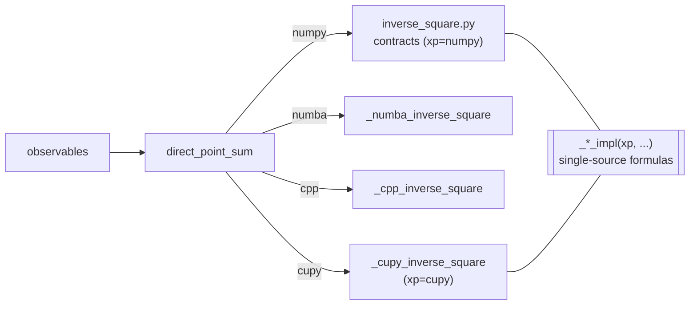

# CuPy (GPU) Backend Design (`backend="cupy"`)

This document details the implementation of the CuPy GPU backend. The
decision record — why CuPy is used, naming, error contract, and chunk
semantics — is
[`docs/architecture/gpu_backend_adr.md`](../architecture/gpu_backend_adr.md)
(the primary source; this document does not restate its rationale).

## 1. Architecture: single-source formulas via xp injection

Unlike the numba (JIT constraints) and C++ (separate language) backends,
the CuPy backend does **not** own a copy of the inverse-square formulas.
The chunk-loop bodies live in `gragra/kernels/inverse_square.py` as
xp-agnostic private helpers (`_potential_impl` / `_acceleration_impl` /
`_gradient_impl`) that take the array module `xp` as an argument:



`_cupy_inverse_square.py` is a thin device wrapper responsible only for:

1. device availability check (`_ensure_cuda_device`, cached success),
2. host-side input validation (shared `_validate_inputs`) and output
   dtype selection (`np.iscomplexobj`, weights-following),
3. one H→D transfer per input array (`cupy.asarray`), one D→H transfer
   of the result (`cupy.asnumpy`), and host-side
   `setflags(write=False)`.

The core `inverse_square.py` never imports cupy (numpy-only purity);
cupy is passed in as the `xp` argument.

## 2. Chunking = VRAM tiling

On the numba/cpp backends `chunk_size` is accepted but ignored. On the
GPU it is an **effective device-memory tiling parameter**:

- `chunk_size=None` materializes the full `(M, N, 3)` intermediate
  (gradient: `(M, N, 3, 3)`) in VRAM at once.
- `chunk_size=C` bounds the intermediate to `(M, C, 3)` etc.

Rough VRAM estimate for the dominant intermediates (float64 = 8 bytes,
complex128 = 16 bytes; a few same-shaped temporaries coexist):

```
potential     ~ a few × M·C·8 bytes           (r2, r_eff, term)
acceleration  ~ a few × M·C·3·8 bytes         (diff, term)
gradient      ~ a few × M·C·9·(8 or 16) bytes (diff_outer, term)
```

e.g. gradient with M=10⁴ targets and C=10⁴ sources per chunk needs
several × 7.2 GiB — choose `chunk_size` to fit your card.

**Chunk invariance is tolerance-based only** (`gpu_backend_adr.md` §6): in-chunk
summation is a parallel non-associative reduction, and small chunks add
sequential `out +=` accumulation error, so results depend (within
tolerance) on `chunk_size`. The invariance test is restricted to small
N accordingly.

## 3. Collision detection

Shared with the numpy path (same `_check_chunk_collision` helper):
`r2 == 0` mask → `bool(mask.any())` → `xp.nonzero(mask)` first element
in row-major order. `nonzero` (unlike `argmax`) is deterministic on
ties for both numpy and cupy, so the reported target/source indices —
and the ValueError message — match the numpy backend exactly. The
global source index is recovered as `start + local_index` across chunk
boundaries. On the `softening_m == 0` path this synchronizes the device
once per chunk; `softening_m > 0` skips the check entirely.

## 4. Error contract (two failure modes + ValueError)

| Situation | Exception | Where |
|---|---|---|
| cupy not installed | `ImportError` with wheel-selection hint | lazy import in `direct_point_sum` |
| cupy installed, no usable GPU/driver | `RuntimeError` (original error chained) | `_ensure_cuda_device` at contract entry |
| unknown backend name | `ValueError` | dispatch |
| unknown backend name | `ValueError` listing the backends enabled for that dispatch path | dispatch |

CuPy imports successfully without a GPU and fails only at device
initialization, hence the runtime check. The check result is cached
with `functools.lru_cache` — success only (exceptions are not cached),
so recovery after e.g. fixing `CUDA_VISIBLE_DEVICES` is picked up. The
cache is per-process and not fork-safe (CUDA contexts do not survive
`fork`).

The coherent and dipole paths use the same lazy-import and device checks,
with their path-specific input and reduction contracts.

## 5. Installation

No `pip` extra is provided (`gpu_backend_adr.md` §4): the CuPy wheel must match your
CUDA/ROCm runtime, which a single extra cannot express.

| Environment | Install |
|---|---|
| CUDA 12.x, no system CUDA toolkit | `pip install "cupy-cuda12x[ctk]>=13.0"` |
| CUDA 12.x, system CUDA toolkit installed | `pip install "cupy-cuda12x>=13.0"` |
| CUDA 11.x | `pip install "cupy-cuda11x"` |
| CUDA 13.x | `pip install "cupy-cuda13x"` |
| ROCm | `cupy-rocm-*` (untested by gragra CI/local checks) |

The `[ctk]` extra matters in practice: recent CuPy (observed with
14.1.1) JIT-compiles elementwise kernels at runtime and needs the CUDA
toolkit *headers*; without a system CUDA installation the first
computation fails with `RuntimeError: Failed to find CUDA headers`.
`[ctk]` pulls the headers as pip wheels (no `nvcc`, no system install
needed). A CUDA-capable GPU and driver are required at runtime either
way.

## 6. Numerical equivalence and determinism

- Numerical comparison with the NumPy reference: `rtol=1e-12, atol=1e-15` (initial value
  per `gpu_backend_adr.md` §7, **confirmed by local GPU measurement** — see below). The
cpp backend earns the same criterion by matching numpy's serial source
  summation order; the GPU cannot (parallel tree reduction), so the
criterion rests on measurement, not summation-order identity.
- Determinism is limited to *same device + same CuPy version + same
  chunk_size*. No cross-thread/cross-device determinism claim (cf. the
  cpp OpenMP determinism test). Only elementwise ops + `cupy.sum` are
  used (no cuBLAS).
- CuPy's memory pool retains device memory after calls return;
  releasing it (`cupy.get_default_memory_pool().free_all_blocks()`) is
  the caller's responsibility.

### Verification status (local-only)

GPU equivalence is verified **locally only** — there is no GPU in
GitHub-hosted CI (cost discipline, `gpu_backend_adr.md` §8). Permanent CI covers the
missing-path tests (`tests/test_cupy_backend_missing.py`); the
available-path suite (`tests/test_cupy_backend_available.py`) is run
locally with `GRAGRA_REQUIRE_CUPY=1`, which fails the session on **any**
skip (not only cupy ones — same mechanism as `GRAGRA_REQUIRE_CPP`).

Measured 2026-07-03, cupy 14.1.1, CUDA 12 wheels, driver 580.142:

- Device 0: NVIDIA RTX A1000 (8 GiB, cc 8.6) — full suite
  `GRAGRA_REQUIRE_CUPY=1 pytest`: **505 passed, 0 skipped**; all
  equivalence tests hold at `rtol=1e-12, atol=1e-15`.
- Fail-on-skip check confirmed firing (`CUDA_VISIBLE_DEVICES="" …`
  exits non-zero).

## 7. Benchmarks

`benchmarks/bench_point_direct.py --backends numpy,numba,cupy` accepts
`cupy` and prints the active CUDA device. Timings exclude the first call
(JIT compilation + memory-pool warm-up).

Reference numbers (environment-dependent; NVIDIA RTX A1000,
`CUDA_VISIBLE_DEVICES=0`, cupy 14.1.1, seed 0, best-of-5,
`point_acceleration`, 2026-07-03):

| N sources | M targets | numpy (ms) | cupy (ms) | speedup vs numpy |
|---|---|---|---|---|
| 1 000 | 100 | 7.6 | 4.6 | 1.7× |
| 1 000 | 1 000 | 84.4 | 34.3 | 2.5× |
| 10 000 | 1 000 | 903.7 | 341.4 | 2.6× |

Honest caveat: gragra computes in fp64, and consumer/workstation GPUs
(RTX A1000: fp64 = 1/32 of fp32; Quadro P2000: likewise 1/32) throttle
fp64 heavily — on this hardware the numba CPU backend overtakes the GPU
at large N (~28× vs ~2.6× at N=10⁴, M=10³). The GPU backend pays off on
datacenter-class fp64 hardware (e.g. the H100/GH class targeted by the
BOTOx deployment, Phase H-b context), and for freeing the CPU. Always
record the device when quoting numbers.

## 8. Dipole and coherent paths

The current CuPy implementation also covers the dipole and coherent paths.
The relevant public APIs include
`displacement_transfer_acceleration`,
`coherent_point_acceleration`, `coherent_point_gravity_gradient`, and
`coherent_projected_acceleration`, together with their transitive higher-level
paths `coherent_gravitoelastic_tensor` and `coherent_acceleration_csd`.
Wall, surface, and Lebedev-specific integrators remain outside this phase
unless they call one of the listed paths.
The implementation and focused backend-comparison tests should be kept in
sync. Transitive paths must be checked as paths, not inferred solely from a
lower-level kernel result.

### 8.1 Independent resolver paths

Whether to unify the three independent backend dispatch points
(`direct_point_dipole_sum`, `observables/coherent.py:_resolve_coherent_parametric_contract`,
`coherent/weights.py:_resolve_plane_wave_weight_factor`) into a shared resolver
is intentionally avoided because the three paths have different contracts;
see [`backend_resolver_adr.md`](../architecture/backend_resolver_adr.md) for
the implementation rationale. Each dispatch point keeps its own resolution mechanism (direct import /
`importlib.import_module` / closure return) and gains its own `"cupy"` branch
independently.

### 8.2 Dipole CuPy path

`kernels/inverse_square.py`'s `_dipole_impl` is xp-injected and shared with
the NumPy/Numba/C++ paths. The CuPy dipole wrapper uses the same device
transfer, validation, collision, and `chunk_size` conventions as the
point-direct wrapper. Host inputs are validated before the lazy CuPy import,
so malformed inputs raise `ValueError` even when CuPy is unavailable.
Device check, error contract (§4), chunk=VRAM
tiling (§2), and collision detection (§3) are unchanged — this is a thin
extension of the existing point-direct wrapper, not a new architecture.
Collision detection is inherited structurally (`_dipole_impl` already calls
the shared `_check_chunk_collision` helper used by the three point-direct
contracts), not merely by prose convention.

**dtype contract**: `mass_kg` is real by the dipole input contract, so the
wrapper must choose `out_dtype` solely from `displacement_m`: complex
`displacement_m` produces `complex128`; real `displacement_m` produces
`float64`. `mass_kg` is never used to drive dtype selection. It must not
reuse `_run_on_device` with `mass_kg` as its `w` argument for dtype
selection — either pass an explicit `dtype_driver` argument to
`_run_on_device`, or have the dipole-specific wrapper decide `out_dtype`
from `displacement_m` before calling the shared device-transfer helper.

The CuPy-vs-NumPy regression suite covers, at minimum, the following cases
(real `mass_kg` throughout):

1. non-chunked (`chunk_size=None`) execution with complex `displacement_m`
   (nonzero imaginary part) — asserts `complex128` output, read-only, and
   value match against the NumPy reference at the §6 criterion (`rtol=1e-12,
   atol=1e-15`).
2. chunked execution (`chunk_size` set to a value smaller than N) with the
   same complex `displacement_m` input — asserts identical dtype/value
   behavior to case 1 (dtype selection must not depend on chunking).
3. real `displacement_m` (no imaginary part) — asserts `float64` output
   (no unnecessary promotion to complex128) for both non-chunked and
   chunked execution.
4. explicit dtype/value comparison against the NumPy reference
   (`dipole_contract`) for both case 1 and case 3, checked with
   `result.dtype` equality (not just value closeness) so a silent
   `float64` truncation of a complex result cannot pass by accident.

### 8.3 Parametric (coherent acceleration/gradient) CuPy

`kernels/parametric.py` backs
`coherent_point_acceleration` / `coherent_point_gravity_gradient` with the
NumPy reference implementation, while `_cupy_parametric.py` provides the
device wrapper. The resolver retains `importlib.import_module` so missing
backend tests continue to exercise the real import path.

**Scope note (potential contract excluded)**: `kernels/parametric.py` defines
`potential_contract_parametric`, `acceleration_contract_parametric`, and
`gradient_contract_parametric`. The CuPy path covers the two contracts used by
the coherent acceleration and gradient observables; there is no public
coherent potential observable at present. If one is added, its NumPy/CuPy
behavior must be specified and tested at that time.

The wrapper mirrors `_cupy_inverse_square.py`: it checks the device, transfers
validated inputs, preserves dtype and read-only output conventions, and uses
the existing `importlib` lookup. Focused tests cover real/complex inputs,
collision reporting, chunked execution, and transitive coherent paths.

### 8.4 Planewave (coherent mass weights) CuPy

The implementation uses a dedicated `kernels/_cupy_planewave.py` module,
**not** an xp-ification of `waves/phase.py`. Rationale:

- `waves/phase.py:plane_wave_complex_factor` is a **shared function also
  consumed by the stochastic ensemble generator** (roadmap: "同一の
  (k̂,k,phase0) で組む" contract, `coherent_statistics_conventions.md` §7/§11.2).
  xp-ifying it would require the same disjoint-write-scope isolation
  discipline as the parametric path, but across a shared file — a materially
  higher-risk refactor for no functional gain, since a standalone
  `_cupy_planewave.py` achieves the same GPU coverage without touching
  the shared stochastic path's dependency.
- `coherent/weights.py:_resolve_plane_wave_weight_factor`'s `numpy` branch
  returns a **closure** (`numpy_contract`) that performs computation beyond
  dispatch (base-weight multiplication, `complex128` cast, defensive copy,
read-only) — per `backend_resolver_adr.md` §1's finding, this computation belongs in the
  backend-specific module, not the resolver. `_cupy_planewave.py` therefore
  owns the CuPy-side equivalent of this multiply/cast/H→D/D→H logic (mirroring
  §1 item 2-3's boundary), keeping `_resolve_plane_wave_weight_factor` a thin
  dispatch as the ADR requires.
- `_resolve_plane_wave_weight_factor`'s `backend == "cupy"` branch (currently
  `raise ValueError("... is point-direct only ...")`) is replaced with a
  branch returning `_cupy_planewave.plane_wave_weight_factor` (or an
  equivalent thin wrapper), following the closure-vs-raw-function asymmetry
  already present for numba/cpp (§ existing code: numba/cpp return the raw
  function; only numpy wraps).

**Phase-formula duplication risk (must be checked explicitly, not left
implicit)**: `_cupy_planewave.py` cannot share code with
`waves/phase.py:plane_wave_complex_factor`'s `exp(1j*sign*phase)` formula
without either (a) xp-injecting `waves/phase.py` — rejected above — or
(b) computing the phase factor on host and transferring it (defeats the
purpose of a GPU path, since the `exp()` over `(N, Ndir, Nf)` is the dominant
cost). The implementation therefore hand-duplicates the phase formula on-device (cupy
`dot`/`exp` equivalents) inside `_cupy_planewave.py`. This is a deliberate,
acknowledged exception to the single-source-formula principle (§1, `gpu_backend_adr.md` §3),
scoped narrowly to this one dispatch point. The important numerical check is a
dedicated equivalence test pinning
`_cupy_planewave`'s on-device phase factor against
`waves.phase.plane_wave_complex_factor`'s host output at the same `rtol` as
§6's numerical-equivalence criterion (`rtol=1e-12, atol=1e-15`, subject to local
measurement per §6) — this is the explicit control that would catch a silent
conjugation-sign bug in the duplicated formula (the load-bearing risk
`coherent_statistics_conventions.md` §7/§11.2 identifies for the shared
`(k̂,k,phase0)` sign contract). Without this test, a hand-duplicated formula
bug would only be caught incidentally by downstream golden tests, not
directly at the source.
Record the phase-factor-only error separately from the reduction error
(`phase_error` versus `reduction_error`); the cancellation registry tolerance
must never absorb a phase-formula mismatch.

**`chunk_size` is accepted but ignored on this path**:
`plane_wave_mass_weights` *does* accept a `chunk_size: int | None = None`
keyword and forwards it to the numpy/cupy backend contract (its numba/cpp
backends do not receive it — they are called without the argument). On the
CuPy backend, `chunk_size` is intentionally a no-op: `plane_wave_weight_factor`
always materializes the full `(N, Ndir, Nf)` complex128 array regardless of
its value. This was verified empirically (`C3-planewave-phase-only` measurement
row, §8.5): chunk_size ∈ {2, 5, None} produced numerically identical
`max_abs`/`max_rel`/`phase_error` on real hardware, confirming the parameter
has zero effect on this path's CuPy execution. Unlike the dipole/parametric
paths (§8.2/§8.3, which inherit `chunk_size`=VRAM-tiling from §2), the
planewave path has
no tiling escape valve** on the CuPy path. Given VRAM is far scarcer than
host RAM (§7's own hardware
example is an 8 GiB card), C-3 has a bounded full-materialization contract:
Before calculating the estimate, all dimension products must be converted to
Python `int` values; NumPy integer multiplication is not allowed to overflow.
For `base_weights`, `itemsize(base_weights)` is exactly 8 for real float64 and
16 for complex128. Before allocating any device array, it must estimate peak storage as
`ceil(1.1 * (4 * 16 * N * Ndir * Nf + 8 * N * Ndir + itemsize(base_weights) * N + 8 * (3*N + 3*Ndir + Nf)))` bytes:
the four
complex terms are explicitly the returned weight array, phase factor, weighted
term, and reduction/output buffer; the `8 * N * Ndir` term is the float64
`(N, Ndir)` dot-product intermediate (`positions · directions.T`), which does
not scale with `Nf` and therefore must be accounted for separately (omitting
it underestimates the peak by up to ~12.5%, since it is at most 1/8 of the
leading `4 * 16 * N * Ndir * Nf` complex term at `Nf = 1`); the `itemsize(base_weights) * N`
term covers the float64/complex128 copy
of base weights; the last term covers positions, directions, and wavenumbers;
`1.1` reserves 10%
for allocator/memory-pool overhead. Degenerate axes (`N == 0`, `Ndir == 0`,
or `Nf == 0`) short-circuit *after* the device check and return an empty
read-only complex128 host array without any device allocation (matching the
NumPy reference path's empty-axis output), so the preflight and the dot
intermediate are never reached for empty inputs. The wrapper must not keep an additional
same-shape live array. It must reject the request with `MemoryError` when that estimate exceeds 50% of
currently free VRAM. The estimate and rejection
are part of the C-3 tests; C-3 does not silently fall back to host memory or
introduce tiling. Inputs satisfying the preflight bound are assumed small
enough to materialize in full. Adding
chunking to the planewave path, if ever needed, is a separate follow-up
(would require extending the non-CuPy backends too, since none currently
tile this path — not a GPU-specific gap).

Historical note: the retired `volume_transfer_kernel` path used one aggregate
preflight before calling either `plane_wave_mass_weights` or the parametric
projected-acceleration contract. With `N` sources, `Ndir` directions, `Nf`
frequencies, and `M=1` target, its ledger is
`B_wave_raw = 4 * 16 * N * Ndir * Nf + 8 * N * Ndir + 8 * (4*N + 3*Ndir + Nf)`
(the `8 * N * Ndir` term is the same dot-product intermediate as above) と定義し、
`B_total = ceil(1.1 * (B_wave_raw + 4 * 16 * max(N, M) * Ndir * Nf + 16 * M * Ndir * Nf))`
とする。これ以外の unlisted live allocation は許可しない。二つ目と三つ目の項は
parametric source temporaries と projected output を上限化していた。削除前の実装には
allocation ledger test があり、
`cupy.get_default_memory_pool().used_bytes()` around each allocation and
proved it did not exceed the declared bound. These measurements are retained
as historical evidence; the adapter and its focused tests have been removed.
The same `B_total <= 0.5 * free_vram_bytes` rule and `MemoryError` applied before
the first allocation. Focused tests exercised both a fitting and an over-limit
volume path, so a lower-level planewave preflight could not hide a later OOM.
The raw estimator was tested for real and complex `base_weights`, including
empty direction/frequency axes, and the over-limit test asserted that no
`cp.asarray` or `cp.zeros` call occurred before the `MemoryError`.

### 8.5 Cancellation-sensitive numerical measurements

Per `coherent_statistics_conventions.md` §12 (tolerance rule primary
definition lives there, backend-independent — rooted in mixed-sign Lebedev
weights, not GPU specifics), **this document records** the
cancellation-sensitive CuPy comparisons. B-1/B-2 NumPy-only tests
are outside this registry because they have no CuPy comparison path. Required
columns for each registered test (the row is keyed by test ID and by
quantity/component/frequency when a test emits more than one cancellation
quantity) include, at minimum: `backend` / `device` / `dtype` / `observable`
/ `shape` / `chunk_size` / `reference` (the numpy value the coefficient is
measured against) / `max_abs` / `max_rel` / `atol` / `rtol` — the table below
carries these plus the `term_d`/gross-scale/phase-error columns needed for
the §12 cancellation-reduction framework. Recording measured tolerances
directly (rather than assuming chunk-size invariance in prose) is safer: a
coefficient measured at one `chunk_size` is not assumed valid at another.
For dipole and parametric paths, record the measured `chunk_size`; a coefficient is valid only
for that recorded tiling configuration. Each cancellation-sensitive quantity
should exercise at least two distinct
`chunk_size` values** (the reference tiling used to derive the registered
coefficient, plus at least one other value) and record a registry row for
each; exact invariance across all `chunk_size` values is not required, but
which `chunk_size` a given tolerance was measured at must always be
traceable from the row. `plane_wave_mass_weights` (`C3-planewave-phase-only`)
accepts a `chunk_size` argument but ignores it on the CuPy path (§8.4): three
values produced numerically identical output. Its active registry entry
therefore records `chunk_size = N/A (full materialization)`.

`d`・`w_d`・`term_{d,q}`・`gross_scale_q` の式と意味論の**一次定義は
`coherent_statistics_conventions.md` §12**（縮約添字族 = 方向 index または source index）
にあり、本節はその添字族の範囲内で経路ごとの束縛を宣言するのみ（§12 が本節へ委譲）。
経路ごとの束縛は次のとおり。C-2b の parametric
source reduction では `d` は source index、`w_d` は対応する parametric weight、
`term_{d,q}` はその source の kernel contribution。C-3 の phase-only test では
direction/source reductionを含めず `term_{d,q}` は host/device の phase factor とし、
`phase_error` のみを記録する（縮約を持たない縮退ケース — `d`/`term_{d,q}` は表スキーマの
統一のための記法であり、§12 の縮約添字族の literal instance ではない。`gross_scale_q =
Σ_d |w_d|·|term_{d,q}|` を実際の重み付き和として phase-only 行へ適用しない）。
C-1 の dipole/source reduction は source index を使う同じ定義を継承する。
したがって phase-only 行には `reduction_error = —`、reduction 行には phase-only
比較の測定値を別列に記録し、同じ数値を二重計上しない。

| Test ID / quantity | backend | device | dtype | observable | shape | `chunk_size` | `term_d` and gross-scale formula | reference (numpy) | `max_abs` | `max_rel` | `atol` | `rtol` | `phase_error` | `reduction_error` | Rationale |
|---|---|---|---|---|---|---|---|---|---|---|---|---|---|---|---|
| `C1-dipole-source-cancellation-chunk2` | `cupy` | RTX A1000 (UUID: GPU-e9de778c-2c0f-fc58-3380-676e6916f320, PCI: 0000:55:00.0), driver 580.159.03, CUDA runtime 12.9, cupy 14.1.1 | `float64` | `dipole_contract` | `(N=8, M=1, 3)` | 2 | `term_{d,i} = Σ_j K_T_ij(Δ_d)·displacement_d[j]`, `w_d = mass_kg[d]`; `gross_scale_i = Σ_d \|w_d\|·\|term_{d,i}\|` (§12 source-index family, x/y components only — z is structurally 0) | numpy | 8.674e-19 (x,y max) | N/A (structural zero reference) | `1e-15 · gross_scale` (≈9.65e-18 for this fixture) | N/A | — | 8.674e-19 | 8-point antipodal-pair fixture (r=10m, softening=0.1m, radial "breathing-mode" displacement h=0.001m, mass=1000kg/source); x,y cancel to a structural zero by antipodal symmetry (hand-verified), z is trivially 0 (all sources at z=0). Verifies GPU non-associative reduction stays within a gross-scale-relative bound near a near-zero reference, where relative error is undefined. |
| `C1-dipole-source-cancellation-chunk5` | `cupy` | (same device/driver/cupy as above) | `float64` | `dipole_contract` | `(N=8, M=1, 3)` | 5 | (same formula as chunk2 row) | numpy | 8.674e-19 (x,y max) | N/A (structural zero reference) | `1e-15 · gross_scale` (≈9.65e-18) | N/A | — | 8.674e-19 | Same fixture as chunk2, `chunk_size=5` (uneven tiling: chunks of 5+3 over N=8). |
| `C2b-parametric-source-cancellation-chunk2` | `cupy` | (same device/driver/cupy as above) | `float64` | `acceleration_contract_parametric` | `(N=8, M=1, 3)` | 2 | `term_{d,i} = Δ_{d,i}/r_eff^3`, `w_d = weights[d]`; `gross_scale_i = Σ_d \|w_d\|·\|term_{d,i}\|` (§12 source-index family, x/y only — z structurally 0) | numpy | 3.553e-15 (x,y max) | N/A (structural zero reference) | `1e-15 · gross_scale` (≈4.83e-14 for this fixture) | N/A | — | 3.553e-15 | Same 8-point antipodal-pair geometry as C1 (r=10m, softening=0.1m), scalar mass weight=1000kg/source; x,y cancel to a structural zero by antipodal symmetry, z trivially 0. |
| `C2b-parametric-source-cancellation-chunk5` | `cupy` | (same device/driver/cupy as above) | `float64` | `acceleration_contract_parametric` | `(N=8, M=1, 3)` | 5 | (same formula as chunk2 row) | numpy | 7.105e-15 (x,y max) | N/A (structural zero reference) | `1e-15 · gross_scale` (≈4.83e-14) | N/A | — | 7.105e-15 | Same fixture as chunk2, `chunk_size=5` (uneven tiling: chunks of 5+3 over N=8). |
| `C3-planewave-phase-only` | `cupy` | (same device/driver/cupy as above) | `complex128` | `plane_wave_mass_weights` | `(N=20, M=N/A, Ndir=5, Nf=4)` | `N/A` (accepted but ignored on the cupy path per §8.4 correction) | `term_d = exp(1j·sign·phase)` | numpy | 4.4295e-13 | 7.2467e-15 | 1e-12 | 1e-12 | 4.4295e-13 | — | Consolidated from three separate measurements at `chunk_size ∈ {2, 5, None}`, which produced numerically identical `max_abs`/`max_rel`/`phase_error` — empirical proof that `chunk_size` has no effect on this path's cupy execution, so one row suffices rather than three near-duplicates. |

All 5 active rows above are backed by local `GRAGRA_REQUIRE_CUPY=1 pytest` evidence
(RTX A1000, driver 580.159.03, CUDA runtime 12.9, cupy 14.1.1; no CI GPU, per
§6's verification-status discipline). `C1-dipole-source-cancellation-*` and
`C2b-parametric-source-cancellation-*` measurements live in
`tests/test_cupy_dipole.py` and `tests/test_cupy_parametric.py` respectively;
The `C3-planewave-phase-only` measurement lives in
`tests/test_cupy_planewave.py`. Each active test carries
a `# registry-id: <ID>` comment mapping it to its row here — the table keeps
the measured values together with their test identifiers (test files do not duplicate this table; see the
note at the top of `tests/test_cupy_planewave.py`, which previously embedded
its own copy of the C-3 rows and now just references this section).
`tests/test_cupy_registry_contract.py` machine-checks that every ID above
appears exactly once (or, for the two chunk-suffixed prefixes, exactly twice
each) and that no
placeholder/stale text remains in this section.
The consistency test verifies that every cancellation-sensitive comparison has
exactly one measurement row and that no B-1/B-2 NumPy-only test is registered.

#### Historical C-3 volume measurements (retired)

The following three rows record local measurements made before the `volume_transfer_kernel` adapter and its CuPy tests were removed. They are retained for provenance only and are excluded from the current registry and test cross-reference contract. For these historical directional reductions, `d` indexed directions, `w_d` was the direction weight, and `term_{d,q}` was the phase-bearing contribution.

| Test ID / quantity | backend | device | dtype | observable | shape | `chunk_size` | `term_d` and gross-scale formula | reference (numpy) | `max_abs` | `max_rel` | `atol` | `rtol` | `phase_error` | `reduction_error` | Rationale |
|---|---|---|---|---|---|---|---|---|---|---|---|---|---|---|---|
| `C3-volume-direction-reduction-chunk2` | `cupy` | (same device/driver/cupy as above) | `complex128` | `volume_transfer_kernel` | `(N=10, M=1, Ndir=5, Nf=1)` | 2 | `term_d = DirectionalComplexKernel.H` | numpy | 1.5516e-17 | 2.7330e-16 | 1e-15 | 1e-12 | 1.5701e-16 | 1.5516e-17 | Unlike `plane_wave_mass_weights`, `chunk_size` here is forwarded to the internal C-2b parametric call and is a real VRAM-tiling parameter — measured `max_rel` differs across chunk_size values (see chunk5/chunkNone rows), so this quantity keeps per-chunk_size rows rather than consolidating to N/A. |
| `C3-volume-direction-reduction-chunk5` | `cupy` | (same device/driver/cupy as above) | `complex128` | `volume_transfer_kernel` | `(N=10, M=1, Ndir=5, Nf=1)` | 5 | (same formula as chunk2 row) | numpy | 1.5516e-17 | 2.3252e-16 | 1e-15 | 1e-12 | 1.5701e-16 | 1.5516e-17 | Same fixture as chunk2, `chunk_size=5`. |
| `C3-volume-direction-reduction-chunkNone` | `cupy` | (same device/driver/cupy as above) | `complex128` | `volume_transfer_kernel` | `(N=10, M=1, Ndir=5, Nf=1)` | `None` (full materialization) | (same formula as chunk2 row) | numpy | 1.3986e-17 | 1.7285e-16 | 1e-15 | 1e-12 | 1.5701e-16 | 1.3986e-17 | Same fixture as chunk2, `chunk_size=None`. |

### 8.6 Error contract for the current paths

The dipole, parametric, and planewave dispatch points use the same two-stage
contract (§4) —
`ImportError` (not installed) / `RuntimeError` (no usable device) — extends
unchanged to these paths, per each backend's own lazy-import
/ device-check pattern (no shared resolver, §8.1).
The planewave preflight adds one deterministic resource failure, `MemoryError`,
before any device allocation when its peak ledger exceeds the VRAM bound; this
is distinct from the missing-install and missing-device errors.

### API path numerical coverage

| API/path | Numerical checks | Related implementation/docs |
|---|---|---|
| `displacement_transfer_acceleration` / `direct_point_dipole_sum` | C-1 dipole CuPy-vs-NumPy — the four §8.2 dtype-contract cases (non-chunked complex, chunked complex, non-chunked real, chunked real; dtype equality + value match against NumPy), plus chunk/collision, missing-device contract | `dipole.py`, `point_direct.py`, `public_api.md`, README/backend docs |
| `coherent_point_acceleration`, `coherent_point_gravity_gradient`, `coherent_projected_acceleration` | C-2b parametric dispatch and CuPy-vs-NumPy tests | coherent docstrings, `public_api.md` |
| `plane_wave_mass_weights` | C-3 phase-only equivalence, full materialization preflight, dtype/shape/error contract | `weights.py`, `public_api.md`, README/backend docs |
| `coherent_gravitoelastic_tensor`, `coherent_acceleration_csd` | transitive CuPy call-path test, G-order and output-unit assertion | each public docstring, `public_api.md`, README/backend docs |

全行で kernel は G-free、observable は G¹（入力がG-freeの場合）、二次統計/adapter は
入力積のG次数を保持することを確認し、lazy import は `_cupy_*` wrapper に隔離する。
