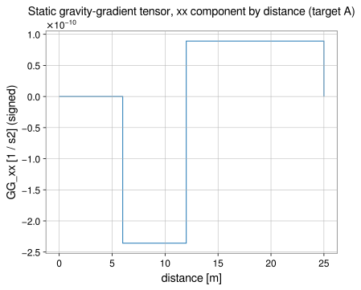
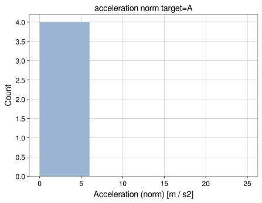

# Source diagnostics and visualization

`gragra.plotting` exposes high-level diagnostics and Matplotlib-ready plots for
discrete sources, analytical shapes, and `EvaluationResult` outputs. This guide
uses the following **notation**:

- $\delta\mathbf{a}_i$: per-element acceleration contribution returned by spatial
  diagnostics such as `plot_map` (the same vector sum as the forward model).
- $\Delta\mathbf{a}_i = G\,m_i(\mathbf{r}_i-\mathbf{r}_T)/r_i^3$: **closed-form**
  point-mass contribution towards a target (used in contribution histograms
  and cumulative profiles). Numerically $\sum_i \Delta\mathbf{a}_i = \sum_i
  \delta\mathbf{a}_i$ up to the documented tolerances.

Further specialized APIs (radial integration, GG by distance, gridded source
fields, and dynamic phasor statistics) are summarized below; deeper narrative
on [displacement and density-perturbation fields](fields.md) and
[formula LaTeX conversion](formulas.md) lives in those guides.

## What is in `gragra.plotting`?

- `hist` and `plot_hist`: per-element **value** histograms (GWexpy `Histogram` or
  step plot) for registered scalar diagnostics.
- `radial_histogram`: integrate registered scalars **by source–target distance**
  with optional normalization.
- `gravity_gradient_radial_histogram`: signed static **gravity-gradient (GG)**
  tensor summed into radial groups.
- `source_field` / `source_field_result`: place source quantities or responses on
  an explicit Cartesian grid (optionally with `spatial_projection`).
- `source_contributions`, `contribution_statistics`,
  `directional_contribution_statistics`: complex per-source responses and
  interference-style statistics.
- `dynamic_radial_histogram`: real GWexpy histograms from radially grouped
  dynamic results.
- `plot_contribution_hist`, `plot_cumulative_contribution`: acceleration
  contribution diagnostics vs element value or vs distance.
- `plot_map`, `plot_shape`, `plot_result`: spatial scatter / shape / evaluation
  result views.
- `plot_field`: visualization of gridded **density or displacement** fields
  (see [Visualizing fields](fields.md#visualizing-fields)).

Figures below were generated from the repository with
`python docs_site/scripts/generate_source_diagnostics_figures.py` (run from the
repo root; the script prepends `src/` to `PYTHONPATH`).

| Diagnostic | Figure |
|---|---|
| `plot_map` (XZ), quantity `kernel_norm` (geometric $1/r^2$, SI m$^{-2}$, no mass factor; mass-weighted $\Delta m/r^2$ is `source_field` / `mass_over_r2`), target A |  |
| `radial_histogram` + `plot_hist`, `mass_over_r2`, `normalization="fraction"` |  |
| `gravity_gradient_radial_histogram`, component `xx` (signed) |  |
| `plot_contribution_hist`, `quantity="norm"` |  |
| `plot_cumulative_contribution`, default `quantity="norm"` |  |
| `source_field`, `mass_over_r2`, `spatial_projection="xz"` |  |
| `dynamic_radial_histogram`, direction-averaged `interference_share` |  |
| `plot_result` static slice (same grid demo as snippet) |  |
| `plot_result` time series |  |

## Histograms (`hist` and `plot_hist`)

Registered quantities include density, height, inverse powers of distance, mass
kernels such as `mass_over_r2`, and related aliases. Distance-based quantities
require `target_id` when multiple targets exist.

`weight="count"` counts elements; `weight="volume"` weights by verified cell
volume (m³). For `density` with `weight="volume"`, the histogram **approximates**
the total mass in each density bin (bin contents are in m³ times density along
the converted horizontal axis).

### Example

```python
import numpy as np
from astropy import units as u

from gragra.gravity_sources import VolumeElementSource, point_sum
from gragra.geometry import Frame
from gragra.plotting import hist, plot_hist, plot_map
from gragra.results import Contribution, GravityFieldDefinition, PotentialReference
from gragra.targets import TargetPoints

root = Frame("root")
field = GravityFieldDefinition.source_field(
    "source", Contribution("total"), PotentialReference.ZERO_AT_INFINITY
)
source = VolumeElementSource(
    [[2.0, 0.0, 0.0], [8.0, 0.0, 0.0], [15.0, 0.0, 0.0], [0.0, 5.0, 0.0]],
    [1.0, 2.0, 3.0, 4.0],
    # Volume densities in kg/m³ → ~0.5–2.5 g/cm³ when plotted with xunit="g/cm3".
    np.array([500.0, 1500.0, 1500.0, 2500.0]),
)
targets = TargetPoints([[-3.0, -4.0, 0.0], [10.0, 0.0, 0.0]] * u.m, ("A", "B"), root)
setup = point_sum(source, frame=root, field_definition=field).at(targets)

# Distance from target A (half-open bands except the last closed edge); counts [0, 2, 2].
distances = hist(setup, "distance", target_id="A", bins=[0.0, 5.0, 10.0, 20.0])

# Volume-weighted density: horizontal axis in g/cm³ (element densities ~0.5–2.5 g/cm³).
volumes = hist(
    setup,
    "density",
    weight="volume",
    bins=[0.0, 0.5, 1.0, 1.5, 2.0, 2.5, 3.0],
    xunit="g/cm3",
)

heights = hist(setup, "height", bins=3)

fig_hist = plot_hist(setup, "inverse_square", target_id="B", bins=[0.0, 0.01, 0.1, 1.0])

fig_map = plot_map(setup, "delta_a_norm", target_id="A", view="3d")
```

## Radial source histograms

`radial_histogram` integrates **registered scalar** source quantities over
Euclidean source-to-target distance bins. Extensive quantities (`mass`,
`mass_over_r2`, …) sum directly; intensive quantities multiply by verified cell
volume first. Bin membership uses **unsoftened** geometric distance even when a
softened kernel was used for a forward evaluation.

```python
from gragra.plotting import plot_hist, radial_histogram

radial = radial_histogram(
    setup,
    "mass_over_r2",
    target_id="A",
    bins=[0.0, 6.0, 12.0, 25.0],
    normalization="fraction",
)
fig, ax, same_result = plot_hist(radial)
```

The `plot_hist(radial_result)` overload draws `result.values` against the stored
edges and returns `(figure, axes, result)`.

## Static gravity-gradient tensor by distance

`gravity_gradient_radial_histogram` sums the **physical** static GG tensor in
each distance group. For source position $\mathbf{r}_i$, target $\mathbf{r}_T$,
mass $\Delta m_i$, and unsoftened radius $r_i$,

\[
\boldsymbol{\Gamma}_j = G\sum_{i\in B_j}\Delta m_i
\frac{3\hat{\mathbf n}_i\hat{\mathbf n}_i^{\mathsf T}-\mathbf I}{r_i^3},
\qquad
\hat{\mathbf n}_i = \frac{\mathbf{r}_i-\mathbf{r}_T}{r_i}.
\]

Components are **signed**; $\|\sum_i \mathbf{\Gamma}_i\|_{\mathrm{F}}$ can differ
from $\sum_i \|\mathbf{\Gamma}_i\|_{\mathrm{F}}$. Bin assignment uses unsoftened
$r_i$; `softening_m` only changes the Plummer GG kernel inside each group.

```python
from gragra.plotting import gravity_gradient_radial_histogram

gg = gravity_gradient_radial_histogram(
    setup,
    target_id="A",
    bins=[0.0, 6.0, 12.0, 25.0],
    softening_m=0.0,
)
xx_histogram = gg.histogram("xx")
total_tensor = gg.total_tensor
```

## Source-position fields (`source_field`)

`source_field(...)` maps scalars, vectors, or tensors defined at **source
locations** onto caller-supplied Cartesian cell edges. Use
`spatial_projection="xz"` (or `"xy"`, `"yz"`) to **sum** contributions along the
omitted axis (Y–integrated XZ sheet in the figure above). That is **not** a
finite-thickness section: the full extent along the collapsed axis is folded into
one cell so the field stays extensive when appropriate.

Example: additive $\sum \Delta m/r^2$ (kg/m²) onto an XZ grid (uses distinct names
so earlier tutorial variables keep the two-target `VolumeElementSource` setup):

```python
import numpy as np
from astropy import units as u

from gragra.gravity_sources import PointMassCloud, point_sum
from gragra.geometry import Frame
from gragra.plotting import source_field
from gragra.results import Contribution, GravityFieldDefinition, PotentialReference
from gragra.targets import TargetPoints

field_root = Frame("field_demo")
field_def = GravityFieldDefinition.source_field(
    "source", Contribution("total"), PotentialReference.ZERO_AT_INFINITY
)
masses_kg = np.array([50.0, 120.0, 80.0])
positions_m = np.array(
    [[-2.0, 0.5, -1.0], [3.0, -0.25, 1.0], [0.5, 1.0, 4.0]]
)
pm_source = PointMassCloud(masses_kg, positions_m)
pm_targets = TargetPoints([[0.0, 0.0, 0.0]] * u.m, ("T",), field_root)
pm_setup = point_sum(pm_source, frame=field_root, field_definition=field_def).at(
    pm_targets
)

x_edges = np.linspace(-5.0, 5.0, 21)
y_edges = np.linspace(-3.0, 3.0, 13)
z_edges = np.linspace(-3.0, 6.0, 19)
scalar_field = source_field(
    pm_setup,
    "mass_over_r2",
    target_id="T",
    grid=(x_edges, y_edges, z_edges),
    aggregation="sum",
    spatial_projection="xz",
)
```

## Complex source contributions and statistics

`source_contributions` builds `SourceContributionResult` from `DensityPhasors`.
`contribution_statistics` and `directional_contribution_statistics` expose
amplitude shares, phases, and interference ratios. For direction-averaged
interference at one frequency,

\[
S_j(f)=\frac{
\sum_d p_d\,\operatorname{Re}\!\left[a_j(f,d)\,a_{\mathrm{tot}}^*(f,d)\right]
}{
\sum_d p_d\,\lvert a_{\mathrm{tot}}(f,d)\rvert^2
}.
\]

Write $I_j(f)\equiv S_j(f)$ for the per-group **interference share** stored by
`dynamic_radial_histogram(..., "interference_share")` at a fixed frequency and
component: cross terms and total powers are direction-averaged **before** the
ratio, so $I_j$ is generally **not** the weighted mean of per-direction
interference ratios $\operatorname{Re}(a_j a_{\mathrm{tot}}^*)/|a_{\mathrm{tot}}|^2$.

### Dynamic radial histogram (worked example)

Three collinear sources at 3 m, 7 m, and 14 m from the origin occupy three
different finite radial groups for edges `[0, 5, 10, 20]` m (half-open bins, with the final
right edge assigned to the last finite bin, matching `source_radial_membership`).
Two independent **synthetic** density
phasor ensembles (`density_a`, `density_b`, peak complex kg/m³) illustrate
direction averaging:

```python
import numpy as np

from gragra.fields.density_series import DensityPhasors
from gragra.plotting import dynamic_radial_histogram, source_contributions

positions_m = np.array(
    [[-3.0, 0.0, 0.0], [-7.0, 0.0, 0.0], [-14.0, 0.0, 0.0]], dtype=np.float64
)
volumes_m3 = np.ones(3)
density_a = np.array(
    [
        [1.0 + 0.0j, 0.5 + 0.5j, 0.25 + 0.0j],
        [0.5 + 0.0j, 0.5 + 0.5j, 0.25 + 0.25j],
    ],
    dtype=np.complex128,
)
density_b = np.array(
    [
        [0.25 + 0.0j, 1.0 + 0.0j, 0.5 + 0.5j],
        [0.5 + 0.5j, 0.25 + 0.0j, 1.0 + 0.0j],
    ],
    dtype=np.complex128,
)
frequencies_hz = np.array([12.0, 24.0])
phas_a = DensityPhasors(
    positions_m,
    volumes_m3,
    density_a,
    frequencies_hz,
    0.0,
    np.zeros(3),
    "root",
    np.zeros(3),
    ("s0", "s1", "s2"),
)
phas_b = DensityPhasors(
    positions_m,
    volumes_m3,
    density_b,
    frequencies_hz,
    0.0,
    np.zeros(3),
    "root",
    np.zeros(3),
    ("s0", "s1", "s2"),
)
target = np.array([[0.0, 0.0, 0.0]])
radial_edges_m = [0.0, 5.0, 10.0, 20.0]
r_a = source_contributions(
    phas_a, "acceleration", target, radial_edges_m=radial_edges_m, softening_m=0.0
)
r_b = source_contributions(
    phas_b, "acceleration", target, radial_edges_m=radial_edges_m, softening_m=0.0
)
directional_interference = dynamic_radial_histogram(
    (r_a, r_b),
    "interference_share",
    target_id="target-0",
    frequency_hz=12.0,
    component="x",
    direction_weights=[1.0, 2.0],
)
```

## Comparing and interpreting diagnostics

Additive checks apply to **raw** integrated sums or vector sums in fixed units.
Normalized fractions or per-length densities **do not** add like the underlying
extensive contributions. Distances in radial diagnostics are geometric and
independent of softening unless noted.

## Spatial diagnostic maps (`plot_map`)

- Quantities include `kernel_norm` (geometric **1/r²** in m$^{-2}$, no $\Delta m$ factor;
  for **$\Delta m/r^2$** use registered `mass_over_r2` or gridded `source_field`), `delta_a_norm`, Cartesian
  `delta_a_x`/`y`/`z`, and `delta_a_projection` (**requires** `direction=…`).
- $\sum_i \delta\mathbf{a}_i$ matches the forward model in `frame`
  (`rtol=1e-12`, `atol=1e-20`).
- `view="xz"` plots an **orthographic scatter** of projected positions; it does
  not integrate along $y$. Compare with `source_field(..., spatial_projection="xz")`.

## Contribution histograms (`plot_contribution_hist`)

Bins **per-element acceleration contributions** $\Delta\mathbf{a}_i$ towards
one target. The horizontal axis is a **scalar contribution** (norm or signed
Cartesian component in m/s²), so `bins` are acceleration edges—not source–target
distance edges (those belong to `plot_cumulative_contribution` and radial tools).
Supported `quantity` values are:

| Input | Maps to |
|---|---|
| `norm`, `delta_a_norm` | $\|\Delta\mathbf{a}_i\|_2$ |
| `x`, `component_x`, `delta_a_x` | $x$ component (m/s²) |
| `y`, `component_y`, `delta_a_y` | $y$ component (m/s²) |
| `z`, `component_z`, `delta_a_z` | $z$ component (m/s²) |

Arbitrary projections belong to `plot_map(..., quantity="delta_a_projection",
direction=...)`.

```python
from gragra.plotting import plot_contribution_hist

fig_chist, ax_chist = plot_contribution_hist(
    setup, "norm", target_id="A", bins="auto"
)
```

## Cumulative distance profiles (`plot_cumulative_contribution`)

First the cumulative **vector**

\[
\mathbf{a}(<R) = \sum_{r_i \le R} \Delta\mathbf{a}_i
\]

is formed with **underflow** (sources closer than the first edge), then finite
bands, using the same half-open rules as `hist`. The default `quantity="norm"`
plots

\[
\left\|\mathbf{a}(<R)\right\|_2
\quad\text{at each finite-bin right edge,}
\]

which is **not** $\sum_{r_i\le R}\|\Delta\mathbf{a}_i\|_2$. Destructive
interference between distance bands can make the cumulative norm **decrease**
with $R$. Overflow contributions are **not** on the staircase curve; their
vector remains in `cumulative_contribution(...).overflow_vector_m_s2`. Comparing
the final finite edge to the **total** acceleration only matches when the last
edge encompasses every source. **Static** cumulative Newtonian acceleration is
not the same object as a **frequency-resolved** NN phasor sum—use dynamic
radial tools for the latter.

```python
from gragra.plotting import plot_cumulative_contribution

fig_cum, ax_cum = plot_cumulative_contribution(
    setup, target_id="A", bins=[0.0, 6.0, 12.0, 25.0]
)
```

## Analytical shape rendering (`plot_shape`)

`plot_shape` resolves **Cuboid**, **Cylinder**, or **SphericalShell** geometry
from a geometry instance, from a model carrying `.geometry`, or from an
evaluation `setup` whose `model_spec.geometry` is one of those types. There is
no separate `Sphere` plot type; uniform spheres are normally represented by
discretized or analytic models that supply one of the supported solids.

```python
import matplotlib.pyplot as plt
import astropy.units as u

from gragra.geometry import Cuboid, Frame
from gragra.plotting import plot_shape

world = Frame("world")
cuboid = Cuboid(
    center=[0.0, 0.0, 0.0] * u.m,
    lengths=[2.0, 3.0, 4.0] * u.m,
    frame=world,
)
fig_sh, ax_sh = plot_shape(cuboid, color="skyblue", alpha=0.6)
```

## Result visualization (`plot_result`)

`plot_result` covers static field slices (`plane="xy"`/`"xz"`/`"yz"` with implied
`view="slice"`), time series (`view="line"`), and spectra or phasors (`view` in
`"spectrum"`, `"scatter"`, …). For the full matrix of options see the API reference for
[`plot_result`](../api/physics.md).

```python
import numpy as np
import astropy.units as u

from gragra.gravity_sources import PointMassCloud, rigid_motion
from gragra.gravity_sources.trajectory import PrescribedRigidTransform
from gragra.plotting import plot_result
from gragra.results import TimeSampling
from gragra.targets import TargetPoints

grid_coords = (
    np.array(
        [[-2.0, -2.0, 0.0], [-2.0, 2.0, 0.0], [2.0, -2.0, 0.0], [2.0, 2.0, 0.0]]
    )
    * u.m
)
grid_targets = TargetPoints(grid_coords, ("1", "2", "3", "4"), root)
eval_result = (
    point_sum(source, frame=root, field_definition=field)
    .at(grid_targets)
    .run()
)
fig_field, ax_field = plot_result(eval_result, plane="xy")

epoch_gps = (1_000_000_000, 0)
sampling = TimeSampling(epoch=epoch_gps, dt=0.1 * u.s, count=10)
epoch = sampling.epoch
t0_s = float(epoch.gpsSeconds) + float(epoch.gpsNanoSeconds) * 1e-9
time_s = t0_s + sampling.dt_seconds * np.arange(sampling.count, dtype=np.float64)
pos = np.column_stack(
    [0.5 * (time_s - time_s[0]), np.zeros(sampling.count), np.zeros(sampling.count)]
)
transform = PrescribedRigidTransform(
    time_s, pos, np.repeat(np.eye(3)[np.newaxis], 10, axis=0)
)
ts_result = (
    rigid_motion(
        PointMassCloud(np.array([1.0]), np.array([[0.0, 0.0, 0.0]])),
        transform,
        frame=root,
        sampling=sampling,
    )
    .at(targets, observables=("acceleration",))
    .run()
)
fig_ts, ax_ts = plot_result(ts_result, target_id="A", view="line")
```

## Notes

### Histogram and `plot_hist` (`hist` / `plot_hist`)

- `xunit` only rescales the **horizontal** diagnostic axis; it must be
  dimensionally equivalent to the quantity’s SI unit. Volume weights and raw
  masses are unchanged. Overflowing or denormalizing conversions raise
  `ValueError`.
- `frame=None` uses the setup’s computation frame (`height` reads $z$ in that
  frame). `plot_field` uses `frame` only for figure labels—see
  [fields.md](fields.md#visualizing-fields).
- Integer/`"auto"` bin rules, underflow/overflow bookkeeping, and GWexpy load
  behaviour are unchanged from the upstream documentation strings.

### Whole-page scope

- Radial and field diagnostics depend on explicit bin edges or grids; changing
  only the plotted window can leave normalization denominators unchanged.
- Visualization does not substitute for model verification—see the
  [verification](../verification/index.md) chapters.
