# Source diagnostics and visualization

`gragra.plotting` exposes high-level diagnostics and Matplotlib-ready plots for
discrete sources, analytical shapes, and `EvaluationResult` outputs.

**Notation**

- $\delta\mathbf{a}_i$: per-element acceleration from spatial diagnostics (`plot_map`,
  `source_field`, …). Its vector sum matches the forward model.
- $\Delta\mathbf{a}_i = G\,m_i(\mathbf{r}_i-\mathbf{r}_T)/r_i^3$: closed-form point-mass
  contribution used in contribution histograms and cumulative profiles
  ($\sum_i \Delta\mathbf{a}_i = \sum_i \delta\mathbf{a}_i$ within documented tolerances).

Figures on this page are produced by
`python docs_site/scripts/generate_source_diagnostics_figures.py` (repo root; prepends `src/`).
High-resolution models use hundreds of elements; short code snippets below use a **four-cell**
tutorial setup with the same API.

## Guide map

| Section | APIs | Figure script entry |
|---|---|---|
| Value / density histograms | `hist`, `plot_hist` | `fig_hist_density_volume` |
| Radial integration | `radial_histogram`, `gravity_gradient_radial_histogram` | `fig_radial_*`, `fig_gg_components` |
| Spatial maps | `plot_map`, `source_field` | `fig_map_*`, `fig_source_field_*` |
| Static contributions | `plot_contribution_hist`, `plot_cumulative_contribution` | `fig_contribution_and_cumulative` |
| Dynamic phasors | `source_contributions`, `dynamic_radial_histogram` | `fig_dynamic_interference` |
| Evaluation views | `plot_result` | `fig_plot_result_*` |
| Geometry preview | `plot_shape` | `fig_plot_shape_cuboid` |

Deeper field physics lives in [Displacement and density-perturbation fields](fields.md);
LaTeX conversion in [formulas.md](formulas.md).

## Histograms (`hist` and `plot_hist`)

Registered quantities include density, height, inverse powers of distance, `mass_over_r2`,
and related aliases. Distance-based quantities need `target_id` when several targets exist.

`weight="count"` counts elements. `weight="volume"` multiplies each element by its verified
cell volume (m³). For `density` with `weight="volume"`, each bin stores the **total volume**
of elements whose density falls in that bin,

\[
H_j = \sum_{\rho_i \in B_j} \Delta V_i \quad [\mathrm{m}^3],
\]

not mass. Mass in a density bin would be $M_j = \sum_{\rho_i \in B_j} \rho_i \Delta V_i$ [kg]
and is **not** what `hist` returns. The horizontal axis can be rescaled with `xunit` (e.g.
g/cm³) without changing the m³ weights.

### Tutorial setup and density-by-volume histogram

```python
import numpy as np
from astropy import units as u

from gragra.gravity_sources import VolumeElementSource, point_sum
from gragra.geometry import Frame
from gragra.plotting import hist, plot_hist, plot_map
from gragra.results import Contribution, GravityFieldDefinition, PotentialReference
from gragra.targets import TargetPoints

root = Frame("root")
field = GravityFieldDefinition.source_field(
    "source", Contribution("total"), PotentialReference.ZERO_AT_INFINITY
)
source = VolumeElementSource(
    [
        [2.0, 0.0, -3.0],
        [8.0, 1.5, 0.0],
        [15.0, -1.0, 4.0],
        [0.0, 5.0, 2.0],
    ],
    [1.0, 2.0, 3.0, 4.0],
    np.array([500.0, 1500.0, 1500.0, 2500.0]),
)
targets = TargetPoints([[-3.0, -4.0, 0.0], [10.0, 0.0, 0.0]] * u.m, ("A", "B"), root)
setup = point_sum(source, frame=root, field_definition=field).at(targets)

distances = hist(setup, "distance", target_id="A", bins=[0.0, 5.0, 10.0, 20.0])

volumes = hist(
    setup,
    "density",
    weight="volume",
    bins=[0.0, 0.5, 1.0, 1.5, 2.0, 2.5, 3.0],
    xunit="g/cm3",
)
fig_density = plot_hist(
    setup,
    "density",
    weight="volume",
    bins=[0.0, 0.5, 1.0, 1.5, 2.0, 2.5, 3.0],
    xunit="g/cm3",
)
```

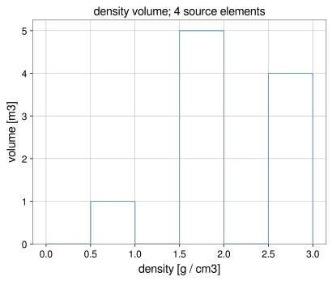

*240-cell figure-quality models use the same API; this plot uses the four-cell tutorial setup.
Vertical axis is m³; multiply by local $\rho$ if you need kg per bin.*

## Spatial diagnostic maps (`plot_map`)

- `kernel_norm`: geometric **$1/r^2$** [m$^{-2}$], no $\Delta m$.
- `delta_a_*`, `delta_a_norm`: signed or unsigned acceleration contributions [m/s²].
- `view="xz"` is an **orthographic scatter** of source $(x,z)$; it does **not** integrate over $y$.
  Y-integrated extensive fields use `source_field(..., spatial_projection="xz")`.

Figure-quality setup: $\sim 240$ volume elements on a $15\times2\times8$ jittered grid, target **A**
at $(-5,-3,1.5)$ m.

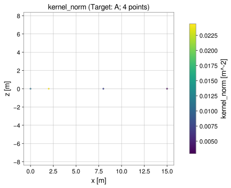{ width="100%" }

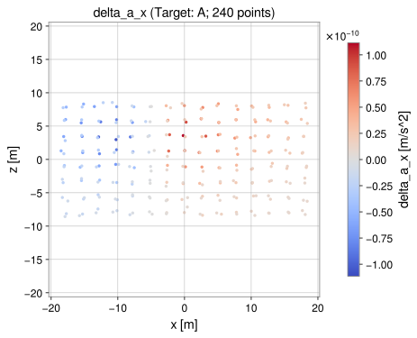{ width="100%" }

```python
from gragra.plotting import plot_map

fig_kernel = plot_map(setup, "kernel_norm", target_id="A", view="xz")
fig_signed = plot_map(setup, "delta_a_x", target_id="A", view="xz")
```

## Source-position fields (`source_field`)

`source_field` bins registered scalars onto caller edges. `spatial_projection="xz"` **sums** along
$Y$ into each $(x,z)$ cell (full $y$ extent, not a thin slab). Intensive quantities are multiplied
by verified cell volume before binning.

Example: **420** point masses in a $28\times18\times11$ m cloud, $\sum \Delta m/r^2$ [kg/m²] at the
origin target (log scale; zero cells masked; see figure caption in the SVG).

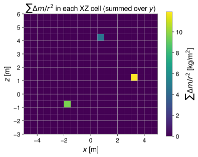{ width="100%" }

```python
import numpy as np
from gragra.plotting import source_field

x_edges = np.linspace(-2.0, 18.0, 21)
y_edges = np.linspace(-2.0, 8.0, 11)
z_edges = np.linspace(-5.0, 6.0, 12)
scalar_field = source_field(
    setup,
    "mass_over_r2",
    target_id="A",
    grid=(x_edges, y_edges, z_edges),
    aggregation="sum",
    spatial_projection="xz",
)
```

## Radial source histograms

`radial_histogram` integrates registered scalars in source–target distance bins. Extensive
quantities sum directly; intensive ones multiply by $\Delta V_i$ first. Bin membership always
uses **unsoftened** geometric distance.

`normalization="fraction"` divides each bin by the signed total over **all** sources
(including underflow / overflow outside the displayed edges):

\[
F_j = \frac{W_j}{\sum_i W_i}.
\]

This is **not** `fraction_per_length` (which also divides by bin width). Do not confuse the two.

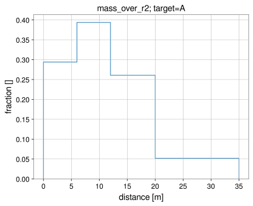{ width="100%" }

```python
from gragra.plotting import plot_hist, radial_histogram

radial = radial_histogram(
    setup,
    "mass_over_r2",
    target_id="A",
    bins=[0.0, 6.0, 12.0, 20.0, 35.0],
    normalization="fraction",
)
fig, ax, same_result = plot_hist(radial)
```

## Static gravity-gradient tensor by distance

`gravity_gradient_radial_histogram` sums the **physical** static GG tensor per distance group.
For bin $B_j$,

\[
\boldsymbol{\Gamma}_j = G\sum_{i\in B_j}\Delta m_i
\frac{3\hat{\mathbf n}_i\hat{\mathbf n}_i^{\mathsf T}-\mathbf I}{r_i^3},
\qquad
\hat{\mathbf n}_i = \frac{\mathbf{r}_i-\mathbf{r}_T}{r_i}.
\]

Components are **signed** [s$^{-2}$]. With `softening_m=0` and a target not collocated with any
source, $\mathrm{tr}(\boldsymbol{\Gamma})=\Gamma_{xx}+\Gamma_{yy}+\Gamma_{zz}$ should match the
forward trace (figure annotates the total trace).

$\|\sum_j \boldsymbol{\Gamma}_j\|_{\mathrm F}$ differs from $\sum_j \|\boldsymbol{\Gamma}_j\|_{\mathrm F}$.

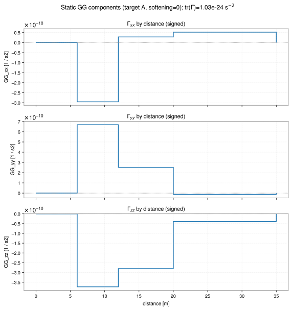{ width="100%" }

```python
from gragra.plotting import gravity_gradient_radial_histogram

gg = gravity_gradient_radial_histogram(
    setup, target_id="A", bins=[0.0, 6.0, 12.0, 20.0, 35.0], softening_m=0.0
)
xx_histogram = gg.histogram("xx")
total_tensor = gg.total_tensor
```

## Contribution and cumulative acceleration diagnostics

`plot_contribution_hist` bins **per-element** $\Delta\mathbf{a}_i$ scalars (norm or component);
axis units are m/s², not distance.

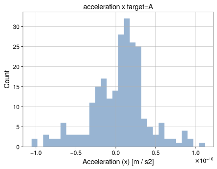{ width="100%" }

`plot_cumulative_contribution` forms the cumulative **vector** $\mathbf{a}(<R)=\sum_{r_i\le R}\Delta\mathbf{a}_i$
and, by default, plots $\|\mathbf{a}(<R)\|_2$, **not** $\sum_{r_i\le R}\|\Delta\mathbf{a}_i\|_2$.
Directional cancellation can make the curve non-monotonic.

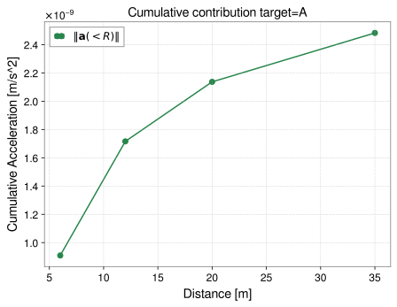{ width="100%" }

```python
from gragra.plotting import plot_contribution_hist, plot_cumulative_contribution

fig_chist, _ = plot_contribution_hist(setup, "x", target_id="A", bins=30)
fig_cum, _ = plot_cumulative_contribution(
    setup, target_id="A", bins=[0.0, 6.0, 12.0, 20.0, 35.0]
)
```

## Complex source contributions and statistics

`source_contributions` builds `SourceContributionResult` from `DensityPhasors`.
Direction-averaged interference share at fixed frequency $f$ and component is

\[
I_j(f)=
\frac{\sum_d p_d\,\operatorname{Re}[a_j(f,d)a_{\mathrm{tot}}^*(f,d)]}
{\sum_d p_d|a_{\mathrm{tot}}(f,d)|^2},
\]

which is generally **not** the weighted mean of per-direction ratios
$\operatorname{Re}(a_j a_{\mathrm{tot}}^*)/|a_{\mathrm{tot}}|^2$. Negative $I_j$ indicates
destructive interference (synthetic complex densities in the figure).

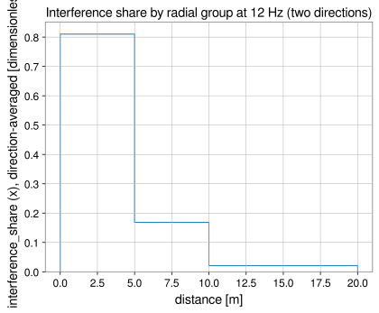{ width="100%" }

Solid: direction-averaged $I_j(f)$ from `dynamic_radial_histogram`; dashed: weighted mean of
$\operatorname{Re}(a_j a_{\mathrm{tot}}^*)/|a_{\mathrm{tot}}|^2$ computed **per direction**
before averaging. The generator asserts they differ at both frequencies; bins with invalid
total power are masked.

The worked example uses three collinear sources and **synthetic** peak complex
densities (kg/m³); see `fig_dynamic_interference()` for parameters.

## Result visualization (`plot_result`)

`plot_result` dispatches on the `EvaluationResult` representation:

| Representation | Typical `view` / `plane` | Role |
|---|---|---|
| Static targets on a grid | `plane="xy"` / `"xz"` / `"yz"` (implies slice) | Colormap of `observable` + `component` |
| Static irregular targets | `view="scatter"` + `plane` | Scatter colored by value |
| Time series | `view="line"` | `component` selects axis; default `part="magnitude"` on reals |
| Fourier / phasor spectra | `view="spectrum"` | `part="magnitude"`, `"real"`, `"imag"`, `"phase"` for complex spectra |

`observable` selects potential, acceleration, or gravity gradient; `component` selects `norm`,
`x`, …, or tensor entry; `part` applies only to **complex** spectral data.

Static field: **41×41** targets in the $xy$ plane, 800 kg point mass at $(1.5,-1,3)$ m.

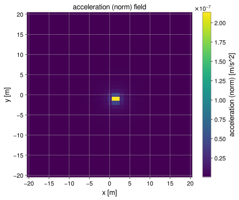{ width="100%" }

Time series: 200 samples, $\Delta t=0.05$ s, harmonic $x(t)$ plus drift for a moving 5 kg source.

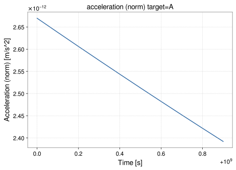{ width="100%" }

Spectrum: circular motion Fourier series; amplitude and phase of $a_x(f)$ share the same
frequency grid (`tref` from the evaluation). Phases of zero-amplitude (sub-tolerance)
components are masked.

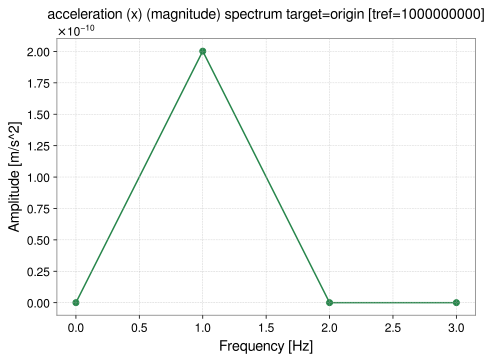{ width="100%" }

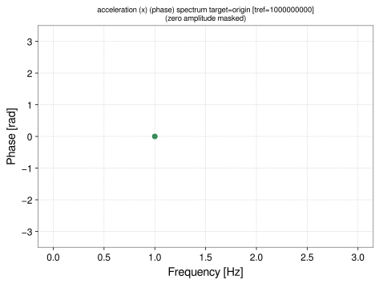{ width="100%" }

```python
from gragra.gravity_sources import PointMassCloud, point_sum, rigid_motion
from gragra.gravity_sources.trajectory import PrescribedRigidTransform
from gragra.plotting import plot_result
from gragra.results import TimeSampling

grid_coords = (
    np.array([[-2.0, -2.0, 0.0], [-2.0, 2.0, 0.0], [2.0, -2.0, 0.0], [2.0, 2.0, 0.0]])
    * u.m
)
grid_targets = TargetPoints(grid_coords, ("1", "2", "3", "4"), root)
eval_result = (
    point_sum(source, frame=root, field_definition=field).at(grid_targets).run()
)
fig_field, _ = plot_result(
    eval_result, observable="acceleration", component="norm", plane="xy"
)

epoch_gps = (1_000_000_000, 0)
sampling = TimeSampling(epoch=epoch_gps, dt=0.1 * u.s, count=20)
epoch = sampling.epoch
t0_s = float(epoch.gpsSeconds) + float(epoch.gpsNanoSeconds) * 1e-9
time_s = t0_s + sampling.dt_seconds * np.arange(sampling.count, dtype=np.float64)
pos = np.column_stack(
    [0.5 * (time_s - time_s[0]), np.zeros(sampling.count), np.zeros(sampling.count)]
)
transform = PrescribedRigidTransform(
    time_s, pos, np.repeat(np.eye(3)[np.newaxis], sampling.count, axis=0)
)
ts_result = (
    rigid_motion(
        PointMassCloud(np.array([1.0]), np.array([[0.0, 0.0, 0.0]])),
        transform,
        frame=root,
        sampling=sampling,
    )
    .at(targets, observables=("acceleration",))
    .run()
)
fig_ts, _ = plot_result(ts_result, target_id="A", view="line", component="x")
```

## Analytical shape rendering (`plot_shape`)

`plot_shape` draws **Cuboid**, **Cylinder**, or **SphericalShell** geometry (including from
`setup.model_spec.geometry` when present).

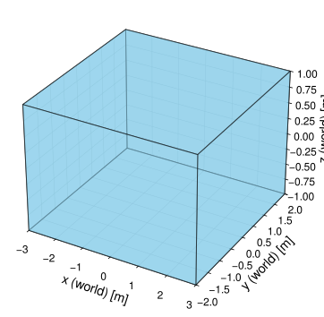

```python
import astropy.units as u
from gragra.geometry import Cuboid, Frame
from gragra.plotting import plot_shape

world = Frame("world")
cuboid = Cuboid(
    center=[0.0, 0.0, 0.0] * u.m,
    lengths=[6.0, 4.0, 2.0] * u.m,
    frame=world,
)
fig_sh, ax_sh = plot_shape(cuboid, color="skyblue", alpha=0.55)
```

## Comparing and interpreting diagnostics

- Additive checks apply to **raw** integrated sums or vector sums in fixed units. Normalized
  fractions do not add like the underlying extensive contributions.
- Radial distances ignore softening unless the diagnostic explicitly uses a softened kernel
  **inside** the group (`gravity_gradient_radial_histogram` softening vs bin edges).
- Visualization does not replace model verification; see [verification](../verification/index.md).

### `plot_hist` notes

- `xunit` rescales only the horizontal axis; weights stay in SI.
- `frame=None` uses the setup computation frame for `height`.

For gridded density/displacement fields see [Visualizing fields](fields.md#visualizing-fields).
