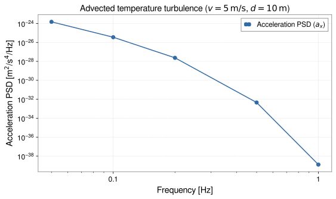

<!-- GENERATED MODEL REFERENCE: regenerate through the catalogue workflow. -->
# Advected atmospheric temperature turbulence

## Model overview

**Level:** — (definition and assignment pending).

**Physical domain:** stochastic atmospheric  
**Geometry:** `atmosphere`

Frozen-flow hypothesis; acceleration PSD

**Source-declared observable / representation pairs:**

- a — Spectral density (PSD)

These pairs are a union over the listed calculation paths. They do not imply every API exposes every combination.

[Back to model catalogue](../guide/model-and-method-catalogue.md)

## Geometry


*Turbulent temperature eddies advected by horizontal wind \(v\) past interferometer line-of-sight with closest approach \(r_{\min}\).*

Line-of-sight/minimum-approach geometry and wind angle are scalar model parameters; no scene/mesh/cavern geometry. Plot shape reuse not material.

## Analytic formulation, sources, and scope

### Equations

Advected atmospheric temperature turbulence produces density perturbations via isobaric thermodynamic fluctuations. The turbulent temperature structure function follows:

$$
D_T(r) = \langle [T(\mathbf x + \mathbf r) - T(\mathbf x)]^2 \rangle = c_T^2 r^p
$$

with structure exponent \(0 < p < 2\) (Kolmogorov turbulence has \(p = 2/3\)) and structure constant \(c_T\) in \(\mathrm{K\cdot m^{-p/2}}\).

Under Taylor's frozen-turbulence hypothesis with horizontal wind speed \(v > 0\), standoff distance \(r_{\min} > 0\), and wind angle \(\theta\), let \(\Omega = 2\pi f\) and define the dimensionless frequency parameter \(x = \Omega r_{\min} / v\).

The G-free one-sided projected acceleration PSD is:

$$
S_a^{(G\text{-free})}(f) = 8\pi^2 \Gamma(p+2) \sin\left(\frac{\pi p}{2}\right) \left(\frac{\rho_0 r_{\min} c_T}{T_0}\right)^2 v^p \Omega^{-(p+1)} B(x, \theta)
$$

where the dimensionless geometric-Bessel factor \(B(x, \theta)\) is:

$$
B(x, \theta) = e^{-2x} \left[\cos^2\theta \left(K_1^2(x) - K_0^2(x)\right) + \frac{1}{2} \sin^2\theta \left(K_0(x) K_2(x) - K_1^2(x)\right)\right]
$$

Here \(K_n(x)\) are modified Bessel functions of the second kind.

Physical SI acceleration PSDs with units \(\mathrm{(m/s^2)^2/Hz}\) are obtained by multiplying by \(G^2\):

$$
S_a^{(\mathrm{SI})}(f) = G^2 S_a^{(G\text{-free})}(f)
$$

### Derivation

Local module implements scaled Bessel geometry and log-tail branch for float64 range; equations are local specification/transcription, not independently proven here.

### References

Existing public documentation and original formulation context:

- [Stochastic NN](../guide/stochastic-nn.md)

**Bibliographic inventory:** partial.

### Applicability and scope

Strict 0&lt;p&lt;2, positive T, wind, minimum approach, positive frequencies; density and \(c_T\) nonnegative. Taylor frozen flow, uniform straight advection, homogeneous isotropic structure-function assumptions.

## STEP 1 — Setup

Primary path: `uniform_advection_temperature_acceleration_psd`

**A+ (`tutorial-display` axes):** wrap outputs with GWexpy only in the generator; do not invent frequency grids on the output side.

Build inputs consistent with **Detailed reference**:

```python
density = 1.2
temperature = 290.0
structure_coeff = 0.01
structure_exp = 2.0 / 3.0
wind_speed = 5.0
min_approach = 10.0
wind_axis_angle = 0.0
```

## STEP 2 — Validate / Inspect

STEP 2 items are tagged by information source:

- **`api`**: read from a gragra evaluation object: `validate()` is a **method**; `parameters`, `formulas`, and `references` are **`@property`** objects (not callable).
- **`tutorial-display`**: assembled for this page from documented inputs or catalogue-verified display equations (not a separate gragra registry lookup).
- **`api-output`**: taken from executed result payloads (units, shapes, GWexpy axes).

#### Display equations (`tutorial-display`)

Catalogue-registered analytic formulation (same as **Analytic formulation, sources, and scope** above):

Advected atmospheric temperature turbulence produces density perturbations via isobaric thermodynamic fluctuations. The turbulent temperature structure function follows:

$$
D_T(r) = \langle [T(\mathbf x + \mathbf r) - T(\mathbf x)]^2 \rangle = c_T^2 r^p
$$

with structure exponent \(0 < p < 2\) (Kolmogorov turbulence has \(p = 2/3\)) and structure constant \(c_T\) in \(\mathrm{K\cdot m^{-p/2}}\).

Under Taylor's frozen-turbulence hypothesis with horizontal wind speed \(v > 0\), standoff distance \(r_{\min} > 0\), and wind angle \(\theta\), let \(\Omega = 2\pi f\) and define the dimensionless frequency parameter \(x = \Omega r_{\min} / v\).

The G-free one-sided projected acceleration PSD is:

$$
S_a^{(G\text{-free})}(f) = 8\pi^2 \Gamma(p+2) \sin\left(\frac{\pi p}{2}\right) \left(\frac{\rho_0 r_{\min} c_T}{T_0}\right)^2 v^p \Omega^{-(p+1)} B(x, \theta)
$$

where the dimensionless geometric-Bessel factor \(B(x, \theta)\) is:

$$
B(x, \theta) = e^{-2x} \left[\cos^2\theta \left(K_1^2(x) - K_0^2(x)\right) + \frac{1}{2} \sin^2\theta \left(K_0(x) K_2(x) - K_1^2(x)\right)\right]
$$

Here \(K_n(x)\) are modified Bessel functions of the second kind.

Physical SI acceleration PSDs with units \(\mathrm{(m/s^2)^2/Hz}\) are obtained by multiplying by \(G^2\):

$$
S_a^{(\mathrm{SI})}(f) = G^2 S_a^{(G\text{-free})}(f)
$$

`request.formulas` lists **implementation routing** (`api`), which may differ from these display equations.

For direct observable evaluation, parameters and display equations are verified above (`tutorial-display`).

```python
try:
    from IPython.display import display
except ImportError:
    display = print
# Direct observable evaluation: parameters verified against catalogue specification
print('Input configuration verified.')
```

## STEP 3 — Calculate

Evaluate the model (`api-output`):

```python
import numpy as np
from gragra.observables.stochastic_temperature import uniform_advection_temperature_acceleration_psd

psd = uniform_advection_temperature_acceleration_psd(
    density_kg_m3=density, temperature_k=temperature,
    structure_coefficient_k_m_neg_p_over_2=structure_coeff,
    structure_exponent=structure_exp, wind_speed_m_s=wind_speed,
    minimum_approach_m=min_approach, wind_axis_angle_rad=wind_axis_angle,
    frequency_hz=np.array([1.0]),
)
print('acceleration PSD at 1 Hz:', psd[0])
```


## STEP 4 — Results / Comparison

The code below computes the result for each case and plots it. Each case is named on the x-axis or in the legend (`api-output`).

```python
import matplotlib.pyplot as plt
import numpy as np
from gragra.observables.stochastic_temperature import uniform_advection_temperature_acceleration_psd

freqs = np.array([0.05, 0.1, 0.2, 0.5, 1.0])
psds = [
    float(uniform_advection_temperature_acceleration_psd(
        density_kg_m3=1.2,
        temperature_k=290.0,
        structure_coefficient_k_m_neg_p_over_2=0.01,
        structure_exponent=2.0 / 3.0,
        wind_speed_m_s=5.0,
        minimum_approach_m=10.0,
        wind_axis_angle_rad=0.0,
        frequency_hz=np.array([f]),
    )[0])
    for f in freqs
]

fig, ax = plt.subplots(figsize=(8.0, 4.8))
ax.plot(freqs, psds, "o-", color="#316aa5", label=r"Acceleration PSD ($a_x$)")
ax.set_xscale("log")
ax.set_yscale("log")
ax.set_xlabel("Frequency [Hz]")
ax.set_ylabel(r"Acceleration PSD [m$^2$/s$^4$/Hz]")
ax.set_title(r"Advected temperature turbulence ($v=5\,\mathrm{m/s}$, $d=10\,\mathrm{m}$)")
ax.grid(True, linestyle="--", alpha=0.45)
ax.legend()
fig.tight_layout()
plt.show()
```




*Figure generated by executing the STEP 4 comparison code above.*

Saved with `fig.savefig(path, bbox_inches='tight', metadata={'Date': None})` and `svg.hashsalt='gragra'` under Matplotlib 3.11.2. SVG byte reproducibility was verified with Matplotlib 3.11.2 under these save conditions. Other versions may produce different SVG bytes or layouts.

## Detailed reference and verification

### Parameters and units

#### API parameters

| Function / Path | Parameter | Type / Format | Default | Description |
|---|---|---|---|---|
| `uniform_advection_temperature_acceleration_psd` | `density_kg_m3` | float | required (kw-only) | Ambient air mass density in kg/m³ (positive) |
| `uniform_advection_temperature_acceleration_psd` | `temperature_k` | float | required (kw-only) | Ambient absolute temperature in Kelvin (T0 > 0) |
| `uniform_advection_temperature_acceleration_psd` | `structure_coefficient_k_m_neg_p_over_2` | float | required (kw-only) | Temperature structure parameter \(c_T\) in K·m^(-p/2) |
| `uniform_advection_temperature_acceleration_psd` | `structure_exponent` | float | required (kw-only) | Power-law structure scaling exponent p in (0, 2) (p = 2/3 for Kolmogorov) |
| `uniform_advection_temperature_acceleration_psd` | `wind_speed_m_s` | float | required (kw-only) | Advection wind speed v in m/s (v > 0) |
| `uniform_advection_temperature_acceleration_psd` | `minimum_approach_m` | float | required (kw-only) | Closest approach distance from wind path to sensor \(r_{\min}\) in meters |
| `uniform_advection_temperature_acceleration_psd` | `wind_axis_angle_rad` | float | required (kw-only) | Angle theta between wind velocity and sensor projection axis in radians |
| `uniform_advection_temperature_acceleration_psd` | `frequency_hz` | float \| ArrayLike | required (kw-only) | Evaluation frequency in Hz (f > 0) |

#### API return values

| Function / Path | Return type | Representation | Quantity & Unit | Shape / Structure | Description |
|---|---|---|---|---|---|
| `uniform_advection_temperature_acceleration_psd` | ndarray \| float | PSD | a: (m/s²)²/Hz | \((N_{\mathrm{freq}},)\) float64 array or scalar | One-sided projected acceleration power spectral density along detector axis (T1) |

#### Mathematical symbols and notation

| Symbol | Meaning | SI unit | Definition / Relation |
|---|---|---|---|
| \(\rho_0\) | Ambient air density | kg/m³ | Unperturbed atmospheric air mass density (\(\rho_0 > 0\)) |
| \(T_0\) | Ambient temperature | K | Mean ambient absolute temperature (\(T_0 > 0\)) |
| \(c_T\) | Structure parameter | K·m^(-p/2) | Temperature structure constant |
| \(p\) | Structure exponent | dimensionless | Power-law scaling index (\(p = 2/3\) for Kolmogorov turbulence) |
| \(v\) | Wind speed | m/s | Mean horizontal wind advection speed (\(v > 0\)) |
| \(r_{\min}\) | Closest approach distance | m | Perpendicular distance from advection line to sensor (\(r_{\min} > 0\)) |
| \(\theta\) | Wind projection angle | rad | Angle between wind velocity vector and detector projection axis |
| \(f\) | Frequency | Hz | Evaluation frequency (\(f > 0\)) |
| \(S_a(f)\) | Projected acceleration PSD | (m/s²)²/Hz | One-sided acceleration PSD along sensor axis |

#### Usage notes

- Evaluates Harms (2019) Sect. 5.2 and Creighton (2000) for frozen-turbulence temperature advection past a gravitational-wave detector test mass.

### Calculation paths

#### T1 uniform advection projected acceleration PSD

- `gragra.observables.stochastic_temperature.uniform_advection_temperature_acceleration_psd`

**Path-level source-declared output union:** a — Spectral density (PSD)

### Derivation and source notes

- The bibliography identifies Jan Harms, ‘Terrestrial gravity fluctuations,’ Living Reviews in Relativity 22 (2019), DOI 10.1007/s41114-019-0022-2.
- For Creighton, the targeted source search located local metadata in the T1 specification but no separate title/author/year/arXiv bibliography record; source identity beyond that recorded metadata is not independently established.
- an unpublished design note, T1-freeze-v1.json, T1-budget-v1.json and T1-fixtures-v1.json are local protocol/evidence planning records, not literature entries. T1 planning records define execution protocols and candidate fixtures; no executed numerical baseline run is included in published literature entries.
- [DOI 10.1007/s41114-019-0022-2](https://doi.org/10.1007/s41114-019-0022-2)
- [arXiv:gr-qc/0007050](https://arxiv.org/abs/gr-qc/0007050)

### Verification

**Evidence classes are distinct:** source declarations, catalogue output-contract probes, existing test code, documentary validation claims, and saved numerical results.

- Representative catalogue output-contract entries: 0.
- Catalogue probe state: Not assessed (no catalogue output probe registered).
- Registered output-contract probes run during catalogue validation check selected API outputs only; they do not measure scientific accuracy.
- Scientific accuracy tests are not part of documentation generation; no accuracy Level is assigned.

**Existing verification inventory:**

Local unit and oracle test code exists; tests were not run in this editorial review. Formal execution protocols remain pending completion, so candidate test suites do not by themselves establish formal science acceptance.

- [`tests/test_stochastic_temperature.py`](https://github.com/tatsuki-washimi/gragra/blob/main/tests/test_stochastic_temperature.py) BASE inputs \(\rho\)=1.2 kg/m³, \(T\)=293 K, \(c_T\)=0.1 K m^(-p/2), \(p\)=2/3, wind=10 m/s, \(r_{\min}\)=5 m, \(\theta\)=0; geometry factor comparison at x={0.1,0.5,1,3,10} uses scipy quad epsabs=1e-13, epsrel=2e-12, limit=300, comparison rtol=3e-11, atol=1e-14. Large-x x=50 comparison uses rtol 0.02 parallel and 0.04 transverse.
- Separate independent oracle test code uses mpmath 35/45 decimal precision at p={0.4, 2/3, 1.3}, x={0.07,1.7,13}; checks integral identity residual &lt;1e-28 and positive-tail bound. This is test code, not execution evidence.

### Applicability and limitations


**Scope note:** Strict 0&lt;p&lt;2, positive T, wind, minimum approach, positive frequencies; density and \(c_T\) nonnegative. Taylor frozen flow, uniform straight advection, homogeneous isotropic structure-function assumptions.

See the public verification and limitations guidance for test-specific conditions and interpretation:

- [Verification matrix](../verification/matrix.md)
- [Verification limitations](../verification/limitations.md)


## Information not yet confirmed

- No arbitrary wind field, finite-outer-scale cutoff, or spatially varying temperature-statistics API is present in this function.

*Publication scope: narrative summaries and links, not private derivation records, internal test artifacts or inventory JSON.*
