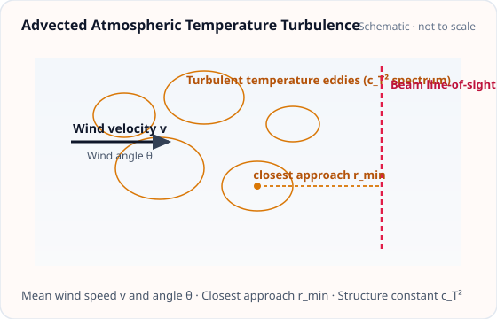

<!-- GENERATED MODEL REFERENCE: regenerate through the catalogue workflow. -->
# Advected atmospheric temperature turbulence

## Model overview

**Level:** — (definition and assignment pending).

**Physical domain:** stochastic atmospheric  
**Geometry:** atmosphere

Frozen-flow hypothesis; acceleration PSD

**Source-declared observable / representation pairs:**

- a — Spectral density (PSD)

These pairs are a union over the listed calculation paths. They do not imply every API exposes every combination.

[Back to model catalogue](../guide/model-and-method-catalogue.md)

## Geometry and equations

*Turbulent temperature eddies advected by horizontal wind v past interferometer line-of-sight with closest approach r_min.*

Line-of-sight/minimum-approach geometry and wind angle are scalar model parameters; no scene/mesh/cavern geometry. Plot shape reuse not material.

### Equations

**Analytical formulation and field equations:**

- Turbulent temperature structure function obeys \(D_T(r) = \langle [T(\mathbf x + \mathbf r) - T(\mathbf x)]^2 \rangle = c_T^2 r^p\) with structure exponent \(0 &lt; p &lt; 2\) (standard Kolmogorov turbulence has \(p = 2/3\)) and coefficient \(c_T\) in \(\mathrm{K\cdot m^{-p/2}}\).
- Under Taylor\'s frozen-flow hypothesis with horizontal wind speed \(v &gt; 0\), turbulence advects across the sensor with minimum approach distance \(r_{\min} &gt; 0\) and wind angle \(\theta\). Let \(\Omega = 2\pi f\) and dimensionless parameter \(x = \Omega r_{\min} / v\).
- The G-free one-sided projected acceleration PSD is \(S_a^{(G\text{-free})}(f) = 8\pi^2 \Gamma(p+2) \sin\left(\frac{\pi p}{2}\right) \left(\frac{\rho_0 r_{\min} c_T}{T_0}\right)^2 v^p \Omega^{-(p+1)} B(x, \theta)\), where \(B(x, \theta) = e^{-2x} [\cos^2\theta (K_1^2(x) - K_0^2(x)) + \frac{1}{2} \sin^2\theta (K_0(x) K_2(x) - K_1^2(x))]\) with modified Bessel functions \(K_n(x)\).
- SI observable multiplication: \(S_a^{(\mathrm{SI})}(f) = G^2 S_a^{(G\text{-free})}(f)\) with units \(\mathrm{(m/s^2)^2/Hz}\).

## Parameters and calculation paths

### Parameters and units

| Symbol | Parameter | Meaning | SI unit |
|---|---|---|---|
| \(\rho_0\) | `density_kg_m3` | Ambient air mass density | kg/m³ |
| \(T_0\) | `temperature_k` | Ambient absolute temperature | K |
| \(c_T\) | `structure_coefficient_k_m_neg_p_over_2` | Temperature structure parameter | K·m^(-p/2) |
| \(p\) | `structure_exponent` | Power-law scaling exponent (Kolmogorov p = 2/3) | dimensionless |
| \(v\) | `wind_speed_m_s` | Advection wind speed | m/s |
| \(r_{\min}\) | `minimum_approach_m` | Closest distance from advection path to sensor | m |
| \(\theta\) | `wind_axis_angle_rad` | Angle between wind velocity and sensor projection axis | rad |
| \(f\) | `frequency_hz` | Evaluation frequency | Hz |

**Additional notes on parameters and models:**

- density_kg_m3: float &gt;= 0, ambient air mass density rho0 in kg/m^3; temperature_k: float &gt; 0, ambient absolute temperature T0 in Kelvin; structure_coefficient_k_m_neg_p_over_2: float &gt;= 0, temperature structure parameter c_T in K*m^(-p/2); structure_exponent: float in (0, 2), power-law scaling exponent p (Kolmogorov p=2/3); wind_speed_m_s: float &gt; 0, advection wind speed v in m/s; minimum_approach_m: float &gt; 0, closest distance r_min from path to sensor in meters; wind_axis_angle_rad: float, angle theta between wind direction and sensor projection axis in radians; frequency_hz: float or array-like &gt; 0, evaluation frequency f in Hz.

### Calculation paths

#### T1 uniform advection projected acceleration PSD

- `gragra.observables.stochastic_temperature.uniform_advection_temperature_acceleration_psd`

**Path-level source-declared output union:** a — Spectral density (PSD)

## Derivation and sources

### Derivation

Local module implements scaled Bessel geometry and log-tail branch for float64 range; equations are local specification/transcription, not independently proven here.

### References

Existing public documentation and original formulation context:

- [Stochastic NN](../guide/stochastic-nn.md)

**Bibliographic inventory:** partial.

- The bibliography identifies Jan Harms, ‘Terrestrial gravity fluctuations,’ Living Reviews in Relativity 22 (2019), DOI 10.1007/s41114-019-0022-2.
- For Creighton, the targeted source search located local metadata in the T1 specification but no separate title/author/year/arXiv bibliography record; source identity beyond that recorded metadata is not independently established.
- an unpublished design note, T1-freeze-v1.json, T1-budget-v1.json and T1-fixtures-v1.json are local protocol/evidence planning records, not literature entries. T1 planning records define execution protocols and candidate fixtures; no executed numerical baseline run is included in published literature entries.
- [DOI 10.1007/s41114-019-0022-2](https://doi.org/10.1007/s41114-019-0022-2)
- [arXiv:gr-qc/0007050](https://arxiv.org/abs/gr-qc/0007050)

## Verification and applicability

### Verification

**Evidence classes are distinct:** source declarations, catalogue output-contract probes, existing test code, documentary validation claims, and saved numerical results.

- Representative catalogue output-contract entries: 0.
- Catalogue probe state: Not assessed (no catalogue output probe registered).
- Registered output-contract probes run during catalogue validation check selected API outputs only; they do not measure scientific accuracy.
- Scientific accuracy tests are not part of documentation generation; no accuracy Level is assigned.

**Existing verification inventory:**

Local unit and oracle test code exists; tests were not run in this editorial review. Formal execution protocols remain pending completion, so candidate test suites do not by themselves establish formal science acceptance.

- [`tests/test_stochastic_temperature.py`](https://github.com/tatsuki-washimi/gragra/blob/main/tests/test_stochastic_temperature.py) BASE inputs rho=1.2 kg/m³, T=293 K, c_T=0.1 K m^(-p/2), p=2/3, wind=10 m/s, r_min=5 m, theta=0; geometry factor comparison at x={0.1,0.5,1,3,10} uses scipy quad epsabs=1e-13, epsrel=2e-12, limit=300, comparison rtol=3e-11, atol=1e-14. Large-x x=50 comparison uses rtol 0.02 parallel and 0.04 transverse.
- Separate independent oracle test code uses mpmath 35/45 decimal precision at p={0.4, 2/3, 1.3}, x={0.07,1.7,13}; checks integral identity residual &lt;1e-28 and positive-tail bound. This is test code, not execution evidence.

### Applicability and limitations

**Scope note:** Strict 0&lt;p&lt;2, positive T, wind, minimum approach, positive frequencies; density and c_T nonnegative. Taylor frozen flow, uniform straight advection, homogeneous isotropic structure-function assumptions.

See the public verification and limitations guidance for test-specific conditions and interpretation:

- [Verification matrix](../verification/matrix.md)
- [Verification limitations](../verification/limitations.md)

## Information not yet confirmed

- No arbitrary wind field, finite-outer-scale cutoff, or spatially varying temperature-statistics API is present in this function.

*Publication scope: narrative summaries and links, not private derivation records, internal test artifacts or inventory JSON.*
