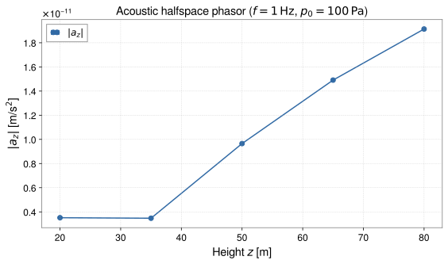

<!-- GENERATED MODEL REFERENCE: regenerate through the catalogue workflow. -->
# Atmospheric acoustic halfspace

## Model overview

**Level:** — (definition and assignment pending).

**Physical domain:** atmospheric acoustic  
**Geometry:** `halfspace`

Plane acoustic wave and rigid-ground reflection

**Source-declared observable / representation pairs:**

- Φ a Γ — Phasor

These pairs are a union over the listed calculation paths. They do not imply every API exposes every combination.

[Back to model catalogue](../guide/model-and-method-catalogue.md)

## Geometry


*Acoustic waves in atmospheric halfspace \(z > 0\) with density perturbation \(\delta\rho = \delta p / c_s^2\) acting on ground sensor at \(z = 0\).*

- z=0 interface; target points on interface rejected.

## Analytic formulation, sources, and scope

### Equations

For acoustic pressure waves propagating in an atmospheric halfspace (\(z > 0\)) bounded by a rigid planar ground surface (\(z = 0\)), let \(c_s\) denote the atmospheric sound speed, \(f\) the acoustic frequency, and \(\omega = 2\pi f\).

With horizontal wavenumber \(k_\rho = (\omega / c_s) \sin\theta\) and vertical wavenumber \(k_z = (\omega / c_s) \cos\theta\) (for angle of incidence \(0 < \theta \le \pi/2\)), the acoustic density perturbation is:

$$
\delta\rho(\mathbf x, t) = \frac{P_0}{c_s^2} \cos(k_z z) e^{i (\mathbf k_\rho \cdot \mathbf x_\perp - \omega t)}.
$$

The G-free gravitational potential in units of \(\mathrm{kg/m}\) evaluates as:

Above ground (\(z > 0\)):

$$
\Phi^{(G\text{-free})}(\mathbf x, t) = \frac{2\pi P_0}{c_s^2 (k_\rho^2 + k_z^2)} \left[ e^{-k_\rho z} - 2 \cos(k_z z) \right] e^{i (\mathbf k_\rho \cdot \mathbf x_\perp - \omega t)}.
$$

Underground (\(z \le 0\)):

$$
\Phi^{(G\text{-free})}(\mathbf x, t) = -\frac{2\pi P_0}{c_s^2 (k_\rho^2 + k_z^2)} e^{k_\rho z} e^{i (\mathbf k_\rho \cdot \mathbf x_\perp - \omega t)}.
$$

Physical SI observables are obtained by multiplying by \(G\):

$$
\Phi^{(\mathrm{SI})} = G \Phi^{(G\text{-free})}, \qquad
\mathbf a^{(\mathrm{SI})} = G \mathbf a^{(G\text{-free})}, \qquad
\mathbf\Gamma^{(\mathrm{SI})} = G \mathbf\Gamma^{(G\text{-free})}.
$$

### Derivation

Closed form present; no independent derivation text located in inspected guide.

### References

Existing public documentation and original formulation context:

- [Analytic models](../guide/gen1-analytic-models.md)

**Bibliographic inventory:** located.

### Applicability and scope

Single plane wave in homogeneous sound speed halfspace; no normal incidence or interface targets.

- \(\theta \in (0, \pi/2]\); grazing has \(k_z = 0\) and \(q \ne 0\).
## STEP 1 — Setup

Primary path: `acoustic_halfspace(...).at(...).run()`

Primary path: `acoustic_halfspace(...).at(...).run()`

Build inputs consistent with **Detailed reference**:

```python
import numpy as np
import astropy.units as u
from gragra.geometry import Frame, HalfSpace
from gragra.targets import TargetPoints
from gragra.analytic.atmospheric import acoustic_halfspace

frame = Frame('world')
model = acoustic_halfspace(
    HalfSpace(frame),
    surface_pressure=100.0 * u.Pa,
    sound_speed=340.0 * u.m / u.s,
    frequency=1.0 * u.Hz,
    incidence_angle=(np.pi / 4.0) * u.rad,
    azimuth=0.0 * u.rad,
    phase_origin=[0.0, 0.0, 0.0] * u.m,
    reference_time=(100, 0),
)
targets = TargetPoints([[0.0, 0.0, 50.0]] * u.m, ('t1',), frame)
request = model.at(targets)
```

## STEP 2 — Validate / Inspect

STEP 2 items are tagged by information source:

- **`api`**: read from a gragra evaluation object: `validate()` is a **method**; `parameters`, `formulas`, and `references` are **`@property`** objects (not callable).
- **`tutorial-display`**: assembled for this page from documented inputs or catalogue-verified display equations (not a separate gragra registry lookup).
- **`api-output`**: taken from executed result payloads (units, shapes, GWexpy axes).

#### Display equations (`tutorial-display`)

Catalogue-registered analytic formulation (same as **Analytic formulation, sources, and scope** above):

For acoustic pressure waves propagating in an atmospheric halfspace (\(z > 0\)) bounded by a rigid planar ground surface (\(z = 0\)), let \(c_s\) denote the atmospheric sound speed, \(f\) the acoustic frequency, and \(\omega = 2\pi f\).

With horizontal wavenumber \(k_\rho = (\omega / c_s) \sin\theta\) and vertical wavenumber \(k_z = (\omega / c_s) \cos\theta\) (for angle of incidence \(0 < \theta \le \pi/2\)), the acoustic density perturbation is:

$$
\delta\rho(\mathbf x, t) = \frac{P_0}{c_s^2} \cos(k_z z) e^{i (\mathbf k_\rho \cdot \mathbf x_\perp - \omega t)}.
$$

The G-free gravitational potential in units of \(\mathrm{kg/m}\) evaluates as:

Above ground (\(z > 0\)):

$$
\Phi^{(G\text{-free})}(\mathbf x, t) = \frac{2\pi P_0}{c_s^2 (k_\rho^2 + k_z^2)} \left[ e^{-k_\rho z} - 2 \cos(k_z z) \right] e^{i (\mathbf k_\rho \cdot \mathbf x_\perp - \omega t)}.
$$

Underground (\(z \le 0\)):

$$
\Phi^{(G\text{-free})}(\mathbf x, t) = -\frac{2\pi P_0}{c_s^2 (k_\rho^2 + k_z^2)} e^{k_\rho z} e^{i (\mathbf k_\rho \cdot \mathbf x_\perp - \omega t)}.
$$

Physical SI observables are obtained by multiplying by \(G\):

$$
\Phi^{(\mathrm{SI})} = G \Phi^{(G\text{-free})}, \qquad
\mathbf a^{(\mathrm{SI})} = G \mathbf a^{(G\text{-free})}, \qquad
\mathbf\Gamma^{(\mathrm{SI})} = G \mathbf\Gamma^{(G\text{-free})}.
$$

`request.formulas` lists **implementation routing** (`api`), which may differ from these display equations.

Inspect and validate the evaluation request (`api`):

```python
try:
    from IPython.display import display
except ImportError:
    display = print
report = request.validate()
if report is not None:
    print(report)
else:
    print('Configuration valid.')
if hasattr(request, 'parameters'):
    display(request.parameters)
if hasattr(request, 'formulas'):
    display(request.formulas)
if hasattr(request, 'references'):
    display(request.references)
```

## STEP 3 — Calculate

Evaluate the model (`api-output`):

```python
res = request.run()
print('potential:', res.potential.value, res.potential.units)
print('acceleration:', res.acceleration.value, res.acceleration.units)
print('gradient:', res.gradient.value, res.gradient.units)
```


## STEP 4 — Results / Comparison

The code below computes the result for each case and plots it. Each case is named on the x-axis or in the legend (`api-output`).

```python
import matplotlib.pyplot as plt
import numpy as np
import astropy.units as u
from gragra.geometry import Frame, HalfSpace
from gragra.targets import TargetPoints
from gragra.analytic.atmospheric import acoustic_halfspace

frame = Frame('world')
zs = np.array([20.0, 35.0, 50.0, 65.0, 80.0])
mags = []
for z_m in zs:
    model = acoustic_halfspace(
        HalfSpace(frame),
        surface_pressure=100.0 * u.Pa,
        sound_speed=340.0 * u.m / u.s,
        frequency=1.0 * u.Hz,
        incidence_angle=(np.pi / 4.0) * u.rad,
        azimuth=0.0 * u.rad,
        phase_origin=[0.0, 0.0, 0.0] * u.m,
        reference_time=(100, 0),
    )
    res = model.at(TargetPoints([[0.0, 0.0, float(z_m)]] * u.m, ('t1',), frame)).run()
    mags.append(float(abs(res.acceleration.value[0, 2, 0])))

fig, ax = plt.subplots(figsize=(8.0, 4.8))
ax.plot(zs, mags, "o-", color="#316aa5", label=r"$|a_z|$")
ax.set_xlabel(r"Height $z$ [m]")
ax.set_ylabel(r"$|a_z|$ [m/s$^2$]")
ax.set_title(r"Acoustic halfspace phasor ($f=1\,\mathrm{Hz}$, $p_0=100\,\mathrm{Pa}$)")
ax.grid(True, linestyle="--", alpha=0.45)
ax.legend()
fig.tight_layout()
plt.show()
```




*Figure generated by executing the STEP 4 comparison code above.*

Saved with `fig.savefig(path, bbox_inches='tight', metadata={'Date': None})` and `svg.hashsalt='gragra'` under Matplotlib 3.11.2. SVG byte reproducibility was verified with Matplotlib 3.11.2 under these save conditions. Other versions may produce different SVG bytes or layouts.

## Detailed reference and verification

### Parameters and units

#### API parameters

| Function / Path | Parameter | Type / Format | Default | Description |
|---|---|---|---|---|
| `acoustic_halfspace` | `halfspace` | HalfSpace | required | HalfSpace geometry representing atmospheric interface (z >= 0) |
| `acoustic_halfspace` | `surface_pressure` | u.Quantity (pressure) | required | Acoustic surface pressure perturbation amplitude |
| `acoustic_halfspace` | `sound_speed` | u.Quantity (speed) | required (kw-only) | Speed of sound in air \(c_s\) |
| `acoustic_halfspace` | `frequency` | u.Quantity (frequency) | required (kw-only) | Acoustic wave frequency f in Hz |
| `acoustic_halfspace` | `incidence_angle` | u.Quantity (angle) | required (kw-only) | Incidence angle theta from normal in (0, pi/2] (0 < theta <= pi/2) |
| `acoustic_halfspace` | `azimuth` | u.Quantity (angle) | required (kw-only) | Horizontal propagation azimuth angle phi |
| `acoustic_halfspace` | `phase_origin` | u.Quantity (length 3-vector) | required (kw-only) | Coordinate phase reference origin |
| `acoustic_halfspace` | `reference_time` | object | required (kw-only) | Reference time epoch for phasor evaluation |

#### API return values

| Function / Path | Return type | Representation | Quantity & Unit | Shape / Structure | Description |
|---|---|---|---|---|---|
| `acoustic_halfspace` | AcousticHalfspaceModel | Phasor | Φ: m²/s², a: m/s², Γ: s⁻² | EvaluationResult with complex Astropy Quantities | High-level atmospheric acoustic wavefield model evaluated via .at(targets).run() |

#### Mathematical symbols and notation

| Symbol | Meaning | SI unit | Definition / Relation |
|---|---|---|---|
| \(P_0\) | Surface pressure amplitude | Pa | Peak acoustic pressure wave amplitude at ground |
| \(c_s\) | Speed of sound | m/s | Speed of sound in atmospheric air |
| \(f\) | Acoustic frequency | Hz | Acoustic oscillation frequency |
| \(\theta\) | Incidence angle | rad | Angle from downward normal (\(0 < \theta \le \pi/2\)) |
| \(\phi\) | Azimuth angle | rad | Horizontal propagation azimuth |
| \(\mathbf k_H\) | Horizontal wavevector | rad/m | \((k_x, k_y) = \frac{2\pi f}{c_s} \sin\theta (\cos\phi, \sin\phi)\) |
| \(\rho_{\mathrm{air}}\) | Air density | kg/m³ | Ambient atmospheric air mass density |
| \(\rho_{\mathrm{ground}}\) | Ground density | kg/m³ | Subsurface medium density |

#### Usage notes

- High-level factory returns an `AcousticHalfspaceModel` evaluated via `.at(targets).run()`.
- Models acoustic reflection from a rigid ground boundary with air occupying \(z \ge 0\).

### Calculation paths

#### plane-wave rigid reflection

- `gragra.analytic.atmospheric.acoustic_halfspace`

**Path-level source-declared output union:** Φ a Γ — Phasor

### Derivation and source notes

- implementation formulas do not establish derivation correctness.

- The G-free air and ground solutions and interface conditions are specified in a non-public design note, which is not reproduced here.
- source=`gragra.constants.G_SI`; detail=applied exactly once by the shared analytic bridge.

### Verification

**Evidence classes are distinct:** source declarations, catalogue output-contract probes, existing test code, documentary validation claims, and saved numerical results.

- Representative catalogue output-contract entries: 0.
- Catalogue probe state: Not assessed (no catalogue output probe registered).
- Registered output-contract probes run during catalogue validation check selected API outputs only; they do not measure scientific accuracy.
- Scientific accuracy tests are not part of documentation generation; no accuracy Level is assigned.

**Existing verification inventory:**

Noncavity production comparison script and module test suites exist; not run in this editorial review.

- [`tests/oracles/gen1/compare_noncavity_production.py`](https://github.com/tatsuki-washimi/gragra/blob/main/tests/oracles/gen1/compare_noncavity_production.py) checks non-cavity atmospheric and seismic production paths. An unpublished test suite verifies acoustic halfspace transfer functions against analytical limits; no committed golden json artifact is used for this model.

### Applicability and limitations

- \(\theta \in (0, \pi/2]\); grazing has \(k_z = 0\) and \(q \ne 0\).

**Scope note:** Single plane wave in homogeneous sound speed halfspace; no normal incidence or interface targets.

See the public verification and limitations guidance for test-specific conditions and interpretation:

- [Verification matrix](../verification/matrix.md)
- [Verification limitations](../verification/limitations.md)


## Information not yet confirmed

- dedicated geometry illustration and exact reference record.

*Publication scope: narrative summaries and links, not private derivation records, internal test artifacts or inventory JSON.*
