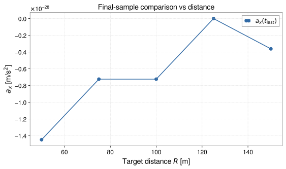
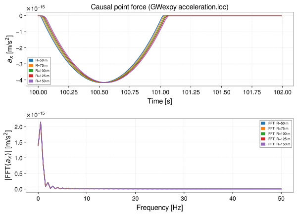

<!-- GENERATED MODEL REFERENCE: regenerate through the catalogue workflow. -->
# Causal point force

## Model overview

**Level:** 4.

**Physical domain:** seismic elastic  
**Geometry:** `point`

Time-dependent force in an infinite homogeneous elastic medium

**Source-declared observable / representation pairs:**

- Φ a Γ — Time series

These pairs are a union over the listed calculation paths. They do not imply every API exposes every combination.

[Back to model catalogue](../guide/model-and-method-catalogue.md)

## Geometry


*Expanding spherical compressional (P) and shear (S) wavefronts generated by a causal point force F(t).*

- Causal C1 signed history, retarded P delay, source collision rejected; uniform supplied sampling.

## Analytic formulation, sources, and scope

### Equations

For a dynamic point force \(\mathbf F(t) = f(t) \mathbf e\) acting at source position \(\mathbf x_0\), let the target distance be \(r = \|\mathbf x - \mathbf x_0\| > 0\), unit radial direction \(\hat{\mathbf n} = (\mathbf x - \mathbf x_0)/r\), and direction cosine \(\mu = \mathbf e \cdot \hat{\mathbf n}\).

Define the causal delay moment (Love 1927, Harms 2019 Section 4.1):

$$
J(t, r) = \int_0^{r/v_P} \tau f(t - \tau) \, d\tau
$$

where \(v_P\) is the medium compressional wave speed.

The induced gravitational potential in SI units is:

$$
\Phi(\mathbf x, t) = -G \frac{J(t, r)}{r^2} \mu
$$

The gravitational acceleration vector is:

$$
\mathbf a(\mathbf x, t) = G \left[ \frac{J(t, r)}{r^3} \mathbf e + \left( \frac{f(t - r/v_P)}{v_P^2 r} - \frac{3 J(t, r)}{r^3} \right) \mu \hat{\mathbf n} \right]
$$

The gravity-gradient tensor \(\mathbf\Gamma(\mathbf x, t) = -\nabla\nabla\Phi\) is:

$$
\mathbf\Gamma(\mathbf x, t) = G \left[ C(t, r) (\mathbf e \otimes \hat{\mathbf n} + \hat{\mathbf n} \otimes \mathbf e + \mu \mathbf I_3) + \mu D(t, r) (\hat{\mathbf n} \otimes \hat{\mathbf n}) \right]
$$

with analytic time-dependent coefficients:

$$
\begin{aligned}
C(t, r) &= \frac{f(t - r/v_P)}{v_P^2 r^2} - \frac{3 J(t, r)}{r^4}, \\
D(t, r) &= \frac{15 J(t, r)}{r^4} - \frac{6 f(t - r/v_P)}{v_P^2 r^2} - \frac{\dot f(t - r/v_P)}{v_P^3 r}.
\end{aligned}
$$

With the force starting at \(t = 0\), all fields are zero for \(t \le 0\). P-wave arrival does not mark the onset of the gravity response. Newtonian gravity is evaluated here without a light-travel delay, so a prompt gravity perturbation appears as soon as the force acts. For \(0 < t < r/v_P\), the retarded force terms \(f(t - r/v_P)\) and \(\dot f(t - r/v_P)\) are zero, while the delay moment reduces to

$$
J(t, r) = \int_0^{t} \tau f(t - \tau) \, d\tau ,
$$

which is generally non-zero and independent of \(v_P\). Substituting into the expressions above gives the response before P-wave arrival (the acceleration corresponds to Harms 2019 Section 4.1; the potential and gradient follow from the general expressions on this page):

$$
\begin{aligned}
\Phi(\mathbf x, t) &= -G \frac{J(t, r)}{r^2} \mu, \\
\mathbf a(\mathbf x, t) &= G \frac{J(t, r)}{r^3} \left( \mathbf e - 3 \mu \hat{\mathbf n} \right), \\
\mathbf\Gamma(\mathbf x, t) &= G \frac{J(t, r)}{r^4} \left[ -3 \left( \mathbf e \otimes \hat{\mathbf n} + \hat{\mathbf n} \otimes \mathbf e + \mu \mathbf I_3 \right) + 15 \mu \, \hat{\mathbf n} \otimes \hat{\mathbf n} \right],
\end{aligned}
\quad 0 < t < \frac{r}{v_P}
$$

### Derivation

Causal point-force Green function and field response; derivation details structured as inventory facts, literature matching, and proof assertions.

### References

Existing public documentation and original formulation context:

- [Analytic models](../guide/gen1-analytic-models.md)

**Bibliographic inventory:** located.

### Applicability and scope

Applicability limits recorded.

- Causal C1 signed history, retarded P delay, source collision rejected; uniform supplied sampling.
## STEP 1 — Setup

Primary path: `point_force(...).at(...).run()`

Primary path: `point_force(...).at(...).run()`

Build inputs consistent with **Detailed reference**:

```python
import astropy.units as u
from gragra.geometry import Frame
from gragra.gravity_sources import smooth_ramp_to_hold
from gragra.results import TimeSampling
from gragra.targets import TargetPoints
from gragra.analytic.seismic import point_force

frame = Frame('world')
sampling = TimeSampling(epoch=(100, 0), dt=0.01 * u.s, count=200)
history = smooth_ramp_to_hold(amplitude=1e6 * u.N, duration=1.0 * u.s, onset=(100, 0))
model = point_force(
    position=[0.0, 0.0, 0.0] * u.m,
    direction=[1.0, 0.0, 0.0],
    history=history,
    frame=frame,
    vp=2000.0 * u.m / u.s,
    sampling=sampling,
)
targets = TargetPoints([[50.0, 0.0, 0.0]] * u.m, ('t1',), frame)
request = model.at(targets)
```

## STEP 2 — Validate / Inspect

STEP 2 items are tagged by information source:

- **`api`**: read from a gragra evaluation object: `validate()` is a **method**; `parameters`, `formulas`, and `references` are **`@property`** objects (not callable).
- **`tutorial-display`**: assembled for this page from documented inputs or catalogue-verified display equations (not a separate gragra registry lookup).
- **`api-output`**: taken from executed result payloads (units, shapes, GWexpy axes).

#### Display equations (`tutorial-display`)

Catalogue-registered analytic formulation (same as **Analytic formulation, sources, and scope** above):

For a dynamic point force \(\mathbf F(t) = f(t) \mathbf e\) acting at source position \(\mathbf x_0\), let the target distance be \(r = \|\mathbf x - \mathbf x_0\| > 0\), unit radial direction \(\hat{\mathbf n} = (\mathbf x - \mathbf x_0)/r\), and direction cosine \(\mu = \mathbf e \cdot \hat{\mathbf n}\).

Define the causal delay moment (Love 1927, Harms 2019 Section 4.1):

$$
J(t, r) = \int_0^{r/v_P} \tau f(t - \tau) \, d\tau
$$

where \(v_P\) is the medium compressional wave speed.

The induced gravitational potential in SI units is:

$$
\Phi(\mathbf x, t) = -G \frac{J(t, r)}{r^2} \mu
$$

The gravitational acceleration vector is:

$$
\mathbf a(\mathbf x, t) = G \left[ \frac{J(t, r)}{r^3} \mathbf e + \left( \frac{f(t - r/v_P)}{v_P^2 r} - \frac{3 J(t, r)}{r^3} \right) \mu \hat{\mathbf n} \right]
$$

The gravity-gradient tensor \(\mathbf\Gamma(\mathbf x, t) = -\nabla\nabla\Phi\) is:

$$
\mathbf\Gamma(\mathbf x, t) = G \left[ C(t, r) (\mathbf e \otimes \hat{\mathbf n} + \hat{\mathbf n} \otimes \mathbf e + \mu \mathbf I_3) + \mu D(t, r) (\hat{\mathbf n} \otimes \hat{\mathbf n}) \right]
$$

with analytic time-dependent coefficients:

$$
\begin{aligned}
C(t, r) &= \frac{f(t - r/v_P)}{v_P^2 r^2} - \frac{3 J(t, r)}{r^4}, \\
D(t, r) &= \frac{15 J(t, r)}{r^4} - \frac{6 f(t - r/v_P)}{v_P^2 r^2} - \frac{\dot f(t - r/v_P)}{v_P^3 r}.
\end{aligned}
$$

With the force starting at \(t = 0\), all fields are zero for \(t \le 0\). P-wave arrival does not mark the onset of the gravity response. Newtonian gravity is evaluated here without a light-travel delay, so a prompt gravity perturbation appears as soon as the force acts. For \(0 < t < r/v_P\), the retarded force terms \(f(t - r/v_P)\) and \(\dot f(t - r/v_P)\) are zero, while the delay moment reduces to

$$
J(t, r) = \int_0^{t} \tau f(t - \tau) \, d\tau ,
$$

which is generally non-zero and independent of \(v_P\). Substituting into the expressions above gives the response before P-wave arrival (the acceleration corresponds to Harms 2019 Section 4.1; the potential and gradient follow from the general expressions on this page):

$$
\begin{aligned}
\Phi(\mathbf x, t) &= -G \frac{J(t, r)}{r^2} \mu, \\
\mathbf a(\mathbf x, t) &= G \frac{J(t, r)}{r^3} \left( \mathbf e - 3 \mu \hat{\mathbf n} \right), \\
\mathbf\Gamma(\mathbf x, t) &= G \frac{J(t, r)}{r^4} \left[ -3 \left( \mathbf e \otimes \hat{\mathbf n} + \hat{\mathbf n} \otimes \mathbf e + \mu \mathbf I_3 \right) + 15 \mu \, \hat{\mathbf n} \otimes \hat{\mathbf n} \right],
\end{aligned}
\quad 0 < t < \frac{r}{v_P}
$$

`request.formulas` lists **implementation routing** (`api`), which may differ from these display equations.

Inspect and validate the evaluation request (`api`):

```python
try:
    from IPython.display import display
except ImportError:
    display = print
report = request.validate()
if report is not None:
    print(report)
else:
    print('Configuration valid.')
if hasattr(request, 'parameters'):
    display(request.parameters)
if hasattr(request, 'formulas'):
    display(request.formulas)
if hasattr(request, 'references'):
    display(request.references)
```

## STEP 3 — Calculate

Evaluate the model (`api-output`):

```python
res = request.run()
print('potential:', res.potential.value, res.potential.units)
print('acceleration:', res.acceleration.value, res.acceleration.units)
```


## STEP 4 — Results / Comparison

The code below computes the result for each case and plots it. Each case is named on the x-axis or in the legend (`api-output`).

```python
import matplotlib.pyplot as plt
import numpy as np
import astropy.units as u
from gragra.geometry import Frame
from gragra.gravity_sources import smooth_ramp_to_hold
from gragra.results import TimeSampling
from gragra.targets import TargetPoints
from gragra.analytic.seismic import point_force

frame = Frame('world')
sampling = TimeSampling(epoch=(100, 0), dt=0.01 * u.s, count=200)
history = smooth_ramp_to_hold(amplitude=1e6 * u.N, duration=1.0 * u.s, onset=(100, 0))
model = point_force(
    position=[0.0, 0.0, 0.0] * u.m,
    direction=[1.0, 0.0, 0.0],
    history=history,
    frame=frame,
    vp=2000.0 * u.m / u.s,
    sampling=sampling,
)
dists = (50.0, 75.0, 100.0, 125.0, 150.0)
traces = []
last_ax = []
for r_m in dists:
    res = model.at(TargetPoints([[r_m, 0.0, 0.0]] * u.m, ('t1',), frame)).run()
    wave = res.acceleration.loc['t1', 'x']
    traces.append((wave, f"R={r_m:.0f} m"))
    last_ax.append(float(res.acceleration.value[0, 0, -1]))

fig_gw, (ax_t, ax_f) = plt.subplots(2, 1, figsize=(8.5, 6.2))
for wave, label in traces:
    ax_t.plot(wave, label=label)
    ax_f.plot(abs(wave.fft()), label=f"|FFT| {label}")
ax_t.set_xlabel("Time [s]")
ax_t.set_ylabel(r"$a_x$ [m/s$^2$]")
ax_t.set_title("Causal point force (GWexpy acceleration.loc)")
ax_t.legend(fontsize=7)
ax_t.grid(True, linestyle="--", alpha=0.4)
ax_f.set_xlabel("Frequency [Hz]")
ax_f.set_ylabel(r"$|\mathrm{FFT}(a_x)|$ [m/s$^2$]")
ax_f.legend(fontsize=7)
ax_f.grid(True, linestyle="--", alpha=0.4)
fig_gw.tight_layout()

fig_cmp, ax_cmp = plt.subplots(figsize=(8.0, 4.8))
ax_cmp.plot(dists, last_ax, "o-", color="#316aa5", label=r"$a_x(t_\mathrm{last})$")
ax_cmp.set_xlabel(r"Target distance $R$ [m]")
ax_cmp.set_ylabel(r"$a_x$ [m/s$^2$]")
ax_cmp.set_title(r"Final-sample comparison vs distance")
ax_cmp.grid(True, linestyle="--", alpha=0.45)
ax_cmp.legend()
fig_cmp.tight_layout()
plt.show()
```




*Figure generated by executing the STEP 4 comparison code above.*



*Time-domain and frequency-domain overlays generated by executing the STEP 4 code above.*

Saved with `fig.savefig(path, bbox_inches='tight', metadata={'Date': None})` and `svg.hashsalt='gragra'` under Matplotlib 3.11.2. SVG byte reproducibility was verified with Matplotlib 3.11.2 under these save conditions. Other versions may produce different SVG bytes or layouts.

## Detailed reference and verification

### Parameters and units

#### API parameters

| Function / Path | Parameter | Type / Format | Default | Description |
|---|---|---|---|---|
| `point_force` | `position` | u.Quantity (length 3-vector) | required | Source location coordinates in frame |
| `point_force` | `direction` | array-like (3,) | required | Nonzero force line-of-action vector |
| `point_force` | `history` | ForceHistory | required | Piecewise-polynomial causal force time-history object |
| `point_force` | `frame` | Frame | required (kw-only) | Reference coordinate frame instance |
| `point_force` | `vp` | u.Quantity (speed) | required (kw-only) | Medium compressional P-wave speed |
| `point_force` | `sampling` | TimeSampling | required (kw-only) | Evaluation time axis discretization grid |

#### API return values

| Function / Path | Return type | Representation | Quantity & Unit | Shape / Structure | Description |
|---|---|---|---|---|---|
| `point_force` | PointForceModel | TimeSeries | Φ: m²/s², a: m/s², Γ: s⁻² | EvaluationResult with TimeSeriesMatrix payloads | High-level causal dynamic point force model evaluated via .at(targets).run() |

#### Mathematical symbols and notation

| Symbol | Meaning | SI unit | Definition / Relation |
|---|---|---|---|
| \(\mathbf x_0\) | Source position | m | Point-force application location |
| \(\mathbf x\) | Target position | m | Observation target coordinates |
| \(\mathbf r\) | Separation vector | m | \(\mathbf r = \mathbf x - \mathbf x_0\) |
| \(r\) | Target distance | m | \(r = \|\mathbf r\| = \|\mathbf x - \mathbf x_0\| > 0\) |
| \(\hat{\mathbf n}\) | Radial unit vector | dimensionless | \(\hat{\mathbf n} = \mathbf r / r\) |
| \(\mathbf e\) | Force direction unit vector | dimensionless | Unit vector along force line of action |
| \(\mu\) | Direction cosine | dimensionless | \(\mu = \mathbf e \cdot \hat{\mathbf n}\) |
| \(v_P\) | Compressional P-wave speed | m/s | Medium P-wave propagation speed |
| \(v_S\) | Shear S-wave speed | m/s | Medium S-wave propagation speed |
| \(F(t)\) | Force history | N | Applied time-dependent force amplitude |
| \(\dot{F}(t)\) | Force time derivative | N/s | First time derivative of force history |
| \(J(t, r)\) | Causal delay moment | N·s² | \(\int_0^{r/v_P} \tau F(t - \tau) d\tau\) |
| \(C(t, r), D(t, r)\) | Gradient coefficients | N·s²/m⁴ | Closed-form tensor coefficients defined in equations |

#### Usage notes

- High-level factory `point_force(...)` evaluates to a `PointForceModel` object; call `.at(targets).run()` to evaluate time series.
- Collision check: targets coincident with the source position (\(r = 0\)) raise `ValueError`.
- Prompt response: all fields are zero for \(t \le 0\), but for \(0 < t < r / v_P\) only the retarded force terms are zero; \(J(t, r)\) is generally non-zero, so a gravity perturbation precedes P-wave arrival.

### Calculation paths

#### implemented model/API path

- `gragra.analytic.seismic.point_force`

**Path-level source-declared output union:** Φ a Γ — Time series

### Derivation and source notes

- Inventory fact: Implemented in [`src/gragra/analytic/seismic/_gen1_point_force.py`](https://github.com/tatsuki-washimi/gragra/blob/main/src/gragra/analytic/seismic/_gen1_point_force.py).
- Literature assertion: Retarded time delay and spatial elastodynamic Green functions correspond to the Stokes-Love solution (Love 1927; Aki & Richards 2002).
- Proof assertion: Far-field 1/R and near-field 1/R^2 asymptotics are validated against numerical quadrature in test suites.

- Love, A. E. H. (1927), ‘A Treatise on the Mathematical Theory of Elasticity’ (4th ed.), Cambridge University Press, Chapter XIII (Elastodynamic Green tensor).
- Aki, K., & Richards, P. G. (2002), ‘Quantitative Seismology’ (2nd ed.), University Science Books, Section 2.4 (Representation theorem and point-force Green tensor).
- Harms, J. (2019), ‘Terrestrial gravity fluctuations’, Living Reviews in Relativity, 22(1), 6, DOI 10.1007/s41114-019-0022-2, Section 4.1.
- [DOI 10.1007/s41114-019-0022-2](https://doi.org/10.1007/s41114-019-0022-2)

### Verification

**Evidence classes are distinct:** source declarations, catalogue output-contract probes, existing test code, documentary validation claims, and saved numerical results.

- Representative catalogue output-contract entries: 0.
- Catalogue probe state: Not assessed (no catalogue output probe registered).
- Registered output-contract probes run during catalogue validation check selected API outputs only; they do not measure scientific accuracy.
- Scientific accuracy tests are not part of documentation generation; Level 4 is assigned based on archived scientific validation records (established closed form / verified reference comparisons in the development repository) within the stated scope conditions.

**Existing verification inventory:**

Verification method, tolerances, and artifact status recorded; tests were not run in this editorial review.

- CAS script [`tests/oracles/gen1/derivations/verify_point_force.py`](https://github.com/tatsuki-washimi/gragra/blob/main/tests/oracles/gen1/derivations/verify_point_force.py) documents r&gt;0,c&gt;0,C1 history assumptions and J derivatives. An unpublished hand-sample test suite evaluates point force cases with rtol 1e-14; no committed output artifact is retained in the public repository.

### Applicability and limitations

- Causal C1 signed history, retarded P delay, source collision rejected; uniform supplied sampling.

**Scope note:** Applicability limits recorded.

See the public verification and limitations guidance for test-specific conditions and interpretation:

- [Verification matrix](../verification/matrix.md)
- [Verification limitations](../verification/limitations.md)


## Information not yet confirmed

- Catalogue `output_contracts` are empty; this is a missing representative probe, not evidence of absent science.
- No additional committed plot asset identified in these assigned API sources.

*Publication scope: narrative summaries and links, not private derivation records, internal test artifacts or inventory JSON.*
