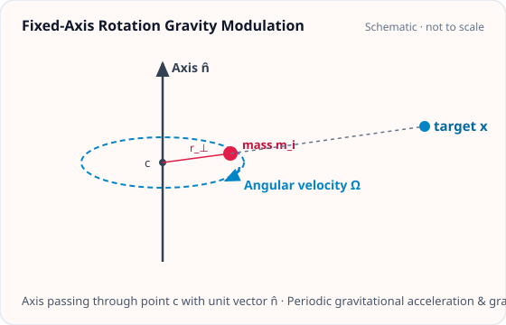
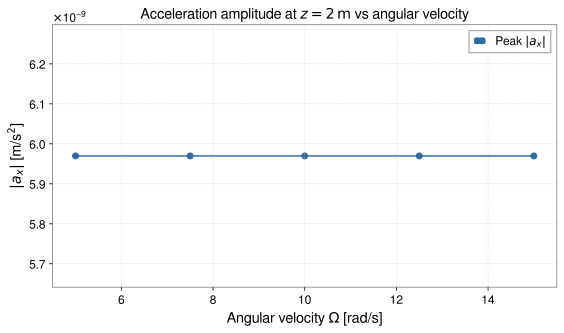
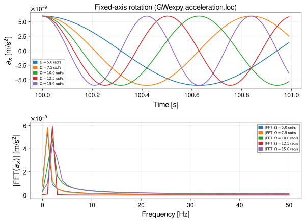

<!-- GENERATED MODEL REFERENCE: regenerate through the catalogue workflow. -->
# Fixed-axis rotation

## Model overview

**Level:** — (definition and assignment pending).

**Physical domain:** rigid motion  
**Geometry:** `point_cloud`

Rotating discrete mass cloud

**Source-declared observable / representation pairs:**

- Φ a Γ — Time series

These pairs are a union over the listed calculation paths. They do not imply every API exposes every combination.

[Back to model catalogue](../guide/model-and-method-catalogue.md)

## Geometry



*Point-mass cloud rotating at constant angular velocity Ω about fixed rotation axis n̂.*

- `plot_shape` supports a limited set of geometry primitives; arbitrary point-cloud trajectories were not confirmed.

## Analytic formulation, sources, and scope

### Equations

For point masses \(m_i\) with reference positions \(\mathbf x_{i,0}\) revolving rigidly at constant angular velocity \(\omega\) around a fixed axis defined by rotation center \(\mathbf x_{\mathrm{orig}}\), unit axis vector \(\hat{\mathbf n}\), initial angle \(\theta_0\), and reference epoch \(t_{\mathrm{epoch}}\):

$$
\mathbf x_i(t) = \mathbf x_{\mathrm{orig}} + \mathbf R\left(\hat{\mathbf n}, \theta_0 + \omega(t - t_{\mathrm{epoch}})\right) (\mathbf x_{i,0} - \mathbf x_{\mathrm{orig}})
$$

where \(\mathbf R(\hat{\mathbf n}, \theta)\) is the Rodrigues rotation matrix about axis \(\hat{\mathbf n}\) by angle \(\theta\).

With separation vector \(\mathbf r_i(t) = \mathbf x - \mathbf x_i(t)\) and distance \(r_i(t) = \|\mathbf r_i(t)\| > 0\), the instantaneous gravitational potential and acceleration are:

$$
\Phi(\mathbf x, t) = -G \sum_{i=1}^N \frac{m_i}{r_i(t)}, \qquad
\mathbf a(\mathbf x, t) = -G \sum_{i=1}^N \frac{m_i \mathbf r_i(t)}{r_i(t)^3}.
$$

The instantaneous gravity-gradient tensor is:

$$
\mathbf\Gamma(\mathbf x, t) = G \sum_{i=1}^N m_i \left[ \frac{3 \mathbf r_i(t) \otimes \mathbf r_i(t)}{r_i(t)^5} - \frac{\mathbf I_3}{r_i(t)^3} \right].
$$

Target points lying on any source mass trajectory (\(r_i(t) = 0\)) are singular and raise a `ValueError`.

### Derivation

The oracle includes formulas, but they are not a derivation proof.

### References

Existing public documentation and original formulation context:

- [Analytic models](../guide/gen1-analytic-models.md)

**Bibliographic inventory:** located.

### Applicability and scope

Point-mass clouds only; collisions are rejected during evaluation.

- Requires `PointMassCloud` and `TimeSampling`. `angle_epoch` is independent of the sampling epoch.
## STEP 1 — Setup

Primary path: `fixed_axis_rotation(...).at(...).run()`

Primary path: `fixed_axis_rotation(...).at(...).run()`

Build inputs consistent with **Detailed reference**:

```python
import numpy as np
import astropy.units as u
from gragra.geometry import Frame
from gragra.gravity_sources import PointMassCloud
from gragra.results import TimeSampling
from gragra.targets import TargetPoints
from gragra.analytic.objects import fixed_axis_rotation

frame = Frame('world')
cloud = PointMassCloud([1000.0], [[1.0, 0.0, 0.0]])
sampling = TimeSampling(epoch=(100, 0), dt=0.01 * u.s, count=100)
model = fixed_axis_rotation(
    cloud, axis=[0.0, 0.0, 1.0], angular_velocity=2.0 * np.pi * u.rad / u.s,
    frame=frame, origin=[0.0, 0.0, 0.0] * u.m, angle0=0.0 * u.rad, angle_epoch=(100, 0),
    sampling=sampling,
)
targets = TargetPoints([[0.0, 0.0, 10.0]] * u.m, ('t1',), frame)
request = model.at(targets)
```

## STEP 2 — Validate / Inspect

STEP 2 items are tagged by information source:

- **`api`**: read from a gragra evaluation object: `validate()` is a **method**; `parameters`, `formulas`, and `references` are **`@property`** objects (not callable).
- **`tutorial-display`**: assembled for this page from documented inputs or catalogue-verified display equations (not a separate gragra registry lookup).
- **`api-output`**: taken from executed result payloads (units, shapes, GWexpy axes).

#### Display equations (`tutorial-display`)

Catalogue-registered analytic formulation (same as **Analytic formulation, sources, and scope** above):

For point masses \(m_i\) with reference positions \(\mathbf x_{i,0}\) revolving rigidly at constant angular velocity \(\omega\) around a fixed axis defined by rotation center \(\mathbf x_{\mathrm{orig}}\), unit axis vector \(\hat{\mathbf n}\), initial angle \(\theta_0\), and reference epoch \(t_{\mathrm{epoch}}\):

$$
\mathbf x_i(t) = \mathbf x_{\mathrm{orig}} + \mathbf R\left(\hat{\mathbf n}, \theta_0 + \omega(t - t_{\mathrm{epoch}})\right) (\mathbf x_{i,0} - \mathbf x_{\mathrm{orig}})
$$

where \(\mathbf R(\hat{\mathbf n}, \theta)\) is the Rodrigues rotation matrix about axis \(\hat{\mathbf n}\) by angle \(\theta\).

With separation vector \(\mathbf r_i(t) = \mathbf x - \mathbf x_i(t)\) and distance \(r_i(t) = \|\mathbf r_i(t)\| > 0\), the instantaneous gravitational potential and acceleration are:

$$
\Phi(\mathbf x, t) = -G \sum_{i=1}^N \frac{m_i}{r_i(t)}, \qquad
\mathbf a(\mathbf x, t) = -G \sum_{i=1}^N \frac{m_i \mathbf r_i(t)}{r_i(t)^3}.
$$

The instantaneous gravity-gradient tensor is:

$$
\mathbf\Gamma(\mathbf x, t) = G \sum_{i=1}^N m_i \left[ \frac{3 \mathbf r_i(t) \otimes \mathbf r_i(t)}{r_i(t)^5} - \frac{\mathbf I_3}{r_i(t)^3} \right].
$$

Target points lying on any source mass trajectory (\(r_i(t) = 0\)) are singular and raise a `ValueError`.

`request.formulas` lists **implementation routing** (`api`), which may differ from these display equations.

Inspect and validate the evaluation request (`api`):

```python
try:
    from IPython.display import display
except ImportError:
    display = print
report = request.validate()
if report is not None:
    print(report)
else:
    print('Configuration valid.')
if hasattr(request, 'parameters'):
    display(request.parameters)
if hasattr(request, 'formulas'):
    display(request.formulas)
if hasattr(request, 'references'):
    display(request.references)
```

## STEP 3 — Calculate

Evaluate the model (`api-output`):

```python
res = request.run()
print('potential:', res.potential.value, res.potential.units)
print('acceleration:', res.acceleration.value, res.acceleration.units)
```


## STEP 4 — Results / Comparison

Five (or fewer) overlayed parameter sets — execute inline (`api-output`):

```python
import matplotlib.pyplot as plt
import numpy as np
import astropy.units as u
from gragra.geometry import Frame
from gragra.gravity_sources import PointMassCloud
from gragra.results import TimeSampling
from gragra.targets import TargetPoints
from gragra.analytic.objects import fixed_axis_rotation

frame = Frame('world')
cloud = PointMassCloud([1000.0], [[1.0, 0.0, 0.0]])
sampling = TimeSampling(epoch=(100, 0), dt=0.01 * u.s, count=100)
omegas = (5.0, 7.5, 10.0, 12.5, 15.0)
traces = []
peak_ax = []
for omega in omegas:
    model = fixed_axis_rotation(
        cloud, axis=[0.0, 0.0, 1.0], angular_velocity=omega * u.rad / u.s,
        frame=frame, origin=[0.0, 0.0, 0.0] * u.m, angle0=0.0 * u.rad,
        angle_epoch=(100, 0), sampling=sampling,
    )
    res = model.at(TargetPoints([[0.0, 0.0, 2.0]] * u.m, ('t1',), frame)).run()
    wave = res.acceleration.loc['t1', 'x']
    traces.append((wave, rf"$\Omega={omega:.1f}$ rad/s"))
    peak_ax.append(float(np.max(np.abs(wave.value))))

fig_gw, (ax_t, ax_f) = plt.subplots(2, 1, figsize=(8.5, 6.2))
for wave, label in traces:
    ax_t.plot(wave, label=label)
    ax_f.plot(abs(wave.fft()), label=f"|FFT| {label}")
ax_t.set_xlabel("Time [s]")
ax_t.set_ylabel(r"$a_x$ [m/s$^2$]")
ax_t.set_title("Fixed-axis rotation (GWexpy acceleration.loc)")
ax_t.legend(fontsize=7)
ax_t.grid(True, linestyle="--", alpha=0.4)
ax_f.set_xlabel("Frequency [Hz]")
ax_f.set_ylabel(r"$|\mathrm{FFT}(a_x)|$ [m/s$^2$]")
ax_f.legend(fontsize=7)
ax_f.grid(True, linestyle="--", alpha=0.4)
fig_gw.tight_layout()

fig_cmp, ax_cmp = plt.subplots(figsize=(8.0, 4.8))
ax_cmp.plot(omegas, peak_ax, "o-", color="#316aa5", label=r"Peak $|a_x|$")
ax_cmp.set_xlabel(r"Angular velocity $\Omega$ [rad/s]")
ax_cmp.set_ylabel(r"$|a_x|$ [m/s$^2$]")
ax_cmp.set_title(r"Acceleration amplitude at $z=2\,\mathrm{m}$ vs angular velocity")
ax_cmp.grid(True, linestyle="--", alpha=0.45)
ax_cmp.legend()
fig_cmp.tight_layout()
plt.show()
```




*Figure generated by executing the STEP 4 comparison code above.*



*Time-domain and frequency-domain overlays generated by executing the STEP 4 code above.*

## Detailed reference and verification

### Parameters and units

#### API parameters

| Function / Path | Parameter | Type / Format | Default | Description |
|---|---|---|---|---|
| `fixed_axis_rotation` | `point_mass` | PointMass | required | Point mass object defining mass m |
| `fixed_axis_rotation` | `radius` | u.Quantity (length) | required | Perpendicular orbital radius r > 0 |
| `fixed_axis_rotation` | `angular_velocity` | u.Quantity (angular speed) | required | Constant rotation angular velocity omega |
| `fixed_axis_rotation` | `axis` | array-like (3,) | required (kw-only) | Rotation axis direction vector |
| `fixed_axis_rotation` | `initial_phase` | u.Quantity (angle) | required (kw-only) | Initial azimuthal phase angle at t = 0 |
| `fixed_axis_rotation` | `frame` | Frame | required (kw-only) | Reference coordinate frame instance |
| `fixed_axis_rotation` | `sampling` | TimeSampling | required (kw-only) | Output time axis discretization |

#### API return values

| Function / Path | Return type | Representation | Quantity & Unit | Shape / Structure | Description |
|---|---|---|---|---|---|
| `fixed_axis_rotation` | _MotionModel | TimeSeries | Φ: m²/s², a: m/s², Γ: s⁻² | EvaluationResult with TimeSeriesMatrix payloads | Point-mass circular trajectory motion model evaluated via .at(targets).run() |

#### Mathematical symbols and notation

| Symbol | Meaning | SI unit | Definition / Relation |
|---|---|---|---|
| \(m\) | Rotating mass | kg | Mass of revolving point body (\(m > 0\)) |
| \(\mathbf x_c\) | Axis center | m | Origin point on rotation axis |
| \(\hat{\mathbf n}\) | Axis unit vector | dimensionless | Unit vector defining orientation of rotation axis |
| \(r\) | Orbital radius | m | Perpendicular radius from axis (\(r > 0\)) |
| \(\omega\) | Angular velocity | rad/s | Constant rotation speed |
| \(\phi_0\) | Initial phase | rad | Azimuthal phase angle at \(t = 0\) |

#### Usage notes

- Axis vector must be nonzero. Target points lying on the circular orbit path raise collision `ValueError`.

### Calculation paths

#### Discrete point-mass cloud rotating about a fixed axis at constant angular velocity

- `gragra.analytic.objects.fixed_axis_rotation`

**Observables after model evaluation:** Φ a Γ — Time series

High-level model factories create evaluation objects; call the documented `.at(...).run()` workflow to evaluate them. Observable functions listed above are direct calls with their own return values.

### Derivation and source notes

- The oracle converts binary64 inputs to exact rational values and computes the rotation and field with 80-digit mpmath precision.

- A non-public design note specifies the exact constant-speed or fixed-axis rotating point-mass field. This is local provenance, not an external bibliography entry.

### Verification

**Evidence classes are distinct:** source declarations, catalogue output-contract probes, existing test code, documentary validation claims, and saved numerical results.

- Representative catalogue output-contract entries: 0.
- Catalogue probe state: Not assessed (no catalogue output probe registered).
- Registered output-contract probes run during catalogue validation check selected API outputs only; they do not measure scientific accuracy.
- Scientific accuracy tests are not part of documentation generation; no accuracy Level is assigned.

**Existing verification inventory:**

An independent oracle-comparison test exists. It was not run for this update.

- A selected case in [`tests/test_rigid_motion_science.py`](https://github.com/tatsuki-washimi/gragra/blob/main/tests/test_rigid_motion_science.py) uses rtol=3e-14. This is test-code evidence only; no result artifact was identified in this review.

### Applicability and limitations

- Requires `PointMassCloud` and `TimeSampling`. `angle_epoch` is independent of the sampling epoch.

**Scope note:** Point-mass clouds only; collisions are rejected during evaluation.

See the public verification and limitations guidance for test-specific conditions and interpretation:

- [Verification matrix](../verification/matrix.md)
- [Verification limitations](../verification/limitations.md)


## Information not yet confirmed

- A dedicated arbitrary point-cloud trajectory illustration and equation renderer.

*Publication scope: narrative summaries and links, not private derivation records, internal test artifacts or inventory JSON.*
