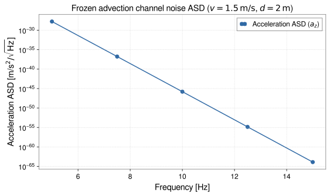

<!-- GENERATED MODEL REFERENCE: regenerate through the catalogue workflow. -->
# Frozen-advection channel water noise

## Model overview

**Level:** 4.

**Physical domain:** water  
**Geometry:** `channel`

Narrow water channel; transfer functions, acceleration/strain ASD

**Source-declared observable / representation pairs:**

- ① Φ a Γ — Phasor
- ② a — Spectral density (ASD)

These pairs are a union over the listed calculation paths. They do not imply every API exposes every combination.

[Back to model catalogue](../guide/model-and-method-catalogue.md)

## Geometry


*Top-down view of open channel of width w with surface fluctuations advected at velocity v and mirror at perpendicular horizontal distance D.*

- Guide gives channel sketch by prose; no reusable channel geometry plotting adapter identified.

## Analytic formulation, sources, and scope

### Equations

An open water channel flows along the \(x\)-axis with mean velocity \(v\) and channel width \(w\), located at perpendicular horizontal standoff distance \(D > 0\) from the observation point. The surface elevation perturbation is modeled as a traveling wave \(\eta(x,t) = \eta_0 e^{-i \Omega (t - x/v)}\) with angular frequency \(\Omega = 2\pi f\).

The dimensionless wavenumber parameter is:

$$
q = \frac{|\Omega| D}{|v|} \qquad (0 < q \le 700; \quad q = 0 \text{ at DC } f=0)
$$

The G-free potential and acceleration transfer functions use modified Bessel functions of the second kind \(K_0(q)\) and \(K_1(q)\):

$$
\begin{aligned}
T_{\Phi,\eta}^{(G\text{-free})} &= -2 \rho_w w K_0(q), \\
T_{a_x,\eta}^{(G\text{-free})} &= 2i \rho_w w \left(\frac{\Omega}{v}\right) K_0(q), \\
T_{a_z,\eta}^{(G\text{-free})} &= -2 \rho_w w \left(\frac{|\Omega|}{|v|}\right) K_1(q).
\end{aligned}
$$

The G-free gravity-gradient transfer function components are:

$$
\begin{aligned}
T_{\Gamma_{xx},\eta}^{(G\text{-free})} &= -2\rho_w w \left(\frac{\Omega}{v}\right)^2 K_0(q), \\
T_{\Gamma_{yy},\eta}^{(G\text{-free})} &= -2\rho_w w \left(\frac{q}{D^2}\right) K_1(q), \\
T_{\Gamma_{zz},\eta}^{(G\text{-free})} &= 2\rho_w w \left[\left(\frac{\Omega}{v}\right)^2 K_0(q) + \left(\frac{q}{D^2}\right) K_1(q)\right], \\
T_{\Gamma_{xz},\eta}^{(G\text{-free})} &= -2i\rho_w w \left(\frac{\Omega|\Omega|}{v|v|}\right) K_1(q).
\end{aligned}
$$

These components strictly satisfy the Laplace vacuum trace condition:

$$
\mathrm{tr}(\mathbf\Gamma) = T_{\Gamma_{xx},\eta} + T_{\Gamma_{yy},\eta} + T_{\Gamma_{zz},\eta} = 0
$$

Physical SI observables are obtained by multiplying by \(G\):

$$
T^{(\mathrm{SI})} = G \, T^{(G\text{-free})}
$$

### Derivation

water oracle contains integral/Bessel reference functions and validation code; not an admitted derivation here.

### References

Existing public documentation and original formulation context:

- [Water NN](../guide/water-newtonian-noise.md)
- [water API](../api/water.md)

**Bibliographic inventory:** partial.

### Applicability and scope

Frozen advection infinite/narrow channel assumptions; f&gt;0 for ASD; geometry and input constraints validated.

- transfer SI layer returns phasor values; ASD uses magnitude and is not a deterministic phasor. channel model's DC limit is separate API; high/low numerical limits are guarded.
## STEP 1 — Setup

Primary path: `water_channel_advection_observables` / `water_channel_advection_asd` (no targets)

Primary path: `water_channel_advection_observables` / `water_channel_advection_asd` (no targets)

Build inputs consistent with **Detailed reference**:

```python
velocity = 1.5
distance = 2.0
width = 0.5
surface_asd = 1e-3
frequency = 5.0
```

## STEP 2 — Validate / Inspect

STEP 2 items are tagged by information source:

- **`api`**: read from a gragra evaluation object: `validate()` is a **method**; `parameters`, `formulas`, and `references` are **`@property`** objects (not callable).
- **`tutorial-display`**: assembled for this page from documented inputs or catalogue-verified display equations (not a separate gragra registry lookup).
- **`api-output`**: taken from executed result payloads (units, shapes, GWexpy axes).

#### Display equations (`tutorial-display`)

Catalogue-registered analytic formulation (same as **Analytic formulation, sources, and scope** above):

An open water channel flows along the \(x\)-axis with mean velocity \(v\) and channel width \(w\), located at perpendicular horizontal standoff distance \(D > 0\) from the observation point. The surface elevation perturbation is modeled as a traveling wave \(\eta(x,t) = \eta_0 e^{-i \Omega (t - x/v)}\) with angular frequency \(\Omega = 2\pi f\).

The dimensionless wavenumber parameter is:

$$
q = \frac{|\Omega| D}{|v|} \qquad (0 < q \le 700; \quad q = 0 \text{ at DC } f=0)
$$

The G-free potential and acceleration transfer functions use modified Bessel functions of the second kind \(K_0(q)\) and \(K_1(q)\):

$$
\begin{aligned}
T_{\Phi,\eta}^{(G\text{-free})} &= -2 \rho_w w K_0(q), \\
T_{a_x,\eta}^{(G\text{-free})} &= 2i \rho_w w \left(\frac{\Omega}{v}\right) K_0(q), \\
T_{a_z,\eta}^{(G\text{-free})} &= -2 \rho_w w \left(\frac{|\Omega|}{|v|}\right) K_1(q).
\end{aligned}
$$

The G-free gravity-gradient transfer function components are:

$$
\begin{aligned}
T_{\Gamma_{xx},\eta}^{(G\text{-free})} &= -2\rho_w w \left(\frac{\Omega}{v}\right)^2 K_0(q), \\
T_{\Gamma_{yy},\eta}^{(G\text{-free})} &= -2\rho_w w \left(\frac{q}{D^2}\right) K_1(q), \\
T_{\Gamma_{zz},\eta}^{(G\text{-free})} &= 2\rho_w w \left[\left(\frac{\Omega}{v}\right)^2 K_0(q) + \left(\frac{q}{D^2}\right) K_1(q)\right], \\
T_{\Gamma_{xz},\eta}^{(G\text{-free})} &= -2i\rho_w w \left(\frac{\Omega|\Omega|}{v|v|}\right) K_1(q).
\end{aligned}
$$

These components strictly satisfy the Laplace vacuum trace condition:

$$
\mathrm{tr}(\mathbf\Gamma) = T_{\Gamma_{xx},\eta} + T_{\Gamma_{yy},\eta} + T_{\Gamma_{zz},\eta} = 0
$$

Physical SI observables are obtained by multiplying by \(G\):

$$
T^{(\mathrm{SI})} = G \, T^{(G\text{-free})}
$$

`request.formulas` lists **implementation routing** (`api`), which may differ from these display equations.

For direct observable evaluation, parameters and display equations are verified above (`tutorial-display`).

```python
try:
    from IPython.display import display
except ImportError:
    display = print
# Direct observable evaluation: parameters verified against catalogue specification
print('Input configuration verified.')
```

## STEP 3 — Calculate

Evaluate the model (`api-output`):

```python
from gragra.observables import water_channel_advection_asd, water_channel_advection_observables

asd = water_channel_advection_asd(
    frequency_hz=frequency, velocity_mps=velocity, distance_m=distance,
    width_m=width, surface_asd_m_per_rt_hz=surface_asd, component='z',
)
print('acceleration ASD (z):', asd)
obs = water_channel_advection_observables(
    frequency_hz=frequency, velocity_mps=velocity, distance_m=distance,
    width_m=width, eta_m=1e-3,
)
print('monochromatic transfer az:', obs.acceleration[0, 2])
```


## STEP 4 — Results / Comparison

The code below evaluates the acceleration ASD at five frequencies for one fixed channel flow and plots a single frequency-dependence curve (`api-output`).

```python
import matplotlib.pyplot as plt
import numpy as np
from gragra.observables import water_channel_advection_asd

freqs = np.array([5.0, 7.5, 10.0, 12.5, 15.0])
asds = water_channel_advection_asd(
    frequency_hz=freqs,
    velocity_mps=1.5,
    distance_m=2.0,
    width_m=0.5,
    surface_asd_m_per_rt_hz=1e-3,
    component='z',
)

fig, ax = plt.subplots(figsize=(8.0, 4.8))
ax.plot(freqs, asds, "o-", color="#316aa5", label=r"Acceleration ASD ($a_z$)")
ax.set_yscale("log")
ax.set_xlabel("Frequency [Hz]")
ax.set_ylabel(r"Acceleration ASD [m/s$^2/\sqrt{\mathrm{Hz}}$]")
ax.set_title(r"Frozen advection channel noise ASD ($v=1.5\,\mathrm{m/s}$, $d=2\,\mathrm{m}$)")
ax.grid(True, linestyle="--", alpha=0.45)
ax.legend()
fig.tight_layout()
plt.show()
```




*Figure generated by executing the STEP 4 comparison code above.*

Saved with `fig.savefig(path, bbox_inches='tight', metadata={'Date': None})` and `svg.hashsalt='gragra'` under Matplotlib 3.11.2. SVG byte reproducibility was verified with Matplotlib 3.11.2 under these save conditions. Other versions may produce different SVG bytes or layouts.

## Detailed reference and verification

### Parameters and units

#### API parameters

| Function / Path | Parameter | Type / Format | Default | Description |
|---|---|---|---|---|
| `water_channel_advection_observables` | `frequency_hz` | float \| array-like | required | Water surface wave frequency in Hz (f > 0) |
| `water_channel_advection_observables` | `velocity_mps` | float | required | Channel stream flow velocity in m/s (v != 0) |
| `water_channel_advection_observables` | `distance_m` | float | required | Perpendicular horizontal distance to channel in meters (D > 0) |
| `water_channel_advection_observables` | `width_m` | float | required | Water channel surface width in meters (w > 0) |
| `water_channel_advection_observables` | `density_kg_m3` | float | 1000.0 | Water mass density in kg/m³ |
| `water_channel_advection_observables` | `eta_m` | complex \| float \| array-like | 1.0 | Water surface elevation phasor amplitude in meters |
| `water_channel_advection_asd` | `surface_asd_m_per_rt_hz` | float \| array-like | required | Water surface displacement ASD in m/sqrt(Hz) |
| `water_channel_advection_asd` | `component` | str | 'x' | Acceleration output component ('x' or 'z') |

#### API return values

| Function / Path | Return type | Representation | Quantity & Unit | Shape / Structure | Description |
|---|---|---|---|---|---|
| `water_channel_advection_observables` | GravityObservables | Phasor | Φ: m²/s², a: m/s², Γ: s⁻² | potential: (1,), acceleration: (1, 3), gradient: (1, 3, 3) | Direct SI gravity observables for advected sinusoidal water channel wave |
| `water_channel_advection_asd` | ndarray | ASD | a: (m/s²)/√Hz | \((N_{\mathrm{freq}},)\) float64 array | Acceleration amplitude spectral density at sensor distance D across specified frequencies |

#### Mathematical symbols and notation

| Symbol | Meaning | SI unit | Definition / Relation |
|---|---|---|---|
| \(f\) | Wave frequency | Hz | Water surface fluctuation frequency |
| \(\Omega\) | Angular frequency | rad/s | \(\Omega = 2\pi f\) |
| \(v\) | Flow velocity | m/s | Water stream advection velocity (\(v \ne 0\)) |
| \(D\) | Perpendicular distance | m | Horizontal distance from channel to detector (\(D > 0\)) |
| \(w\) | Channel width | m | Width of water surface (\(w > 0\)) |
| \(\rho_w\) | Water density | kg/m³ | Fluid mass density (default 1000.0 kg/m³) |
| \(\eta\) | Surface displacement | m | Surface wave elevation phasor amplitude |
| \(S_\eta^{1/2}(f)\) | Surface displacement ASD | m/√Hz | One-sided surface elevation ASD |
| \(q\) | Dimensionless wavenumber | dimensionless | \(q = \lvert\Omega\rvert D / \lvert v\rvert\) |
| \(K_0(q), K_1(q)\) | Modified Bessel functions | dimensionless | Second kind modified Bessel functions |

#### Usage notes

- Evaluated for \(0 < q \le 700\). Direct G-free transfer functions convert to physical SI units by multiplying by \(G\).

### Calculation paths

#### G-free complex transfer and SI phasor observables

- `gragra.observables.water_channel_advection_observables`

**Path-level source-declared output union:** Φ a Γ — Phasor

#### acceleration ASD

- `gragra.observables.water_channel_advection_asd`

**Path-level source-declared output union:** a — Spectral density (ASD)

### Derivation and source notes

- [`tests/oracles/water_analytic_reference.py`](https://github.com/tatsuki-washimi/gragra/blob/main/tests/oracles/water_analytic_reference.py) documents line integral and K0/K1 forms. Test/reference code is not a proof nor reproduced now.

- Atsushi Nishizawa (2021-03-31), 'Water Newtonian noise for KAGRA' (JGW-T1706440-v2).
- Atsushi Nishizawa (2021-09-03), 'Edge contribution of a water channel to a Newtonian noise' (JGW-T2214308-v1).
- Kentaro Somiya et al. (2019), TAUP2019 (JGW-T1910792); Somiya & Nishizawa (2017), KAGRA f2f.
- Guide marks historical Chen 2016 notes / Somiya TAUP 2019 slide formulas `ORIGINAL_SOURCE_UNVERIFIED`; it does not claim identity with unverified external notebooks. The narrow-channel uncorrelated-cell derivation is explicitly `INDEPENDENT_DERIVATION`.

### Verification

**Evidence classes are distinct:** source declarations, catalogue output-contract probes, existing test code, documentary validation claims, and saved numerical results.

- Representative catalogue output-contract entries: 4.
- Catalogue probe state: recorded (a representative API output contract, not an accuracy test).
- Registered output-contract probes run during catalogue validation check selected API outputs only; they do not measure scientific accuracy.
- Scientific accuracy tests are not part of documentation generation; Level 4 is assigned based on archived scientific validation records (established closed form / verified reference comparisons in the development repository) within the stated scope conditions.

**Existing verification inventory:**

Analytic-reference and finite surface reference code exists; tests were not run in this editorial review.

- [`tests/oracles/water_analytic_reference.py`](https://github.com/tatsuki-washimi/gragra/blob/main/tests/oracles/water_analytic_reference.py) includes spatial quadrature vs Bessel checks, tensor trace and limits; [`tests/test_analytic_water.py`](https://github.com/tatsuki-washimi/gragra/blob/main/tests/test_analytic_water.py) includes identities and stress limits. [`tests/oracles/water_surface_reference.py`](https://github.com/tatsuki-washimi/gragra/blob/main/tests/oracles/water_surface_reference.py) reports 1e-10 then 1e-12 adaptive quadrature tolerances; code/result distinction: no committed executed science result found in this pass.

#### Registered representative output probes

| API | Observable | Representation | Probe |
|---|---|---|---|
| `gragra.observables.water_channel_advection_observables` | Φ | Phasor | `water_transfer_si` |
| `gragra.observables.water_channel_advection_observables` | a | Phasor | `water_transfer_si` |
| `gragra.observables.water_channel_advection_observables` | Γ | Phasor | `water_transfer_si` |
| `gragra.observables.water_channel_advection_asd` | a | Spectral density (ASD) | `water_asd_si` |

### Applicability and limitations

- transfer SI layer returns phasor values; ASD uses magnitude and is not a deterministic phasor. channel model's DC limit is separate API; high/low numerical limits are guarded.

**Scope note:** Frozen advection infinite/narrow channel assumptions; f&gt;0 for ASD; geometry and input constraints validated.

See the public verification and limitations guidance for test-specific conditions and interpretation:

- [Verification matrix](../verification/matrix.md)
- [Verification limitations](../verification/limitations.md)


## Information not yet confirmed

- verified primary source and saved result artifact; channel illustration.

*Publication scope: narrative summaries and links, not private derivation records, internal test artifacts or inventory JSON.*
