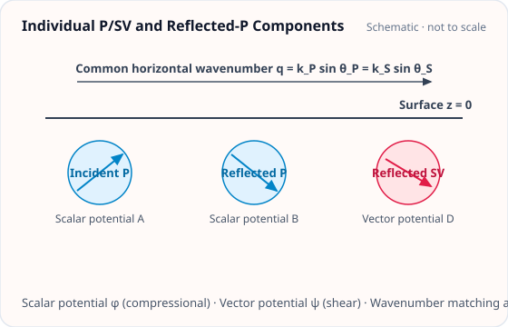

<!-- GENERATED MODEL REFERENCE: regenerate through the catalogue workflow. -->
# Individual P/SV and reflected-P benchmarks

## Model overview

**Level:** — (definition and assignment pending).

**Physical domain:** seismic elastic  
**Geometry:** halfspace

Single incident mode versus a traction-free reflected composite

**Source-declared observable / representation pairs:**

- Φ a Γ — Phasor

These pairs are a union over the listed calculation paths. They do not imply every API exposes every combination.

[Back to model catalogue](../guide/model-and-method-catalogue.md)

## Geometry and equations

*Decomposition into incident P, reflected P, and mode-converted SV wave potentials with horizontal wavenumber matching.*

- Bare wave excludes free-surface composite and rejects z=0; reflected composite satisfies traction-free boundary and is ground-only z&gt;0; literal Eq90 helper distinct from production coefficient.

### Equations

**Analytical formulation and field equations:**

- Single upward plane P-wave (Harms 2019 Eqs. 86/87): with prefactor \(C_1 = -\frac{\rho \xi_0^P}{i k_P}\), G-free potential is \(\Phi^{(G\text{-free})} = 2\pi C_1 e^{-k_\rho z} e^{i \mathbf k_\rho \cdot \mathbf x_\perp}\) above ground (\(z &gt; 0\)), and \(\Phi^{(G\text{-free})} = 2\pi C_1 [2 e^{i k_z z} - e^{k_\rho z}] e^{i \mathbf k_\rho \cdot \mathbf x_\perp}\) underground (\(z &lt; 0\)).
- Single upward plane SV-wave (Harms 2019 Eq. 88): with prefactor \(C_2 = \frac{\rho \xi_0^{SV}}{k_S}\), G-free potential is \(\Phi^{(G\text{-free})} = 2\pi C_2 e^{-k_\rho |z|} e^{i \mathbf k_\rho \cdot \mathbf x_\perp}\), valid on both sides of the surface.
- Reflected-P composite above ground (\(z &gt; 0\)): incident P + reflected P + converted SV satisfying traction-free surface boundary condition. Potential is \(\Phi^{(G\text{-free})} = 2\pi C_1 \delta(\theta, k_\rho) e^{-k_\rho z} e^{i \mathbf k_\rho \cdot \mathbf x_\perp}\) with dimensionless wavenumber ratios \(r_\rho = k_\rho/k_S\), \(r_{zP} = k_{zP}/k_S\), \(r_{zS} = k_{zS}/k_S\) and transfer coefficient \(\delta(\theta, k_\rho) = \frac{8 r_\rho^2 r_{zP} r_{zS} + 4i r_\rho r_{zP} (1 - 2r_\rho^2)}{(1 - 2r_\rho^2)^2 + 4 r_\rho^2 r_{zP} r_{zS}}\).
- Implementation detail (A-U08): Production API uses physical \(+i\) converted-SV coefficient from the solved surface displacement field. The literal Harms (2019) Eq. (90) expression with \(-i\) is retained in private test helper _harms2019_reflected_p_delta for verification.

## Parameters and calculation paths

### Parameters and units

| Symbol | Parameter | Meaning | SI unit |
|---|---|---|---|
| \(\rho\) | `density_kg_m3` | Medium mass density | kg/m³ |
| \(v_P\) | `vp_m_s` | Elastic P-wave speed | m/s |
| \(v_S\) | `vs_m_s` | Elastic S-wave speed | m/s |
| \(f\) | `frequency_hz` | Wave frequency | Hz |
| \(\xi\) | `displacement_m` | Wave displacement amplitude | m |
| \(\theta\) | `incidence_angle_rad` | Incidence angle from surface normal | rad |
| \(\phi\) | `azimuth_rad` | Azimuth angle | rad |
| \(\mathbf x\) | `targets_m` | Evaluation targets in halfspace (z > 0) | m |

**Additional notes on parameters and models:**

- targets_m: array-like (M, 3), evaluation points in meters (z-up coordinate system; \(z \le 0\) rejected for the above-ground reflected composite).
- density_kg_m3: float, background mass density in \(\mathrm{kg/m^3}\); v_p_m_s, v_s_m_s: float, P- and S-wave speeds in m/s (\(v_P &gt; \sqrt{4/3}v_S &gt; 0\)).
- frequency_hz: float or array-like, positive frequency in Hz; displacement_m: float, incident displacement amplitude in meters.
- incidence_angle_rad: float, angle \(0 \le \theta &lt; \pi/2\) from normal; azimuth_rad: float, azimuth angle; phase_origin_m: array-like (3,), phase origin in meters.

### Calculation paths

#### Single upward incident P or SV

- `gragra.observables.halfspace_single_bodywave_observables`

**Path-level source-declared output union:** Φ a Γ — Phasor

#### Incident P + reflected P + converted SV

- `gragra.observables.halfspace_reflected_p_above_observables`

**Path-level source-declared output union:** Φ a Γ — Phasor

## Derivation and sources

### Derivation

Local design and validation records contain a boundary-value re-derivation for the reflected-P coefficient and independent Green reconstruction; this inventory did not execute or re-prove them.

- Non-public design and validation notes describe a Cartesian displacement/stress derivation and direct Poisson boundary-value checks; their contents are not reproduced here.

### References

Existing public documentation and original formulation context:

- [Analytic benchmarks](../guide/analytic-benchmarks.md)

**Bibliographic inventory:** partial.

- Harms 2019 DOI 10.1007/s41114-019-0022-2, Sec.3.4.1 pp.42-43 Eq.86-90.
- [DOI 10.1007/s41114-019-0022-2](https://doi.org/10.1007/s41114-019-0022-2)

## Verification and applicability

### Verification

**Evidence classes are distinct:** source declarations, catalogue output-contract probes, existing test code, documentary validation claims, and saved numerical results.

- Representative catalogue output-contract entries: 0.
- Catalogue probe state: Not assessed (no catalogue output probe registered).
- Registered output-contract probes run during catalogue validation check selected API outputs only; they do not measure scientific accuracy.
- Scientific accuracy tests are not part of documentation generation; no accuracy Level is assigned.

**Existing verification inventory:**

Verification method, tolerances, and artifact status recorded; tests were not run in this task.

- [`tests/test_bodywave_literature_oracle.py`](https://github.com/tatsuki-washimi/gragra/blob/main/tests/test_bodywave_literature_oracle.py) independently checks formulas and boundary-value solve; representative rtol 1e-10 Phi/a, 1e-9 Gamma. Test code only, no saved results found.

### Applicability and limitations

- Both paths reject z==0. Single-mode API allows mixed ground/underground targets; reflected-P composite is ground-only z&gt;0.
- Incidence angle is from surface normal and exact grazing is rejected; reflected path only accepts incident P.

**Scope note:** Applicability limits recorded.

See the public verification and limitations guidance for test-specific conditions and interpretation:

- [Verification matrix](../verification/matrix.md)
- [Verification limitations](../verification/limitations.md)

## Information not yet confirmed

- Catalogue output_contracts are empty; this is a missing representative probe, not evidence of absent science.
- No additional committed plot asset identified in these assigned API sources.

*Publication scope: narrative summaries and links, not private derivation records, internal test artifacts or inventory JSON.*
