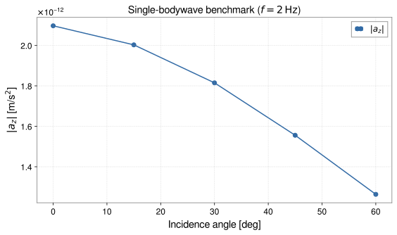

<!-- GENERATED MODEL REFERENCE: regenerate through the catalogue workflow. -->
# Individual P/SV and reflected-P benchmarks

## Model overview

**Level:** — (definition and assignment pending).

**Physical domain:** seismic elastic  
**Geometry:** `halfspace`

Single incident mode versus a traction-free reflected composite

**Source-declared observable / representation pairs:**

- Φ a Γ — Phasor

These pairs are a union over the listed calculation paths. They do not imply every API exposes every combination.

[Back to model catalogue](../guide/model-and-method-catalogue.md)

## Geometry


*Decomposition into incident P, reflected P, and mode-converted SV wave potentials with horizontal wavenumber matching.*

- Bare wave excludes free-surface composite and rejects z=0; reflected composite satisfies traction-free boundary and is ground-only z&gt;0; literal Eq90 helper distinct from production coefficient.

## Analytic formulation, sources, and scope

### Equations

Benchmarks for isolated and reflected plane body waves in an elastic halfspace (\(z \le 0\)) reflecting at a planar traction-free surface (\(z = 0\)):

**1. Single upward plane P-wave** (Harms 2019 Eqs. 86–87, with prefactor \(C_1 = -\frac{\rho \xi_0^P}{i k_P}\)):

$$
\Phi^{(G\text{-free})}(\mathbf x) =
\begin{cases}
2\pi C_1 e^{-k_\rho z} e^{i \mathbf k_\rho \cdot \mathbf x_\perp}, & z > 0, \\
2\pi C_1 \left( 2 e^{i k_z z} - e^{k_\rho z} \right) e^{i \mathbf k_\rho \cdot \mathbf x_\perp}, & z \le 0.
\end{cases}
$$

**2. Single upward plane SV-wave** (Harms 2019 Eq. 88, with prefactor \(C_2 = \frac{\rho \xi_0^{SV}}{k_S}\)):

$$
\Phi^{(G\text{-free})}(\mathbf x) = 2\pi C_2 e^{-k_\rho |z|} e^{i \mathbf k_\rho \cdot \mathbf x_\perp} \qquad (\text{all } z).
$$

**3. Reflected-P composite wave** (incident P + reflected P + converted SV satisfying traction-free conditions):

Above ground (\(z > 0\)), the composite potential is:

$$
\Phi^{(G\text{-free})}(\mathbf x) = 2\pi C_1 \delta(\theta, k_\rho) e^{-k_\rho z} e^{i \mathbf k_\rho \cdot \mathbf x_\perp}
$$

with dimensionless wavenumber ratios \(r_\rho = k_\rho / k_S\), \(r_{zP} = k_{zP} / k_S\), \(r_{zS} = k_{zS} / k_S\), and composite transfer coefficient:

$$
\delta(\theta, k_\rho) = \frac{8 r_\rho^2 r_{zP} r_{zS} + 4i r_\rho r_{zP} (1 - 2r_\rho^2)}{(1 - 2r_\rho^2)^2 + 4 r_\rho^2 r_{zP} r_{zS}}.
$$

### Derivation

Local design and validation records contain a boundary-value re-derivation for the reflected-P coefficient and independent Green reconstruction; this inventory did not execute or re-prove them.

### References

Existing public documentation and original formulation context:

- [Analytic benchmarks](../guide/analytic-benchmarks.md)

**Bibliographic inventory:** partial.

### Applicability and scope

Applicability limits recorded.

- Both paths reject z==0. Single-mode API allows mixed ground/underground targets; reflected-P composite is ground-only z&gt;0.
- Incidence angle is from surface normal and exact grazing is rejected; reflected path only accepts incident P.
## STEP 1 — Setup

Primary path: `halfspace_single_bodywave_observables` (benchmark; keep low-level)

Primary path: `halfspace_single_bodywave_observables` (benchmark; keep low-level)

Build inputs consistent with **Detailed reference**:

```python
import numpy as np

targets = [[0.0, 0.0, -50.0]]
wave_type = 'P'
density = 2500.0
vp = 4000.0
vs = 2000.0
frequency = 2.0
incidence_angle = np.pi / 6.0
azimuth = 0.0
displacement = 1e-6
```

## STEP 2 — Validate / Inspect

STEP 2 items are tagged by information source:

- **`api`**: read from a gragra evaluation object: `validate()` is a **method**; `parameters`, `formulas`, and `references` are **`@property`** objects (not callable).
- **`tutorial-display`**: assembled for this page from documented inputs or catalogue-verified display equations (not a separate gragra registry lookup).
- **`api-output`**: taken from executed result payloads (units, shapes, GWexpy axes).

#### Display equations (`tutorial-display`)

Catalogue-registered analytic formulation (same as **Analytic formulation, sources, and scope** above):

Benchmarks for isolated and reflected plane body waves in an elastic halfspace (\(z \le 0\)) reflecting at a planar traction-free surface (\(z = 0\)):

**1. Single upward plane P-wave** (Harms 2019 Eqs. 86–87, with prefactor \(C_1 = -\frac{\rho \xi_0^P}{i k_P}\)):

$$
\Phi^{(G\text{-free})}(\mathbf x) =
\begin{cases}
2\pi C_1 e^{-k_\rho z} e^{i \mathbf k_\rho \cdot \mathbf x_\perp}, & z > 0, \\
2\pi C_1 \left( 2 e^{i k_z z} - e^{k_\rho z} \right) e^{i \mathbf k_\rho \cdot \mathbf x_\perp}, & z \le 0.
\end{cases}
$$

**2. Single upward plane SV-wave** (Harms 2019 Eq. 88, with prefactor \(C_2 = \frac{\rho \xi_0^{SV}}{k_S}\)):

$$
\Phi^{(G\text{-free})}(\mathbf x) = 2\pi C_2 e^{-k_\rho |z|} e^{i \mathbf k_\rho \cdot \mathbf x_\perp} \qquad (\text{all } z).
$$

**3. Reflected-P composite wave** (incident P + reflected P + converted SV satisfying traction-free conditions):

Above ground (\(z > 0\)), the composite potential is:

$$
\Phi^{(G\text{-free})}(\mathbf x) = 2\pi C_1 \delta(\theta, k_\rho) e^{-k_\rho z} e^{i \mathbf k_\rho \cdot \mathbf x_\perp}
$$

with dimensionless wavenumber ratios \(r_\rho = k_\rho / k_S\), \(r_{zP} = k_{zP} / k_S\), \(r_{zS} = k_{zS} / k_S\), and composite transfer coefficient:

$$
\delta(\theta, k_\rho) = \frac{8 r_\rho^2 r_{zP} r_{zS} + 4i r_\rho r_{zP} (1 - 2r_\rho^2)}{(1 - 2r_\rho^2)^2 + 4 r_\rho^2 r_{zP} r_{zS}}.
$$

`request.formulas` lists **implementation routing** (`api`), which may differ from these display equations.

For direct observable evaluation, parameters and display equations are verified above (`tutorial-display`).

```python
try:
    from IPython.display import display
except ImportError:
    display = print
# Direct observable evaluation: parameters verified against catalogue specification
print('Input configuration verified.')
```

## STEP 3 — Calculate

Evaluate the model (`api-output`):

```python
from gragra.observables import halfspace_single_bodywave_observables

res = halfspace_single_bodywave_observables(
    targets_m=targets, wave_type=wave_type, density_kg_m3=density,
    v_p_m_s=vp, v_s_m_s=vs, frequency_hz=frequency,
    incidence_angle_rad=incidence_angle, azimuth_rad=azimuth,
    displacement_m=displacement,
)
print('potential:', res.potential)
print('acceleration:', res.acceleration)
print('gradient:', res.gradient)
```


## STEP 4 — Results / Comparison

Five (or fewer) overlayed parameter sets — execute inline (`api-output`):

```python
import matplotlib.pyplot as plt
import numpy as np
from gragra.observables import halfspace_single_bodywave_observables

angles = np.array([0.0, 15.0, 30.0, 45.0, 60.0])
mags = [
    float(np.abs(halfspace_single_bodywave_observables(
        targets_m=[[0.0, 0.0, -50.0]],
        wave_type='P',
        density_kg_m3=2500.0,
        v_p_m_s=4000.0,
        v_s_m_s=2000.0,
        frequency_hz=2.0,
        incidence_angle_rad=np.deg2rad(deg),
        azimuth_rad=0.0,
        displacement_m=1e-6,
    ).acceleration[0, 2]))
    for deg in angles
]

fig, ax = plt.subplots(figsize=(8.0, 4.8))
ax.plot(angles, mags, "o-", color="#316aa5", label=r"$|a_z|$")
ax.set_xlabel(r"Incidence angle [deg]")
ax.set_ylabel(r"$|a_z|$ [m/s$^2$]")
ax.set_title(r"Single-bodywave benchmark ($f=2\,\mathrm{Hz}$)")
ax.grid(True, linestyle="--", alpha=0.45)
ax.legend()
fig.tight_layout()
plt.show()
```




*Figure generated by executing the STEP 4 comparison code above.*

## Detailed reference and verification

### Parameters and units

#### API parameters

| Function / Path | Parameter | Type / Format | Default | Description |
|---|---|---|---|---|
| `halfspace_single_bodywave_observables` | `targets_m` | array-like (M, 3) | required | Target positions in elastic halfspace (meters) |
| `halfspace_single_bodywave_observables` | `wave_type` | Literal['P', 'SV'] | required (kw-only) | Wave mode to evaluate ('P' or 'SV') |
| `halfspace_single_bodywave_observables` | `density_kg_m3` | float | required (kw-only) | Medium mass density in kg/m³ |
| `halfspace_single_bodywave_observables` | `v_p_m_s` | float | required (kw-only) | P-wave speed in m/s |
| `halfspace_single_bodywave_observables` | `v_s_m_s` | float | required (kw-only) | S-wave speed in m/s |
| `halfspace_single_bodywave_observables` | `frequency_hz` | float \| array-like | required (kw-only) | Wave frequency in Hz |
| `halfspace_single_bodywave_observables` | `incidence_angle_rad` | float | required (kw-only) | Incidence angle in radians |
| `halfspace_single_bodywave_observables` | `displacement_m` | float \| complex \| array-like | required (kw-only) | Wave displacement amplitude in meters |
| `halfspace_reflected_p_above_observables` | `incident_displacement_m` | float \| complex \| array-like | required (kw-only) | Incident P-wave displacement amplitude in meters |

#### API return values

| Function / Path | Return type | Representation | Quantity & Unit | Shape / Structure | Description |
|---|---|---|---|---|---|
| `halfspace_single_bodywave_observables` | GravityObservables | Phasor | Φ: m²/s², a: m/s², Γ: s⁻² | potential: (M,), acceleration: (M, 3), gradient: (M, 3, 3) | Complex SI observables of a single upward-propagating plane P or SV wave |
| `halfspace_reflected_p_above_observables` | GravityObservables | Phasor | Φ: m²/s², a: m/s², Γ: s⁻² | potential: (M,), acceleration: (M, 3), gradient: (M, 3, 3) | Complex SI observables above ground for reflected-P composite (incident P + reflected P + converted SV) |

#### Mathematical symbols and notation

| Symbol | Meaning | SI unit | Definition / Relation |
|---|---|---|---|
| \(\rho\) | Medium density | kg/m³ | Elastic background mass density |
| \(v_P, v_S\) | Elastic wave speeds | m/s | Compressional and shear wave speeds |
| \(f\) | Wave frequency | Hz | Linear frequency |
| \(\xi\) | Displacement phasor | m | Wave component phasor amplitude |
| \(\theta\) | Incidence angle | rad | Angle from downward vertical |
| \(\phi\) | Azimuth angle | rad | Horizontal propagation direction |

#### Usage notes

- Benchmark APIs isolate individual wave contributions (e.g. single upward incident P or SV, or incident P plus reflected P and converted SV) for analytical validation.

### Calculation paths

#### Single upward incident P or SV

- `gragra.observables.halfspace_single_bodywave_observables`

**Path-level source-declared output union:** Φ a Γ — Phasor

#### Incident P + reflected P + converted SV

- `gragra.observables.halfspace_reflected_p_above_observables`

**Path-level source-declared output union:** Φ a Γ — Phasor

### Derivation and source notes

- Inventory fact: Model implementations provide benchmark fields for individual P, SV, and reflected P waves.
- Literature assertion: Field expressions correspond to Harms (2019) Eqs. 86–90 and Aki & Richards (2002) Section 5.2.
- Proof assertion: Cartesian displacement/stress derivation and direct Poisson boundary-value checks are verified in test oracles.

- Harms 2019 DOI 10.1007/s41114-019-0022-2, Sec.3.4.1 pp.42-43 Eq.86-90.
- [DOI 10.1007/s41114-019-0022-2](https://doi.org/10.1007/s41114-019-0022-2)

### Verification

**Evidence classes are distinct:** source declarations, catalogue output-contract probes, existing test code, documentary validation claims, and saved numerical results.

- Representative catalogue output-contract entries: 0.
- Catalogue probe state: Not assessed (no catalogue output probe registered).
- Registered output-contract probes run during catalogue validation check selected API outputs only; they do not measure scientific accuracy.
- Scientific accuracy tests are not part of documentation generation; no accuracy Level is assigned.

**Existing verification inventory:**

Verification method, tolerances, and artifact status recorded; tests were not run in this task.

- [`tests/test_bodywave_literature_oracle.py`](https://github.com/tatsuki-washimi/gragra/blob/main/tests/test_bodywave_literature_oracle.py) independently checks formulas and boundary-value solve; representative rtol 1e-10 Phi/a, 1e-9 Gamma. Test code only, no saved results found.

### Applicability and limitations

- Both paths reject z==0. Single-mode API allows mixed ground/underground targets; reflected-P composite is ground-only z&gt;0.
- Incidence angle is from surface normal and exact grazing is rejected; reflected path only accepts incident P.

**Scope note:** Applicability limits recorded.

See the public verification and limitations guidance for test-specific conditions and interpretation:

- [Verification matrix](../verification/matrix.md)
- [Verification limitations](../verification/limitations.md)


## Information not yet confirmed

- Catalogue `output_contracts` are empty; this is a missing representative probe, not evidence of absent science.
- No additional committed plot asset identified in these assigned API sources.

*Publication scope: narrative summaries and links, not private derivation records, internal test artifacts or inventory JSON.*
