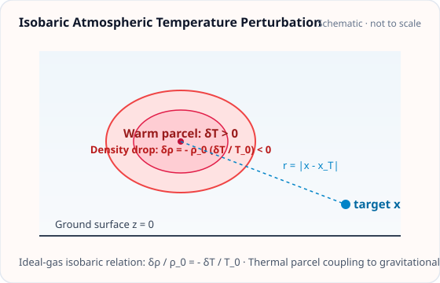
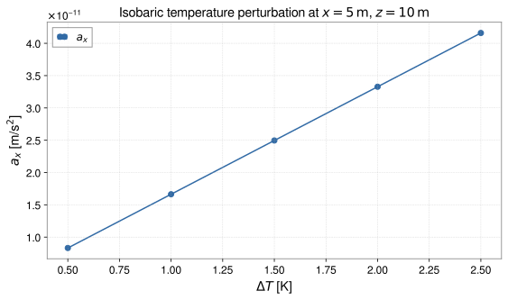

<!-- GENERATED MODEL REFERENCE: regenerate through the catalogue workflow. -->
# Isobaric temperature perturbation

## Model overview

**Level:** — (definition and assignment pending).

**Physical domain:** atmospheric temperature  
**Geometry:** `sphere`, `cuboid`, `cylinder`

Fourier, Gaussian and bounded temperature anomalies; density-to-gravity coupling

**Source-declared observable / representation pairs:**

- ① Φ a Γ — Static
- ② Φ a Γ — Phasor

These pairs are a union over the listed calculation paths. They do not imply every API exposes every combination.

[Back to model catalogue](../guide/model-and-method-catalogue.md)

## Geometry



*Thermal parcel with temperature fluctuation \(\delta T\) inducing isobaric density fluctuation \(\delta\rho/\rho_0 = -\delta T / T_0\).*

- The API supports these profile objects; geometry dimensions are profile inputs. No dedicated temperature anomaly map asset was located.

## Analytic formulation, sources, and scope

### Equations

Under isobaric thermodynamic conditions, small temperature variations \(\delta T\) couple linearly to mass density perturbations:

$$
\delta\rho(\mathbf x) = -\rho_0 \frac{\delta T(\mathbf x)}{T_0}
$$

where \(\rho_0 > 0\) is ambient background density and \(T_0 > 0\) is background temperature in Kelvin.

**1. Harmonic Fourier temperature mode**:

For temperature perturbation \(\delta T(\mathbf x) = \Delta T \cos(\mathbf k \cdot (\mathbf x - \mathbf x_0))\) with central density amplitude \(\rho_c = -\rho_0 \Delta T / T_0\), the G-free gravitational potential is:

$$
\Phi^{(G\text{-free})}(\mathbf x) = -\frac{4\pi \rho_c}{k^2} e^{i \mathbf k \cdot (\mathbf x - \mathbf x_0)} \qquad (k = \|\mathbf k\| > 0)
$$

with gravitational acceleration vector:

$$
\mathbf a^{(G\text{-free})}(\mathbf x) = -i \mathbf k \Phi^{(G\text{-free})}(\mathbf x).
$$

**2. Gaussian temperature plume**:

For Gaussian temperature distribution \(\delta T(\mathbf x) = \Delta T e^{-\|\mathbf x - \mathbf c\|^2 / (2\sigma^2)}\):

At the plume center (\(\mathbf x = \mathbf c\)):

$$
\Phi^{(G\text{-free})}(\mathbf c) = -4\pi \rho_c \sigma^2, \qquad
\mathbf a(\mathbf c) = \mathbf 0, \qquad
\mathbf\Gamma^{(G\text{-free})}(\mathbf c) = -\frac{4\pi \rho_c}{3} \mathbf I_3.
$$

In the far field (\(\|\mathbf x - \mathbf c\| \gg \sigma\)), the gravitational field approaches a point mass with effective monopole mass:

$$
M_{\mathrm{eff}} = (2\pi)^{3/2} \rho_c \sigma^3.
$$

### Derivation

equation prose plus test oracle/derivation scripts; local text is not proof of correctness.

### References

Existing public documentation and original formulation context:

- [Analytic models](../guide/gen1-analytic-models.md)
- [fields API](../api/physics.md)

**Bibliographic inventory:** located.

### Applicability and scope

linearized isobaric model; bounded geometry not sealed heating; Fourier wavevector nonzero and zero mode excluded.

- Gaussian all-space support; finite geometry material boundary rejected for potential/acceleration/gradient; phasors are peak coefficients with no 1/2.
## STEP 1 — Setup

Primary path: `isobaric_temperature(...).at(...).run()`

Primary path: `isobaric_temperature(...).at(...).run()`

Build inputs consistent with **Detailed reference**:

```python
import numpy as np
import astropy.units as u
from gragra.geometry import Frame
from gragra.targets import TargetPoints
from gragra.analytic.atmospheric import isobaric_temperature
from gragra.fields import TemperatureFourierMode

frame = Frame('world')
profile = TemperatureFourierMode(
    wavevector=np.array([0.1, 0.0, 0.0]) / u.m,
    phase_origin=np.zeros(3) * u.m,
    frame=frame,
)
model = isobaric_temperature(
    profile, 2.0 * u.K, rho0=1.2 * u.kg / u.m**3, T0=290.0 * u.K,
)
targets = TargetPoints([[5.0, 0.0, 10.0]] * u.m, ('t1',), frame)
request = model.at(targets)
```

## STEP 2 — Validate / Inspect

STEP 2 items are tagged by information source:

- **`api`**: read from a gragra evaluation object: `validate()` is a **method**; `parameters`, `formulas`, and `references` are **`@property`** objects (not callable).
- **`tutorial-display`**: assembled for this page from documented inputs or catalogue-verified display equations (not a separate gragra registry lookup).
- **`api-output`**: taken from executed result payloads (units, shapes, GWexpy axes).

#### Display equations (`tutorial-display`)

Catalogue-registered analytic formulation (same as **Analytic formulation, sources, and scope** above):

Under isobaric thermodynamic conditions, small temperature variations \(\delta T\) couple linearly to mass density perturbations:

$$
\delta\rho(\mathbf x) = -\rho_0 \frac{\delta T(\mathbf x)}{T_0}
$$

where \(\rho_0 > 0\) is ambient background density and \(T_0 > 0\) is background temperature in Kelvin.

**1. Harmonic Fourier temperature mode**:

For temperature perturbation \(\delta T(\mathbf x) = \Delta T \cos(\mathbf k \cdot (\mathbf x - \mathbf x_0))\) with central density amplitude \(\rho_c = -\rho_0 \Delta T / T_0\), the G-free gravitational potential is:

$$
\Phi^{(G\text{-free})}(\mathbf x) = -\frac{4\pi \rho_c}{k^2} e^{i \mathbf k \cdot (\mathbf x - \mathbf x_0)} \qquad (k = \|\mathbf k\| > 0)
$$

with gravitational acceleration vector:

$$
\mathbf a^{(G\text{-free})}(\mathbf x) = -i \mathbf k \Phi^{(G\text{-free})}(\mathbf x).
$$

**2. Gaussian temperature plume**:

For Gaussian temperature distribution \(\delta T(\mathbf x) = \Delta T e^{-\|\mathbf x - \mathbf c\|^2 / (2\sigma^2)}\):

At the plume center (\(\mathbf x = \mathbf c\)):

$$
\Phi^{(G\text{-free})}(\mathbf c) = -4\pi \rho_c \sigma^2, \qquad
\mathbf a(\mathbf c) = \mathbf 0, \qquad
\mathbf\Gamma^{(G\text{-free})}(\mathbf c) = -\frac{4\pi \rho_c}{3} \mathbf I_3.
$$

In the far field (\(\|\mathbf x - \mathbf c\| \gg \sigma\)), the gravitational field approaches a point mass with effective monopole mass:

$$
M_{\mathrm{eff}} = (2\pi)^{3/2} \rho_c \sigma^3.
$$

`request.formulas` lists **implementation routing** (`api`), which may differ from these display equations.

Inspect and validate the evaluation request (`api`):

```python
try:
    from IPython.display import display
except ImportError:
    display = print
report = request.validate()
if report is not None:
    print(report)
else:
    print('Configuration valid.')
if hasattr(request, 'parameters'):
    display(request.parameters)
if hasattr(request, 'formulas'):
    display(request.formulas)
if hasattr(request, 'references'):
    display(request.references)
```

## STEP 3 — Calculate

Evaluate the model (`api-output`):

```python
res = request.run()
print('potential:', res.potential)
print('acceleration:', res.acceleration)
print('gradient:', res.gradient)
```


## STEP 4 — Results / Comparison

The code below computes the result for each case and plots it. Each case is named on the x-axis or in the legend (`api-output`).

```python
import matplotlib.pyplot as plt
import numpy as np
import astropy.units as u
from gragra.geometry import Frame
from gragra.targets import TargetPoints
from gragra.analytic.atmospheric import isobaric_temperature
from gragra.fields import TemperatureFourierMode

frame = Frame('world')
profile = TemperatureFourierMode(
    wavevector=np.array([0.1, 0.0, 0.0]) / u.m,
    phase_origin=np.zeros(3) * u.m,
    frame=frame,
)
dts = np.array([0.5, 1.0, 1.5, 2.0, 2.5])
ax_vals = []
for delta_t_k in dts:
    model = isobaric_temperature(
        profile, float(delta_t_k) * u.K, rho0=1.2 * u.kg / u.m**3, T0=290.0 * u.K,
    )
    res = model.at(TargetPoints([[5.0, 0.0, 10.0]] * u.m, ('t1',), frame)).run()
    arr = res.acceleration.to_value(u.m / u.s**2)
    ax_vals.append(float(arr.flat[0]))

fig, ax = plt.subplots(figsize=(8.0, 4.8))
ax.plot(dts, ax_vals, "o-", color="#316aa5", label=r"$a_x$")
ax.set_xlabel(r"$\Delta T$ [K]")
ax.set_ylabel(r"$a_x$ [m/s$^2$]")
ax.set_title(r"Isobaric temperature perturbation at $x=5\,\mathrm{m}$, $z=10\,\mathrm{m}$")
ax.grid(True, linestyle="--", alpha=0.45)
ax.legend()
fig.tight_layout()
plt.show()
```




*Figure generated by executing the STEP 4 comparison code above.*

Saved with `fig.savefig(path, bbox_inches='tight', metadata={'Date': None})` and `svg.hashsalt='gragra'` under Matplotlib 3.11.2. SVG byte reproducibility was verified with Matplotlib 3.11.2 under these save conditions. Other versions may produce different SVG bytes or layouts.

## Detailed reference and verification

### Parameters and units

#### API parameters

| Function / Path | Parameter | Type / Format | Default | Description |
|---|---|---|---|---|
| `isobaric_temperature` | `profile` | _Profile | required | Temperature spatial profile instance (Fourier, Gaussian, or finite body) |
| `isobaric_temperature` | `delta_temperature` | u.Quantity (temperature) | required | Temperature fluctuation amplitude delta T |
| `isobaric_temperature` | `rho0` | u.Quantity (density) | required (kw-only) | Ambient unperturbed air mass density |
| `isobaric_temperature` | `T0` | u.Quantity (temperature) | required (kw-only) | Ambient absolute temperature in Kelvin |
| `isobaric_temperature` | `frequency` | u.Quantity \| None | None | Optional oscillation frequency for phasor evaluation |
| `isobaric_temperature` | `reference_time` | object \| None | None | Optional reference epoch for phasor representation |

#### API return values

| Function / Path | Return type | Representation | Quantity & Unit | Shape / Structure | Description |
|---|---|---|---|---|---|
| `isobaric_temperature` | TemperatureModel | Static / Phasor | Φ: m²/s², a: m/s², Γ: s⁻² | EvaluationResult with Astropy Quantities | Isobaric temperature perturbation model evaluated via .at(targets).run() |

#### Mathematical symbols and notation

| Symbol | Meaning | SI unit | Definition / Relation |
|---|---|---|---|
| \(\rho_0\) | Ambient air density | kg/m³ | Unperturbed background air mass density |
| \(T_0\) | Ambient temperature | K | Background absolute temperature (\(T_0 > 0\)) |
| \(\delta T\) | Temperature perturbation | K | Local temperature fluctuation |
| \(\delta\rho\) | Density perturbation | kg/m³ | Isobaric ideal gas relation \(\delta\rho = -\rho_0 \frac{\delta T}{T_0}\) |

#### Usage notes

- Evaluates via `.at(targets).run()` based on the linearized isobaric coupling \(\delta\rho / \rho_0 = -\delta T / T_0\).

### Calculation paths

#### Fourier temperature mode (static and single-frequency phasor)

- `gragra.analytic.atmospheric.isobaric_temperature`

**Path-level source-declared output union:** Φ a Γ — Static; Φ a Γ — Phasor

#### Gaussian temperature anomaly (all-space)

- `gragra.analytic.atmospheric.isobaric_temperature`

**Path-level source-declared output union:** Φ a Γ — Static; Φ a Γ — Phasor

#### Finite Sphere temperature body

- `gragra.analytic.atmospheric.isobaric_temperature`

**Path-level source-declared output union:** Φ a Γ — Static; Φ a Γ — Phasor

#### Finite Cuboid temperature body

- `gragra.analytic.atmospheric.isobaric_temperature`

**Path-level source-declared output union:** Φ a Γ — Static; Φ a Γ — Phasor

#### Finite Cylinder temperature body

- `gragra.analytic.atmospheric.isobaric_temperature`

**Path-level source-declared output union:** Φ a Γ — Static; Φ a Γ — Phasor

### Derivation and source notes

- test suites exercise center, far-field, trace and scale invariance; no saved executed artifact identified.

- an unpublished design note: approved isobaric, plane-wave, Gaussian and finite-body formulas.
- `gragra.fields.thermodynamic.isobaric_temperature_density_perturbation`: signed \(\delta\rho=-\rho_0\delta T/T_0\) linearization.
- `gragra.constants.G_SI`: applied exactly once by shared analytic bridge.

### Verification

**Evidence classes are distinct:** source declarations, catalogue output-contract probes, existing test code, documentary validation claims, and saved numerical results.

- Representative catalogue output-contract entries: 0.
- Catalogue probe state: Not assessed (no catalogue output probe registered).
- Registered output-contract probes run during catalogue validation check selected API outputs only; they do not measure scientific accuracy.
- Scientific accuracy tests are not part of documentation generation; no accuracy Level is assigned.

**Existing verification inventory:**

High-level test code covers plane wave phasor/static and Gaussian limits; not run here.

- Gaussian center and far field equations checked; tests use assertions including exact center limits and Poisson trace. Other cases use rtol=2e-13 scale invariance. Test-code-only.

### Applicability and limitations

- Gaussian all-space support; finite geometry material boundary rejected for potential/acceleration/gradient; phasors are peak coefficients with no 1/2.

**Scope note:** linearized isobaric model; bounded geometry not sealed heating; Fourier wavevector nonzero and zero mode excluded.

See the public verification and limitations guidance for test-specific conditions and interpretation:

- [Verification matrix](../verification/matrix.md)
- [Verification limitations](../verification/limitations.md)


## Information not yet confirmed

- dedicated profile visualization and exact bibliography/result records.

*Publication scope: narrative summaries and links, not private derivation records, internal test artifacts or inventory JSON.*
