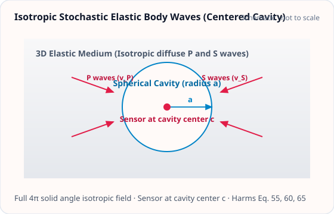

<!-- GENERATED MODEL REFERENCE: regenerate through the catalogue workflow. -->
# Isotropic stochastic elastic body waves

## Model overview

**Level:** — (definition and assignment pending).

**Physical domain:** stochastic seismic  
**Geometry:** fullspace, cavity

Infinite-medium P field and idealized P/S cavity-center CSD

**Source-declared observable / representation pairs:**

- a — Spectral density (CSD)

These pairs are a union over the listed calculation paths. They do not imply every API exposes every combination.

[Back to model catalogue](../guide/model-and-method-catalogue.md)

## Geometry and equations

*3D isotropic diffuse field of P and S body waves surrounding a centered spherical cavity with sensor at center c.*

B2 centered spherical cavity only, scattering neglected; arbitrary cavity geometry unsupported by API. basic plotting helper supports SphericalShell static shape but no source coupled setup stated.

### Equations

**Analytical formulation and field equations:**

- Full-space isotropic P-waves (B1): \(\mathbf S_a^{(G\text{-free})}(f) = (4\pi \rho)^2 S_{\xi,P}(f) \mathbf I_3\), where \(S_{\xi,P}(f)\) is the one-sided per-component P-displacement PSD (Harms 2019 Eqs. 55, 60).
- Spherical cavity P/S-waves (B2): Evaluated at center of spherical cavity of radius \(R &gt; 0\) with wavenumbers \(k_P = 2\pi f / v_P\) and \(k_S = 2\pi f / v_S\). With spherical Bessel factors \(f_P = \frac{j_1(k_P R)}{k_P R}\) and \(f_S = \frac{j_1(k_S R)}{k_S R}\), the isotropic CSD is \(\mathbf S_a^{(G\text{-free})}(f) = (4\pi \rho)^2 [4 f_P^2 S_{\xi,P}(f) + f_S^2 S_{\xi,S}(f)] \mathbf I_3\) (Harms 2019 Eq. 65).
- Physical SI CSD: Multiplies G-free CSD by \(G^2\): \(\mathbf S_a^{(\mathrm{SI})}(f) = G^2 \mathbf S_a^{(G\text{-free})}(f)\) in \(\mathrm{(m/s^2)^2/Hz}\).

## Parameters and calculation paths

### Parameters and units

#### API parameters

| Function / Path | Parameter | Type / Format | Default | Description |
|---|---|---|---|---|
| `fullspace_p_isotropic_acceleration_csd` | `density_kg_m3` | float | required (kw-only) | Elastic medium mass density in kg/m³ |
| `fullspace_p_isotropic_acceleration_csd` | `frequency_hz` | float | ArrayLike | required (kw-only) | Evaluation frequency in Hz (f > 0) |
| `fullspace_p_isotropic_acceleration_csd` | `p_displacement_psd_m2_hz` | float | ArrayLike | required (kw-only) | One-sided per-component P-wave displacement PSD in m²/Hz |
| `spherical_cavity_ps_isotropic_acceleration_csd` | `radius_m` | float | required (kw-only) | Cavity radius R in meters (R > 0) |
| `spherical_cavity_ps_isotropic_acceleration_csd` | `v_p_m_s` | float | required (kw-only) | Compressional P-wave speed in m/s |
| `spherical_cavity_ps_isotropic_acceleration_csd` | `v_s_m_s` | float | required (kw-only) | Shear S-wave speed in m/s (0 < v_S < v_P) |
| `spherical_cavity_ps_isotropic_acceleration_csd` | `s_displacement_psd_m2_hz` | float | ArrayLike | required (kw-only) | One-sided per-component S-wave displacement PSD in m²/Hz |

#### Mathematical symbols and notation

| Symbol | Meaning | SI unit | Definition / Relation |
|---|---|---|---|
| \(\rho\) | Medium density | kg/m³ | Elastic background mass density |
| \(v_P, v_S\) | Elastic wave speeds | m/s | Compressional and shear wave speeds |
| \(R\) | Cavity radius | m | Spherical cavity radius (\(R > 0\), cavity B2 model) |
| \(f\) | Frequency | Hz | Evaluation frequency in Hz |
| \(S_{\xi,P}(f)\) | P displacement PSD | m²/Hz | Per-component one-sided P-wave displacement PSD |
| \(S_{\xi,S}(f)\) | S displacement PSD | m²/Hz | Per-component one-sided S-wave displacement PSD |
| \(\mathbf S_a(f)\) | Acceleration CSD tensor | (m/s²)²/Hz | 3x3 diagonal isotropic tensor \(\frac{4\pi}{3} G^2 \rho^2 S_{\xi,P}(f) \mathbf I_3\) (fullspace) |

#### Usage notes

- Fullspace model B1 evaluates the homogeneous unbounded P-wave field.
- Cavity model B2 evaluates centered test mass inside spherical cavity with P and S boundary couplings.

### Calculation paths

#### Fullspace isotropic P

- `gragra.observables.stochastic_bodywave.fullspace_p_isotropic_acceleration_csd`

**Path-level source-declared output union:** a — Spectral density (CSD)

#### Centered spherical cavity isotropic P/S

- `gragra.observables.stochastic_bodywave.spherical_cavity_ps_isotropic_acceleration_csd`

**Path-level source-declared output union:** a — Spectral density (CSD)

## Derivation and sources

### Derivation

Full-space uses local bulk gravity transfer. Cavity implementation uses stable j1(x)/x series for |x|&lt;1e-3; local computational transcription, not independent proof.

### References

Existing public documentation and original formulation context:

- [Stochastic NN](../guide/stochastic-nn.md)

**Bibliographic inventory:** located.

- The local formula specification maps formulas to the implementation; it is not itself a bibliographic record.
- [DOI 10.1007/s41114-019-0022-2](https://doi.org/10.1007/s41114-019-0022-2)

## Verification and applicability

### Verification

**Evidence classes are distinct:** source declarations, catalogue output-contract probes, existing test code, documentary validation claims, and saved numerical results.

- Representative catalogue output-contract entries: 0.
- Catalogue probe state: Not assessed (no catalogue output probe registered).
- Registered output-contract probes run during catalogue validation check selected API outputs only; they do not measure scientific accuracy.
- Scientific accuracy tests are not part of documentation generation; no accuracy Level is assigned.

**Existing verification inventory:**

Test implementation records concrete checks; tests were not run in this editorial review. No committed executed-result artifact was identified for the assigned stochastic bodywave tests.

- [`tests/test_stochastic_bodywave.py`](https://github.com/tatsuki-washimi/gragra/blob/main/tests/test_stochastic_bodywave.py): fullspace formula uses rho=2500 kg/m³, f=2 Hz, S=3e-18 m²/Hz and exact allclose rtol=0, atol=0.
- Cavity direct angular/vector-sum comparison checks real P and S CSD separately at rtol=2e-11, atol=0; imaginary residual atol=1e-13*max(expected). Code is a test oracle route, not saved run output.

### Applicability and limitations

**Scope note:** f&gt;0, one-sided per-component PSD nonnegative; B2 radius, density, vp, vs conditions; no scattering. No general displacement/potential/gradient outputs.

See the public verification and limitations guidance for test-specific conditions and interpretation:

- [Verification matrix](../verification/matrix.md)
- [Verification limitations](../verification/limitations.md)

## Information not yet confirmed

- Boundary scattering, non-spherical cavity and potential/gradient are absent from these APIs.

*Publication scope: narrative summaries and links, not private derivation records, internal test artifacts or inventory JSON.*
