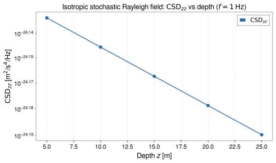

<!-- GENERATED MODEL REFERENCE: regenerate through the catalogue workflow. -->
# Isotropic stochastic Rayleigh field

## Model overview

**Level:** — (definition and assignment pending).

**Physical domain:** stochastic seismic  
**Geometry:** `halfspace`

Multiple test masses at depth; acceleration CSD

**Source-declared observable / representation pairs:**

- a — Spectral density (CSD)

These pairs are a union over the listed calculation paths. They do not imply every API exposes every combination.

[Back to model catalogue](../guide/model-and-method-catalogue.md)

## Geometry


*Isotropic Rayleigh field at single target depth z yielding 3x3 diagonal acceleration CSD tensor diag(1/2, 1/2, 1).*

Free-surface half-space geometry, test masses below surface; no arbitrary cavity/modal/mesh visualization. `plot_shape` only selected basic solids.

## Analytic formulation, sources, and scope

### Equations

For an isotropic stochastic field of Rayleigh waves in an elastic halfspace at depth \(z \ge 0\) beneath a traction-free surface (\(z = 0\)):

With Rayleigh wavenumber \(k_R = 2\pi f / c_R\) and dimensionless decay parameters \(q = \sqrt{1 - (c_R/v_P)^2}\), \(s = \sqrt{1 - (c_R/v_S)^2}\), and \(\zeta = \sqrt{q/s}\), the depth-dependent coupling amplitude factor is:

$$
A(z) = 2\pi \rho \left(\frac{1 - \zeta}{q - \zeta}\right) e^{-k_R z}.
$$

The G-free acceleration cross-spectral density (CSD) tensor is:

$$
\mathbf S_a^{(G\text{-free})}(f) = A^2(z) S_\xi(f) \operatorname{diag}\left(\frac{1}{2}, \frac{1}{2}, 1\right)
$$

where \(S_\xi(f)\) is the one-sided surface vertical displacement PSD in \(\mathrm{m^2/Hz}\). All off-diagonal components vanish identically under ideal spatial isotropy.

Physical SI acceleration CSD tensors in units of \(\mathrm{(m/s^2)^2/Hz}\) are obtained by multiplying by \(G^2\):

$$
\mathbf S_a^{(\mathrm{SI})}(f) = G^2 \mathbf S_a^{(G\text{-free})}(f).
$$

### Derivation

Analytic azimuth integration is stated; local implementation gives transfer, gamma, q/s and tensor factors. No external derivation independently checked.

### References

Existing public documentation and original formulation context:

- [Stochastic NN](../guide/stochastic-nn.md)

**Bibliographic inventory:** located.

### Applicability and scope

f&gt;0; targets strictly z&gt;0; rho&gt;=0; stable isotropic halfspace requires vp²&gt;(4/3)vs²; speeds positive. Homogeneous isotropic field and one-sided input PSD assumptions.

## STEP 1 — Setup

Primary path: `rayleigh_isotropic_acceleration_csd`

**A+ (`tutorial-display` axes):** wrap outputs with GWexpy only in the generator; do not invent frequency grids on the output side.

Build inputs consistent with **Detailed reference**:

```python
targets = [[0.0, 0.0, 10.0]]
density = 2500.0
vp = 4000.0
vs = 2000.0
frequency = 1.0
surface_psd = 1e-12
```

## STEP 2 — Validate / Inspect

STEP 2 items are tagged by information source:

- **`api`**: read from a gragra evaluation object: `validate()` is a **method**; `parameters`, `formulas`, and `references` are **`@property`** objects (not callable).
- **`tutorial-display`**: assembled for this page from documented inputs or catalogue-verified display equations (not a separate gragra registry lookup).
- **`api-output`**: taken from executed result payloads (units, shapes, GWexpy axes).

#### Display equations (`tutorial-display`)

Catalogue-registered analytic formulation (same as **Analytic formulation, sources, and scope** above):

For an isotropic stochastic field of Rayleigh waves in an elastic halfspace at depth \(z \ge 0\) beneath a traction-free surface (\(z = 0\)):

With Rayleigh wavenumber \(k_R = 2\pi f / c_R\) and dimensionless decay parameters \(q = \sqrt{1 - (c_R/v_P)^2}\), \(s = \sqrt{1 - (c_R/v_S)^2}\), and \(\zeta = \sqrt{q/s}\), the depth-dependent coupling amplitude factor is:

$$
A(z) = 2\pi \rho \left(\frac{1 - \zeta}{q - \zeta}\right) e^{-k_R z}.
$$

The G-free acceleration cross-spectral density (CSD) tensor is:

$$
\mathbf S_a^{(G\text{-free})}(f) = A^2(z) S_\xi(f) \operatorname{diag}\left(\frac{1}{2}, \frac{1}{2}, 1\right)
$$

where \(S_\xi(f)\) is the one-sided surface vertical displacement PSD in \(\mathrm{m^2/Hz}\). All off-diagonal components vanish identically under ideal spatial isotropy.

Physical SI acceleration CSD tensors in units of \(\mathrm{(m/s^2)^2/Hz}\) are obtained by multiplying by \(G^2\):

$$
\mathbf S_a^{(\mathrm{SI})}(f) = G^2 \mathbf S_a^{(G\text{-free})}(f).
$$

`request.formulas` lists **implementation routing** (`api`), which may differ from these display equations.

For direct observable evaluation, parameters and display equations are verified above (`tutorial-display`).

```python
try:
    from IPython.display import display
except ImportError:
    display = print
# Direct observable evaluation: parameters verified against catalogue specification
print('Input configuration verified.')
```

## STEP 3 — Calculate

Evaluate the model (`api-output`):

```python
import numpy as np
from gragra.observables.stochastic_rayleigh import rayleigh_isotropic_acceleration_csd

csd = rayleigh_isotropic_acceleration_csd(
    targets_m=targets, density_kg_m3=density, v_p_m_s=vp, v_s_m_s=vs,
    frequency_hz=frequency, surface_vertical_displacement_psd_m2_hz=surface_psd,
)
print('CSD shape:', csd.shape)
print('CSD_zz at 10 m depth:', np.real(csd[0, 2, 2]))
```


## STEP 4 — Results / Comparison

Five (or fewer) overlayed parameter sets — execute inline (`api-output`):

```python
import matplotlib.pyplot as plt
import numpy as np
from gragra.observables.stochastic_rayleigh import rayleigh_isotropic_acceleration_csd

zs_m = np.array([5.0, 10.0, 15.0, 20.0, 25.0])
csd_zz = [
    float(np.real(rayleigh_isotropic_acceleration_csd(
        targets_m=[[0.0, 0.0, float(z)]],
        density_kg_m3=2500.0,
        v_p_m_s=4000.0,
        v_s_m_s=2000.0,
        frequency_hz=1.0,
        surface_vertical_displacement_psd_m2_hz=1e-12,
    )[0, 2, 2]))
    for z in zs_m
]

fig, ax = plt.subplots(figsize=(8.0, 4.8))
ax.plot(zs_m, csd_zz, "o-", color="#316aa5", label=r"$\mathrm{CSD}_{zz}$")
ax.set_yscale("log")
ax.set_xlabel(r"Depth $z$ [m]")
ax.set_ylabel(r"$\mathrm{CSD}_{zz}$ [m$^2$/s$^4$/Hz]")
ax.set_title(r"Isotropic stochastic Rayleigh field: $\mathrm{CSD}_{zz}$ vs depth ($f=1\,\mathrm{Hz}$)")
ax.grid(True, linestyle="--", alpha=0.45)
ax.legend()
fig.tight_layout()
plt.show()
```




*Figure generated by executing the STEP 4 comparison code above.*

## Detailed reference and verification

### Parameters and units

#### API parameters

| Function / Path | Parameter | Type / Format | Default | Description |
|---|---|---|---|---|
| `rayleigh_isotropic_acceleration_csd` | `targets_m` | ArrayLike (M, 3) | required | Observation target coordinates strictly in ground halfspace (z > 0) in meters |
| `rayleigh_isotropic_acceleration_csd` | `density_kg_m3` | float | required (kw-only) | Subsurface ground mass density in kg/m³ (positive) |
| `rayleigh_isotropic_acceleration_csd` | `v_p_m_s` | float | required (kw-only) | Compressional P-wave speed in m/s |
| `rayleigh_isotropic_acceleration_csd` | `v_s_m_s` | float | required (kw-only) | Shear S-wave speed in m/s (\(v_P^2 > \frac{4}{3} v_S^2\)) |
| `rayleigh_isotropic_acceleration_csd` | `frequency_hz` | float \| ArrayLike | required (kw-only) | Evaluation frequency in Hz (f > 0) |
| `rayleigh_isotropic_acceleration_csd` | `surface_vertical_displacement_psd_m2_hz` | float \| ArrayLike | required (kw-only) | One-sided vertical surface displacement PSD in m²/Hz |

#### API return values

| Function / Path | Return type | Representation | Quantity & Unit | Shape / Structure | Description |
|---|---|---|---|---|---|
| `rayleigh_isotropic_acceleration_csd` | ndarray | CSD | a: (m/s²)²/Hz | \((N_{\mathrm{targets}}, 3, 3)\) complex128 array | One-sided 3x3 acceleration cross-spectral density matrix for isotropic Rayleigh noise at depth z |

#### Mathematical symbols and notation

| Symbol | Meaning | SI unit | Definition / Relation |
|---|---|---|---|
| \(\mathbf x\) | Target position | m | Target coordinates strictly in subsurface halfspace (\(z > 0\)) |
| \(\rho\) | Ground density | kg/m³ | Subsurface rock density (\(\rho > 0\)) |
| \(v_P, v_S\) | Elastic wave speeds | m/s | P- and S-wave speeds satisfying \(v_P^2 > \frac{4}{3}v_S^2\) |
| \(f\) | Frequency | Hz | Rayleigh wave evaluation frequency |
| \(S_\xi(f)\) | Surface vertical PSD | m²/Hz | One-sided vertical surface displacement PSD |
| \(\mathbf S_a(f, z)\) | Acceleration CSD tensor | (m/s²)²/Hz | Single-point 3x3 CSD tensor \(\mathbf S_a = A^2(z) S_\xi(f) \operatorname{diag}(1/2, 1/2, 1)\) |
| \(A(z)\) | Depth coupling function | s⁻² | Analytical depth attenuation factor from Harms (2019) |

#### Usage notes

- Returns single-point 3x3 acceleration CSD tensor of shape `(M, 3, 3)` across target points.
- Target constraint: targets must lie strictly in the ground subsurface (\(z > 0\)).

### Calculation paths

#### Isotropic Rayleigh acceleration CSD

- `gragra.observables.stochastic_rayleigh.rayleigh_isotropic_acceleration_csd`

**Path-level source-declared output union:** a — Spectral density (CSD)

### Derivation and source notes

- The record is listed in the internal reference inventory. The literature content was not independently re-verified for this update.
- [DOI 10.1007/s41114-019-0022-2](https://doi.org/10.1007/s41114-019-0022-2)

### Verification

**Evidence classes are distinct:** source declarations, catalogue output-contract probes, existing test code, documentary validation claims, and saved numerical results.

- Representative catalogue output-contract entries: 1.
- Catalogue probe state: recorded (a representative API output contract, not an accuracy test).
- Registered output-contract probes run during catalogue validation check selected API outputs only; they do not measure scientific accuracy.
- Scientific accuracy tests are not part of documentation generation; no accuracy Level is assigned.

**Existing verification inventory:**

Tests include Harms Eq.112 and shape/PSD/SI checks; report conditions only as coded. Test code, no rerun. No assigned committed result artifact found.


#### Registered representative output probes

| API | Observable | Representation | Probe |
|---|---|---|---|
| `gragra.observables.stochastic_rayleigh.rayleigh_isotropic_acceleration_csd` | a | Spectral density (CSD) | `rayleigh_csd_si` |

### Applicability and limitations


**Scope note:** f&gt;0; targets strictly z&gt;0; rho&gt;=0; stable isotropic halfspace requires vp²&gt;(4/3)vs²; speeds positive. Homogeneous isotropic field and one-sided input PSD assumptions.

See the public verification and limitations guidance for test-specific conditions and interpretation:

- [Verification matrix](../verification/matrix.md)
- [Verification limitations](../verification/limitations.md)


## Information not yet confirmed

- High-level EvaluationResult/setup integration deferred; no PSD/CSD integration in result workflows.

*Publication scope: narrative summaries and links, not private derivation records, internal test artifacts or inventory JSON.*
