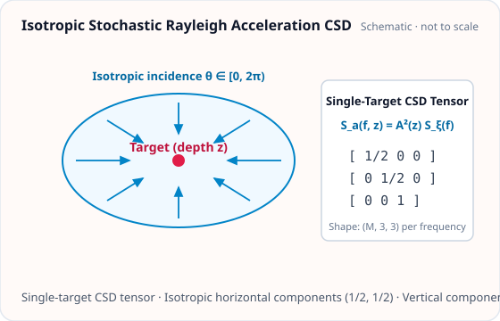

<!-- GENERATED MODEL REFERENCE: regenerate through the catalogue workflow. -->
# Isotropic stochastic Rayleigh field

## Model overview

**Level:** — (definition and assignment pending).

**Physical domain:** stochastic seismic  
**Geometry:** halfspace

Multiple test masses at depth; acceleration CSD

**Source-declared observable / representation pairs:**

- a — Spectral density (CSD)

These pairs are a union over the listed calculation paths. They do not imply every API exposes every combination.

[Back to model catalogue](../guide/model-and-method-catalogue.md)

## Geometry and equations

*Isotropic Rayleigh field at single target depth z yielding 3x3 diagonal acceleration CSD tensor diag(1/2, 1/2, 1).*

Free-surface half-space geometry, test masses below surface; no arbitrary cavity/modal/mesh visualization. plot_shape only selected basic solids.

### Equations

**Analytical formulation and field equations:**

- Evaluated in the elastic ground half-space at depth \(z &gt; 0\) beneath a free surface at \(z = 0\). Rayleigh wavenumber is \(k_R = 2\pi f / v_R\) with \(q = k_R / k_P\), \(s = k_R / k_S\), and \(\zeta = \sqrt{q/s}\).
- Depth coupling factor: \(\gamma = \frac{1 - \zeta}{q - \zeta}\), and amplitude factor \(A(z) = 2\pi \rho \gamma e^{-k_R z}\).
- G-free acceleration CSD tensor: \(\mathbf S_a^{(G\text{-free})}(f) = A^2(z) S_\xi(f) \operatorname{diag}\left(\frac{1}{2}, \frac{1}{2}, 1\right)\), where \(S_\xi(f)\) is the one-sided surface vertical displacement PSD in \(\mathrm{m^2/Hz}\). Off-diagonal terms vanish under ideal isotropy.
- The horizontal diagonal reproduces Harms (2019) Eq. (112). Physical SI CSD multiplies by \(G^2\): \(\mathbf S_a^{(\mathrm{SI})}(f) = G^2 \mathbf S_a^{(G\text{-free})}(f)\) in \(\mathrm{(m/s^2)^2/Hz}\).

## Parameters and calculation paths

### Parameters and units

| Symbol | Parameter | Meaning | SI unit |
|---|---|---|---|
| \(\mathbf x\) | `targets_m` | Target positions in ground halfspace (z > 0) | m |
| \(\rho\) | `density_kg_m3` | Subsurface ground mass density | kg/m³ |
| \(v_P\) | `v_p_m_s` | Compressional P-wave speed | m/s |
| \(v_S\) | `v_s_m_s` | Shear S-wave speed (v_P^2 > 4/3 v_S^2) | m/s |
| \(f\) | `frequency_hz` | Rayleigh wave frequency | Hz |
| \(S_\xi(f)\) | `surface_vertical_displacement_psd_m2_hz` | One-sided vertical surface displacement PSD | m²/Hz |

**Additional notes on parameters and models:**

- targets_m: array-like (M, 3), target positions strictly in ground halfspace z &gt; 0 in meters; density_kg_m3: float rho &gt;= 0 in kg/m^3; v_p_m_s: float v_p &gt; 0 in m/s; v_s_m_s: float v_s &gt; 0 in m/s, satisfying stability condition v_p^2 &gt; (4/3) v_s^2; frequency_hz: float or array-like &gt; 0 in Hz; surface_vertical_displacement_psd_m2_hz: float or array-like &gt;= 0, one-sided vertical surface displacement PSD in m^2/Hz.

### Calculation paths

#### Isotropic Rayleigh acceleration CSD

- `gragra.observables.stochastic_rayleigh.rayleigh_isotropic_acceleration_csd`

**Path-level source-declared output union:** a — Spectral density (CSD)

## Derivation and sources

### Derivation

Analytic azimuth integration is stated; local implementation gives transfer, gamma, q/s and tensor factors. No external derivation independently checked.

### References

Existing public documentation and original formulation context:

- [Stochastic NN](../guide/stochastic-nn.md)

**Bibliographic inventory:** located.

- The record is listed in the internal reference inventory. The literature content was not independently re-verified for this update.
- [DOI 10.1007/s41114-019-0022-2](https://doi.org/10.1007/s41114-019-0022-2)

## Verification and applicability

### Verification

**Evidence classes are distinct:** source declarations, catalogue output-contract probes, existing test code, documentary validation claims, and saved numerical results.

- Representative catalogue output-contract entries: 1.
- Catalogue probe state: recorded (a representative API output contract, not an accuracy test).
- Registered output-contract probes run during catalogue validation check selected API outputs only; they do not measure scientific accuracy.
- Scientific accuracy tests are not part of documentation generation; no accuracy Level is assigned.

**Existing verification inventory:**

Tests include Harms Eq.112 and shape/PSD/SI checks; report conditions only as coded. Test code, no rerun. No assigned committed result artifact found.

#### Registered representative output probes

| API | Observable | Representation | Probe |
|---|---|---|---|
| `gragra.observables.stochastic_rayleigh.rayleigh_isotropic_acceleration_csd` | a | Spectral density (CSD) | `rayleigh_csd_si` |

### Applicability and limitations

**Scope note:** f&gt;0; targets strictly z&gt;0; rho&gt;=0; stable isotropic halfspace requires vp²&gt;(4/3)vs²; speeds positive. Homogeneous isotropic field and one-sided input PSD assumptions.

See the public verification and limitations guidance for test-specific conditions and interpretation:

- [Verification matrix](../verification/matrix.md)
- [Verification limitations](../verification/limitations.md)

## Information not yet confirmed

- High-level EvaluationResult/setup integration deferred; no PSD/CSD integration in result workflows.

*Publication scope: narrative summaries and links, not private derivation records, internal test artifacts or inventory JSON.*
