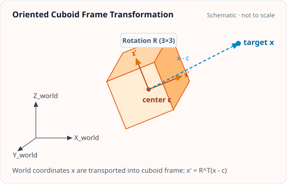
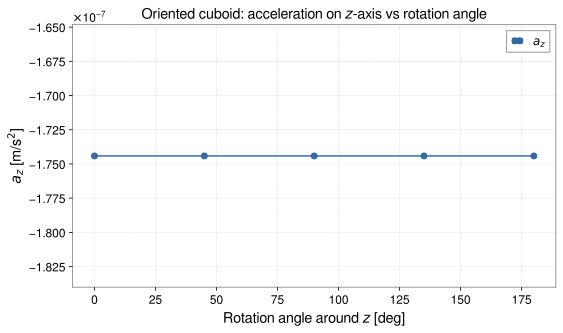

<!-- GENERATED MODEL REFERENCE: regenerate through the catalogue workflow. -->
# Oriented cuboid

## Model overview

**Level:** 4.

**Physical domain:** static gravity  
**Geometry:** `cuboid`

Rotated finite prism and target-frame response

**Source-declared observable / representation pairs:**

- Φ a Γ — Static

These pairs are a union over the listed calculation paths. They do not imply every API exposes every combination.

[Back to model catalogue](../guide/model-and-method-catalogue.md)

## Geometry



*World frame (X, Y, Z) and rotated cuboid frame (x', y', z') related by rotation matrix R.*

- API receives `center_m`, `lengths_m`, `targets_m` and `rotation_matrix` directly; it is not a Cuboid geometry object factory. The separate plotting helper takes a direct geometry/model/setup and resolves only Cuboid, Cylinder, SphericalShell; it can transform geometry coordinates through its Frame to `display_frame`.
- Oriented API proper Q and inherited base cuboid boundary rejection.

## Analytic formulation, sources, and scope

### Equations

For an arbitrarily oriented cuboid centered at \(\mathbf c\) with rotation matrix \(\mathbf Q \in \mathrm{SO}(3)\) mapping coordinates from the cuboid body frame to the world frame:

The target coordinates in the body frame are:

$$
\mathbf x_{\mathrm{body}} = \mathbf Q^T (\mathbf x - \mathbf c)
$$

The gravitational observables transform covariantly from the body-frame field:

$$
\begin{aligned}
\Phi(\mathbf x) &= \Phi_{\mathrm{body}}(\mathbf x_{\mathrm{body}}), \\
\mathbf a(\mathbf x) &= \mathbf Q \mathbf a_{\mathrm{body}}(\mathbf x_{\mathrm{body}}), \\
\mathbf\Gamma(\mathbf x) &= \mathbf Q \mathbf\Gamma_{\mathrm{body}}(\mathbf x_{\mathrm{body}}) \mathbf Q^T.
\end{aligned}
$$

Exterior targets satisfy the Laplace trace condition \(\mathrm{tr}(\mathbf\Gamma) = 0\), while interior targets satisfy the Poisson equation \(\mathrm{tr}(\mathbf\Gamma) = -4\pi G\rho\). Boundary points on cuboid faces, edges, or vertices are strictly rejected.

### Derivation

Inherits the aligned-cuboid vertex-antiderivative derivation; the oriented wrapper applies a local-to-world coordinate transformation.

### References

Existing public documentation and original formulation context:

- [Physics API](../api/physics.md)
- [coordinate conventions](../concepts/conventions.md)

**Bibliographic inventory:** located.

### Applicability and scope

Rotation must be proper; local cuboid boundary restrictions continue to apply.

- No general non-cuboid geometry or arbitrary affine scaling is claimed.
## STEP 1 — Setup

Primary path: Frame + Cuboid + `uniform_cuboid(..., output_frame=...)`

Primary path: Frame + Cuboid + `uniform_cuboid(..., output_frame=...)`

Build inputs consistent with **Detailed reference**:

```python
import numpy as np
import astropy.units as u
from gragra.geometry import Frame, Cuboid
from gragra.targets import TargetPoints
from gragra.analytic.objects import uniform_cuboid

world = Frame('world')
Q = np.array([[0.0, -1.0, 0.0], [1.0, 0.0, 0.0], [0.0, 0.0, 1.0]])
body_frame = Frame('body', basis=Q, parent=world)
geometry = Cuboid([0.0, 0.0, 0.0] * u.m, [2.0, 3.0, 4.0] * u.m, body_frame)
density = 2500.0 * u.kg / u.m**3
targets = TargetPoints([[4.0, 0.0, 0.0]] * u.m, ('t1',), world)
model = uniform_cuboid(geometry, density)
request = model.at(targets, output_frame=world)
```

## STEP 2 — Validate / Inspect

STEP 2 items are tagged by information source:

- **`api`**: read from a gragra evaluation object: `validate()` is a **method**; `parameters`, `formulas`, and `references` are **`@property`** objects (not callable).
- **`tutorial-display`**: assembled for this page from documented inputs or catalogue-verified display equations (not a separate gragra registry lookup).
- **`api-output`**: taken from executed result payloads (units, shapes, GWexpy axes).

#### Display equations (`tutorial-display`)

Catalogue-registered analytic formulation (same as **Analytic formulation, sources, and scope** above):

For an arbitrarily oriented cuboid centered at \(\mathbf c\) with rotation matrix \(\mathbf Q \in \mathrm{SO}(3)\) mapping coordinates from the cuboid body frame to the world frame:

The target coordinates in the body frame are:

$$
\mathbf x_{\mathrm{body}} = \mathbf Q^T (\mathbf x - \mathbf c)
$$

The gravitational observables transform covariantly from the body-frame field:

$$
\begin{aligned}
\Phi(\mathbf x) &= \Phi_{\mathrm{body}}(\mathbf x_{\mathrm{body}}), \\
\mathbf a(\mathbf x) &= \mathbf Q \mathbf a_{\mathrm{body}}(\mathbf x_{\mathrm{body}}), \\
\mathbf\Gamma(\mathbf x) &= \mathbf Q \mathbf\Gamma_{\mathrm{body}}(\mathbf x_{\mathrm{body}}) \mathbf Q^T.
\end{aligned}
$$

Exterior targets satisfy the Laplace trace condition \(\mathrm{tr}(\mathbf\Gamma) = 0\), while interior targets satisfy the Poisson equation \(\mathrm{tr}(\mathbf\Gamma) = -4\pi G\rho\). Boundary points on cuboid faces, edges, or vertices are strictly rejected.

`request.formulas` lists **implementation routing** (`api`), which may differ from these display equations.

Inspect and validate the evaluation request (`api`):

```python
try:
    from IPython.display import display
except ImportError:
    display = print
report = request.validate()
if report is not None:
    print(report)
else:
    print('Configuration valid.')
if hasattr(request, 'parameters'):
    display(request.parameters)
if hasattr(request, 'formulas'):
    display(request.formulas)
if hasattr(request, 'references'):
    display(request.references)
```

## STEP 3 — Calculate

Evaluate the model (`api-output`):

```python
result = request.run()
print('potential:', result.potential)
print('acceleration:', result.acceleration)
print('gradient:', result.gradient)
```


## STEP 4 — Results / Comparison

The body rotates about the \(z\) axis while the target stays at \((4, 0, 0)\,\mathrm{m}\), off the rotation axis. The response has a 180° period because a 180° rotation maps the cuboid onto itself. \(a_x\) changes by about 9 %, and \(a_y\) changes sign between 45° and 135°. Every value comes from `uniform_cuboid`, the same path as STEP 3. A target on the rotation axis would show no dependence on the angle (`api-output`).

```python
import matplotlib.pyplot as plt

angles_deg = (0.0, 45.0, 90.0, 135.0, 180.0)
ax_values = []
ay_values = []
for angle_deg in angles_deg:
    th = np.deg2rad(angle_deg)
    Q = np.array([[np.cos(th), -np.sin(th), 0.0], [np.sin(th), np.cos(th), 0.0], [0.0, 0.0, 1.0]])
    case = Cuboid([0.0, 0.0, 0.0] * u.m, [2.0, 3.0, 4.0] * u.m, Frame('body', basis=Q, parent=world))
    acc = uniform_cuboid(case, density).at(targets, output_frame=world).run().acceleration
    a_vector = acc.to_value(u.m / u.s**2)[0]
    ax_values.append(a_vector[0])
    ay_values.append(a_vector[1])

fig, (ax_x, ax_y) = plt.subplots(2, 1, figsize=(8.0, 5.4), sharex=True)
ax_x.plot(angles_deg, ax_values, 'o-', color='#316aa5', label=r'$a_x$')
ax_y.plot(angles_deg, ay_values, 's-', color='#27864b', label=r'$a_y$')
ax_x.set_ylabel(r'$a_x$ [m/s$^2$]')
ax_y.set_ylabel(r'$a_y$ [m/s$^2$]')
ax_y.set_xlabel(r'Body rotation angle around $z$ [deg]')
ax_x.set_title(r'Oriented cuboid: target fixed at $(4,0,0)\,\mathrm{m}$, $2\times3\times4\,\mathrm{m}$, $\rho=2500\,\mathrm{kg/m^3}$')
for ax in (ax_x, ax_y):
    ax.grid(True, linestyle='--', alpha=0.45)
    ax.legend()
fig.tight_layout()
plt.show()
```




*Figure generated by executing the STEP 4 comparison code above.*

Saved with `fig.savefig(path, bbox_inches='tight', metadata={'Date': None})` and `svg.hashsalt='gragra'` under Matplotlib 3.11.2. SVG byte reproducibility was verified with Matplotlib 3.11.2 under these save conditions. Other versions may produce different SVG bytes or layouts.

## Detailed reference and verification

### Parameters and units

#### API parameters

| Function / Path | Parameter | Type / Format | Default | Description |
|---|---|---|---|---|
| `oriented_cuboid_observables` | `center_m` | array-like (3,) | required | Cuboid center coordinates in world frame (meters) |
| `oriented_cuboid_observables` | `lengths_m` | array-like (3,) | required | Full side lengths in local body frame (meters) |
| `oriented_cuboid_observables` | `density_kg_m3` | float | required | Uniform mass density in kg/m³ |
| `oriented_cuboid_observables` | `targets_m` | array-like (M, 3) | required | Evaluation target coordinates in world frame (meters) |
| `oriented_cuboid_observables` | `rotation_matrix` | array-like (3, 3) | required (kw-only) | Proper rotation matrix Q in SO(3) mapping local body to world frame |

#### API return values

| Function / Path | Return type | Representation | Quantity & Unit | Shape / Structure | Description |
|---|---|---|---|---|---|
| `oriented_cuboid_observables` | GravityObservables | Static | Φ: m²/s², a: m/s², Γ: s⁻² | potential: (M,), acceleration: (M, 3), gradient: (M, 3, 3) | Direct SI observables transformed to world coordinates via proper rotation matrix Q |

#### Mathematical symbols and notation

| Symbol | Meaning | SI unit | Definition / Relation |
|---|---|---|---|
| \(\mathbf c\) | Cuboid center | m | Center in world coordinate frame |
| \(\mathbf L\) | Body side lengths | m | Edge lengths in local principal axis frame |
| \(\rho\) | Mass density | kg/m³ | Uniform interior mass density |
| \(\mathbf Q\) | Rotation matrix | dimensionless | Proper orthogonal matrix \(\mathbf Q \in \mathrm{SO}(3)\) (\(\det \mathbf Q = +1, \mathbf Q^T \mathbf Q = \mathbf I\)) |
| \(\mathbf x\) | World target position | m | Transformed to body frame via \(\mathbf x_{\mathrm{local}} = \mathbf Q^T (\mathbf x - \mathbf c)\) |

#### Usage notes

- The `rotation_matrix` argument must satisfy proper rotation conditions (\(\det \mathbf Q = +1\) and \(\mathbf Q^T \mathbf Q = \mathbf I\)). Improper rotations or reflections raise `ValueError`.
- Observables are transformed back to world frame: \(\Phi = \Phi_{\mathrm{local}}\), \(\mathbf a = \mathbf Q \mathbf a_{\mathrm{local}}\), \(\mathbf \Gamma = \mathbf Q \mathbf \Gamma_{\mathrm{local}} \mathbf Q^T\).

### Calculation paths

#### rotated cuboid G-free/SI transport

- `gragra.observables.oriented_cuboid_observables`

**Path-level source-declared output union:** Φ a Γ — Static

### Derivation and source notes

- cuboid derivation document applies to same closed form. oriented wrapper computes `local_targets = (targets - center) @ Q`, evaluates `cuboid_observables_g_free`, then covariant vector/tensor transport; this is coordinate transformation, not a new physical derivation.

- The foundational closed form is documented by Nagy (1966), Nagy, Papp & Benedek (2000) and its 2002 erratum, and Blakely (1995). The derivation document does not list DOIs.

### Verification

**Evidence classes are distinct:** source declarations, catalogue output-contract probes, existing test code, documentary validation claims, and saved numerical results.

- Representative catalogue output-contract entries: 0.
- Catalogue probe state: Not assessed (no catalogue output probe registered).
- Registered output-contract probes run during catalogue validation check selected API outputs only; they do not measure scientific accuracy.
- Scientific accuracy tests are not part of documentation generation; Level 4 is assigned based on archived scientific validation records (established closed form / verified reference comparisons in the development repository) within the stated scope conditions.

**Existing verification inventory:**

Tests and acceptance claims are recorded separately; no rerun in this task.

- [`tests/test_analytic_oriented.py`](https://github.com/tatsuki-washimi/gragra/blob/main/tests/test_analytic_oriented.py) covers identity, translation, rotation, SI conversion. Ledger states world-coordinate Gauss reference tolerances potential/acceleration 1e-10, gradient 1e-9, atol 1e-10; integration-int63/ot-focused.meta is recorded result path in external evidence tree but not checked/reproduced here.

### Applicability and limitations

- No general non-cuboid geometry or arbitrary affine scaling is claimed.

**Scope note:** Rotation must be proper; local cuboid boundary restrictions continue to apply.

See the public verification and limitations guidance for test-specific conditions and interpretation:

- [Verification matrix](../verification/matrix.md)
- [Verification limitations](../verification/limitations.md)


## Information not yet confirmed

- Catalogue has no `output_contracts`; no representative catalogue probe is defined.
- Sphere geometry is not among `plot_shape`-supported types; direct `oriented_cuboid_observables` arrays are not themselves a geometry/model/setup argument. Reuse requires a separate Cuboid geometry object, with its own Frame transform.
- `formula_to_latex` applicability is limited to its registered expressions; no claim for arbitrary oriented equations.

*Publication scope: narrative summaries and links, not private derivation records, internal test artifacts or inventory JSON.*
