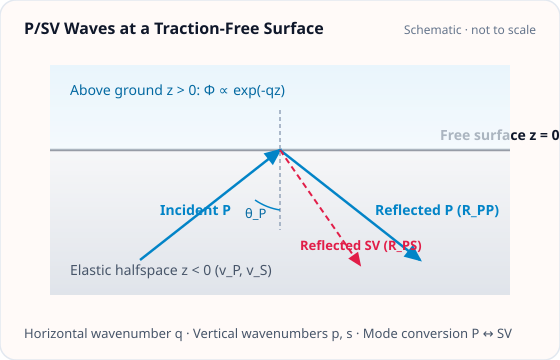

<!-- GENERATED MODEL REFERENCE: regenerate through the catalogue workflow. -->
# P/SV waves at a free surface

## Model overview

**Level:** — (definition and assignment pending).

**Physical domain:** seismic elastic  
**Geometry:** halfspace

Homogeneous elastic halfspace; incidence, reflection and mode conversion

**Source-declared observable / representation pairs:**

- Φ a Γ — Phasor

These pairs are a union over the listed calculation paths. They do not imply every API exposes every combination.

[Back to model catalogue](../guide/model-and-method-catalogue.md)

## Geometry and equations

*Incident P or SV wave from subsurface z < 0 reflecting and mode-converting at planar traction-free boundary z = 0.*

- High-level phasor model vs array-based SI wrapper; flat free surface and local frame conventions.

### Equations

**Analytical formulation and field equations:**

- Plane waves in an elastic halfspace (\(z &lt; 0\)) reflecting at a planar traction-free boundary (\(z = 0\)), with horizontal wavenumber \(q\), vertical P-wavenumber \(p = \sqrt{(\omega/v_P)^2 - q^2}\), and vertical S-wavenumber \(s = \sqrt{(\omega/v_S)^2 - q^2}\).
- Lossless reflection and mode-conversion potential ratios obey the characteristic traction-free system with denominator \(\Delta = (1 - 2q^2/k_S^2)^2 + 4 (q/k_S)^2 (p/k_S) (s/k_S)\). For incident P wave, reflection ratios are \(R_{PP} = [4 (q/k_S)^2 (p/k_S) (s/k_S) - (1 - 2q^2/k_S^2)^2]/\Delta\) and \(R_{PS} = [4 (q/k_S) (p/k_S) (1 - 2q^2/k_S^2)]/\Delta\).
- Gravitational potential evaluates in G-free units (kg/m) with surface potential amplitudes \(\phi_{\mathrm{surf}} = A + B\) and \(\psi_{\mathrm{surf}} = C + D\) (where \(A, B\) are incident/reflected P-wave scalar potential amplitudes and \(C, D\) are incident/reflected SV-wave vector potential amplitudes). Above ground (\(z &gt; 0\)): \(\Phi^{(G\text{-free})}(\mathbf x) = -2\pi\rho (\phi_{\mathrm{surf}} + i \psi_{\mathrm{surf}}) e^{-q z} e^{i \mathbf q \cdot (\mathbf x_\perp - \mathbf x_{0,\perp})}\). Underground (\(z &lt; 0\)): combines the surface displacement sheet \(2\pi\rho (\phi_{\mathrm{surf}} - i \psi_{\mathrm{surf}}) e^{q z}\) with the interior dilatational field \(-4\pi\rho [\phi_{\mathrm{inc}}(z) + \phi_{\mathrm{ref}}(z)]\).
- Acceleration \(\mathbf a = -\nabla \Phi\) and gradient \(\mathbf\Gamma = -\nabla\nabla \Phi\) are analytic throughout. Physical SI observables multiply by \(G\). Non-grazing incident angles (\(0 \le \theta &lt; \pi/2\)) are supported analytically.

## Parameters and calculation paths

### Parameters and units

| Symbol | Parameter | Meaning | SI unit |
|---|---|---|---|
| \(\rho\) | `density_kg_m3` | Medium mass density (rho > 0) | kg/m³ |
| \(v_P\) | `vp_m_s` | Elastic P-wave speed | m/s |
| \(v_S\) | `vs_m_s` | Elastic S-wave speed | m/s |
| \(\xi_{\mathrm{inc}}\) | `displacement` | Incident displacement amplitude | m |
| — | `wave_type` | Incident wave mode ('P' or 'SV') | dimensionless |
| \(\theta\) | `incidence_angle_rad` | Incidence angle from surface normal, in [0, pi/2) | rad |
| \(\phi\) | `azimuth_rad` | Horizontal propagation azimuth angle | rad |
| \(\mathbf x_0\) | `phase_origin` | Phase reference coordinates | m |
| \(t_0\) | `reference_time` | Phasor time origin | s |

**Additional notes on parameters and models:**

- density_kg_m3: float, medium mass density \(\rho\) in \(\mathrm{kg/m^3}\); vp_m_s, vs_m_s: float, elastic wave speeds in m/s.
- displacement: FrequencySeries or Quantity, incident displacement amplitude in meters; wave_type: 'P' or 'SV'.
- incidence_angle_rad: float, incidence angle \(\theta \in [0, \pi/2)\) from surface normal (exact grazing \(\pi/2\) rejected); azimuth_rad: float, azimuth angle.
- phase_origin: array-like (3,), phase reference coordinate in meters; reference_time: time origin for phasor evaluation.

### Calculation paths

#### implemented model/API path

- `gragra.analytic.seismic.halfspace_psv`
- `gragra.observables.halfspace_psv_observables`

**Path-level source-declared output union:** Φ a Γ — Phasor

## Derivation and sources

### Derivation

Formula expressions are declared in source; a separate local derivation proof was not located in the focused scan.

- No separate derivation is asserted from the formula declaration alone.

### References

Existing public documentation and original formulation context:

- [Analytic models](../guide/gen1-analytic-models.md)
- [waves](../guide/waves.md)

**Bibliographic inventory:** partial.

- Local model metadata calls D1 traction-free P/SV halfspace; Fourier matching q&gt;0 and documented continuous normal-incidence q=0 family.

## Verification and applicability

### Verification

**Evidence classes are distinct:** source declarations, catalogue output-contract probes, existing test code, documentary validation claims, and saved numerical results.

- Representative catalogue output-contract entries: 0.
- Catalogue probe state: Not assessed (no catalogue output probe registered).
- Registered output-contract probes run during catalogue validation check selected API outputs only; they do not measure scientific accuracy.
- Scientific accuracy tests are not part of documentation generation; no accuracy Level is assigned.

**Existing verification inventory:**

Verification method, tolerances, and artifact status recorded; tests were not run in this task.

- [`tests/test_halfspace_psv.py`](https://github.com/tatsuki-washimi/gragra/blob/main/tests/test_halfspace_psv.py) uses numerical z-source convolution (scipy quad epsrel 2e-12 default, epsabs tolerance/10), plus SI/phase shifts/gradient trace checks; test code only, no result artifact found.

### Applicability and limitations

- High-level phasor model vs array-based SI wrapper; flat free surface and local frame conventions.

**Scope note:** Applicability limits recorded.

See the public verification and limitations guidance for test-specific conditions and interpretation:

- [Verification matrix](../verification/matrix.md)
- [Verification limitations](../verification/limitations.md)

## Information not yet confirmed

- Catalogue output_contracts are empty; this is a missing representative probe, not evidence of absent science.
- No additional committed plot asset identified in these assigned API sources.

*Publication scope: narrative summaries and links, not private derivation records, internal test artifacts or inventory JSON.*
