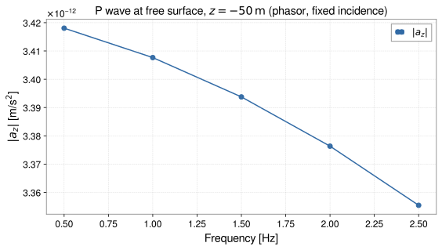

<!-- GENERATED MODEL REFERENCE: regenerate through the catalogue workflow. -->
# P/SV waves at a free surface

## Model overview

**Level:** — (definition and assignment pending).

**Physical domain:** seismic elastic  
**Geometry:** `halfspace`

Homogeneous elastic halfspace; incidence, reflection and mode conversion

**Source-declared observable / representation pairs:**

- Φ a Γ — Phasor

These pairs are a union over the listed calculation paths. They do not imply every API exposes every combination.

[Back to model catalogue](../guide/model-and-method-catalogue.md)

## Geometry


*Incident P or SV wave from subsurface z < 0 reflecting and mode-converting at planar traction-free boundary z = 0.*

- High-level phasor model vs array-based SI wrapper; flat free surface and local frame conventions.

## Analytic formulation, sources, and scope

### Equations

Plane waves in an elastic halfspace (\(z < 0\)) reflecting at a planar traction-free boundary (\(z = 0\)). Let \(q\) be the horizontal wavenumber, and define the vertical P-wave and S-wave wavenumbers:

$$
p = \sqrt{\left(\frac{\omega}{v_P}\right)^2 - q^2}, \qquad
s = \sqrt{\left(\frac{\omega}{v_S}\right)^2 - q^2}
$$

where \(v_P\) and \(v_S\) are compressional and shear wave speeds, and \(k_S = \omega / v_S\).

The traction-free boundary conditions yield the characteristic denominator:

$$
\Delta = \left(1 - \frac{2q^2}{k_S^2}\right)^2 + 4 \left(\frac{q}{k_S}\right)^2 \left(\frac{p}{k_S}\right) \left(\frac{s}{k_S}\right)
$$

For an incident P wave, the lossless reflection and mode-conversion potential amplitude ratios are:

$$
R_{PP} = \frac{4 (q/k_S)^2 (p/k_S) (s/k_S) - (1 - 2q^2/k_S^2)^2}{\Delta},
\qquad
R_{PS} = \frac{4 (q/k_S) (p/k_S) (1 - 2q^2/k_S^2)}{\Delta}
$$

The G-free gravitational potential \(\Phi^{(G\text{-free})}(\mathbf x)\) evaluates in units of \(\mathrm{kg/m}\). Let \(\phi_{\mathrm{surf}} = A + B\) and \(\psi_{\mathrm{surf}} = C + D\) denote surface potential amplitudes (with \(A, B\) incident/reflected P scalar potentials, and \(C, D\) incident/reflected SV vector potentials).

Above ground (\(z > 0\)):

$$
\Phi^{(G\text{-free})}(\mathbf x) = -2\pi\rho (\phi_{\mathrm{surf}} + i \psi_{\mathrm{surf}}) e^{-q z} e^{i \mathbf q \cdot (\mathbf x_\perp - \mathbf x_{0,\perp})}
$$

Underground (\(z < 0\)):

$$
\Phi^{(G\text{-free})}(\mathbf x) = 2\pi\rho (\phi_{\mathrm{surf}} - i \psi_{\mathrm{surf}}) e^{q z} e^{i \mathbf q \cdot (\mathbf x_\perp - \mathbf x_{0,\perp})} - 4\pi\rho [\phi_{\mathrm{inc}}(z) + \phi_{\mathrm{ref}}(z)] e^{i \mathbf q \cdot (\mathbf x_\perp - \mathbf x_{0,\perp})}
$$

The gravitational acceleration \(\mathbf a = -\nabla \Phi\) and gravity-gradient tensor \(\mathbf\Gamma = -\nabla\nabla \Phi\) are analytic throughout. Physical SI observables multiply by \(G\):

$$
\Phi^{(\mathrm{SI})} = G \Phi^{(G\text{-free})}, \qquad
\mathbf a^{(\mathrm{SI})} = G \mathbf a^{(G\text{-free})}, \qquad
\mathbf\Gamma^{(\mathrm{SI})} = G \mathbf\Gamma^{(G\text{-free})}
$$

### Derivation

Formulation follows traction-free boundary conditions; internal validation records classified into inventory facts, literature correspondence, and proof assertions.

### References

Existing public documentation and original formulation context:

- [Analytic models](../guide/gen1-analytic-models.md)
- [waves](../guide/waves.md)

**Bibliographic inventory:** located.

### Applicability and scope

Applicability limits recorded.

- High-level phasor model vs array-based SI wrapper; flat free surface and local frame conventions.
## STEP 1 — Setup

Primary path: `halfspace_psv(...).at(...).run()`

Primary path: `halfspace_psv(...).at(...).run()`

Build inputs consistent with **Detailed reference**:

```python
import numpy as np
import astropy.units as u
from gragra.geometry import Frame, HalfSpace
from gragra.results import PhasorRepresentation
from gragra.targets import TargetPoints
from gragra.analytic.seismic import halfspace_psv
from gwexpy.frequencyseries import FrequencySeries

world = Frame('world')
targets = TargetPoints([[0.0, 0.0, -50.0]] * u.m, ('t1',), world)
displacement = FrequencySeries(np.array([1e-6 + 0.0j]), frequencies=[2.0] * u.Hz, unit=u.m)
model = halfspace_psv(
    HalfSpace(world),
    density=2500.0 * u.kg / u.m**3,
    vp=4000.0 * u.m / u.s,
    vs=2000.0 * u.m / u.s,
    displacement=displacement,
    representation=PhasorRepresentation(),
    reference_time=(0, 0),
    wave_type='P',
    incidence_angle_rad=np.pi / 6.0,
    azimuth_rad=0.0,
    phase_origin=[0.0, 0.0, 0.0] * u.m,
)
request = model.at(targets)
```

## STEP 2 — Validate / Inspect

STEP 2 items are tagged by information source:

- **`api`**: read from a gragra evaluation object: `validate()` is a **method**; `parameters`, `formulas`, and `references` are **`@property`** objects (not callable).
- **`tutorial-display`**: assembled for this page from documented inputs or catalogue-verified display equations (not a separate gragra registry lookup).
- **`api-output`**: taken from executed result payloads (units, shapes, GWexpy axes).

#### Display equations (`tutorial-display`)

Catalogue-registered analytic formulation (same as **Analytic formulation, sources, and scope** above):

Plane waves in an elastic halfspace (\(z < 0\)) reflecting at a planar traction-free boundary (\(z = 0\)). Let \(q\) be the horizontal wavenumber, and define the vertical P-wave and S-wave wavenumbers:

$$
p = \sqrt{\left(\frac{\omega}{v_P}\right)^2 - q^2}, \qquad
s = \sqrt{\left(\frac{\omega}{v_S}\right)^2 - q^2}
$$

where \(v_P\) and \(v_S\) are compressional and shear wave speeds, and \(k_S = \omega / v_S\).

The traction-free boundary conditions yield the characteristic denominator:

$$
\Delta = \left(1 - \frac{2q^2}{k_S^2}\right)^2 + 4 \left(\frac{q}{k_S}\right)^2 \left(\frac{p}{k_S}\right) \left(\frac{s}{k_S}\right)
$$

For an incident P wave, the lossless reflection and mode-conversion potential amplitude ratios are:

$$
R_{PP} = \frac{4 (q/k_S)^2 (p/k_S) (s/k_S) - (1 - 2q^2/k_S^2)^2}{\Delta},
\qquad
R_{PS} = \frac{4 (q/k_S) (p/k_S) (1 - 2q^2/k_S^2)}{\Delta}
$$

The G-free gravitational potential \(\Phi^{(G\text{-free})}(\mathbf x)\) evaluates in units of \(\mathrm{kg/m}\). Let \(\phi_{\mathrm{surf}} = A + B\) and \(\psi_{\mathrm{surf}} = C + D\) denote surface potential amplitudes (with \(A, B\) incident/reflected P scalar potentials, and \(C, D\) incident/reflected SV vector potentials).

Above ground (\(z > 0\)):

$$
\Phi^{(G\text{-free})}(\mathbf x) = -2\pi\rho (\phi_{\mathrm{surf}} + i \psi_{\mathrm{surf}}) e^{-q z} e^{i \mathbf q \cdot (\mathbf x_\perp - \mathbf x_{0,\perp})}
$$

Underground (\(z < 0\)):

$$
\Phi^{(G\text{-free})}(\mathbf x) = 2\pi\rho (\phi_{\mathrm{surf}} - i \psi_{\mathrm{surf}}) e^{q z} e^{i \mathbf q \cdot (\mathbf x_\perp - \mathbf x_{0,\perp})} - 4\pi\rho [\phi_{\mathrm{inc}}(z) + \phi_{\mathrm{ref}}(z)] e^{i \mathbf q \cdot (\mathbf x_\perp - \mathbf x_{0,\perp})}
$$

The gravitational acceleration \(\mathbf a = -\nabla \Phi\) and gravity-gradient tensor \(\mathbf\Gamma = -\nabla\nabla \Phi\) are analytic throughout. Physical SI observables multiply by \(G\):

$$
\Phi^{(\mathrm{SI})} = G \Phi^{(G\text{-free})}, \qquad
\mathbf a^{(\mathrm{SI})} = G \mathbf a^{(G\text{-free})}, \qquad
\mathbf\Gamma^{(\mathrm{SI})} = G \mathbf\Gamma^{(G\text{-free})}
$$

`request.formulas` lists **implementation routing** (`api`), which may differ from these display equations.

Inspect and validate the evaluation request (`api`):

```python
try:
    from IPython.display import display
except ImportError:
    display = print
report = request.validate()
if report is not None:
    print(report)
else:
    print('Configuration valid.')
if hasattr(request, 'parameters'):
    display(request.parameters)
if hasattr(request, 'formulas'):
    display(request.formulas)
if hasattr(request, 'references'):
    display(request.references)
```

## STEP 3 — Calculate

Evaluate the model (`api-output`):

```python
import numpy as np

result = request.run()
acc = np.asarray(result.acceleration)
print('acceleration shape:', acc.shape)
print('az phasor:', acc[0, 2, 0])
```


## STEP 4 — Results / Comparison

Five (or fewer) overlayed parameter sets — execute inline (`api-output`):

```python
import matplotlib.pyplot as plt
import numpy as np
import astropy.units as u
from gwexpy.frequencyseries import FrequencySeries
from gragra.geometry import Frame, HalfSpace
from gragra.results import PhasorRepresentation
from gragra.targets import TargetPoints
from gragra.analytic.seismic import halfspace_psv

frame = Frame('world')
targets = TargetPoints([[0.0, 0.0, -50.0]] * u.m, ('t1',), frame)
freqs = np.array([0.5, 1.0, 1.5, 2.0, 2.5])
mags = []
for f_hz in freqs:
    disp = FrequencySeries(np.array([1e-6 + 0.0j]), frequencies=[float(f_hz)] * u.Hz, unit=u.m)
    model = halfspace_psv(
        HalfSpace(frame),
        density=2500.0 * u.kg / u.m**3,
        vp=4000.0 * u.m / u.s,
        vs=2000.0 * u.m / u.s,
        displacement=disp,
        representation=PhasorRepresentation(),
        reference_time=(0, 0),
        wave_type='P',
        incidence_angle_rad=np.pi / 6.0,
        azimuth_rad=0.0,
        phase_origin=[0.0, 0.0, 0.0] * u.m,
    )
    acc = np.asarray(model.at(targets).run().acceleration)[:, 2, 0]
    mags.append(float(np.abs(acc[0])))

fig, ax = plt.subplots(figsize=(8.0, 4.8))
ax.plot(freqs, mags, "o-", color="#316aa5", label=r"$|a_z|$")
ax.set_xlabel(r"Frequency [Hz]")
ax.set_ylabel(r"$|a_z|$ [m/s$^2$]")
ax.set_title(r"P wave at free surface, $z=-50\,\mathrm{m}$ (phasor, fixed incidence)")
ax.grid(True, linestyle="--", alpha=0.45)
ax.legend()
fig.tight_layout()
plt.show()
```




*Figure generated by executing the STEP 4 comparison code above.*

## Detailed reference and verification

### Parameters and units

#### API parameters

| Function / Path | Parameter | Type / Format | Default | Description |
|---|---|---|---|---|
| `halfspace_psv` | `geometry` | HalfSpace | required | Traction-free elastic halfspace geometry |
| `halfspace_psv` | `density` | u.Quantity (density) | required | Medium mass density |
| `halfspace_psv` | `vp` | u.Quantity (speed) | required | Compressional P-wave speed |
| `halfspace_psv` | `vs` | u.Quantity (speed) | required | Shear S-wave speed |
| `halfspace_psv` | `displacement` | FrequencySeries | required | Incident displacement amplitude series |
| `halfspace_psv` | `wave_type` | Literal['P', 'SV'] | required | Incident wave mode ('P' or 'SV') |
| `halfspace_psv` | `incidence_angle_rad` | float | required | Incidence angle from surface normal in [0, pi/2) |
| `halfspace_psv` | `azimuth_rad` | float | required | Horizontal propagation azimuth in radians |
| `halfspace_psv_observables` | `targets_m` | array-like (M, 3) | required | Evaluation target coordinates in meters |
| `halfspace_psv_observables` | `incident_displacement_m` | float \| complex \| array-like | required (kw-only) | Incident displacement amplitude in meters |

#### API return values

| Function / Path | Return type | Representation | Quantity & Unit | Shape / Structure | Description |
|---|---|---|---|---|---|
| `halfspace_psv` | HalfspacePSVModel | Phasor | Φ: m²/s², a: m/s², Γ: s⁻² | EvaluationResult with complex Astropy Quantities | High-level coupled P/SV halfspace model evaluated via .at(targets).run() |
| `halfspace_psv_observables` | GravityObservables | Phasor | Φ: m²/s², a: m/s², Γ: s⁻² | potential: (M,), acceleration: (M, 3), gradient: (M, 3, 3) | Complex SI observables for incident P/SV waves reflecting at traction-free surface |

#### Mathematical symbols and notation

| Symbol | Meaning | SI unit | Definition / Relation |
|---|---|---|---|
| \(\rho\) | Medium density | kg/m³ | Elastic medium density (\(\rho > 0\)) |
| \(v_P, v_S\) | Elastic wave speeds | m/s | Compressional and shear wave speeds |
| \(\theta\) | Incidence angle | rad | Angle from downward normal (\(\theta \in [0, \pi/2)\)) |
| \(\phi\) | Azimuth angle | rad | Horizontal propagation azimuth |
| \(\xi_{\mathrm{inc}}\) | Incident displacement | m | Incoming plane wave phasor amplitude |
| \(R_{PP}, R_{PS}, R_{SP}, R_{SS}\) | Reflection coefficients | dimensionless | Aki-Richards free-surface mode conversion coefficients |

#### Usage notes

- Exact grazing incidence (\(\theta = \pi/2\)) is rejected by the API.
- Evaluates combined displacement and gravitational perturbation including incident, reflected, and mode-converted waves.

### Calculation paths

#### implemented model/API path

- `gragra.analytic.seismic.halfspace_psv`
- `gragra.observables.halfspace_psv_observables`

**Path-level source-declared output union:** Φ a Γ — Phasor

### Derivation and source notes

- Inventory fact: Implemented in [`src/gragra/analytic/seismic/_halfspace_psv_model.py`](https://github.com/tatsuki-washimi/gragra/blob/main/src/gragra/analytic/seismic/_halfspace_psv_model.py).
- Literature assertion: Incident and reflected P/SV wave potentials and surface displacement boundary conditions match Aki & Richards (2002) and Harms (2019) Eqs. 86–91.
- Proof assertion: Numerical boundary-matching checks and test oracles exist in test code; no separate mathematical proof is asserted in this catalogue.

- Aki, K., & Richards, P. G. (2002), ‘Quantitative Seismology’ (2nd ed.), University Science Books, Section 5.2 (P-SV wave reflection at a free surface).
- Harms, J. (2019), ‘Terrestrial gravity fluctuations’, Living Reviews in Relativity, 22(1), 6, DOI 10.1007/s41114-019-0022-2, Section 4.
- [DOI 10.1007/s41114-019-0022-2](https://doi.org/10.1007/s41114-019-0022-2)

### Verification

**Evidence classes are distinct:** source declarations, catalogue output-contract probes, existing test code, documentary validation claims, and saved numerical results.

- Representative catalogue output-contract entries: 0.
- Catalogue probe state: Not assessed (no catalogue output probe registered).
- Registered output-contract probes run during catalogue validation check selected API outputs only; they do not measure scientific accuracy.
- Scientific accuracy tests are not part of documentation generation; no accuracy Level is assigned.

**Existing verification inventory:**

Verification method, tolerances, and artifact status recorded; tests were not run in this task.

- [`tests/test_halfspace_psv.py`](https://github.com/tatsuki-washimi/gragra/blob/main/tests/test_halfspace_psv.py) uses numerical z-source convolution (scipy quad epsrel 2e-12 default, epsabs tolerance/10), plus SI/phase shifts/gradient trace checks; test code only, no result artifact found.

### Applicability and limitations

- High-level phasor model vs array-based SI wrapper; flat free surface and local frame conventions.

**Scope note:** Applicability limits recorded.

See the public verification and limitations guidance for test-specific conditions and interpretation:

- [Verification matrix](../verification/matrix.md)
- [Verification limitations](../verification/limitations.md)


## Information not yet confirmed

- Catalogue `output_contracts` are empty; this is a missing representative probe, not evidence of absent science.
- No additional committed plot asset identified in these assigned API sources.

*Publication scope: narrative summaries and links, not private derivation records, internal test artifacts or inventory JSON.*
