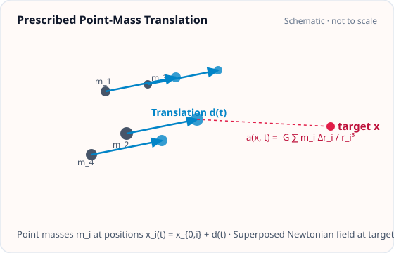
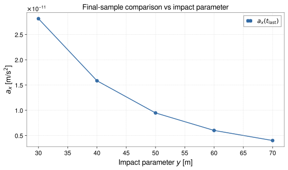
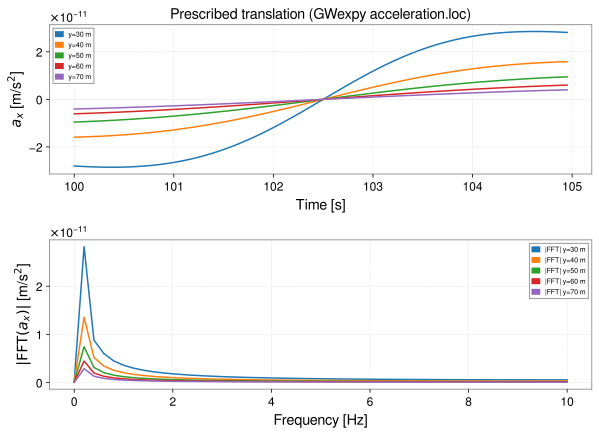

<!-- GENERATED MODEL REFERENCE: regenerate through the catalogue workflow. -->
# Prescribed point-mass translation

## Model overview

**Level:** — (definition and assignment pending).

**Physical domain:** rigid motion  
**Geometry:** `point`

Constant-velocity mass; time-sampled field

**Source-declared observable / representation pairs:**

- Φ a Γ — Time series

These pairs are a union over the listed calculation paths. They do not imply every API exposes every combination.

[Back to model catalogue](../guide/model-and-method-catalogue.md)

## Geometry



*Discrete point masses \(m_i\) moving with individual velocities \(\mathbf v_i\) from initial positions \(\mathbf x_{0,i}\) and their Newtonian field at target \(\mathbf x\).*

- Exact prescribed trajectory, not a dynamical motion solver; distinct from linearized phasor model.

## Analytic formulation, sources, and scope

### Equations

For a collection of \(N\) point masses \(m_i\) moving along uniform linear trajectories \(\mathbf x_i(t) = \mathbf x_{i,0} + \mathbf v_i (t - t_0)\), let the relative displacement vector to evaluation target \(\mathbf x\) be:

$$
\mathbf r_i(t) = \mathbf x - \mathbf x_i(t), \qquad r_i(t) = \|\mathbf r_i(t)\| > 0.
$$

The instantaneous Newtonian gravitational field observables are:

$$
\begin{aligned}
\Phi(\mathbf x, t) &= -G \sum_{i=1}^N \frac{m_i}{r_i(t)}, \\
\mathbf a(\mathbf x, t) &= -G \sum_{i=1}^N \frac{m_i \mathbf r_i(t)}{r_i(t)^3}, \\
\mathbf\Gamma(\mathbf x, t) &= G \sum_{i=1}^N m_i \left[ \frac{3 \mathbf r_i(t) \otimes \mathbf r_i(t)}{r_i(t)^5} - \frac{\mathbf I_3}{r_i(t)^3} \right].
\end{aligned}
$$

These observables strictly satisfy \(\mathrm{tr}(\mathbf\Gamma) = 0\) at all non-coincident evaluation targets. Coincident points (\(r_i(t) = 0\)) are singular and raise a `ValueError`.

### Derivation

Formula expressions are declared in source; a separate local derivation proof was not located in the focused scan.

### References

Existing public documentation and original formulation context:

- [Analytic models](../guide/gen1-analytic-models.md)

**Bibliographic inventory:** partial.

### Applicability and scope

Applicability limits recorded.

- Exact prescribed trajectory, not a dynamical motion solver; distinct from linearized phasor model.
## STEP 1 — Setup

Primary path: `constant_velocity(...).at(...).run()`

Primary path: `constant_velocity(...).at(...).run()`

Build inputs consistent with **Detailed reference**:

```python
import astropy.units as u
from gragra.geometry import Frame
from gragra.gravity_sources import PointMass
from gragra.results import TimeSampling
from gragra.targets import TargetPoints
from gragra.analytic.objects import constant_velocity

frame = Frame('world')
pm = PointMass(1000.0, [-25.0, 0.0, 0.0])
sampling = TimeSampling(epoch=(100, 0), dt=0.05 * u.s, count=100)
model = constant_velocity(
    pm, [10.0, 0.0, 0.0] * u.m / u.s, frame=frame, motion_epoch=(100, 0), sampling=sampling
)
targets = TargetPoints([[0.0, 50.0, 0.0]] * u.m, ('t1',), frame)
request = model.at(targets)
```

## STEP 2 — Validate / Inspect

STEP 2 items are tagged by information source:

- **`api`**: read from a gragra evaluation object: `validate()` is a **method**; `parameters`, `formulas`, and `references` are **`@property`** objects (not callable).
- **`tutorial-display`**: assembled for this page from documented inputs or catalogue-verified display equations (not a separate gragra registry lookup).
- **`api-output`**: taken from executed result payloads (units, shapes, GWexpy axes).

#### Display equations (`tutorial-display`)

Catalogue-registered analytic formulation (same as **Analytic formulation, sources, and scope** above):

For a collection of \(N\) point masses \(m_i\) moving along uniform linear trajectories \(\mathbf x_i(t) = \mathbf x_{i,0} + \mathbf v_i (t - t_0)\), let the relative displacement vector to evaluation target \(\mathbf x\) be:

$$
\mathbf r_i(t) = \mathbf x - \mathbf x_i(t), \qquad r_i(t) = \|\mathbf r_i(t)\| > 0.
$$

The instantaneous Newtonian gravitational field observables are:

$$
\begin{aligned}
\Phi(\mathbf x, t) &= -G \sum_{i=1}^N \frac{m_i}{r_i(t)}, \\
\mathbf a(\mathbf x, t) &= -G \sum_{i=1}^N \frac{m_i \mathbf r_i(t)}{r_i(t)^3}, \\
\mathbf\Gamma(\mathbf x, t) &= G \sum_{i=1}^N m_i \left[ \frac{3 \mathbf r_i(t) \otimes \mathbf r_i(t)}{r_i(t)^5} - \frac{\mathbf I_3}{r_i(t)^3} \right].
\end{aligned}
$$

These observables strictly satisfy \(\mathrm{tr}(\mathbf\Gamma) = 0\) at all non-coincident evaluation targets. Coincident points (\(r_i(t) = 0\)) are singular and raise a `ValueError`.

`request.formulas` lists **implementation routing** (`api`), which may differ from these display equations.

Inspect and validate the evaluation request (`api`):

```python
try:
    from IPython.display import display
except ImportError:
    display = print
report = request.validate()
if report is not None:
    print(report)
else:
    print('Configuration valid.')
if hasattr(request, 'parameters'):
    display(request.parameters)
if hasattr(request, 'formulas'):
    display(request.formulas)
if hasattr(request, 'references'):
    display(request.references)
```

## STEP 3 — Calculate

Evaluate the model (`api-output`):

```python
res = request.run()
print('potential:', res.potential.value, res.potential.units)
print('acceleration:', res.acceleration.value, res.acceleration.units)
```


## STEP 4 — Results / Comparison

The code below computes the result for each case and plots it. Each case is named on the x-axis or in the legend (`api-output`).

```python
import matplotlib.pyplot as plt
import numpy as np
import astropy.units as u
from gragra.geometry import Frame
from gragra.gravity_sources import PointMass
from gragra.results import TimeSampling
from gragra.targets import TargetPoints
from gragra.analytic.objects import constant_velocity

frame = Frame('world')
pm = PointMass(1000.0, [-25.0, 0.0, 0.0])
sampling = TimeSampling(epoch=(100, 0), dt=0.05 * u.s, count=100)
model = constant_velocity(
    pm, [10.0, 0.0, 0.0] * u.m / u.s, frame=frame, motion_epoch=(100, 0), sampling=sampling,
)
ys = (30.0, 40.0, 50.0, 60.0, 70.0)
traces = []
last_ax = []
for y_m in ys:
    res = model.at(TargetPoints([[0.0, y_m, 0.0]] * u.m, ('t1',), frame)).run()
    wave = res.acceleration.loc['t1', 'x']
    traces.append((wave, f"y={y_m:.0f} m"))
    last_ax.append(float(res.acceleration.value[0, 0, -1]))

fig_gw, (ax_t, ax_f) = plt.subplots(2, 1, figsize=(8.5, 6.2))
for wave, label in traces:
    ax_t.plot(wave, label=label)
    ax_f.plot(abs(wave.fft()), label=f"|FFT| {label}")
ax_t.set_xlabel("Time [s]")
ax_t.set_ylabel(r"$a_x$ [m/s$^2$]")
ax_t.set_title("Prescribed translation (GWexpy acceleration.loc)")
ax_t.legend(fontsize=7)
ax_t.grid(True, linestyle="--", alpha=0.4)
ax_f.set_xlabel("Frequency [Hz]")
ax_f.set_ylabel(r"$|\mathrm{FFT}(a_x)|$ [m/s$^2$]")
ax_f.legend(fontsize=7)
ax_f.grid(True, linestyle="--", alpha=0.4)
fig_gw.tight_layout()

fig_cmp, ax_cmp = plt.subplots(figsize=(8.0, 4.8))
ax_cmp.plot(ys, last_ax, "o-", color="#316aa5", label=r"$a_x(t_\mathrm{last})$")
ax_cmp.set_xlabel(r"Impact parameter $y$ [m]")
ax_cmp.set_ylabel(r"$a_x$ [m/s$^2$]")
ax_cmp.set_title(r"Final-sample comparison vs impact parameter")
ax_cmp.grid(True, linestyle="--", alpha=0.45)
ax_cmp.legend()
fig_cmp.tight_layout()
plt.show()
```




*Figure generated by executing the STEP 4 comparison code above.*



*Time-domain and frequency-domain overlays generated by executing the STEP 4 code above.*

Saved with `fig.savefig(path, bbox_inches='tight', metadata={'Date': None})` and `svg.hashsalt='gragra'` under Matplotlib 3.11.2. SVG byte reproducibility was verified with Matplotlib 3.11.2 under these save conditions. Other versions may produce different SVG bytes or layouts.

## Detailed reference and verification

### Parameters and units

#### API parameters

| Function / Path | Parameter | Type / Format | Default | Description |
|---|---|---|---|---|
| `constant_velocity` | `point_mass` | PointMass | required | Point mass object containing mass and initial position |
| `constant_velocity` | `velocity` | u.Quantity (speed 3-vector) | required | Constant velocity vector v in frame |
| `constant_velocity` | `frame` | Frame | required (kw-only) | Reference coordinate frame instance |
| `constant_velocity` | `motion_epoch` | object | required (kw-only) | Reference epoch t0 at which position equals initial position |
| `constant_velocity` | `sampling` | TimeSampling | required (kw-only) | Evaluation time axis discretization |

#### API return values

| Function / Path | Return type | Representation | Quantity & Unit | Shape / Structure | Description |
|---|---|---|---|---|---|
| `constant_velocity` | _MotionModel | TimeSeries | Φ: m²/s², a: m/s², Γ: s⁻² | EvaluationResult with TimeSeriesMatrix payloads | Constant-velocity point-mass motion model evaluated via .at(targets).run() |

#### Mathematical symbols and notation

| Symbol | Meaning | SI unit | Definition / Relation |
|---|---|---|---|
| \(m\) | Point mass | kg | Discrete mass magnitude (\(m > 0\)) |
| \(\mathbf x_0\) | Initial position | m | Body location at reference epoch \(t = t_0\) |
| \(\mathbf v\) | Velocity vector | m/s | Constant translation velocity |
| \(t_0\) | Motion epoch | s | Reference time for initial coordinates |
| \(t\) | Evaluation time | s | Evaluation time sample points |
| \(\mathbf x(t)\) | Trajectory position | m | \(\mathbf x(t) = \mathbf x_0 + \mathbf v (t - t_0)\) |
| \(\mathbf x_{\mathrm{target}}\) | Target position | m | Sensor evaluation coordinates |
| \(r(t)\) | Target distance | m | \(r(t) = \|\mathbf x_{\mathrm{target}} - \mathbf x(t)\|\) |

#### Usage notes

- Evaluates via `.at(targets).run()` to yield discrete time-series for potential, acceleration, and gradient.
- Collision check: if the trajectory intersects any target point (\(r(t) = 0\)), evaluation raises `ValueError`.

### Calculation paths

#### implemented model/API path

- `gragra.analytic.objects.constant_velocity`

**Observables after model evaluation:** Φ a Γ — Time series

High-level model factories create evaluation objects; call the documented `.at(...).run()` workflow to evaluate them. Observable functions listed above are direct calls with their own return values.

### Derivation and source notes

- No separate derivation is asserted from the formula declaration alone.

- Shared motion implementation reference metadata; local formulas in source.

### Verification

**Evidence classes are distinct:** source declarations, catalogue output-contract probes, existing test code, documentary validation claims, and saved numerical results.

- Representative catalogue output-contract entries: 0.
- Catalogue probe state: Not assessed (no catalogue output probe registered).
- Registered output-contract probes run during catalogue validation check selected API outputs only; they do not measure scientific accuracy.
- Scientific accuracy tests are not part of documentation generation; no accuracy Level is assigned.

**Existing verification inventory:**

Verification method, tolerances, and artifact status recorded; tests were not run in this task.

- [`tests/test_rigid_motion_science.py`](https://github.com/tatsuki-washimi/gragra/blob/main/tests/test_rigid_motion_science.py) uses independent mpmath transform oracle/frozen fixtures; key comparison 3e-14 tolerances; test code only, no saved result.

### Applicability and limitations

- Exact prescribed trajectory, not a dynamical motion solver; distinct from linearized phasor model.

**Scope note:** Applicability limits recorded.

See the public verification and limitations guidance for test-specific conditions and interpretation:

- [Verification matrix](../verification/matrix.md)
- [Verification limitations](../verification/limitations.md)


## Information not yet confirmed

- Catalogue `output_contracts` are empty; this is a missing representative probe, not evidence of absent science.
- No additional committed plot asset identified in these assigned API sources.

*Publication scope: narrative summaries and links, not private derivation records, internal test artifacts or inventory JSON.*
