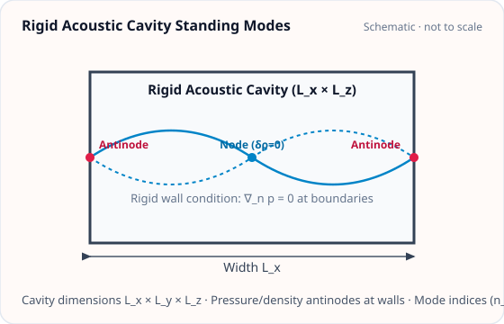
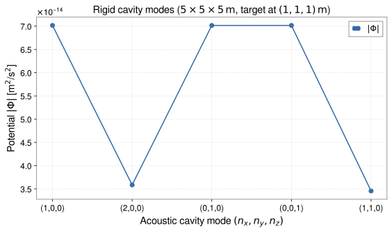

<!-- GENERATED MODEL REFERENCE: regenerate through the catalogue workflow. -->
# Rigid acoustic cavity modes

## Model overview

**Level:** — (definition and assignment pending).

**Physical domain:** atmospheric acoustic  
**Geometry:** `cavity`

Neumann modes in a sphere, cuboid or cylinder; geometry-dependent normalization and numerical limits

**Source-declared observable / representation pairs:**

- Φ a Γ — Phasor

These pairs are a union over the listed calculation paths. They do not imply every API exposes every combination.

[Back to model catalogue](../guide/model-and-method-catalogue.md)

## Geometry



*Standing acoustic modes in a rectangular cavity of dimensions Lx × Ly × Lz with rigid boundary conditions.*

- No arbitrary modal amplitude plot; selected static Cuboid/Cylinder/SphericalShell plot capability only.

## Analytic formulation, sources, and scope

### Equations

Acoustic eigenmodes in a rigid cavity filled with air of sound speed \(c_s\) satisfy the Helmholtz equation \((\nabla^2 + k^2)\Psi = 0\) with rigid Neumann boundary condition:

$$
\left. \frac{\partial \Psi}{\partial n} \right|_{\partial V} = 0.
$$

The modal eigenfrequency is \(f = c_s k / (2\pi)\) (the static zero mode \(k = 0\) is excluded).

**1. Rectangular cuboid cavity** (\([-L_j/2, L_j/2]\) along each axis \(j \in \{x, y, z\}\)) with mode indices \((n_x, n_y, n_z)\):

$$
\Psi(\mathbf x) = N \prod_{j \in \{x,y,z\}} \cos\left[\frac{n_j \pi (x_j + L_j/2)}{L_j}\right], \qquad
k = \pi \sqrt{\sum_{j=x,y,z} \left(\frac{n_j}{L_j}\right)^2}
$$

where the spatial RMS normalization factor is:

$$
N = 2^{r/2}
$$

and \(r\) is the number of non-zero mode indices (\(r = \sum_j \mathbf 1_{n_j > 0}\)).

**2. Circular cylinder cavity** (radius \(R\), centered height \(z \in [-H/2, H/2]\)) with mode indices \((m, n, q)\):

$$
\Psi_{mnq}(r, \phi, z) = N_{mnq} J_m\left(\frac{\alpha_{mn} r}{R}\right) A_m(\phi) \cos\left[\frac{q \pi (z + H/2)}{H}\right], \qquad
k = \sqrt{\left(\frac{\alpha_{mn}}{R}\right)^2 + \left(\frac{q\pi}{H}\right)^2}
$$

where \(\alpha_{mn}\) is the \(n\)-th zero of the derivative of the Bessel function (\(J_m'(\alpha_{mn}) = 0\)), \(N_{mnq}\) is the spatial RMS normalization factor, and the azimuthal dependence is selected by `azimuth`:

$$
A_m(\phi) = \begin{cases}
\cos(m\phi), & \text{for } \texttt{azimuth="cos"}, \\
\sin(m\phi), & \text{for } \texttt{azimuth="sin"} \quad (m \ge 1).
\end{cases}
$$

For \(m = 0\), the sine azimuthal branch vanishes and is disallowed by the API.

**3. Spherical cavity** (radius \(R\)) with radial index \(n\) and angular index \(l\):

$$
\Psi(r, \theta, \phi) = j_l(k_{ln} r) Y_{lm}(\theta, \phi)
$$

where \(k_{ln}\) is determined by the boundary condition on the spherical Bessel derivative \(j_l'(k_{ln} R) = 0\).

The acoustic density perturbation is \(\delta\rho = (P_0 / c_s^2) \Psi(\mathbf x)\), and the induced G-free gravitational potential solves the Poisson system:

$$
\nabla^2 \Phi^{(G\text{-free})} = 4\pi \frac{P_0}{c_s^2} \Psi(\mathbf x).
$$

Target points on physical cavity walls, caps, and rims are singular and raise a `ValueError`.

### Derivation

Equations documented; test/oracle code exists but is not a proof or newly run result.

### References

Existing public documentation and original formulation context:

- [Analytic models](../guide/gen1-analytic-models.md)

**Bibliographic inventory:** located.

### Applicability and scope

zero mode excluded; matching mode descriptor required; boundary targets restricted.

- sphere derivative-root indices; cylinder m=0 sine azimuth undefined; cuboid all-zero constant mode unsupported.
## STEP 1 — Setup

Primary path: `acoustic_cavity_mode(...).at(...).run()`

Primary path: `acoustic_cavity_mode(...).at(...).run()`

Build inputs consistent with **Detailed reference**:

```python
import astropy.units as u
from gragra.geometry import Frame, Cuboid
from gragra.targets import TargetPoints
from gragra.analytic.atmospheric import acoustic_cavity_mode, CuboidAcousticMode

frame = Frame('world')
geom = Cuboid([0.0, 0.0, 0.0] * u.m, [5.0, 5.0, 5.0] * u.m, frame)
mode = CuboidAcousticMode(1, 0, 0)
model = acoustic_cavity_mode(
    geom, mode, pressure_amplitude=10.0 * u.Pa,
    sound_speed=340.0 * u.m / u.s, reference_time=(100, 0),
)
targets = TargetPoints([[1.0, 1.0, 1.0]] * u.m, ('t1',), frame)
request = model.at(targets)
```

## STEP 2 — Validate / Inspect

STEP 2 items are tagged by information source:

- **`api`**: read from a gragra evaluation object: `validate()` is a **method**; `parameters`, `formulas`, and `references` are **`@property`** objects (not callable).
- **`tutorial-display`**: assembled for this page from documented inputs or catalogue-verified display equations (not a separate gragra registry lookup).
- **`api-output`**: taken from executed result payloads (units, shapes, GWexpy axes).

#### Display equations (`tutorial-display`)

Catalogue-registered analytic formulation (same as **Analytic formulation, sources, and scope** above):

Acoustic eigenmodes in a rigid cavity filled with air of sound speed \(c_s\) satisfy the Helmholtz equation \((\nabla^2 + k^2)\Psi = 0\) with rigid Neumann boundary condition:

$$
\left. \frac{\partial \Psi}{\partial n} \right|_{\partial V} = 0.
$$

The modal eigenfrequency is \(f = c_s k / (2\pi)\) (the static zero mode \(k = 0\) is excluded).

**1. Rectangular cuboid cavity** (\([-L_j/2, L_j/2]\) along each axis \(j \in \{x, y, z\}\)) with mode indices \((n_x, n_y, n_z)\):

$$
\Psi(\mathbf x) = N \prod_{j \in \{x,y,z\}} \cos\left[\frac{n_j \pi (x_j + L_j/2)}{L_j}\right], \qquad
k = \pi \sqrt{\sum_{j=x,y,z} \left(\frac{n_j}{L_j}\right)^2}
$$

where the spatial RMS normalization factor is:

$$
N = 2^{r/2}
$$

and \(r\) is the number of non-zero mode indices (\(r = \sum_j \mathbf 1_{n_j > 0}\)).

**2. Circular cylinder cavity** (radius \(R\), centered height \(z \in [-H/2, H/2]\)) with mode indices \((m, n, q)\):

$$
\Psi_{mnq}(r, \phi, z) = N_{mnq} J_m\left(\frac{\alpha_{mn} r}{R}\right) A_m(\phi) \cos\left[\frac{q \pi (z + H/2)}{H}\right], \qquad
k = \sqrt{\left(\frac{\alpha_{mn}}{R}\right)^2 + \left(\frac{q\pi}{H}\right)^2}
$$

where \(\alpha_{mn}\) is the \(n\)-th zero of the derivative of the Bessel function (\(J_m'(\alpha_{mn}) = 0\)), \(N_{mnq}\) is the spatial RMS normalization factor, and the azimuthal dependence is selected by `azimuth`:

$$
A_m(\phi) = \begin{cases}
\cos(m\phi), & \text{for } \texttt{azimuth="cos"}, \\
\sin(m\phi), & \text{for } \texttt{azimuth="sin"} \quad (m \ge 1).
\end{cases}
$$

For \(m = 0\), the sine azimuthal branch vanishes and is disallowed by the API.

**3. Spherical cavity** (radius \(R\)) with radial index \(n\) and angular index \(l\):

$$
\Psi(r, \theta, \phi) = j_l(k_{ln} r) Y_{lm}(\theta, \phi)
$$

where \(k_{ln}\) is determined by the boundary condition on the spherical Bessel derivative \(j_l'(k_{ln} R) = 0\).

The acoustic density perturbation is \(\delta\rho = (P_0 / c_s^2) \Psi(\mathbf x)\), and the induced G-free gravitational potential solves the Poisson system:

$$
\nabla^2 \Phi^{(G\text{-free})} = 4\pi \frac{P_0}{c_s^2} \Psi(\mathbf x).
$$

Target points on physical cavity walls, caps, and rims are singular and raise a `ValueError`.

`request.formulas` lists **implementation routing** (`api`), which may differ from these display equations.

Inspect and validate the evaluation request (`api`):

```python
try:
    from IPython.display import display
except ImportError:
    display = print
report = request.validate()
if report is not None:
    print(report)
else:
    print('Configuration valid.')
if hasattr(request, 'parameters'):
    display(request.parameters)
if hasattr(request, 'formulas'):
    display(request.formulas)
if hasattr(request, 'references'):
    display(request.references)
```

## STEP 3 — Calculate

Evaluate the model (`api-output`):

```python
res = request.run()
print('potential:', res.potential.value, res.potential.units)
print('acceleration:', res.acceleration.value, res.acceleration.units)
print('gradient:', res.gradient.value, res.gradient.units)
```


## STEP 4 — Results / Comparison

Five (or fewer) overlayed parameter sets — execute inline (`api-output`):

```python
import matplotlib.pyplot as plt
import numpy as np
import astropy.units as u
from gragra.geometry import Frame, Cuboid
from gragra.targets import TargetPoints
from gragra.analytic.atmospheric import acoustic_cavity_mode, CuboidAcousticMode

frame = Frame('world')
geom = Cuboid([0.0, 0.0, 0.0] * u.m, [5.0, 5.0, 5.0] * u.m, frame)
modes = [
    CuboidAcousticMode(1, 0, 0),
    CuboidAcousticMode(2, 0, 0),
    CuboidAcousticMode(0, 1, 0),
    CuboidAcousticMode(0, 0, 1),
    CuboidAcousticMode(1, 1, 0),
]
labels = [f"({m.nx},{m.ny},{m.nz})" for m in modes]
pots = []
for mode in modes:
    model = acoustic_cavity_mode(
        geom, mode, pressure_amplitude=10.0 * u.Pa,
        sound_speed=340.0 * u.m / u.s, reference_time=(100, 0),
    )
    res = model.at(TargetPoints([[1.0, 1.0, 1.0]] * u.m, ('t1',), frame)).run()
    pots.append(float(abs(res.potential.value[0, 0, 0])))

fig, ax = plt.subplots(figsize=(8.0, 4.8))
ax.plot(np.arange(len(modes)), pots, "o-", color="#316aa5", label=r"$|\Phi|$")
ax.set_xticks(np.arange(len(modes)))
ax.set_xticklabels(labels)
ax.set_xlabel("Acoustic cavity mode $(n_x, n_y, n_z)$")
ax.set_ylabel(r"Potential $|\Phi|$ [m$^2$/s$^2$]")
ax.set_title(r"Rigid cavity modes ($5\times 5\times 5\,\mathrm{m}$, target at $(1,1,1)\,\mathrm{m}$)")
ax.grid(True, linestyle="--", alpha=0.45)
ax.legend()
fig.tight_layout()
plt.show()
```




*Figure generated by executing the STEP 4 comparison code above.*

## Detailed reference and verification

### Parameters and units

#### API parameters

| Function / Path | Parameter | Type / Format | Default | Description |
|---|---|---|---|---|
| `acoustic_cavity_mode` | `geometry` | Sphere \| Cuboid \| Cylinder | required | Cavity boundary geometry instance |
| `acoustic_cavity_mode` | `mode` | SphereAcousticMode \| CuboidAcousticMode \| CylinderAcousticMode | required | Acoustic eigenmode descriptor instance |
| `acoustic_cavity_mode` | `pressure_amplitude` | u.Quantity (pressure) | required | Spatial-RMS modal peak pressure phasor amplitude |
| `acoustic_cavity_mode` | `sound_speed` | u.Quantity (speed) | required (kw-only) | Speed of sound inside cavity air |
| `acoustic_cavity_mode` | `reference_time` | object | required (kw-only) | Time origin for phasor evaluation |
| `acoustic_cavity_mode` | `numerics` | AcousticCavityNumerics | default settings | Numerical convergence controls (max evaluations/refinements) |

#### API return values

| Function / Path | Return type | Representation | Quantity & Unit | Shape / Structure | Description |
|---|---|---|---|---|---|
| `acoustic_cavity_mode` | SphereAcousticCavityModel \| CuboidAcousticCavityModel \| CylinderAcousticCavityModel | Phasor | Φ: m²/s², a: m/s², Γ: s⁻² | EvaluationResult with complex Astropy Quantities | Standing acoustic normal mode in rigid cavity evaluated via .at(targets).run() |

#### Mathematical symbols and notation

| Symbol | Meaning | SI unit | Definition / Relation |
|---|---|---|---|
| \((l, m, n)\) | Mode numbers | dimensionless | Acoustic eigenmode indices |
| \(c_s\) | Sound speed | m/s | Speed of sound inside cavity |
| \(\rho_0\) | Air equilibrium density | kg/m³ | Ambient unperturbed cavity air density |
| \(\delta p_0\) | Pressure amplitude | Pa | Spatial-RMS peak pressure phasor amplitude |
| \(k\) | Modal wavenumber | rad/m | Eigenvalue of Helmholtz equation \((\nabla^2 + k^2)\Psi = 0\) |
| \(f\) | Modal frequency | Hz | Acoustic eigenfrequency \(f = c_s k / (2\pi)\) |
| \(\Psi(\mathbf x)\) | Spatial mode function | dimensionless | Normalized eigenmode satisfying Neumann boundary condition |

#### Usage notes

- Evaluates via `.at(targets).run()` for target points strictly outside the cavity.
- Targets on the physical cavity walls, caps, or rims raise `ValueError`.

### Calculation paths

#### Sphere Neumann mode

- `gragra.analytic.atmospheric.acoustic_cavity_mode`

**Path-level source-declared output union:** Φ a Γ — Phasor

#### Cuboid Neumann mode

- `gragra.analytic.atmospheric.acoustic_cavity_mode`

**Path-level source-declared output union:** Φ a Γ — Phasor

#### Cylinder Neumann mode

- `gragra.analytic.atmospheric.acoustic_cavity_mode`

**Path-level source-declared output union:** Φ a Γ — Phasor

### Derivation and source notes

- Cylinder tests check eigenfrequency, normalization and derivative-related properties; saved oracle result paths not fully assembled.

- Sphere: an unpublished design note (approved eigenmode, RMS normalization, potential and Cartesian derivatives); `G_SI` applied once.
- Cuboid: an unpublished design note (separable source-volume Gaussian transform, interval derivatives, integrated-by-parts tails); an unpublished design note (`gen1_cavity_v1` runtime estimates and componentwise rigorous tails).
- Cylinder: an unpublished design note (real-mode normalization, exact overlaps, gap-selected transforms); #cylinder-rigorous-tail-coefficients (outward omitted-integral bounds); `G_SI` applied once.
- No external bibliographic DOI is recorded by these entries.

### Verification

**Evidence classes are distinct:** source declarations, catalogue output-contract probes, existing test code, documentary validation claims, and saved numerical results.

- Representative catalogue output-contract entries: 0.
- Catalogue probe state: Not assessed (no catalogue output probe registered).
- Registered output-contract probes run during catalogue validation check selected API outputs only; they do not measure scientific accuracy.
- Scientific accuracy tests are not part of documentation generation; no accuracy Level is assigned.

**Existing verification inventory:**

Shape-specific high-level tests; not run here.

- Cylinder frequency \(f = c_s k / (2\pi)\) rel=2e-15; gradient/Hessian finite differences use rtol 2e-8/3e-7 in selected checks. Test-code-only; other shapes have separate test suites.

### Applicability and limitations

- sphere derivative-root indices; cylinder m=0 sine azimuth undefined; cuboid all-zero constant mode unsupported.

**Scope note:** zero mode excluded; matching mode descriptor required; boundary targets restricted.

See the public verification and limitations guidance for test-specific conditions and interpretation:

- [Verification matrix](../verification/matrix.md)
- [Verification limitations](../verification/limitations.md)


## Information not yet confirmed

- modal plotting, exact references by geometry, saved run records.

*Publication scope: narrative summaries and links, not private derivation records, internal test artifacts or inventory JSON.*
