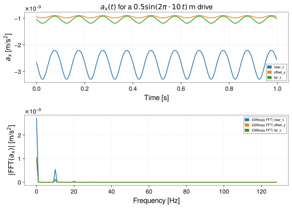

<!-- GENERATED MODEL REFERENCE: regenerate through the catalogue workflow. -->
# Rigid-body time series and Fourier response

## Model overview

**Level:** 4.

**Physical domain:** rigid motion  
**Geometry:** `point_cloud`

Prescribed positions/rotations; periodic or finite-window Fourier evaluation

**Source-declared observable / representation pairs:**

- ① Φ a Γ — Time series
- ② Φ a Γ — Fourier series
- ③ Φ a Γ — Fourier transform

These pairs are a union over the listed calculation paths. They do not imply every API exposes every combination.

[Back to model catalogue](../guide/model-and-method-catalogue.md)

## Geometry


*Rigid-body time-domain motion (translation c(t) and rotation R(t)) and corresponding Fourier series harmonic response.*

- `plot_shape` is not a Fourier trajectory renderer.

## Analytic formulation, sources, and scope

### Equations

For a general rigid body represented as a cloud of point masses \(m_i\) at fixed body-frame coordinates \(\mathbf x_{\mathrm{body},i}\), undergoing prescribed center-of-mass translation \(\mathbf c(t)\) and rotation matrix \(\mathbf R(t) \in \mathrm{SO}(3)\):

The instantaneous world coordinates of mass \(i\) are:

$$
\mathbf x_i(t) = \mathbf c(t) + \mathbf R(t) \mathbf x_{\mathrm{body},i}.
$$

With separation vector \(\mathbf r_i(t) = \mathbf x - \mathbf x_i(t)\) and distance \(r_i(t) = \|\mathbf r_i(t)\| > 0\), the instantaneous Newtonian field observables evaluate as:

$$
\Phi(\mathbf x, t) = -G \sum_{i=1}^N \frac{m_i}{r_i(t)}, \qquad
\mathbf a(\mathbf x, t) = -G \sum_{i=1}^N \frac{m_i \mathbf r_i(t)}{r_i(t)^3}, \qquad
\mathbf\Gamma(\mathbf x, t) = G \sum_{i=1}^N m_i \left[ \frac{3 \mathbf r_i(t) \otimes \mathbf r_i(t)}{r_i(t)^5} - \frac{\mathbf I_3}{r_i(t)^3} \right].
$$

**Continuous Fourier series and Fourier transform paths:**

The continuous Fourier path integrates callable pose over time using Fourier kernel convention \(\exp[-2\pi i f (t - t_{\mathrm{ref}})]\), where \(t_{\mathrm{ref}}\) is the reference epoch.

1. **Periodic Fourier series**: For strictly periodic motion of fundamental period \(T = 1/f_0\), one-sided Fourier series amplitude coefficients \(A_n\) relate to complex two-sided coefficients \(C_n\) by:

$$
A_0 = C_0, \qquad A_n = 2 C_n \quad (n \ge 1).
$$

2. **Finite-window Fourier transform**: For motion evaluated over a finite observation window \([T_{\mathrm{start}}, T_{\mathrm{end}}]\), windowed Fourier integral coefficients are retained directly without doubling:

$$
\tilde{\mathbf a}(f) = \int_{T_{\mathrm{start}}}^{T_{\mathrm{end}}} \mathbf a(t) e^{-2\pi i f (t - t_{\mathrm{ref}})} \, dt.
$$

### Derivation

Newton oracle is code; Fourier numerical integration prose is not a local derivation.

### References

Existing public documentation and original formulation context:

- [Rigid-motion Fourier guide](../guide/rigid-motion-fourier.md)
- [results API](../api/results.md)

**Bibliographic inventory:** located.

### Applicability and scope

sampled/continuous argument combinations exclusive; finite window has aliasing/phase caveats.

- return type provisional; G applied once at observable layer; memory budget per-lane.
## STEP 1 — Setup

Prescribed rigid translation of a point-mass cloud on a uniform time grid (`api` sampled `rigid_motion` path).

```python
import numpy as np
import astropy.units as u
from gwpy.time import LIGOTimeGPS
from gragra.geometry import Frame
from gragra.gravity_sources import (
    PointMassCloud,
    PrescribedRigidTransform,
    rigid_motion,
)
from gragra.results import TimeSampling
from gragra.targets import TargetPoints

world = Frame('world')
source = PointMassCloud([1000.0], [[0.0, 0.0, 0.0]])
epoch = (0, 0)
m, dt = 256, 1.0 / 256
sampling = TimeSampling(epoch=LIGOTimeGPS(*epoch), dt=dt * u.s, count=m)
time_s = np.arange(m) * dt  # seconds from the epoch
translations = np.zeros((m, 3))
translations[:, 0] = 0.5 * np.sin(2 * np.pi * 10.0 * time_s)
transform = PrescribedRigidTransform(
    time_s, translations, np.repeat(np.eye(3)[None], m, axis=0),
)
targets = TargetPoints(
    [[5.0, 0.0, 0.0], [5.0, 5.0, 0.0], [8.0, 0.0, 0.0]] * u.m,
    ('near_x', 'offset_y', 'far_x'),
    world,
)
model = rigid_motion(source, transform, frame=world, sampling=sampling)
request = model.at(targets, observables=('acceleration',))
```

## STEP 2 — Validate / Inspect

STEP 2 items are tagged by information source:

- **`api`**: read from a gragra evaluation object: `validate()` is a **method**; `parameters`, `formulas`, and `references` are **`@property`** objects (not callable).
- **`tutorial-display`**: assembled for this page from documented inputs or catalogue-verified display equations (not a separate gragra registry lookup).
- **`api-output`**: taken from executed result payloads (units, shapes, GWexpy axes).

#### Display equations (`tutorial-display`)

Catalogue-registered analytic formulation (same as **Analytic formulation, sources, and scope** above):

For a general rigid body represented as a cloud of point masses \(m_i\) at fixed body-frame coordinates \(\mathbf x_{\mathrm{body},i}\), undergoing prescribed center-of-mass translation \(\mathbf c(t)\) and rotation matrix \(\mathbf R(t) \in \mathrm{SO}(3)\):

The instantaneous world coordinates of mass \(i\) are:

$$
\mathbf x_i(t) = \mathbf c(t) + \mathbf R(t) \mathbf x_{\mathrm{body},i}.
$$

With separation vector \(\mathbf r_i(t) = \mathbf x - \mathbf x_i(t)\) and distance \(r_i(t) = \|\mathbf r_i(t)\| > 0\), the instantaneous Newtonian field observables evaluate as:

$$
\Phi(\mathbf x, t) = -G \sum_{i=1}^N \frac{m_i}{r_i(t)}, \qquad
\mathbf a(\mathbf x, t) = -G \sum_{i=1}^N \frac{m_i \mathbf r_i(t)}{r_i(t)^3}, \qquad
\mathbf\Gamma(\mathbf x, t) = G \sum_{i=1}^N m_i \left[ \frac{3 \mathbf r_i(t) \otimes \mathbf r_i(t)}{r_i(t)^5} - \frac{\mathbf I_3}{r_i(t)^3} \right].
$$

**Continuous Fourier series and Fourier transform paths:**

The continuous Fourier path integrates callable pose over time using Fourier kernel convention \(\exp[-2\pi i f (t - t_{\mathrm{ref}})]\), where \(t_{\mathrm{ref}}\) is the reference epoch.

1. **Periodic Fourier series**: For strictly periodic motion of fundamental period \(T = 1/f_0\), one-sided Fourier series amplitude coefficients \(A_n\) relate to complex two-sided coefficients \(C_n\) by:

$$
A_0 = C_0, \qquad A_n = 2 C_n \quad (n \ge 1).
$$

2. **Finite-window Fourier transform**: For motion evaluated over a finite observation window \([T_{\mathrm{start}}, T_{\mathrm{end}}]\), windowed Fourier integral coefficients are retained directly without doubling:

$$
\tilde{\mathbf a}(f) = \int_{T_{\mathrm{start}}}^{T_{\mathrm{end}}} \mathbf a(t) e^{-2\pi i f (t - t_{\mathrm{ref}})} \, dt.
$$

`request.formulas` lists **implementation routing** (`api`), which may differ from these display equations.

```python
try:
    from IPython.display import display
except ImportError:
    display = print
report = request.validate()
if report is not None:
    print(report)
else:
    print('Configuration valid.')
display(request.parameters)
```

## STEP 3 — Calculate

```python
ts_result = request.run()
print('times:', ts_result.acceleration.times)
waveform = ts_result.acceleration.loc['near_x', 'x']
print('near_x ax sample:', waveform.value[:4], '...')
```


Legacy two-sample linear motion (CI registry sample):

```python
import numpy as np
from gragra.gravity_sources import PointMassCloud, PrescribedRigidTransform
from gragra.observables import rigid_motion_observable

cloud = PointMassCloud([1000.0], [[0.0, 0.0, 0.0]])
transform = PrescribedRigidTransform(
    time_s=[0.0, 1.0],
    translations_m=[[0.0, 0.0, 0.0], [0.1, 0.0, 0.0]],
    rotation_matrices=[np.eye(3), np.eye(3)]
)
acc = rigid_motion_observable(cloud, transform, [[0.0, 0.0, 5.0]], observable='acceleration')
print('acceleration:', acc)
```

## STEP 4 — Results / Comparison

**Time domain (`api-output`):** three targets, \(a_x(t)\) from `.run()`.

**Frequency domain — gragra `EvaluationResult` paths (do not conflate):**

1. **`.fft(tref=epoch)`** — one-sided Fourier transform coefficients \(\tilde a_k\) with units **m/s** (`FourierTransformRepresentation`).
2. **`.spectrum('transient', tref=epoch)`** — one-sided complex amplitude spectrum \(A_k\) with units **m/s²** (`AmplitudeSpectrumRepresentation`).

**GWexpy** `TimeSeries.fft()` on `ts_result.acceleration.loc[...]` uses **GWpy/GWexpy normalisation**, distinct from gragra `EvaluationResult.fft()`. STEP 4 draws the GWexpy series in the first figure and the gragra transform in the second figure. The printed ratio \(2/T\) is a normalisation identity between the two gragra spectra, not a physics check.

Direct **Fourier coefficients** without time simulation use the **continuous** `rigid_motion(callable_pose, epoch=...)` branch (see `rigid_motion` docstring).

```python
import matplotlib.pyplot as plt
from gragra.plotting import plot_result

T = m * dt
fig_gw, (ax_time, ax_gw) = plt.subplots(2, 1, figsize=(8.5, 6.0))
for target_id in targets.ids:
    waveform = ts_result.acceleration.loc[target_id, 'x']
    ax_time.plot(waveform, label=target_id)
    ax_gw.plot(abs(waveform.fft()), label=f'|GWexpy FFT| {target_id}')
ax_time.set_xlabel('Time [s]')
ax_time.set_ylabel(r'$a_x$ [m/s$^2$]')
ax_time.set_title(r'$a_x(t)$ for a $0.5\sin(2\pi\cdot 10\,t)\,\mathrm{m}$ drive')
ax_gw.set_xlabel('Frequency [Hz]')
ax_gw.set_ylabel(r'$|\mathrm{FFT}(a_x)|$ [m/s$^2$]')
ax_time.legend(fontsize=7)
ax_gw.legend(fontsize=7)
ax_time.grid(True, linestyle='--', alpha=0.4)
ax_gw.grid(True, linestyle='--', alpha=0.4)
fig_gw.tight_layout()

ft = ts_result.fft(tref=epoch)
fig_sp, ax_sp = plot_result(
    ft,
    observable='acceleration',
    component='x',
    part='magnitude',
    target_id='near_x',
    view='spectrum',
)
ax_sp.set_title(rf'$|\tilde a_x(f)|$ from EvaluationResult.fft(tref=epoch), $T={T:.3f}\,\mathrm{{s}}$')
ax_sp.set_ylabel(r'$|\tilde a_x|$ [m/s]')
plt.show()

sp = ts_result.spectrum('transient', tref=epoch)
freqs = ft.acceleration.frequencies.to_value(u.Hz)
k = int(round(10.0 / (freqs[1] - freqs[0])))
ratio = abs(sp.acceleration.value[0, 0, k]) / abs(ft.acceleration.value[0, 0, k])
print(f'T={T} s, |A_k|/|ã_k| at 10 Hz =', ratio, 's^-1 (expect 2/T =', 2.0 / T, 's^-1)')
```




*Figures generated by executing the STEP 4 comparison code above.*

Saved with `fig.savefig(path, bbox_inches='tight', metadata={'Date': None})` and `svg.hashsalt='gragra'` under Matplotlib 3.11.2. SVG byte reproducibility was verified with Matplotlib 3.11.2 under these save conditions. Other versions may produce different SVG bytes or layouts.

## Detailed reference and verification

### Parameters and units

#### API parameters

| Function / Path | Parameter | Type / Format | Default | Description |
|---|---|---|---|---|
| `rigid_motion` | `source` | PointMassCloud | required | Cloud of discrete point masses representing rigid body |
| `rigid_motion` | `transform` | PrescribedRigidTransform \| PoseFunction | required | Rigid pose function or time-series transformation |
| `rigid_motion` | `frame` | Frame | required (kw-only) | Reference coordinate frame instance |
| `rigid_motion` | `sampling` | TimeSampling \| None | None | Discrete time sampling (required for sampled time-series path) |
| `rigid_motion_observable` | `observable` | str | required (kw-only) | 'potential', 'acceleration', or 'gradient' |
| `rigid_motion_observable` | `softening_m` | float | 0.0 | Plummer softening parameter in meters |

#### API return values

| Function / Path | Return type | Representation | Quantity & Unit | Shape / Structure | Description |
|---|---|---|---|---|---|
| `rigid_motion` | _ContinuousRigidMotionModel | TimeSeries / Fourier | Φ: m²/s², a: m/s², Γ: s⁻² | EvaluationResult with continuous/discrete time or Fourier payloads | Continuous or sampled rigid-body motion model evaluated via .at(targets).run() |
| `rigid_motion_observable` | ndarray | TimeSeries / Fourier | Φ: m²/s², a: m/s², Γ: s⁻² | \((N_{\mathrm{frames}}, N_{\mathrm{targets}}, \dots)\) float64 array | Assembled dense SI observables across time frames and targets for requested observable |

#### Mathematical symbols and notation

| Symbol | Meaning | SI unit | Definition / Relation |
|---|---|---|---|
| \(M\) | Total body mass | kg | Sum of constituent point masses \(M = \sum_i m_i\) |
| \(\mathbf x_{\mathrm{cm}}(t)\) | Center of mass | m | Rigid body center-of-mass trajectory |
| \(\mathbf R(t)\) | Rotation matrix | dimensionless | Instantaneous orientation matrix in \(\mathrm{SO}(3)\) |
| \(\mathbf I\) | Inertia tensor | kg·m² | Moment of inertia tensor around center of mass |
| \(\mathbf x_i(t)\) | Point mass position | m | \(\mathbf x_i(t) = \mathbf x_{\mathrm{cm}}(t) + \mathbf R(t) \mathbf x_{i,\mathrm{body}}\) |

#### Usage notes

- Supports sampled time-series evaluation (`rigid_motion_observable`) and continuous Fourier series / Fourier transform evaluation.

### Calculation paths

#### sampled rigid-body time series

- `gragra.gravity_sources.rigid_motion`
- `gragra.observables.rigid_motion_observable`

**Path-level source-declared output union:** Φ a Γ — Time series

#### callable pose periodic Fourier series

- `gragra.gravity_sources.rigid_motion`

**Path-level source-declared output union:** Φ a Γ — Fourier series

#### callable pose finite-window Fourier transform

- `gragra.gravity_sources.rigid_motion`

**Path-level source-declared output union:** Φ a Γ — Fourier transform

### Derivation and source notes

- 80-digit independent mpmath oracle; no proof of periodic quadrature found.

- RigidMotionModelSpec.references returns an empty DataFrame. Continuous Fourier model and its series/transform specs likewise return empty DataFrames.

### Verification

**Evidence classes are distinct:** source declarations, catalogue output-contract probes, existing test code, documentary validation claims, and saved numerical results.

- Representative catalogue output-contract entries: 0.
- Catalogue probe state: Not assessed (no catalogue output probe registered).
- Registered output-contract probes run during catalogue validation check selected API outputs only; they do not measure scientific accuracy.
- Scientific accuracy tests are not part of documentation generation; Level 4 is assigned based on archived scientific validation records (established closed form / verified reference comparisons in the development repository) within the stated scope conditions.

**Existing verification inventory:**

Tests cover observables/Fourier/oracle comparisons; not run here.

- test-code-only; `rigid_motion_science` oracle comparisons rtol=3e-14; no committed executed-result path located.

### Applicability and limitations

- return type provisional; G applied once at observable layer; memory budget per-lane.

**Scope note:** sampled/continuous argument combinations exclusive; finite window has aliasing/phase caveats.

See the public verification and limitations guidance for test-specific conditions and interpretation:

- [Verification matrix](../verification/matrix.md)
- [Verification limitations](../verification/limitations.md)


## Information not yet confirmed

- saved scientific runs not located.

*Publication scope: narrative summaries and links, not private derivation records, internal test artifacts or inventory JSON.*
