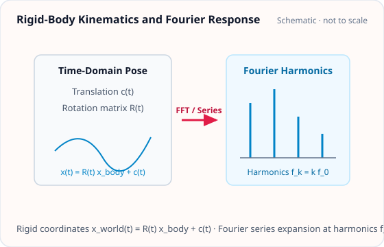

<!-- GENERATED MODEL REFERENCE: regenerate through the catalogue workflow. -->
# Rigid-body time series and Fourier response

## Model overview

**Level:** — (definition and assignment pending).

**Physical domain:** rigid motion  
**Geometry:** point_cloud

Prescribed positions/rotations; periodic or finite-window Fourier evaluation

**Source-declared observable / representation pairs:**

- ① Φ a Γ — Time series
- ② Φ a Γ — Fourier series
- ③ Φ a Γ — Fourier transform

These pairs are a union over the listed calculation paths. They do not imply every API exposes every combination.

[Back to model catalogue](../guide/model-and-method-catalogue.md)

## Geometry and equations

*Rigid-body time-domain motion (translation c(t) and rotation R(t)) and corresponding Fourier series harmonic response.*

- plot_shape is not a Fourier trajectory renderer.

### Equations

**Analytical formulation and field equations:**

- Body kinematics follow general pose transformation \(\mathbf x(t) = \mathbf R(t) \mathbf x_{\mathrm{body}} + \mathbf c(t)\) with proper rotation \(\mathbf R(t) \in \mathrm{SO}(3)\) and translation \(\mathbf c(t)\).
- Sampled time-series path evaluates instantaneous Newtonian field (\(\Phi, \mathbf a, \mathbf\Gamma\)) at discrete time sampling steps via rigid_motion_observable.
- Continuous Fourier path integrates callable pose over time using Fourier convention \(\exp[-2\pi i f (t - t_{\mathrm{ref}})]\). For periodic motion, one-sided Fourier series amplitude coefficients satisfy \(A_0 = C_0, A_n = 2 C_n\) (\(n \ge 1\)). For finite-window Fourier transforms, windowed integral coefficients are retained directly without doubling.

## Parameters and calculation paths

### Parameters and units

- source: PointMassCloud object defining point masses in kg and body-frame positions in meters; transform: PrescribedRigidTransform or callable pose returning (R(t), c(t)).
- Sampled route: uses TimeSampling specifying discrete evaluation epochs in seconds.
- Fourier route: reference_time GPS epoch, frequencies list in Hz (requires \(f_{\mathrm{max}} |t_{\mathrm{epoch}} - t_{\mathrm{ref}}| \le 10^6\) cycles). Returns potential, acceleration, and gradient Fourier objects.

### Calculation paths

#### sampled rigid-body time series

- `gragra.gravity_sources.rigid_motion`
- `gragra.observables.rigid_motion_observable`

**Path-level source-declared output union:** Φ a Γ — Time series

#### callable pose periodic Fourier series

- `gragra.gravity_sources.rigid_motion`

**Path-level source-declared output union:** Φ a Γ — Fourier series

#### callable pose finite-window Fourier transform

- `gragra.gravity_sources.rigid_motion`

**Path-level source-declared output union:** Φ a Γ — Fourier transform

## Derivation and sources

### Derivation

Newton oracle is code; Fourier numerical integration prose is not a local derivation.

- 80-digit independent mpmath oracle; no proof of periodic quadrature found.

### References

Existing public documentation and original formulation context:

- [Rigid-motion Fourier guide](../guide/rigid-motion-fourier.md)
- [results API](../api/results.md)

**Bibliographic inventory:** located.

- RigidMotionModelSpec.references returns an empty DataFrame. Continuous Fourier model and its series/transform specs likewise return empty DataFrames.

## Verification and applicability

### Verification

**Evidence classes are distinct:** source declarations, catalogue output-contract probes, existing test code, documentary validation claims, and saved numerical results.

- Representative catalogue output-contract entries: 0.
- Catalogue probe state: Not assessed (no catalogue output probe registered).
- Registered output-contract probes run during catalogue validation check selected API outputs only; they do not measure scientific accuracy.
- Scientific accuracy tests are not part of documentation generation; no accuracy Level is assigned.

**Existing verification inventory:**

Tests cover observables/Fourier/oracle comparisons; not run here.

- test-code-only; rigid_motion_science oracle comparisons rtol=3e-14; no committed executed-result path located.

### Applicability and limitations

- return type provisional; G applied once at observable layer; memory budget per-lane.

**Scope note:** sampled/continuous argument combinations exclusive; finite window has aliasing/phase caveats.

See the public verification and limitations guidance for test-specific conditions and interpretation:

- [Verification matrix](../verification/matrix.md)
- [Verification limitations](../verification/limitations.md)

## Information not yet confirmed

- saved scientific runs not located.

*Publication scope: narrative summaries and links, not private derivation records, internal test artifacts or inventory JSON.*
