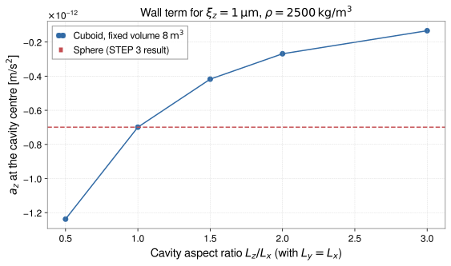

<!-- GENERATED MODEL REFERENCE: regenerate through the catalogue workflow. -->
# Small-cavity wall approximation

## Model overview

**Level:** 4.

**Physical domain:** seismic elastic  
**Geometry:** `cavity`

Sphere, cuboid or cylinder; selected linearized wall contribution only

**Source-declared observable / representation pairs:**

- ① Φ a Γ — Static
- ② Φ a Γ — Phasor

These pairs are a union over the listed calculation paths. They do not imply every API exposes every combination.

[Back to model catalogue](../guide/model-and-method-catalogue.md)

## Geometry


*Planar wall boundary with normal displacement ξ_n inducing effective surface mass sheet σ = ρ ξ_n at distance d.*

- The model accepts Sphere, Cuboid, Cylinder, but `plot_shape` helper supports only Cuboid, Cylinder, SphericalShell and explicitly rejects Cavity types; high-level `small_cavity_wall` model is cavity-named and is not automatically plot-able. A standalone Sphere geometry is not among the supported classes.
- Harms scalar table supports five discrete shape/location rows; tensor paths have separate geometric coverage.

## Analytic formulation, sources, and scope

### Equations

The small-cavity wall approximation evaluates gravitational perturbations caused by the displacement of a cavern boundary enclosing an underground test mass or sensor.

For high-level cavity geometry instances (Sphere, Cuboid, or Cylinder) subject to wall displacement \(\mathbf u\), the boundary-induced perturbations to the potential, acceleration, and gradient are:

$$
\Phi_{\mathrm{wall}} = -\mathbf u \cdot \mathbf a_{\mathrm{body}}, \qquad
\mathbf a_{\mathrm{wall}} = \mathbf\Gamma_{\mathrm{body}} \mathbf u, \qquad
\mathbf\Gamma_{\mathrm{wall}} = \mathbf\Xi_{\mathrm{body}} \mathbf u
$$

where \(\mathbf a_{\mathrm{body}}\), \(\mathbf\Gamma_{\mathrm{body}}\), and \(\mathbf\Xi_{\mathrm{body}}\) are the field, gradient, and third-rank gradient tensor of the notionally filled body at the instrument position.

For homogeneous host media using the Harms (2022) scalar lookup model, the scalar wall coupling factor \(C_{\mathrm{sca}}\) is a dimensionless geometric quantity. The resulting scalar acceleration amplitudes in G-free and SI units are:

$$
a_{\mathrm{G-free}} = -C_{\mathrm{sca}} \rho \xi,
\qquad
a_{\mathrm{SI}} = -G C_{\mathrm{sca}} \rho \xi
$$

where \(\rho\) is host medium mass density and \(\xi\) is scalar ground displacement amplitude.

In tensor notation, vector acceleration perturbations evaluate as:

$$
\begin{aligned}
\text{G-free:}\quad \frac{\Delta\mathbf a}{G} &= -\rho \mathbf C_g \mathbf u, \\
\text{SI:}\quad \Delta\mathbf a &= -G \rho \mathbf C_g \mathbf u.
\end{aligned}
$$

The approximation applies when the cavity dimensions are small compared to the seismic wavelength and source-to-target distance, ensuring linear first-order perturbation theory holds.

### Derivation

Scalar Harms coefficients are literal table entries; general tensors are local derivation/numerical surface paths with recorded convention mapping.

### References

Existing public documentation and original formulation context:

- [Analytic models](../guide/gen1-analytic-models.md)
- [physics API](../api/physics.md)

**Bibliographic inventory:** located.

### Applicability and scope

Wall-only first-order SCA; small cavity relative to source-target distance; no bulk or scattering term. Scalar lookup only five combos; tensor APIs own separate boundaries and geometry scopes.

- Harms floor-center table row does not specify boundary condition/tensor direction/one-sided limit. Scalar lookup does not carry k. high-level model excludes physical wall. No arbitrary model-wide formula/plot capability.
## STEP 1 — Setup

Primary path: `small_cavity_wall(...).at(...).run()`

Primary path: `small_cavity_wall(...).at(...).run()`

Build inputs consistent with **Detailed reference**:

```python
import astropy.units as u
from gragra.geometry import Frame, Sphere
from gragra.targets import TargetPoints
from gragra.analytic.seismic import small_cavity_wall

frame = Frame('world')
geometry = Sphere([0.0, 0.0, 0.0] * u.m, 1.0 * u.m, frame)
displacement = [0.0, 0.0, 1e-6] * u.m
density = 2500.0 * u.kg / u.m**3
targets = TargetPoints([[0.0, 0.0, 0.0]] * u.m, ('cavity_center',), frame)
model = small_cavity_wall(geometry, displacement, density=density)
request = model.at(targets)
```

## STEP 2 — Validate / Inspect

STEP 2 items are tagged by information source:

- **`api`**: read from a gragra evaluation object: `validate()` is a **method**; `parameters`, `formulas`, and `references` are **`@property`** objects (not callable).
- **`tutorial-display`**: assembled for this page from documented inputs or catalogue-verified display equations (not a separate gragra registry lookup).
- **`api-output`**: taken from executed result payloads (units, shapes, GWexpy axes).

#### Display equations (`tutorial-display`)

Catalogue-registered analytic formulation (same as **Analytic formulation, sources, and scope** above):

The small-cavity wall approximation evaluates gravitational perturbations caused by the displacement of a cavern boundary enclosing an underground test mass or sensor.

For high-level cavity geometry instances (Sphere, Cuboid, or Cylinder) subject to wall displacement \(\mathbf u\), the boundary-induced perturbations to the potential, acceleration, and gradient are:

$$
\Phi_{\mathrm{wall}} = -\mathbf u \cdot \mathbf a_{\mathrm{body}}, \qquad
\mathbf a_{\mathrm{wall}} = \mathbf\Gamma_{\mathrm{body}} \mathbf u, \qquad
\mathbf\Gamma_{\mathrm{wall}} = \mathbf\Xi_{\mathrm{body}} \mathbf u
$$

where \(\mathbf a_{\mathrm{body}}\), \(\mathbf\Gamma_{\mathrm{body}}\), and \(\mathbf\Xi_{\mathrm{body}}\) are the field, gradient, and third-rank gradient tensor of the notionally filled body at the instrument position.

For homogeneous host media using the Harms (2022) scalar lookup model, the scalar wall coupling factor \(C_{\mathrm{sca}}\) is a dimensionless geometric quantity. The resulting scalar acceleration amplitudes in G-free and SI units are:

$$
a_{\mathrm{G-free}} = -C_{\mathrm{sca}} \rho \xi,
\qquad
a_{\mathrm{SI}} = -G C_{\mathrm{sca}} \rho \xi
$$

where \(\rho\) is host medium mass density and \(\xi\) is scalar ground displacement amplitude.

In tensor notation, vector acceleration perturbations evaluate as:

$$
\begin{aligned}
\text{G-free:}\quad \frac{\Delta\mathbf a}{G} &= -\rho \mathbf C_g \mathbf u, \\
\text{SI:}\quad \Delta\mathbf a &= -G \rho \mathbf C_g \mathbf u.
\end{aligned}
$$

The approximation applies when the cavity dimensions are small compared to the seismic wavelength and source-to-target distance, ensuring linear first-order perturbation theory holds.

`request.formulas` lists **implementation routing** (`api`), which may differ from these display equations.

Inspect and validate the evaluation request (`api`):

```python
try:
    from IPython.display import display
except ImportError:
    display = print
report = request.validate()
if report is not None:
    print(report)
else:
    print('Configuration valid.')
if hasattr(request, 'parameters'):
    display(request.parameters)
if hasattr(request, 'formulas'):
    display(request.formulas)
if hasattr(request, 'references'):
    display(request.references)
```

## STEP 3 — Calculate

Evaluate the model (`api-output`):

```python
result = request.run()
print('wall acceleration:', result.acceleration)
```


## STEP 4 — Results / Comparison

The target stays at the cavity centre and the displacement stays along \(z\). Five cuboid cavities of equal volume differ in aspect ratio; the dashed line is the sphere from STEP 3 (`api-output`). Elongating the cavity along the displacement reduces \(|a_z|\). At the centre, the three axial coupling factors sum to \(4\pi\), so a cube and a sphere both give \(-(4\pi/3)G\rho\xi\). This model is the wall term only and has no bulk or scattering contribution. The scalar helper `sca_wall_acceleration` is a separate low-level table lookup that returns a G-free value in \(\mathrm{kg/m^2}\); the printed ratio compares its cube row with the plotted value after multiplying by `G_SI`.

```python
import matplotlib.pyplot as plt
import numpy as np
from gragra.analytic import sca_wall_acceleration
from gragra.constants import G_SI
from gragra.geometry import Cuboid

volume_m3 = 8.0
aspect_ratios = (0.5, 1.0, 1.5, 2.0, 3.0)
az_values = []
for ratio in aspect_ratios:
    side = (volume_m3 / ratio) ** (1.0 / 3.0)
    cavity = Cuboid([0.0, 0.0, 0.0] * u.m, [side, side, ratio * side] * u.m, frame)
    res = small_cavity_wall(cavity, displacement, density=density).at(targets).run()
    az_values.append(res.acceleration.to_value(u.m / u.s**2)[0, 2])
sphere_az = result.acceleration.to_value(u.m / u.s**2)[0, 2]

fig, ax = plt.subplots(figsize=(8.0, 4.8))
ax.plot(aspect_ratios, az_values, 'o-', color='#316aa5', label=r'Cuboid, fixed volume $8\,\mathrm{m^3}$')
ax.axhline(sphere_az, color='#c44e52', linestyle='--', label='Sphere (STEP 3 result)')
ax.set_xlabel(r'Cavity aspect ratio $L_z/L_x$ (with $L_y=L_x$)')
ax.set_ylabel(r'$a_z$ at the cavity centre [m/s$^2$]')
ax.set_title(r'Wall term for $\xi_z=1\,\mathrm{\mu m}$, $\rho=2500\,\mathrm{kg/m^3}$')
ax.grid(True, linestyle='--', alpha=0.45)
ax.legend()
fig.tight_layout()
plt.show()

# Auxiliary: the scalar Table 1 lookup is G-free [kg/m^2]; multiply by G_SI to compare.
scalar_si = G_SI * sca_wall_acceleration('cube', 'center_3d', density_kg_m3=2500.0, displacement_m=1e-6)
print('cube a_z / (G_SI * sca_wall_acceleration):', az_values[1] / scalar_si)
```




*Figure generated by executing the STEP 4 comparison code above.*

Saved with `fig.savefig(path, bbox_inches='tight', metadata={'Date': None})` and `svg.hashsalt='gragra'` under Matplotlib 3.11.2. SVG byte reproducibility was verified with Matplotlib 3.11.2 under these save conditions. Other versions may produce different SVG bytes or layouts.

## Detailed reference and verification

### Parameters and units

#### API parameters

| Function / Path | Parameter | Type / Format | Default | Description |
|---|---|---|---|---|
| `small_cavity_wall` | `geometry` | Sphere \| Cuboid \| Cylinder | required | Cavity boundary geometry instance |
| `small_cavity_wall` | `displacement` | u.Quantity (length 3-vector) | required | Rigid cavity wall displacement vector |
| `small_cavity_wall` | `density` | u.Quantity (density) | required (kw-only) | Surrounding rock mass density |
| `sca_wall_coupling_factor` | `cavern_shape` | Literal | required | `sphere`, `cube`, `half_sphere`, or `elongated_cuboid_2to1to1` |
| `sca_wall_coupling_factor` | `test_mass_location` | Literal | required | `arbitrary`, `center_3d`, or `floor_center_2d` |
| `sca_wall_acceleration` | `density_kg_m3` | float | required | Surrounding rock mass density in kg/m³ |
| `sca_wall_acceleration` | `displacement_m` | float | required | Wall displacement amplitude in meters |

#### API return values

| Function / Path | Return type | Representation | Quantity & Unit | Shape / Structure | Description |
|---|---|---|---|---|---|
| `small_cavity_wall` | SmallCavityWallModel | Phasor | a: m/s² | EvaluationResult with acceleration Quantity | High-level small-cavity wall model evaluated via .at(targets).run() |
| `sca_wall_coupling_factor` | float | Coupling factor | dimensionless | scalar float | Dimensionless cavity wall coupling factor \(C_{\mathrm{sca}}\) (Harms et al. 2022 Table 1) |
| `sca_wall_acceleration` | float | Phasor | a: m/s² | scalar float | Small-cavity limit cavern wall acceleration amplitude (G-free / SI) |

#### Mathematical symbols and notation

| Symbol | Meaning | SI unit | Definition / Relation |
|---|---|---|---|
| \(\mathbf u\) | Wall displacement vector | m | Rigid displacement vector of cavity wall (high-level model) |
| \(\xi\) | Wall displacement amplitude | m | Ground displacement scalar amplitude (scalar lookup) |
| \(\rho\) | Rock mass density | kg/m³ | Density of surrounding medium |
| \(C_{\mathrm{sca}}\) | Coupling factor | dimensionless | Geometric factor from Harms et al. (2022) Table 1 |
| \(a_{\mathrm{G-free}}\) | G-free acceleration amplitude | G-free | \(a_{\mathrm{G-free}} = -C_{\mathrm{sca}} \rho \xi\) |
| \(a_{\mathrm{SI}}\) | Physical SI acceleration amplitude | m/s² | \(a_{\mathrm{SI}} = -G C_{\mathrm{sca}} \rho \xi\) |
| \(\mathbf a\) | Coupled acceleration vector | m/s² | \(\mathbf a_{\mathrm{wall}} = \mathbf\Gamma_{\mathrm{body}} \mathbf u\) |

#### Usage notes

- High-level `small_cavity_wall` evaluates the complete spatial acceleration field for supported boundary geometries using body field contraction.
- Scalar functions `sca_wall_coupling_factor` and `sca_wall_acceleration` provide tabulated coupling constants and point evaluations for scalar displacement amplitude.
- The scalar function `sca_wall_acceleration` returns G-free acceleration amplitude \(-C_{\mathrm{sca}}\rho\xi\); multiply by \(G\) for physical SI acceleration.

### Calculation paths

#### geometry-aware `small_cavity_wall` model

- `gragra.analytic.seismic.small_cavity_wall`

**Path-level source-declared output union:** Φ a Γ — Static; Φ a Γ — Phasor

#### Harms 2022 scalar table lookup and acceleration

- `gragra.analytic.sca_wall_acceleration`

**Path-level source-declared output union:** a — Static

#### Harms 2022 dimensionless coupling factor lookup

- `gragra.analytic.sca_wall_coupling_factor`

This path provides a related coefficient, coupling quantity, or helper rather than a direct Φ/a/Γ output.

#### shape-specific tensor SCA numeric paths (related, not the assigned scalar factory)

- `gragra.analytic.sca_wall_coupling_factor`
- `gragra.analytic.seismic.small_cavity_wall`

This path provides a related coefficient, coupling quantity, or helper rather than a direct Φ/a/Γ output.

### Derivation and source notes

- Do not generalize table scalar into all-geometry analytic tensor. Tensor source-map explicitly restricts interpretation and physical-boundary handling.

- Harms et al., ‘A lower limit for Newtonian-noise models of the Einstein Telescope’ (2022), EPJ Plus 137:687, DOI 10.1140/epjp/s13360-022-02851-z; Eqs 1–4,7, Table 1. Tempel et al. 2025 pp. 9–12,42–46 recorded for tensor convention. This inventory records repository citations, not independent paper inspection.
- [DOI 10.1140/epjp/s13360-022-02851-z](https://doi.org/10.1140/epjp/s13360-022-02851-z)

### Verification

**Evidence classes are distinct:** source declarations, catalogue output-contract probes, existing test code, documentary validation claims, and saved numerical results.

- Representative catalogue output-contract entries: 0.
- Catalogue probe state: Not assessed (no catalogue output probe registered).
- Registered output-contract probes run during catalogue validation check selected API outputs only; they do not measure scientific accuracy.
- Scientific accuracy tests are not part of documentation generation; Level 4 is assigned based on archived scientific validation records (established closed form / verified reference comparisons in the development repository) within the stated scope conditions.

**Existing verification inventory:**

Test code, prose verification, and saved run metadata separated; no new run executed.

- [`tests/test_analytic_sca_tensor.py`](https://github.com/tatsuki-washimi/gragra/blob/main/tests/test_analytic_sca_tensor.py) implements independent surface quadrature, target convergence, boundary/rotation/complex displacement checks. Reported tolerance: norm(current-previous)&lt;=1e-12+1e-9*max(norm(current),1), order doubles up to 128. Historical focused runs are not rerun here. The validation inventory records the scalar-focused command as successful. No formal execution performed.

### Applicability and limitations

- Harms floor-center table row does not specify boundary condition/tensor direction/one-sided limit. Scalar lookup does not carry k. high-level model excludes physical wall. No arbitrary model-wide formula/plot capability.

**Scope note:** Wall-only first-order SCA; small cavity relative to source-target distance; no bulk or scattering term. Scalar lookup only five combos; tensor APIs own separate boundaries and geometry scopes.

See the public verification and limitations guidance for test-specific conditions and interpretation:

- [Verification matrix](../verification/matrix.md)
- [Verification limitations](../verification/limitations.md)


## Information not yet confirmed

- No `output_contracts` in catalog group; no runnable representative catalogue probe defined.
- Exact all five scalar coefficient values omitted from this record.
- No new science run or artifact inspection; prose historical claims remain un-reproduced.

*Publication scope: narrative summaries and links, not private derivation records, internal test artifacts or inventory JSON.*
