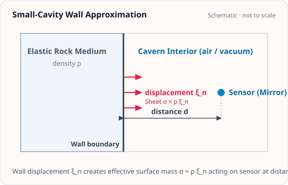

<!-- GENERATED MODEL REFERENCE: regenerate through the catalogue workflow. -->
# Small-cavity wall approximation

## Model overview

**Level:** — (definition and assignment pending).

**Physical domain:** seismic elastic  
**Geometry:** cavity

Sphere, cuboid or cylinder; selected linearized wall contribution only

**Source-declared observable / representation pairs:**

- ① Φ a Γ — Static
- ② Φ a Γ — Phasor

These pairs are a union over the listed calculation paths. They do not imply every API exposes every combination.

[Back to model catalogue](../guide/model-and-method-catalogue.md)

## Geometry and equations

*Planar wall boundary with normal displacement ξ_n inducing effective surface mass sheet σ = ρ ξ_n at distance d.*

- The model accepts Sphere, Cuboid, Cylinder, but plot_shape helper supports only Cuboid, Cylinder, SphericalShell and explicitly rejects Cavity types; high-level small_cavity_wall model is cavity-named and is not automatically plot-able. A standalone Sphere geometry is not among the supported classes.
- Harms scalar table supports five discrete shape/location rows; tensor paths have separate geometric coverage.

### Equations

**Analytical formulation and field equations:**

- High-level small_cavity_wall evaluates selected wall contributions to potential \(\Phi\), acceleration \(\mathbf a\), and gradient \(\mathbf\Gamma\) (static or single-frequency phasor) for cavity wall displacement \(\mathbf u\): \(\Phi_{\mathrm{wall}} = -\mathbf u \cdot \mathbf a_{\mathrm{body}}\), \(\mathbf a_{\mathrm{wall}} = \mathbf\Gamma_{\mathrm{body}} \mathbf u\).
- Harms 2022 scalar wall coupling factor is dimensionless geometric factor \(C\). sca_wall_acceleration computes the acceleration vector from the lookup factor: \(\mathbf a = C G \rho \mathbf u\).
- Tensor contraction G-free: \(\Delta\mathbf a / G = -\rho \mathbf C_g \mathbf u\); SI: \(\Delta\mathbf a = -G \rho \mathbf C_g \mathbf u\). SCA approximation applies only when the cavity is much smaller than source-to-target distance; high-level model displacement must be first-order small.

## Parameters and calculation paths

### Parameters and units

#### API parameters

| Function / Path | Parameter | Type / Format | Default | Description |
|---|---|---|---|---|
| `small_cavity_wall` | `geometry` | Sphere | Cuboid | Cylinder | required | Cavity boundary geometry instance |
| `small_cavity_wall` | `displacement` | u.Quantity (length 3-vector) | required | Rigid cavity wall displacement vector |
| `small_cavity_wall` | `density` | u.Quantity (density) | required (kw-only) | Surrounding rock mass density |
| `sca_wall_coupling_factor` | `cavern_shape` | Literal | required | 'sphere', 'cube', 'half_sphere', or 'elongated_cuboid_2to1to1' |
| `sca_wall_coupling_factor` | `test_mass_location` | Literal | required | 'arbitrary', 'center_3d', or 'floor_center_2d' |
| `sca_wall_acceleration` | `density_kg_m3` | float | required | Surrounding rock mass density in kg/m³ |
| `sca_wall_acceleration` | `displacement_m` | float | required | Wall displacement amplitude in meters |

#### Mathematical symbols and notation

| Symbol | Meaning | SI unit | Definition / Relation |
|---|---|---|---|
| \(\mathbf u\) | Wall displacement | m | Rigid displacement vector of cavity wall |
| \(\rho\) | Rock mass density | kg/m³ | Density of surrounding medium |
| \(C_{\mathrm{sca}}\) | Coupling factor | dimensionless | Geometric factor from Harms et al. (2022) Table 1 |
| \(\mathbf a\) | Coupled acceleration | m/s² | \(\mathbf a = -C_{\mathrm{sca}} G \rho \mathbf u\) |

#### Usage notes

- High-level `small_cavity_wall` evaluates the complete spatial acceleration field for supported boundary geometries.
- Scalar functions `sca_wall_coupling_factor` and `sca_wall_acceleration` provide tabulated coupling constants and point evaluations.

### Calculation paths

#### geometry-aware small_cavity_wall model

- `gragra.analytic.seismic.small_cavity_wall`

**Path-level source-declared output union:** Φ a Γ — Static; Φ a Γ — Phasor

#### Harms 2022 scalar table lookup and acceleration

- `gragra.analytic.sca_wall_acceleration`

**Path-level source-declared output union:** a — Static

#### Harms 2022 dimensionless coupling factor lookup

- `gragra.analytic.sca_wall_coupling_factor`

This path provides a related coefficient, coupling quantity, or helper rather than a direct Φ/a/Γ output.

#### shape-specific tensor SCA numeric paths (related, not the assigned scalar factory)

- `gragra.analytic.sca_wall_coupling_factor`
- `gragra.analytic.seismic.small_cavity_wall`

This path provides a related coefficient, coupling quantity, or helper rather than a direct Φ/a/Γ output.

## Derivation and sources

### Derivation

Scalar Harms coefficients are literal table entries; general tensors are local derivation/numerical surface paths with recorded convention mapping.

- Do not generalize table scalar into all-geometry analytic tensor. Tensor source-map explicitly restricts interpretation and physical-boundary handling.

### References

Existing public documentation and original formulation context:

- [Analytic models](../guide/gen1-analytic-models.md)
- [physics API](../api/physics.md)

**Bibliographic inventory:** located.

- Harms et al., ‘A lower limit for Newtonian-noise models of the Einstein Telescope’ (2022), EPJ Plus 137:687, DOI 10.1140/epjp/s13360-022-02851-z; Eqs 1–4,7, Table 1. Tempel et al. 2025 pp. 9–12,42–46 recorded for tensor convention. This inventory records repository citations, not independent paper inspection.
- [DOI 10.1140/epjp/s13360-022-02851-z](https://doi.org/10.1140/epjp/s13360-022-02851-z)

## Verification and applicability

### Verification

**Evidence classes are distinct:** source declarations, catalogue output-contract probes, existing test code, documentary validation claims, and saved numerical results.

- Representative catalogue output-contract entries: 0.
- Catalogue probe state: Not assessed (no catalogue output probe registered).
- Registered output-contract probes run during catalogue validation check selected API outputs only; they do not measure scientific accuracy.
- Scientific accuracy tests are not part of documentation generation; no accuracy Level is assigned.

**Existing verification inventory:**

Test code, prose verification, and saved run metadata separated; no new run executed.

- [`tests/test_analytic_sca_tensor.py`](https://github.com/tatsuki-washimi/gragra/blob/main/tests/test_analytic_sca_tensor.py) implements independent surface quadrature, target convergence, boundary/rotation/complex displacement checks. Reported tolerance: norm(current-previous)&lt;=1e-12+1e-9*max(norm(current),1), order doubles up to 128. Historical focused runs are not rerun here. The validation inventory records the scalar-focused command as successful. No formal execution performed.

### Applicability and limitations

- Harms floor-center table row does not specify boundary condition/tensor direction/one-sided limit. Scalar lookup does not carry k. high-level model excludes physical wall. No arbitrary model-wide formula/plot capability.

**Scope note:** Wall-only first-order SCA; small cavity relative to source-target distance; no bulk or scattering term. Scalar lookup only five combos; tensor APIs own separate boundaries and geometry scopes.

See the public verification and limitations guidance for test-specific conditions and interpretation:

- [Verification matrix](../verification/matrix.md)
- [Verification limitations](../verification/limitations.md)

## Information not yet confirmed

- No output_contracts in catalog group; no runnable representative catalogue probe defined.
- Exact all five scalar coefficient values omitted from this record.
- No new science run or artifact inspection; prose historical claims remain un-reproduced.

*Publication scope: narrative summaries and links, not private derivation records, internal test artifacts or inventory JSON.*
