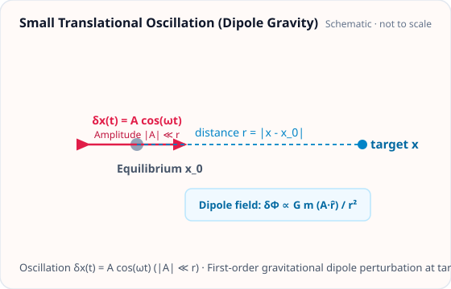

<!-- GENERATED MODEL REFERENCE: regenerate through the catalogue workflow. -->
# Small translational oscillation

## Model overview

**Level:** — (definition and assignment pending).

**Physical domain:** rigid motion  
**Geometry:** `point`

Linearized point-mass or cloud phasor

**Source-declared observable / representation pairs:**

- Φ a Γ — Phasor

These pairs are a union over the listed calculation paths. They do not imply every API exposes every combination.

[Back to model catalogue](../guide/model-and-method-catalogue.md)

## Geometry and equations



*Harmonic translational oscillation δx(t) = A cos(ωt) (|A| ≪ r) generating a dipole gravitational perturbation.*

- Small first-order translation approximation, phasor not exact finite motion.

### Equations

For point masses \(m_i\) at equilibrium positions \(\mathbf x_{0,i}\) undergoing small harmonic translational oscillations \(\mathbf u_i(t) = \operatorname{Re}\left[\mathbf u_i e^{-2\pi i f (t - t_{\mathrm{ref}})}\right]\) (\(\|\mathbf u_i\| \ll r_i\)) with oscillation frequency \(f\) and reference epoch \(t_{\mathrm{ref}}\):

Let the unperturbed separation vector to target \(\mathbf x\) be:

$$
\mathbf r_i = \mathbf x - \mathbf x_{0,i}, \qquad r_i = \|\mathbf r_i\| > 0.
$$

Under the peak phasor convention (representing physical amplitude without an extra factor of \(1/2\)), the first-order perturbation in gravitational potential is:

$$
\delta\Phi(\mathbf x) = -G \sum_{i=1}^N \frac{m_i (\mathbf r_i \cdot \mathbf u_i)}{r_i^3}.
$$

The first-order perturbation in gravitational acceleration is:

$$
\delta\mathbf a(\mathbf x) = G \sum_{i=1}^N m_i \left[ \frac{\mathbf u_i}{r_i^3} - \frac{3 (\mathbf r_i \cdot \mathbf u_i) \mathbf r_i}{r_i^5} \right].
$$

The first-order perturbation in the gravity-gradient tensor is:

$$
\delta\mathbf\Gamma(\mathbf x) = G \sum_{i=1}^N m_i \left[ -\frac{3 \left( \mathbf u_i \otimes \mathbf r_i + \mathbf r_i \otimes \mathbf u_i + (\mathbf r_i \cdot \mathbf u_i) \mathbf I_3 \right)}{r_i^5} + \frac{15 (\mathbf r_i \cdot \mathbf u_i) \mathbf r_i \otimes \mathbf r_i}{r_i^7} \right].
$$

The perturbation tensor is symmetric and traceless: \(\delta\mathbf\Gamma = \delta\mathbf\Gamma^T\) and \(\mathrm{tr}(\delta\mathbf\Gamma) = 0\). Targets coincident with equilibrium positions (\(r_i = 0\)) are singular and raise a `ValueError`.

## Parameters and calculation paths

### Parameters and units

#### API parameters

| Function / Path | Parameter | Type / Format | Default | Description |
|---|---|---|---|---|
| `translational_oscillation` | `point_mass` | PointMass | required | Point mass object with mass and equilibrium coordinates |
| `translational_oscillation` | `amplitude` | u.Quantity (length 3-vector) | required | Displacement amplitude vector \(\boldsymbol\xi_0\) |
| `translational_oscillation` | `frequency` | u.Quantity (frequency) | required | Oscillation frequency f in Hz |
| `translational_oscillation` | `phase` | u.Quantity (angle) | required (kw-only) | Initial oscillation phase angle |
| `translational_oscillation` | `frame` | Frame | required (kw-only) | Reference coordinate frame instance |
| `translational_oscillation` | `sampling` | TimeSampling | required (kw-only) | Output time axis discretization |

#### API return values

| Function / Path | Return type | Representation | Quantity & Unit | Shape / Structure | Description |
|---|---|---|---|---|---|
| `translational_oscillation` | _MotionModel | Phasor | Φ: m²/s², a: m/s², Γ: s⁻² | EvaluationResult with FrequencySeriesMatrix payloads | First-order harmonic point-mass oscillation model evaluated via .at(targets).run() |

#### Mathematical symbols and notation

| Symbol | Meaning | SI unit | Definition / Relation |
|---|---|---|---|
| \(m\) | Point mass | kg | Oscillating body mass (\(m > 0\)) |
| \(\mathbf x_0\) | Equilibrium center | m | Center of harmonic oscillation |
| \(\boldsymbol{\xi}_0\) | Displacement amplitude | m | Peak displacement amplitude 3-vector |
| \(f\) | Oscillation frequency | Hz | Linear frequency (\(\omega = 2\pi f\)) |
| \(\phi\) | Initial phase | rad | Harmonic phase angle at \(t = 0\) |
| \(\mathbf x(t)\) | Trajectory position | m | \(\mathbf x(t) = \mathbf x_0 + \boldsymbol{\xi}_0 \sin(2\pi f t + \phi)\) |

#### Usage notes

- Evaluates via `.at(targets).run()` to produce harmonic time series or phasor responses.

### Calculation paths

#### implemented model/API path

- `gragra.analytic.objects.translational_oscillation`

**Observables after model evaluation:** Φ a Γ — Phasor

High-level model factories create evaluation objects; call the documented `.at(...).run()` workflow to evaluate them. Observable functions listed above are direct calls with their own return values.

### Calculation example and output

The following Python snippet evaluates this model with representative parameters and prints the resulting physical quantities:

```python
import astropy.units as u
from gragra.geometry import Frame
from gragra.gravity_sources import PointMass
from gragra.targets import TargetPoints
from gragra.analytic.objects import translational_oscillation

frame = Frame('world')
pm = PointMass(1000.0, [0.0, 0.0, 0.0])
model = translational_oscillation(
    pm, [0.01, 0.0, 0.0]*u.m, frame=frame, frequency=5.0*u.Hz,
    reference_time=(100, 0)
)
res = model.at(TargetPoints([[0.0, 0.0, 10.0]]*u.m, ('t1',), frame)).run()
print('potential:', res.potential.value, res.potential.units)
print('acceleration:', res.acceleration.value, res.acceleration.units)
print('gradient:', res.gradient.value, res.gradient.units)
```

Representative output:

```text
potential: [[[0.-0.j]]] [[Unit("m2 / s2")]]
acceleration: [[[6.6743e-13+0.j]
  [0.0000e+00+0.j]
  [0.0000e+00+0.j]]] [[Unit("m / s2") Unit("m / s2") Unit("m / s2")]]
gradient: [[[ 0.00000e+00+0.j]
  [ 0.00000e+00+0.j]
  [-2.00229e-13+0.j]
  [ 0.00000e+00+0.j]
  [ 0.00000e+00+0.j]
  [ 0.00000e+00+0.j]
  [-2.00229e-13+0.j]
  [ 0.00000e+00+0.j]
  [ 0.00000e+00+0.j]]] [[Unit("1 / s2") Unit("1 / s2") Unit("1 / s2") Unit("1 / s2")
  Unit("1 / s2") Unit("1 / s2") Unit("1 / s2") Unit("1 / s2")
  Unit("1 / s2")]]
```

## Derivation and sources

### Derivation

Formula expressions are declared in source; a separate local derivation proof was not located in the focused scan.

- No separate derivation is asserted from the formula declaration alone.

### References

Existing public documentation and original formulation context:

- [Analytic models](../guide/gen1-analytic-models.md)

**Bibliographic inventory:** partial.

- Shared motion reference metadata; formulas recorded in source.

## Verification and applicability

### Verification

**Evidence classes are distinct:** source declarations, catalogue output-contract probes, existing test code, documentary validation claims, and saved numerical results.

- Representative catalogue output-contract entries: 0.
- Catalogue probe state: Not assessed (no catalogue output probe registered).
- Registered output-contract probes run during catalogue validation check selected API outputs only; they do not measure scientific accuracy.
- Scientific accuracy tests are not part of documentation generation; no accuracy Level is assigned.

**Existing verification inventory:**

Verification method, tolerances, and artifact status recorded; tests were not run in this task.

- Rigid-motion oracle tests exist, but oscillation-specific saved result not located; no current execution.

### Applicability and limitations

- Small first-order translation approximation, phasor not exact finite motion.

**Scope note:** Applicability limits recorded.

See the public verification and limitations guidance for test-specific conditions and interpretation:

- [Verification matrix](../verification/matrix.md)
- [Verification limitations](../verification/limitations.md)


## Information not yet confirmed

- Catalogue `output_contracts` are empty; this is a missing representative probe, not evidence of absent science.
- No additional committed plot asset identified in these assigned API sources.

*Publication scope: narrative summaries and links, not private derivation records, internal test artifacts or inventory JSON.*
