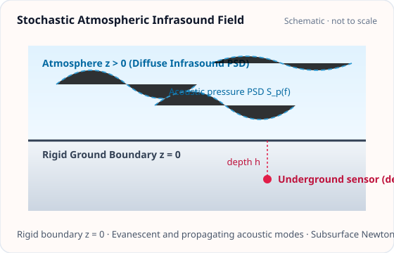

<!-- GENERATED MODEL REFERENCE: regenerate through the catalogue workflow. -->
# Stochastic atmospheric infrasound

## Model overview

**Level:** — (definition and assignment pending).

**Physical domain:** stochastic atmospheric  
**Geometry:** `halfspace`, `cavity`

Surface, underground and centered-cavern idealizations; acceleration CSD

**Source-declared observable / representation pairs:**

- a — Spectral density (CSD)

These pairs are a union over the listed calculation paths. They do not imply every API exposes every combination.

[Back to model catalogue](../guide/model-and-method-catalogue.md)

## Geometry and equations



*Diffuse atmospheric infrasound power spectral density above rigid ground z = 0 penetrating to underground depth h.*

A1 rigid surface; A2 depth halfspace; A3 centered cavern idealization. Basic SphericalShell plotting is static only and does not encode modal acoustic fields.

### Equations

Atmospheric infrasound produces Newtonian noise through adiabatic pressure and density fluctuations advecting or propagating across the detector environment. Let \(S_p(f)\) denote the pressure power spectral density in \(\mathrm{Pa^2/Hz}\), \(c_s\) the atmospheric sound speed, and \(f\) the frequency.

**A1: Surface isotropic infrasound**

The G-free acceleration cross-spectral density (CSD) tensor at the surface is:

$$
\mathbf S_a^{(G\text{-free})}(f) = \frac{S_p(f)}{(c_s f)^2} \operatorname{diag}\left(\frac{1}{3}, \frac{1}{3}, \frac{2}{3}\right)
$$

**A2: Underground observation at depth \(h \ge 0\)**

At depth \(h\), high horizontal wavenumbers are exponentially attenuated:

$$
\mathbf S_a^{(G\text{-free})}(f) = \frac{S_p(f) I_{\mathrm{iso}}(x)}{(c_s f)^2} \operatorname{diag}(1, 1, 2)
$$

with dimensionless depth parameter \(x = 4\pi f h / c_s\) and angular attenuation integral:

$$
I_{\mathrm{iso}}(x) = \frac{1}{2} \int_0^{\pi/2} \sin^3\theta \, e^{-x \sin\theta} \, d\theta
$$

**A3: Instrument centered in a spherical cavern of radius \(R \ge 0\)**

The cavern acts as a geometric high-pass filter on ambient pressure fluctuations:

$$
\mathbf S_a^{(G\text{-free})}(f) = S_{a,ii}^{(G\text{-free})}(f) \, \mathbf I_3
$$

with isotropic diagonal spectral component:

$$
S_{a,ii}^{(G\text{-free})}(f) = \frac{4}{3 (c_s f)^2} S_{p,\mathrm{cav}}(f) \left[1 - \operatorname{sinc}\left(\frac{2\pi f R}{c_s}\right)\right]^2
$$

which vanishes smoothly as \(R \to 0\).

**SI observable conversion**

All G-free acceleration CSD tensors \(\mathbf S_a^{(G\text{-free})}\) in units of \(\mathrm{kg^2/(m^4\cdot Hz)}\) convert to physical SI units \(\mathrm{(m/s^2)^2/Hz}\) by multiplying by \(G^2\):

$$
\mathbf S_a^{(\mathrm{SI})} = G^2 \mathbf S_a^{(G\text{-free})}
$$

## Parameters and calculation paths

### Parameters and units

#### API parameters

| Function / Path | Parameter | Type / Format | Default | Description |
|---|---|---|---|---|
| `surface_isotropic_acoustic_acceleration_csd` | `sound_speed_m_s` | float | required (kw-only) | Speed of sound in air \(c_s\) in m/s (positive) |
| `surface_isotropic_acoustic_acceleration_csd` | `frequency_hz` | float \| ArrayLike | required (kw-only) | Evaluation frequency in Hz (f > 0) |
| `surface_isotropic_acoustic_acceleration_csd` | `surface_pressure_psd_pa2_hz` | float \| ArrayLike | required (kw-only) | One-sided surface pressure PSD in Pa²/Hz |
| `underground_isotropic_acoustic_acceleration_csd` | `depth_m` | float | required (kw-only) | Detector depth below surface h in meters (h >= 0) |
| `centered_cavern_isotropic_acoustic_acceleration_csd` | `radius_m` | float | required (kw-only) | Cavern inner radius R in meters (R >= 0) |
| `centered_cavern_isotropic_acoustic_acceleration_csd` | `cavern_pressure_psd_pa2_hz` | float \| ArrayLike | required (kw-only) | One-sided pressure PSD inside cavern in Pa²/Hz |

#### API return values

| Function / Path | Return type | Representation | Quantity & Unit | Shape / Structure | Description |
|---|---|---|---|---|---|
| `surface_isotropic_acoustic_acceleration_csd` | ndarray | CSD | a: (m/s²)²/Hz | (3, 3) complex128 array | One-sided acceleration CSD tensor at surface (A1) for isotropic atmospheric infrasound |
| `underground_isotropic_acoustic_acceleration_csd` | ndarray | CSD | a: (m/s²)²/Hz | (3, 3) complex128 array | One-sided acceleration CSD tensor underground at depth h (A2) for isotropic infrasound |
| `centered_cavern_isotropic_acoustic_acceleration_csd` | ndarray | CSD | a: (m/s²)²/Hz | (3, 3) complex128 array | One-sided acceleration CSD tensor at cavern center (A3) for isotropic infrasound |

#### Mathematical symbols and notation

| Symbol | Meaning | SI unit | Definition / Relation |
|---|---|---|---|
| \(c_s\) | Speed of sound | m/s | Speed of sound in air (\(c_s > 0\)) |
| \(f\) | Frequency | Hz | Acoustic evaluation frequency in Hz |
| \(S_p^{\mathrm{surf}}(f)\) | Surface pressure PSD | Pa²/Hz | One-sided pressure PSD at ground surface (A1, A2) |
| \(h\) | Detector depth | m | Depth below ground surface (\(h \ge 0\), A2) |
| \(R\) | Cavern radius | m | Inner cavern radius (\(R \ge 0\), A3) |
| \(S_p^{\mathrm{cav}}(f)\) | Cavern pressure PSD | Pa²/Hz | Pressure PSD inside cavern (A3) |
| \(\mathbf S_a(f)\) | Acceleration CSD tensor | (m/s²)²/Hz | 3x3 diagonal CSD tensor with SI factor \(G^2\) |

#### Usage notes

- Covers A1 (surface isotropic), A2 (underground at depth \(h\)), and A3 (centered inside spherical cavern of radius \(R\)).

### Calculation paths

#### A1 isotropic surface acoustic

- `gragra.observables.stochastic_acoustic.surface_isotropic_acoustic_acceleration_csd`

**Path-level source-declared output union:** a — Spectral density (CSD)

#### A2 isotropic underground acoustic

- `gragra.observables.stochastic_acoustic.underground_isotropic_acoustic_acceleration_csd`

**Path-level source-declared output union:** a — Spectral density (CSD)

#### A3 centered cavern acoustic

- `gragra.observables.stochastic_acoustic.centered_cavern_isotropic_acoustic_acceleration_csd`

**Path-level source-declared output union:** a — Spectral density (CSD)

### Calculation example and output

The following Python snippet evaluates this model with representative parameters and prints the resulting physical quantities:

```python
from gragra.observables.stochastic_acoustic import surface_isotropic_acoustic_acceleration_csd

csd = surface_isotropic_acoustic_acceleration_csd(
    sound_speed_m_s=340.0, frequency_hz=1.0, surface_pressure_psd_pa2_hz=1e-4
)
print('Infrasound CSD matrix:\n', csd)
```

Representative output:

```text
Infrasound CSD matrix:
 [[1.28449482e-30 0.00000000e+00 0.00000000e+00]
 [0.00000000e+00 1.28449482e-30 0.00000000e+00]
 [0.00000000e+00 0.00000000e+00 2.56898965e-30]]
```

## Derivation and sources

### Derivation

A2 implementation records integral definition and three numerical domains; A3 specification distinguishes published hemispherical-cavern Eq.13 from separately developed response. Text inventory only, no algebraic certification.

### References

Existing public documentation and original formulation context:

- [Stochastic NN](../guide/stochastic-nn.md)
- [limitations](../verification/limitations.md)

**Bibliographic inventory:** located.

- The local model specification distinguishes the provenance of Eq. 13 from the separate A3 response. It is not an independent bibliographic record.
- The A3 centered-cavern API is a related API identified in the source. The ledger group lists only the surface and underground APIs; A3 is not treated as an original catalogue symbol.
- [DOI 10.1007/s41114-019-0022-2](https://doi.org/10.1007/s41114-019-0022-2)
- [DOI 10.1063/5.0018414](https://doi.org/10.1063/5.0018414)

## Verification and applicability

### Verification

**Evidence classes are distinct:** source declarations, catalogue output-contract probes, existing test code, documentary validation claims, and saved numerical results.

- Representative catalogue output-contract entries: 0.
- Catalogue probe state: Not assessed (no catalogue output probe registered).
- Registered output-contract probes run during catalogue validation check selected API outputs only; they do not measure scientific accuracy.
- Scientific accuracy tests are not part of documentation generation; no accuracy Level is assigned.

**Existing verification inventory:**

Test implementation records explicit A1/A2/A3 checks; tests were not run in this editorial review. No committed executed-result artifact for these exact test functions was identified.

- [`tests/test_stochastic_acoustic.py`](https://github.com/tatsuki-washimi/gragra/blob/main/tests/test_stochastic_acoustic.py) A1: \(c_s\)=343 m/s, pressure PSD=4e-4 Pa²/Hz, \(f\)=2 Hz; closed tensor equality rtol=0, atol=0; doubled-frequency 1/f² scaling rtol=2e-15.
- A2 depth factor independent angular quadrature uses x={0,0.1,0.7,1,5,10,20,50}, scipy quad epsabs=epsrel=2e-14, limit=200; comparison rtol=2e-4, atol=2e-14. Test comment says implementation-conditioning, not final science acceptance.

### Applicability and limitations


**Scope note:** frequency \(f &gt; 0\); sound speed \(c_s &gt; 0\); depth/radius non-negative in kernels; PSD non-negative. A3 center and idealized geometry; acoustic formulations noted as under refinement in guide.

See the public verification and limitations guidance for test-specific conditions and interpretation:

- [Verification matrix](../verification/matrix.md)
- [Verification limitations](../verification/limitations.md)


## Information not yet confirmed

- Modal/resolved cavern, arbitrary cavity geometry, acoustic frequency-dependent boundary conditions not represented.

*Publication scope: narrative summaries and links, not private derivation records, internal test artifacts or inventory JSON.*
