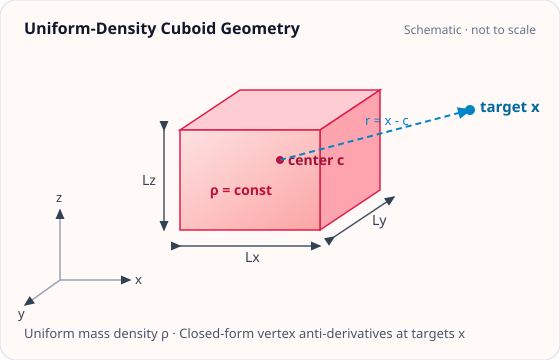

<!-- GENERATED MODEL REFERENCE: regenerate through the catalogue workflow. -->
# Uniform-density cuboid

## Model overview

**Level:** — (definition and assignment pending).

**Physical domain:** static gravity  
**Geometry:** cuboid

Finite rectangular prism; static Newton field

**Source-declared observable / representation pairs:**

- Φ a Γ — Static

These pairs are a union over the listed calculation paths. They do not imply every API exposes every combination.

[Back to model catalogue](../guide/model-and-method-catalogue.md)

## Geometry and equations

*Axis-aligned cuboid with center c, dimensions (Lx, Ly, Lz), uniform density ρ, and evaluation target x.*

- high-level Cuboid holds frame/lengths. Vertex antiderivative domain interior/exterior away from material boundary. No arbitrary mesh reuse implied.

### Equations

**Analytical formulation and field equations:**

- For an axis-aligned cuboid centered at \(\mathbf c\) with side lengths \((L_x, L_y, L_z)\) and uniform density \(\rho\), relative corner coordinates are \((u_i, v_j, w_k) = (x_t - c_x \mp L_x/2, y_t - c_y \mp L_y/2, z_t - c_z \mp L_z/2)\) with distance \(r = \sqrt{u^2 + v^2 + w^2}\).
- The G-free potential is \(\Phi^{(G\text{-free})} = \rho \sum_{i,j,k=1}^2 (-1)^{i+j+k} F_1(u_i, v_j, w_k)\), where \(F_1(u, v, w) = u v \ln(w+r) + v w \ln(u+r) + w u \ln(v+r) - \frac{u^2}{2}\operatorname{atan}\left(\frac{vw}{ur}\right) - \frac{v^2}{2}\operatorname{atan}\left(\frac{wu}{vr}\right) - \frac{w^2}{2}\operatorname{atan}\left(\frac{uv}{wr}\right)\) (Nagy et al. 2000, Petrovic 1996).
- Acceleration components use \(F_2(u, v, w) = u \ln(v+r) + v \ln(u+r) - w \operatorname{atan}\left(\frac{uv}{wr}\right)\), and the diagonal gradient satisfies \(\Gamma_{xx}^{(G\text{-free})} = \rho \sum (-1)^{i+j+k} \operatorname{atan}\left(\frac{vw}{ur}\right)\). Off-diagonal terms use \(\ln(w+r)\).
- Interior points strictly satisfy \(\mathrm{tr}(\mathbf\Gamma) = -4\pi G\rho\) (G-free: \(-4\pi\rho\)), and exterior points satisfy \(\mathrm{tr}(\mathbf\Gamma) = 0\). Targets on material boundaries (faces, edges, vertices) have logarithmic singularities or jump discontinuities and raise ValueError.

## Parameters and calculation paths

### Parameters and units

| Symbol | Parameter | Meaning | SI unit |
|---|---|---|---|
| \(\mathbf c\) | `center_m` | Cuboid center | m |
| \(\mathbf L\) | `lengths_m` | Full side lengths (Lx, Ly, Lz), all positive | m |
| \(\rho\) | `density_kg_m3` | Uniform mass density (positive) | kg/m³ |
| \(\mathbf x\) | `targets_m` | Evaluation targets, shape (M, 3) | m |

**Additional notes on parameters and models:**

- center_m: array-like (3,), cuboid center c in meters; lengths_m: array-like (3,), full side lengths (Lx, Ly, Lz) in meters (all positive); density_kg_m3: float, uniform mass density rho in kg/m^3 (positive); targets_m: array-like (M, 3), evaluation targets in meters.
- High-level model gragra.analytic.objects.uniform_cuboid accepts a Cuboid geometry object and an Astropy Quantity density. Points on faces, edges, or vertices raise ValueError.

### Calculation paths

#### axis-aligned cuboid closed form

- `gragra.analytic.objects.uniform_cuboid`
- `gragra.observables.cuboid_observables`

**Observables after model evaluation:** Φ a Γ — Static

High-level model factories create evaluation objects; call the documented `.at(...).run()` workflow to evaluate them. Observable functions listed above are direct calls with their own return values.

## Derivation and sources

### Derivation

Committed independent derivation document exists; its text is inventoried as a derivation record, not re-proven here.

- A non-public validation note includes the source-formula discussion and implementation conclusions; its contents are not reproduced in this catalogue.

### References

Existing public documentation and original formulation context:

- [Analytic benchmarks](../guide/analytic-benchmarks.md)
- [analytic models](../guide/gen1-analytic-models.md)

**Bibliographic inventory:** located.

- Nagy, D. (1966), ‘The gravitational attraction of a right rectangular prism.’ Nagy, D., Papp, G., & Benedek, J. (2000), ‘The gravitational potential and its ...’; 2002 erratum. Petrović (1996) is named in analytic benchmark/report, but complete record not transcribed here.

## Verification and applicability

### Verification

**Evidence classes are distinct:** source declarations, catalogue output-contract probes, existing test code, documentary validation claims, and saved numerical results.

- Representative catalogue output-contract entries: 3.
- Catalogue probe state: recorded (a representative API output contract, not an accuracy test).
- Registered output-contract probes run during catalogue validation check selected API outputs only; they do not measure scientific accuracy.
- Scientific accuracy tests are not part of documentation generation; no accuracy Level is assigned.

**Existing verification inventory:**

Test implementation and documentary claims found; no checks were run for this inventory.

- [`tests/test_analytic_cuboid.py`](https://github.com/tatsuki-washimi/gragra/blob/main/tests/test_analytic_cuboid.py) includes derivative consistency, symmetry, Poisson trace, boundary rejection, independent interior/exterior quadrature, SI wrapper. Report states boundary tolerance atol=1e-12*max(half_lengths), interior trace -4πGρ, exterior trace 0. formula ledger records unrelated historical run metadata; revision-matched raw output path for assigned cuboid probe not established. cuboid_si contract is representative probe only.

#### Registered representative output probes

| API | Observable | Representation | Probe |
|---|---|---|---|
| `gragra.observables.cuboid_observables` | Φ | Static | `cuboid_si` |
| `gragra.observables.cuboid_observables` | a | Static | `cuboid_si` |
| `gragra.observables.cuboid_observables` | Γ | Static | `cuboid_si` |

### Applicability and limitations

- interior tr Γ=-4πGρ; exterior tr Γ=0. Numerical tolerance does not define boundary values.

**Scope note:** Uniform-density, rectangular prism only; points on faces/edges/vertices rejected due discontinuity/log singularity.

See the public verification and limitations guidance for test-specific conditions and interpretation:

- [Verification matrix](../verification/matrix.md)
- [Verification limitations](../verification/limitations.md)

## Information not yet confirmed

- Catalog probe not executed; no numeric output recorded here.
- Petrović full bibliographic record not transcribed.
- Source derivation/tests do not establish a rerun at this task revision.

*Publication scope: narrative summaries and links, not private derivation records, internal test artifacts or inventory JSON.*
