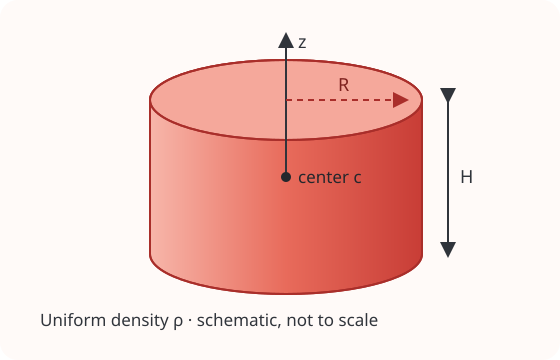
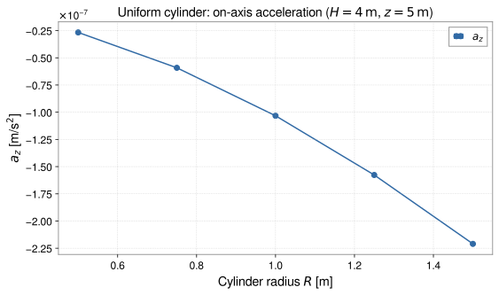

<!-- GENERATED MODEL REFERENCE: regenerate through the catalogue workflow. -->
# Uniform-density cylinder

## Model overview

**Level:** — (definition and assignment pending).

**Physical domain:** static gravity  
**Geometry:** `cylinder`

Finite uniform-density cylinder with an on-axis closed form and separate general-position numerical and analytic paths

**Source-declared observable / representation pairs:**

- Φ a Γ — Static

These pairs are a union over the listed calculation paths. They do not imply every API exposes every combination.

[Back to model catalogue](../guide/model-and-method-catalogue.md)

## Geometry

The finite solid cylinder has center \(\mathbf c\), radius \(R>0\), height \(H>0\), and local symmetry axis \(z\). Density is supplied to the model separately from its geometry.



*Schematic geometry; dimensions are not to scale.*

- Cylinder geometry in its frame; high-level evaluator transforms arbitrary target positions to geometry frame and calls general-point analytic cylinder triple. It is not on-axis-restricted. Low-level `cylinder_axis_observables` remains a distinct axis-only API; general numerical and analytic APIs have separate algorithm paths.

## Analytic formulation, sources, and scope

### Equations

For a uniform cylinder centered at \(\mathbf c\), let
\(z=x_z-c_z\), \(u_1=-H/2-z\), and \(u_2=H/2-z\). Define

$$
P(u)=\frac{1}{2}\left[u\left(\sqrt{R^2+u^2}-|u|\right)
+R^2\operatorname{asinh}\left(\frac{u}{R}\right)\right],
\qquad
F(u)=|u|-\sqrt{R^2+u^2}.
$$

The on-axis potential and acceleration in SI units are

$$
\Phi(z)=-2\pi G\rho\left[P(u_2)-P(u_1)\right],
\qquad
a_z(z)=2\pi G\rho\left[F(u_2)-F(u_1)\right].
$$

By axial symmetry, the on-axis gravity-gradient tensor is diagonal, with

$$
\Gamma_{zz}=\frac{\partial a_z}{\partial z},
\qquad
\Gamma_{xx}=\Gamma_{yy}=\frac{-4\pi G\rho_{\mathrm{local}}-\Gamma_{zz}}{2}.
$$

Here \(\rho_{\mathrm{local}}=\rho\) for \(|z|<H/2\) and is zero outside
the cylinder. End-face targets \(z=\pm H/2\) are rejected by the bundled
axis API because the gradient is undefined or discontinuous there. These
closed forms apply to targets on the cylinder axis. General-point APIs use
separate numerical-quadrature or elliptic/series paths.

### Derivation

An independent derivation exists for the on-axis closed forms, but its detailed contents are not published. References for the general-position elliptic/series derivation were not located.

### References

Existing public documentation and original formulation context:

- [Analytic benchmarks](../guide/analytic-benchmarks.md)
- [physics API](../api/physics.md)

**Bibliographic inventory:** partial.

### Applicability and scope

Axis closed form is strictly axial; off-axis targets rejected. General numerical and analytic variants have separate methods and physical boundary exclusion.

- Axis API does not offer general off-axis closed form. Numerical quadrature is exploratory/reference; analytic general-point path is a separate API; not Conway claimed solution.
## STEP 1 — Setup

Primary path: `uniform_cylinder(...).at(...).run()`

Primary path: `uniform_cylinder(...).at(...).run()`

Build inputs consistent with **Detailed reference**:

```python
import astropy.units as u
from gragra.geometry import Frame, Cylinder
from gragra.targets import TargetPoints
from gragra.analytic.objects import uniform_cylinder

frame = Frame('lab')
geometry = Cylinder([0.0, 0.0, 0.0] * u.m, 1.0 * u.m, 4.0 * u.m, frame)
density = 2700.0 * u.kg / u.m**3
targets = TargetPoints([[0.0, 0.0, 5.0]] * u.m, ('on_axis',), frame)
model = uniform_cylinder(geometry, density)
request = model.at(targets)
```

## STEP 2 — Validate / Inspect

STEP 2 items are tagged by information source:

- **`api`**: read from a gragra evaluation object: `validate()` is a **method**; `parameters`, `formulas`, and `references` are **`@property`** objects (not callable).
- **`tutorial-display`**: assembled for this page from documented inputs or catalogue-verified display equations (not a separate gragra registry lookup).
- **`api-output`**: taken from executed result payloads (units, shapes, GWexpy axes).

#### Display equations (`tutorial-display`)

Catalogue-registered analytic formulation (same as **Analytic formulation, sources, and scope** above):

For a uniform cylinder centered at \(\mathbf c\), let
\(z=x_z-c_z\), \(u_1=-H/2-z\), and \(u_2=H/2-z\). Define

$$
P(u)=\frac{1}{2}\left[u\left(\sqrt{R^2+u^2}-|u|\right)
+R^2\operatorname{asinh}\left(\frac{u}{R}\right)\right],
\qquad
F(u)=|u|-\sqrt{R^2+u^2}.
$$

The on-axis potential and acceleration in SI units are

$$
\Phi(z)=-2\pi G\rho\left[P(u_2)-P(u_1)\right],
\qquad
a_z(z)=2\pi G\rho\left[F(u_2)-F(u_1)\right].
$$

By axial symmetry, the on-axis gravity-gradient tensor is diagonal, with

$$
\Gamma_{zz}=\frac{\partial a_z}{\partial z},
\qquad
\Gamma_{xx}=\Gamma_{yy}=\frac{-4\pi G\rho_{\mathrm{local}}-\Gamma_{zz}}{2}.
$$

Here \(\rho_{\mathrm{local}}=\rho\) for \(|z|<H/2\) and is zero outside
the cylinder. End-face targets \(z=\pm H/2\) are rejected by the bundled
axis API because the gradient is undefined or discontinuous there. These
closed forms apply to targets on the cylinder axis. General-point APIs use
separate numerical-quadrature or elliptic/series paths.

`request.formulas` lists **implementation routing** (`api`), which may differ from these display equations.

Inspect and validate the evaluation request (`api`):

```python
try:
    from IPython.display import display
except ImportError:
    display = print
report = request.validate()
if report is not None:
    print(report)
else:
    print('Configuration valid.')
if hasattr(request, 'parameters'):
    display(request.parameters)
if hasattr(request, 'formulas'):
    display(request.formulas)
if hasattr(request, 'references'):
    display(request.references)
```

## STEP 3 — Calculate

Evaluate the model (`api-output`):

```python
result = request.run()
print('potential:', result.potential)
print('acceleration:', result.acceleration)
print('gradient:', result.gradient)
```


## STEP 4 — Results / Comparison

The code below computes the result for each case and plots it. Each case is named on the x-axis or in the legend (`api-output`).

```python
import matplotlib.pyplot as plt
import numpy as np

radii = np.array([0.5, 0.75, 1.0, 1.25, 1.5])
az = []
for r in radii:
    case = Cylinder([0.0, 0.0, 0.0] * u.m, float(r) * u.m, 4.0 * u.m, frame)
    acc = uniform_cylinder(case, density).at(targets).run().acceleration
    az.append(acc.to_value(u.m / u.s**2)[0, 2])

fig, ax = plt.subplots(figsize=(8.0, 4.8))
ax.plot(radii, az, "o-", color="#316aa5", label=r"$a_z$")
ax.set_xlabel(r"Cylinder radius $R$ [m]")
ax.set_ylabel(r"$a_z$ [m/s$^2$]")
ax.set_title(r"Uniform cylinder: on-axis acceleration ($H=4\,\mathrm{m}$, $z=5\,\mathrm{m}$)")
ax.grid(True, linestyle="--", alpha=0.45)
ax.legend()
fig.tight_layout()
plt.show()
```




*Figure generated by executing the STEP 4 comparison code above.*

Saved with `fig.savefig(path, bbox_inches='tight', metadata={'Date': None})` and `svg.hashsalt='gragra'` under Matplotlib 3.11.2. SVG byte reproducibility was verified with Matplotlib 3.11.2 under these save conditions. Other versions may produce different SVG bytes or layouts.

## Detailed reference and verification

### Parameters and units

#### API parameters

| Function / Path | Parameter | Type / Format | Default | Description |
|---|---|---|---|---|
| `uniform_cylinder` | `geometry` | Cylinder | required | Astropy Cylinder geometry (center, radius, height) |
| `uniform_cylinder` | `density` | u.Quantity (density) | required | Astropy Quantity uniform mass density |
| `cylinder_axis_observables` | `center_m` | array-like (3,) | required | Cylinder center coordinates in meters |
| `cylinder_axis_observables` | `radius_m` | float | required | Cylinder circular radius R > 0 in meters |
| `cylinder_axis_observables` | `height_m` | float | required | Cylinder height H > 0 in meters |
| `cylinder_axis_observables` | `density_kg_m3` | float | required | Uniform mass density in kg/m³ |
| `cylinder_axis_observables` | `targets_m` | array-like (M, 3) | required | Evaluation targets strictly on the symmetry axis |
| `cylinder_observables` | `quadrature_order` | int | 32 | Gauss-Legendre numerical quadrature order for general points |
| `cylinder_analytic_observables` | `rotation_matrix` | array-like (3, 3) \| None | None | Optional rotation matrix for analytic off-axis path |
| `cylinder_acceleration_gradient_g_free` | `center_m` | array-like (3,) | required | Cylinder center coordinates in meters |
| `cylinder_acceleration_gradient_g_free` | `radius_m` | float | required | Cylinder circular radius R > 0 in meters |
| `cylinder_acceleration_gradient_g_free` | `height_m` | float | required | Cylinder full height H > 0 in meters |
| `cylinder_acceleration_gradient_g_free` | `density_kg_m3` | float | required | Uniform mass density in kg/m³ |
| `cylinder_acceleration_gradient_g_free` | `targets_m` | array-like (M, 3) | required | Evaluation target coordinates in meters (rejects material boundary) |
| `cylinder_acceleration_gradient_g_free` | `rotation_matrix` | array-like (3, 3) \| None | None (kw-only) | Optional rotation matrix mapping local cylinder frame to world |
| `cylinder_analytic_observables_g_free` | `center_m` | array-like (3,) | required | Cylinder center coordinates in meters |
| `cylinder_analytic_observables_g_free` | `radius_m` | float | required | Cylinder circular radius R > 0 in meters |
| `cylinder_analytic_observables_g_free` | `height_m` | float | required | Cylinder full height H > 0 in meters |
| `cylinder_analytic_observables_g_free` | `density_kg_m3` | float | required | Uniform mass density in kg/m³ |
| `cylinder_analytic_observables_g_free` | `targets_m` | array-like (M, 3) | required | Evaluation target coordinates in meters (rejects material boundary) |
| `cylinder_analytic_observables_g_free` | `rotation_matrix` | array-like (3, 3) \| None | None (kw-only) | Optional rotation matrix mapping local cylinder frame to world |
| `cylinder_acceleration_gradient` | `center_m` | array-like (3,) | required | Cylinder center coordinates in meters |
| `cylinder_acceleration_gradient` | `radius_m` | float | required | Cylinder circular radius R > 0 in meters |
| `cylinder_acceleration_gradient` | `height_m` | float | required | Cylinder full height H > 0 in meters |
| `cylinder_acceleration_gradient` | `density_kg_m3` | float | required | Uniform mass density in kg/m³ |
| `cylinder_acceleration_gradient` | `targets_m` | array-like (M, 3) | required | Evaluation target coordinates in meters (rejects material boundary) |
| `cylinder_acceleration_gradient` | `rotation_matrix` | array-like (3, 3) \| None | None (kw-only) | Optional rotation matrix mapping local cylinder frame to world |

#### API return values

| Function / Path | Return type | Representation | Quantity & Unit | Shape / Structure | Description |
|---|---|---|---|---|---|
| `cylinder_acceleration_gradient_g_free` | tuple[FloatArray, FloatArray] | Static | a: kg/m², Γ: kg/m³ | (acceleration: (M, 3), gradient: (M, 3, 3)) | Analytic G-free acceleration vector and full gravity-gradient tensor via elliptic functions |
| `cylinder_analytic_observables_g_free` | GFreeGravityValues | Static | Φ: kg/m, a: kg/m², Γ: kg/m³ | potential: (M,), acceleration: (M, 3), gradient: (M, 3, 3) | Full G-free analytic observables container with infinity-zero potential convention |
| `cylinder_acceleration_gradient` | tuple[np.ndarray, np.ndarray] | Static | a: m/s², Γ: s⁻² | (acceleration: (M, 3), gradient: (M, 3, 3)) | Analytic SI acceleration vector and full gravity-gradient tensor via elliptic functions |
| `cylinder_analytic_observables` | GravityObservables | Static | Φ: m²/s², a: m/s², Γ: s⁻² | potential: (M,), acceleration: (M, 3), gradient: (M, 3, 3) | Full-space analytic cylinder observables with infinity-zero potential convention |
| `cylinder_axis_observables` | GravityObservables | Static | Φ: m²/s², a: m/s², Γ: s⁻² | potential: (M,), acceleration: (M, 3), gradient: (M, 3, 3) | On-axis closed-form SI potential, axial acceleration, and diagonal gradient |
| `cylinder_observables` | GravityObservables | Static | Φ: m²/s², a: m/s², Γ: s⁻² | potential: (M,), acceleration: (M, 3), gradient: (M, 3, 3) | General-point finite cylinder SI observables via numerical quadrature / series |
| `uniform_cylinder` | UniformCylinderModel | Static | Φ: m²/s², a: m/s², Γ: s⁻² | EvaluationResult with Astropy Quantities | High-level model factory; evaluate via .at(targets).run() to yield physical field quantities |

#### Mathematical symbols and notation

| Symbol | Meaning | SI unit | Definition / Relation |
|---|---|---|---|
| \(\mathbf c\) | Cylinder center | m | Center of circular cylinder |
| \(R\) | Cylinder radius | m | Radius of circular cross section (\(R > 0\)) |
| \(H\) | Cylinder height | m | Total height along cylinder axis (\(H > 0\)) |
| \(\rho\) | Mass density | kg/m³ | Uniform cylinder mass density |
| \(z\) | Relative axial coordinate | m | \(z = x_z - c_z\) |
| \(u_1, u_2\) | End-cap distance offsets | m | \(u_1 = -H/2 - z\), \(u_2 = H/2 - z\) |
| \(P(u), F(u)\) | On-axis potential and acceleration kernels | m², m | Antiderivatives defined in model equations |

#### Usage notes

- On-axis closed-form API (`cylinder_axis_observables`): targets must lie strictly on the cylinder symmetry axis (\(x = c_x, y = c_y\)). End-face targets \(z = \pm H/2\) raise `ValueError`.
- General-point APIs: `cylinder_observables` uses Gauss-Legendre quadrature; `cylinder_analytic_observables` uses elliptic integral series expansions.

### Calculation paths

#### high-level static uniform-cylinder model; general target field

- `gragra.analytic.objects.uniform_cylinder`

**Observables after model evaluation:** Φ a Γ — Static

#### on-axis closed-form observable API

- `gragra.observables.cylinder_axis_observables`

**Path-level source-declared output union:** Φ a Γ — Static

#### general-point numerical semi-analytic potential diagnostic

- `gragra.observables.cylinder_observables`

**Path-level source-declared output union:** Φ a Γ — Static

#### general-point analytic elliptic/series path (separate API)

- `gragra.analytic.cylinder_acceleration_gradient_g_free`
- `gragra.analytic.cylinder_analytic_observables_g_free`
- `gragra.observables.cylinder_acceleration_gradient`
- `gragra.observables.cylinder_analytic_observables`

**Path-level source-declared output union:** Φ a Γ — Static

**Outputs by API:**

- `gragra.analytic.cylinder_acceleration_gradient_g_free`: a Γ — Static
- `gragra.analytic.cylinder_analytic_observables_g_free`: Φ a Γ — Static
- `gragra.observables.cylinder_acceleration_gradient`: a Γ — Static
- `gragra.observables.cylinder_analytic_observables`: Φ a Γ — Static

High-level model factories create evaluation objects; call the documented `.at(...).run()` workflow to evaluate them. Observable functions listed above are direct calls with their own return values.

### Derivation and source notes

- The unpublished derivation covers only the on-axis closed forms; references for the general-position elliptic/series derivation were not assembled.

- Analytic benchmark names Conway formula only to distinguish it from the numerical path; axis closed-form source derivation path is cited. No claim that a paper was inspected here.

### Verification

**Evidence classes are distinct:** source declarations, catalogue output-contract probes, existing test code, documentary validation claims, and saved numerical results.

- Representative catalogue output-contract entries: 3.
- Catalogue probe state: recorded (a representative API output contract, not an accuracy test).
- Registered output-contract probes run during catalogue validation check selected API outputs only; they do not measure scientific accuracy.
- Scientific accuracy tests are not part of documentation generation; no accuracy Level is assigned.

**Existing verification inventory:**

Existing scientific test code and historical saved results are catalogued separately. Registered representative output-contract probes are run during catalogue validation; they confirm selected API outputs, not scientific accuracy.

- [`tests/test_analytic_cylinder_potential.py`](https://github.com/tatsuki-washimi/gragra/blob/main/tests/test_analytic_cylinder_potential.py) and [`tests/test_analytic_cylinder_offaxis.py`](https://github.com/tatsuki-washimi/gragra/blob/main/tests/test_analytic_cylinder_offaxis.py) implement independent reference comparisons and boundaries. formula ledger names oracle metadata and acceptance for newer cylinder/SCA lines; do not treat these as current revision reruns. On-axis validation report gives boundary tolerances 1e-12 R and 1e-12 H. catalogue `cylinder_axis_si` is output contract only.

#### Registered representative output probes

| API | Observable | Representation | Probe |
|---|---|---|---|
| `gragra.observables.cylinder_axis_observables` | Φ | Static | `cylinder_axis_si` |
| `gragra.observables.cylinder_axis_observables` | a | Static | `cylinder_axis_si` |
| `gragra.observables.cylinder_axis_observables` | Γ | Static | `cylinder_axis_si` |

### Applicability and limitations

- Axis API does not offer general off-axis closed form. Numerical quadrature is exploratory/reference; analytic general-point path is a separate API; not Conway claimed solution.

**Scope note:** Axis closed form is strictly axial; off-axis targets rejected. General numerical and analytic variants have separate methods and physical boundary exclusion.

See the public verification and limitations guidance for test-specific conditions and interpretation:

- [Verification matrix](../verification/matrix.md)
- [Verification limitations](../verification/limitations.md)


## Information not yet confirmed

- Catalogue contract only probes axis API; no general off-axis catalogue contracts.
- No revision-matched saved numerical accuracy result was located; representative output contracts do not establish scientific accuracy.
- Full bibliography and general-point derivation record need further lookup.

*Publication scope: narrative summaries and links, not private derivation records, internal test artifacts or inventory JSON.*
