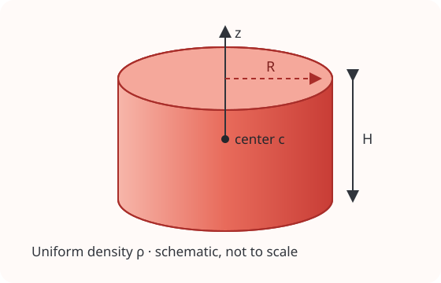

<!-- GENERATED MODEL REFERENCE: regenerate through gragra-dev catalogue workflow. -->
# Uniform-density cylinder

## Model overview

**Level:** — (definition and assignment pending).

**Physical domain:** static gravity  
**Geometry:** cylinder

Finite cylinder; check the selected function's axial/off-axis domain

**Source-declared observable / representation pairs:**

- Φ a Γ — Static

These pairs are a union over the listed calculation paths. They do not imply every API exposes every combination.

[Back to model catalogue](../guide/model-and-method-catalogue.md)

## Geometry and equations

The finite solid cylinder has center \(\mathbf c\), radius \(R>0\), height \(H>0\), and local symmetry axis \(z\). Density is supplied to the model separately from its geometry.

*Schematic geometry; dimensions are not to scale.*

- Cylinder geometry in its frame; high-level evaluator transforms arbitrary target positions to geometry frame and calls general-point analytic cylinder triple. It is not on-axis-restricted. Low-level cylinder_axis_observables remains a distinct axis-only API; general numerical and analytic APIs have separate algorithm paths.

### Equations

For a uniform cylinder centered at \(\mathbf c\), let
\(z=x_z-c_z\), \(u_1=-H/2-z\), and \(u_2=H/2-z\). Define

$$
P(u)=\frac{1}{2}\left[u\left(\sqrt{R^2+u^2}-|u|\right)
+R^2\operatorname{asinh}\left(\frac{u}{R}\right)\right],
\qquad
F(u)=|u|-\sqrt{R^2+u^2}.
$$

The on-axis potential and acceleration in SI units are

$$
\Phi(z)=-2\pi G\rho\left[P(u_2)-P(u_1)\right],
\qquad
a_z(z)=2\pi G\rho\left[F(u_2)-F(u_1)\right].
$$

By axial symmetry, the on-axis gravity-gradient tensor is diagonal, with

$$
\Gamma_{zz}=\frac{\partial a_z}{\partial z},
\qquad
\Gamma_{xx}=\Gamma_{yy}=\frac{-4\pi G\rho_{\mathrm{local}}-\Gamma_{zz}}{2}.
$$

Here \(\rho_{\mathrm{local}}=\rho\) for \(|z|<H/2\) and is zero outside
the cylinder. End-face targets \(z=\pm H/2\) are rejected by the bundled
axis API because the gradient is undefined or discontinuous there. These
closed forms apply to targets on the cylinder axis. General-point APIs use
separate numerical-quadrature or elliptic/series paths.

## Parameters and calculation paths

### Parameters and units

- center_m (3,) m; radius_m m positive; height_m m positive; density_kg_m3 kg/m³; targets_m (M,3) m; quadrature_order integer default 32 for numerical path; rotation_matrix for analytic route.

### Calculation paths

#### high-level static uniform-cylinder model; general target field

- `gragra.analytic.objects.uniform_cylinder`

**Path-level source-declared outputs:** Φ a Γ — Static

#### on-axis closed-form observable API

- `gragra.observables.cylinder_axis_observables`

**Path-level source-declared outputs:** Φ a Γ — Static

#### general-point numerical semi-analytic potential diagnostic

- `gragra.observables.cylinder_observables`

**Path-level source-declared outputs:** Φ a Γ — Static

#### general-point analytic elliptic/series path (separate API)

- `gragra.analytic.cylinder_acceleration_gradient_g_free`
- `gragra.analytic.cylinder_analytic_observables_g_free`
- `gragra.observables.cylinder_acceleration_gradient`
- `gragra.observables.cylinder_analytic_observables`

**Path-level source-declared outputs:** Φ a Γ — Static

Factory APIs construct model/evaluation objects; observables may be obtained after the documented .at(...).run() sequence rather than directly from the factory call. Follow the linked API examples.

## Derivation and sources

### Derivation

Independent axis closed-form derivation is saved; this inventory does not endorse algebra beyond source record.

- (internal evidence record) records cylinder axis derivation. General-point elliptic/series derivation references were not assembled here.

### References

Existing public documentation and original formulation context:

- [Analytic benchmarks](../guide/analytic-benchmarks.md)
- [physics API](../api/physics.md)

**Bibliographic inventory:** partial.

- Analytic benchmark names Conway formula only to distinguish it from the numerical path; axis closed-form source derivation path is cited. No claim that a paper was inspected here.

## Verification and applicability

### Verification

**Evidence classes are distinct:** source declarations, catalogue output-contract probes, existing test code, documentary validation claims, and saved numerical results.

- Representative catalogue output-contract entries: 3.
- Catalogue probe state: recorded (a representative API output contract, not an accuracy test).
- This documentation generation does not perform scientific re-execution or assign an accuracy Level.

**Existing verification inventory:**

Test code and stored historical records are distinct; no test or numerical probe run now.

- (internal evidence record) and (internal evidence record) implement independent reference comparisons and boundaries. formula ledger names oracle metadata and acceptance for newer cylinder/SCA lines; do not treat these as current revision reruns. On-axis validation report gives boundary tolerances 1e-12 R and 1e-12 H. catalogue cylinder_axis_si is output contract only.

#### Registered representative output probes

| API | Observable | Representation | Probe |
|---|---|---|---|
| `gragra.observables.cylinder_axis_observables` | Φ | Static | `cylinder_axis_si` |
| `gragra.observables.cylinder_axis_observables` | a | Static | `cylinder_axis_si` |
| `gragra.observables.cylinder_axis_observables` | Γ | Static | `cylinder_axis_si` |

### Applicability and limitations

- Axis API does not offer general off-axis closed form. Numerical quadrature is exploratory/reference; analytic general-point path is a separate API; not Conway claimed solution.

**Scope note:** Axis closed form is strictly axial; off-axis targets rejected. General numerical and analytic variants have separate methods and physical boundary exclusion.

See the public verification and limitations guidance for test-specific conditions and interpretation:

- [Verification matrix](../verification/matrix.md)
- [Verification limitations](../verification/limitations.md)

## Information not yet confirmed

- Catalogue contract only probes axis API; no general off-axis catalogue contracts.
- No result probe executed; no acceptance inferred from representative output contracts.
- Full bibliography and general-point derivation record need further lookup.

*Publication scope: narrative summaries and links, not private derivation records, internal test artifacts or inventory JSON.*
