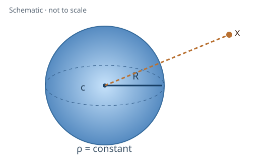
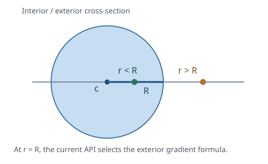

<!-- GENERATED MODEL REFERENCE: regenerate through gragra-dev catalogue workflow. -->
# Uniform-density sphere

**Level:** — (definition and assignment pending).

**Physical domain:** static gravity  
**Geometry:** sphere

Finite sphere; static potential, acceleration and gravity gradient, inside or outside

**Source-declared observable / representation pairs:**

- Φ a Γ — Static

These pairs are a union over the listed calculation paths. They do not imply every API exposes every combination.

[Back to model catalogue](../guide/model-and-method-catalogue.md)

## Geometry

The finite uniform-density sphere has center \(\mathbf c\), radius \(R>0\), density \(\rho\), and target position \(\mathbf x\).

*The figures are schematic, not sampled or measured scientific data.*

- The Sphere shape supplies geometry data, while the analytic model supplies density. This API does not establish a generalization to arbitrary meshes or shapes.

## Equations

Let \(\mathbf r=\mathbf x-\mathbf c\), \(r=|\mathbf r|\),
\(M=4\pi\rho R^3/3\). The physical SI results are

$$
\Phi(r)=
\begin{cases}
-\dfrac{GM}{2R^3}(3R^2-r^2), & r<R,\\
-\dfrac{GM}{r}, & r\ge R,
\end{cases}
$$

$$
\mathbf a(\mathbf r)=
\begin{cases}
-\dfrac{GM}{R^3}\mathbf r, & r<R,\\
-\dfrac{GM}{r^3}\mathbf r, & r\ge R,
\end{cases}
$$

$$
\Gamma_{ij}=
\begin{cases}
-\dfrac{GM}{R^3}\delta_{ij}, & r<R,\\
GM\left(\dfrac{3r_ir_j}{r^5}-\dfrac{\delta_{ij}}{r^3}\right), & r\ge R.
\end{cases}
$$

The implementation chooses the **exterior gradient expression at \(r=R\)**.
Potential and acceleration are continuous there; the tensor requires
one-sided limits because the density is discontinuous.

## Parameters and units

| Parameter | Meaning | SI unit |
|---|---|---|
| center_m / \(\mathbf c\) | Sphere center | m |
| radius_m / \(R\) | Positive radius | m |
| density_kg_m3 / \(\rho\) | Uniform density | kg/m³ |
| targets_m / \(\mathbf x\) | Evaluation targets, shape (N, 3) | m |

The high-level factory instead accepts a Sphere geometry and an Astropy Quantity density. G-free helpers and SI wrappers have different return types.

## APIs and calculation paths

### G-free closed form / SI static wrapper

- `gragra.observables.uniform_sphere_observables`

**Path-level source-declared outputs:** Φ a Γ — Static

### Quantity model EvaluationSetup

- `gragra.analytic.objects.uniform_sphere`

**Path-level source-declared outputs:** Φ a Γ — Static

Factory APIs construct model/evaluation objects; observables may be obtained after the documented .at(...).run() sequence rather than directly from the factory call. Follow the linked API examples.

## Derivation and provenance

The spherical symmetry solution follows from \(\nabla^2\Phi=4\pi G\rho\) inside the source and \(\nabla^2\Phi=0\) outside. Finite potential at the center, \(\Phi\to0\) at infinity, and matching \(\Phi\) and radial acceleration at \(r=R\) determine the constants. Differentiating gives \(\mathbf a=-\nabla\Phi\) and \(\Gamma_{ij}=\partial a_i/\partial x_j\).

This is a standard mathematical outline; a separately archived independent sphere derivation was not located in the inventory.

## References

Existing public documentation and original formulation context:

- [Analytic benchmarks](../guide/analytic-benchmarks.md)
- [sphere example](../examples/uniform_sphere_workflow.md)

**Bibliographic inventory:** partial.

- No sphere-specific bibliographic record was found in the relevant portions of this inventory.

## Verification evidence

**Evidence classes are distinct:** source declarations, catalogue output-contract probes, existing test code, documentary validation claims, and saved numerical results.

- Representative catalogue output-contract entries: 3.
- Catalogue probe state: recorded (a representative API output contract, not an accuracy test).
- This documentation generation does not perform scientific re-execution or assign an accuracy Level.

**Existing verification inventory:**

Test implementations, documentary verification claims, and saved run records are separate evidence. No tests were run for this update.

- tests/test_geometry_vs_analytic.py implements interior and exterior sphere comparisons for potential and acceleration, including complex density. tests/test_convergence_suite.py implements selected potential, acceleration, and gradient checks at exterior targets. The documentation specifies one bounded sphere-convergence case and requires a finest-resolution relative-error bound plus overall potential improvement from coarse to fine; it does not claim a fitted slope or monotonic improvement at every level. The saved results are general verification records for an older SHA cited by the formula ledger, not a reproduction of sphere-specific results for this revision. The catalogue probe named sphere_si is a representative output-contract probe.

### Existing discretization acceptance conditions

The documented sphere refinement case uses R = 1 m, density 1000 kg/m³ and one exterior target. Its finest-spacing relative error must be at most 0.05 for each of Φ, a and Γ, with overall coarsest-to-finest improvement required for potential. These are acceptance criteria for a discretized-source path, not measured errors or a 5% accuracy claim for the analytic formula. This documentation update does not rerun that convergence case. See [documented discretization conditions](../guide/geometry.md#discretization-error).

### Registered representative output probes

| API | Observable | Representation | Probe |
|---|---|---|---|
| `gragra.observables.uniform_sphere_observables` | Φ | Static | `sphere_si` |
| `gragra.observables.uniform_sphere_observables` | a | Static | `sphere_si` |
| `gragra.observables.uniform_sphere_observables` | Γ | Static | `sphere_si` |

## Applicability and limitations

- Targets may be inside or outside the sphere. Discretization-convergence evidence covers one limited condition.

**Scope note:** This is an idealized finite sphere with uniform density; no accuracy guarantee applies beyond the assumptions of the analytic formula.

See the public verification and limitations guidance for test-specific conditions and interpretation:

- [Verification matrix](../verification/matrix.md)
- [Verification limitations](../verification/limitations.md)

## Information still to locate or publish

- Catalogue representative probes document output contracts; they are not numerical accuracy tests.
- A sphere-specific bibliographic record and an archived independent derivation have not been located.
- Existing evidence-record claims are distinct from results executed for this revision.

*Publication scope: narrative summaries and links, not private derivation records, internal test artifacts or inventory JSON.*
