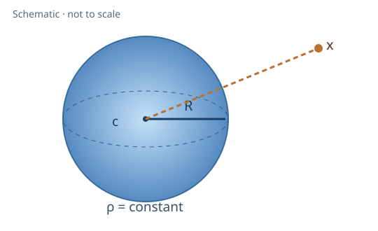
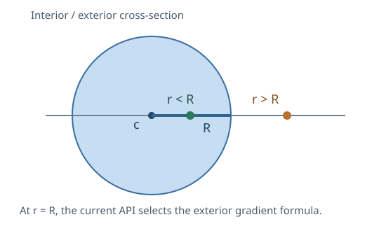

<!-- GENERATED MODEL REFERENCE: regenerate through the catalogue workflow. -->
# Uniform-density sphere

## Model overview

**Level:** — (definition and assignment pending).

**Physical domain:** static gravity  
**Geometry:** sphere

Finite sphere; static potential, acceleration and gravity gradient, inside or outside

**Source-declared observable / representation pairs:**

- Φ a Γ — Static

These pairs are a union over the listed calculation paths. They do not imply every API exposes every combination.

[Back to model catalogue](../guide/model-and-method-catalogue.md)

## Geometry and equations

The finite uniform-density sphere has center \(\mathbf c\), radius \(R>0\), density \(\rho\), and target position \(\mathbf x\).





*The figures are schematic, not sampled or measured scientific data.*

- The Sphere shape supplies geometry data, while the analytic model supplies density. This API does not establish a generalization to arbitrary meshes or shapes.

### Equations

Let \(\mathbf r=\mathbf x-\mathbf c\), \(r=|\mathbf r|\),
\(M=4\pi\rho R^3/3\). The physical SI results are

$$
\Phi(r)=
\begin{cases}
-\dfrac{GM}{2R^3}(3R^2-r^2), & r<R,\\
-\dfrac{GM}{r}, & r\ge R,
\end{cases}
$$

$$
\mathbf a(\mathbf r)=
\begin{cases}
-\dfrac{GM}{R^3}\mathbf r, & r<R,\\
-\dfrac{GM}{r^3}\mathbf r, & r\ge R,
\end{cases}
$$

$$
\Gamma_{ij}=
\begin{cases}
-\dfrac{GM}{R^3}\delta_{ij}, & r<R,\\
GM\left(\dfrac{3r_ir_j}{r^5}-\dfrac{\delta_{ij}}{r^3}\right), & r\ge R.
\end{cases}
$$

The implementation chooses the **exterior gradient expression at \(r=R\)**.
Potential and acceleration are continuous there; the tensor requires
one-sided limits because the density is discontinuous.

## Parameters and calculation paths

### Parameters and units

#### API parameters

| Function / Path | Parameter | Type / Format | Default | Description |
|---|---|---|---|---|
| `uniform_sphere_observables` | `center_m` | array-like (3,) | required | Sphere center coordinates in meters |
| `uniform_sphere_observables` | `radius_m` | float | required | Sphere radius (positive) in meters |
| `uniform_sphere_observables` | `density_kg_m3` | float \| complex | required | Uniform mass density in kg/m³ |
| `uniform_sphere_observables` | `targets_m` | array-like (M, 3) | required | Evaluation target coordinates in meters |
| `uniform_sphere` | `geometry` | Sphere | required | Astropy Sphere geometry (center and radius) |
| `uniform_sphere` | `density` | u.Quantity (density) | required | Astropy Quantity uniform mass density in kg/m³ |

#### API return values

| Function / Path | Return type | Representation | Quantity & Unit | Shape / Structure | Description |
|---|---|---|---|---|---|
| `uniform_sphere_observables` | GravityObservables | Static | Φ: m²/s², a: m/s², Γ: s⁻² | potential: (M,), acceleration: (M, 3), gradient: (M, 3, 3) | Direct SI observables container (float64 arrays) for M evaluation targets |
| `uniform_sphere` | UniformSphereModel | Static | Φ: m²/s², a: m/s², Γ: s⁻² | EvaluationResult with Astropy Quantities | High-level model factory; evaluate via .at(targets).run() to yield physical field quantities |

#### Mathematical symbols and notation

| Symbol | Meaning | SI unit | Definition / Relation |
|---|---|---|---|
| \(\mathbf c\) | Sphere center | m | Center of spherical mass distribution |
| \(R\) | Sphere radius | m | Positive radius of sphere (\(R > 0\)) |
| \(\rho\) | Uniform mass density | kg/m³ | Constant volumetric density inside sphere |
| \(\mathbf x\) | Evaluation target | m | Field evaluation coordinate vector |
| \(\mathbf r\) | Separation vector | m | \(\mathbf r = \mathbf x - \mathbf c\) |
| \(r\) | Radial distance | m | \(r = \|\mathbf r\| = \|\mathbf x - \mathbf c\|\) |
| \(M\) | Total sphere mass | kg | \(M = \frac{4}{3}\pi \rho R^3\) |

#### Usage notes

- High-level factory `uniform_sphere(geometry, density)` constructs a `UniformSphereModel` evaluated via `.at(targets).run()`.
- Boundary evaluation: potential and acceleration are continuous at \(r = R\); gravity gradient uses the exterior expression at the boundary.

### Calculation paths

#### G-free closed form / SI static wrapper

- `gragra.observables.uniform_sphere_observables`

**Path-level source-declared output union:** Φ a Γ — Static

#### Quantity model EvaluationSetup

- `gragra.analytic.objects.uniform_sphere`

**Observables after model evaluation:** Φ a Γ — Static

High-level model factories create evaluation objects; call the documented `.at(...).run()` workflow to evaluate them. Observable functions listed above are direct calls with their own return values.

### Calculation example and output

The following Python snippet evaluates this model with representative parameters and prints the resulting physical quantities:

```python
from gragra.observables import uniform_sphere_observables

res = uniform_sphere_observables(
    center_m=[0.0, 0.0, 0.0], radius_m=1.0, density_kg_m3=2000.0,
    targets_m=[[0.0, 0.0, 5.0]]
)
print('potential:', res.potential)
print('acceleration:', res.acceleration)
print('gradient:', res.gradient)
```

Representative output:

```text
potential: [-1.1182897e-07]
acceleration: [[-0.0000000e+00 -0.0000000e+00 -2.2365794e-08]]
gradient: [[[-4.47315879e-09  0.00000000e+00  0.00000000e+00]
  [ 0.00000000e+00 -4.47315879e-09  0.00000000e+00]
  [ 0.00000000e+00  0.00000000e+00  8.94631759e-09]]]
```

## Derivation and sources

### Derivation

The spherical symmetry solution follows from \(\nabla^2\Phi=4\pi G\rho\) inside the source and \(\nabla^2\Phi=0\) outside. Finite potential at the center, \(\Phi\to0\) at infinity, and matching \(\Phi\) and radial acceleration at \(r=R\) determine the constants. Differentiating gives \(\mathbf a=-\nabla\Phi\) and \(\Gamma_{ij}=\partial a_i/\partial x_j\).

This is a standard mathematical outline; a separately archived independent sphere derivation was not located in the inventory.

### References

Existing public documentation and original formulation context:

- [Analytic benchmarks](../guide/analytic-benchmarks.md)
- [sphere example](../examples/uniform_sphere_workflow.md)

**Bibliographic inventory:** partial.

- No sphere-specific bibliographic record was found in the relevant portions of this inventory.

## Verification and applicability

### Verification

**Evidence classes are distinct:** source declarations, catalogue output-contract probes, existing test code, documentary validation claims, and saved numerical results.

- Representative catalogue output-contract entries: 3.
- Catalogue probe state: recorded (a representative API output contract, not an accuracy test).
- Registered output-contract probes run during catalogue validation check selected API outputs only; they do not measure scientific accuracy.
- Scientific accuracy tests are not part of documentation generation; no accuracy Level is assigned.

**Existing verification inventory:**

Test implementations, documentary verification claims, and saved run records are separate evidence. No scientific accuracy tests were run for this update.

- [`tests/test_geometry_vs_analytic.py`](https://github.com/tatsuki-washimi/gragra/blob/main/tests/test_geometry_vs_analytic.py) implements interior and exterior sphere comparisons for potential and acceleration, including complex density. [`tests/test_convergence_suite.py`](https://github.com/tatsuki-washimi/gragra/blob/main/tests/test_convergence_suite.py) implements selected potential, acceleration, and gradient checks at exterior targets. The documentation specifies one bounded sphere-convergence case and requires a finest-resolution relative-error bound plus overall potential improvement from coarse to fine; it does not claim a fitted slope or monotonic improvement at every level. The saved results are general verification records for an older SHA cited by the formula ledger, not a reproduction of sphere-specific results for this revision. The catalogue probe named sphere_si is a representative output-contract probe.

#### Existing discretization acceptance conditions

The documented sphere refinement case uses R = 1 m, density 1000 kg/m³, one exterior target at (2.7, 0.3, -0.4) m, and spacings R/[10, 20, 40, 80]. Its finest-spacing relative error must be at most 0.05 for each of Φ, a and Γ, with overall coarsest-to-finest improvement required for potential. These are acceptance criteria for a discretized-source path, not measured errors or a 5% accuracy claim for the analytic formula. This documentation update does not rerun that convergence case. See [documented discretization conditions](../guide/geometry.md#discretization-error).

#### Registered representative output probes

| API | Observable | Representation | Probe |
|---|---|---|---|
| `gragra.observables.uniform_sphere_observables` | Φ | Static | `sphere_si` |
| `gragra.observables.uniform_sphere_observables` | a | Static | `sphere_si` |
| `gragra.observables.uniform_sphere_observables` | Γ | Static | `sphere_si` |

### Applicability and limitations

- Targets may be inside or outside the sphere. Discretization-convergence evidence covers one limited condition.

**Scope note:** This is an idealized finite sphere with uniform density; no accuracy guarantee applies beyond the assumptions of the analytic formula.

See the public verification and limitations guidance for test-specific conditions and interpretation:

- [Verification matrix](../verification/matrix.md)
- [Verification limitations](../verification/limitations.md)


## Information not yet confirmed

- Catalogue representative probes document output contracts; they are not numerical accuracy tests.
- A sphere-specific bibliographic record and an archived independent derivation have not been located.
- Existing tests and documentary claims are distinct from results executed for this revision.

*Publication scope: narrative summaries and links, not private derivation records, internal test artifacts or inventory JSON.*
