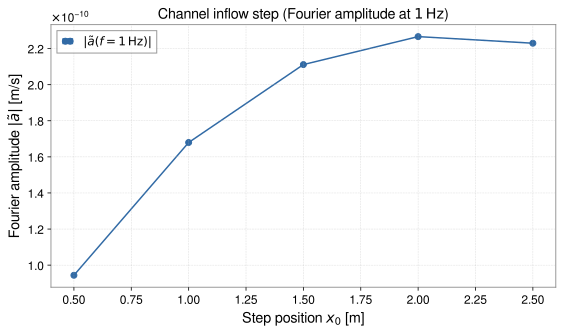

<!-- GENERATED MODEL REFERENCE: regenerate through the catalogue workflow. -->
# Water-channel inflow step

## Model overview

**Level:** 4.

**Physical domain:** water  
**Geometry:** `channel`

Deterministic transient Fourier amplitude, **not** a stationary ASD

**Source-declared observable / representation pairs:**

- a — Other (Fourier amplitude; see API)

These pairs are a union over the listed calculation paths. They do not imply every API exposes every combination.

[Back to model catalogue](../guide/model-and-method-catalogue.md)

## Geometry


*Single Heaviside step displacement of water volume \(\Delta V\) at coordinate \(x_0\) inducing transient acceleration at perpendicular distance \(D\).*

An endpoint step in a linear channel. No dedicated plotting or reuse mapping was identified; the general shape helper targets basic static shapes.

## Analytic formulation, sources, and scope

### Equations

For a transient deterministic volume inflow step event \(\Delta V\) occurring at inflow coordinate \(x_0\) in an open water channel at perpendicular horizontal distance \(D > 0\):

The single-event acceleration Fourier amplitude in physical units \(\mathrm{m/(s^2\cdot Hz) = m/s}\) is:

$$
|\Delta a_x(f)| = G \rho_w \Delta V \frac{|x_0|}{(D^2 + x_0^2)^{3/2}} \frac{1}{2\pi f}.
$$

The single-event differential gravitational strain Fourier amplitude is:

$$
|h(f)| = \frac{|\Delta a_x(f)|}{(2\pi f)^2 L_{\mathrm{arm}}}
$$

where \(L_{\mathrm{arm}}\) is the interferometer arm length (default \(3000\text{ m}\)).

*Note: This formulation represents the Fourier transform of a single deterministic transient Heaviside event, not a stationary stochastic ASD.*

### Derivation

The formula is documented in the API docstring. No separate derivation note was identified among the assigned files.

### References

Existing public documentation and original formulation context:

- [Water NN](../guide/water-newtonian-noise.md)
- [water API](../api/water.md)

**Bibliographic inventory:** located.

### Applicability and scope

f&gt;0, D&gt;0, ΔV&gt;0, finite x0 and positive rho; output has acceleration×time unit m/s, and MUST NOT be treated as stationary ASD.

## STEP 1 — Setup

Primary path: `water_edge_step_fourier_amplitude`

**A+ (`tutorial-display` axes):** wrap outputs with GWexpy only in the generator; do not invent frequency grids on the output side.

Build inputs consistent with **Detailed reference**:

```python
import numpy as np

step_position = 1.0
distance = 3.0
volume = 0.5
frequency = np.array([1.0])
```

## STEP 2 — Validate / Inspect

STEP 2 items are tagged by information source:

- **`api`**: read from a gragra evaluation object: `validate()` is a **method**; `parameters`, `formulas`, and `references` are **`@property`** objects (not callable).
- **`tutorial-display`**: assembled for this page from documented inputs or catalogue-verified display equations (not a separate gragra registry lookup).
- **`api-output`**: taken from executed result payloads (units, shapes, GWexpy axes).

#### Display equations (`tutorial-display`)

Catalogue-registered analytic formulation (same as **Analytic formulation, sources, and scope** above):

For a transient deterministic volume inflow step event \(\Delta V\) occurring at inflow coordinate \(x_0\) in an open water channel at perpendicular horizontal distance \(D > 0\):

The single-event acceleration Fourier amplitude in physical units \(\mathrm{m/(s^2\cdot Hz) = m/s}\) is:

$$
|\Delta a_x(f)| = G \rho_w \Delta V \frac{|x_0|}{(D^2 + x_0^2)^{3/2}} \frac{1}{2\pi f}.
$$

The single-event differential gravitational strain Fourier amplitude is:

$$
|h(f)| = \frac{|\Delta a_x(f)|}{(2\pi f)^2 L_{\mathrm{arm}}}
$$

where \(L_{\mathrm{arm}}\) is the interferometer arm length (default \(3000\text{ m}\)).

*Note: This formulation represents the Fourier transform of a single deterministic transient Heaviside event, not a stationary stochastic ASD.*

`request.formulas` lists **implementation routing** (`api`), which may differ from these display equations.

For direct observable evaluation, parameters and display equations are verified above (`tutorial-display`).

```python
try:
    from IPython.display import display
except ImportError:
    display = print
# Direct observable evaluation: parameters verified against catalogue specification
print('Input configuration verified.')
```

## STEP 3 — Calculate

Evaluate the model (`api-output`):

```python
from gragra.observables import water_edge_step_fourier_amplitude

f_amp = water_edge_step_fourier_amplitude(
    x0_m=step_position, distance_m=distance, volume_m3=volume, frequency_hz=frequency,
)
print('Fourier amplitude |A| [m/s]:', abs(f_amp[0]))
```


## STEP 4 — Results / Comparison

The code below computes the result for each case and plots it. Each case is named on the x-axis or in the legend (`api-output`).

```python
import matplotlib.pyplot as plt
import numpy as np
from gragra.observables import water_edge_step_fourier_amplitude

x0 = np.array([0.5, 1.0, 1.5, 2.0, 2.5])
amp = [
    float(np.abs(water_edge_step_fourier_amplitude(
        x0_m=float(x0_m), distance_m=3.0, volume_m3=0.5, frequency_hz=np.array([1.0]),
    )[0]))
    for x0_m in x0
]

fig, ax = plt.subplots(figsize=(8.0, 4.8))
ax.plot(x0, amp, "o-", color="#316aa5", label=r"$|\tilde a(f=1\,\mathrm{Hz})|$")
ax.set_xlabel(r"Step position $x_0$ [m]")
ax.set_ylabel(r"Fourier amplitude $|\tilde a|$ [m/s]")
ax.set_title(r"Channel inflow step (Fourier amplitude at $1\,\mathrm{Hz}$)")
ax.grid(True, linestyle="--", alpha=0.45)
ax.legend()
fig.tight_layout()
plt.show()
```




*Figure generated by executing the STEP 4 comparison code above.*

Saved with `fig.savefig(path, bbox_inches='tight', metadata={'Date': None})` and `svg.hashsalt='gragra'` under Matplotlib 3.11.2. SVG byte reproducibility was verified with Matplotlib 3.11.2 under these save conditions. Other versions may produce different SVG bytes or layouts.

## Detailed reference and verification

### Parameters and units

#### API parameters

| Function / Path | Parameter | Type / Format | Default | Description |
|---|---|---|---|---|
| `water_edge_step_fourier_amplitude` | `x0_m` | float | required | Inflow edge coordinate along channel axis in meters |
| `water_edge_step_fourier_amplitude` | `distance_m` | float | required | Perpendicular distance from channel to detector D in meters (D > 0) |
| `water_edge_step_fourier_amplitude` | `volume_m3` | float | required | Displaced water volume step Delta V in m³ |
| `water_edge_step_fourier_amplitude` | `frequency_hz` | float \| array-like | required | Fourier transform evaluation frequency in Hz (f > 0) |
| `water_edge_step_fourier_amplitude` | `density_kg_m3` | float | 1000.0 | Fluid mass density in kg/m³ |

#### API return values

| Function / Path | Return type | Representation | Quantity & Unit | Shape / Structure | Description |
|---|---|---|---|---|---|
| `water_edge_step_fourier_amplitude` | ndarray | Fourier | a: (m/s²)·s | \((N_{\mathrm{freq}},)\) complex128 array | Fourier spectral amplitude of single transient acceleration step during water channel inflow |

#### Mathematical symbols and notation

| Symbol | Meaning | SI unit | Definition / Relation |
|---|---|---|---|
| \(x_0\) | Inflow edge coordinate | m | Position of step volume event along channel |
| \(D\) | Perpendicular distance | m | Distance from channel axis to test mass (\(D > 0\)) |
| \(\Delta V\) | Volume step | m³ | Displaced water volume magnitude (\(\Delta V > 0\)) |
| \(f\) | Fourier frequency | Hz | Evaluation frequency in Hz |
| \(\rho_w\) | Water density | kg/m³ | Fluid mass density (default 1000.0 kg/m³) |
| \(\Delta a_x(t)\) | Step acceleration response | m/s² | \(\Delta a_x(t) = G \rho_w \Delta V \frac{x_0}{(D^2 + x_0^2)^{3/2}} \Theta(t)\) |

#### Usage notes

- Evaluates single-event volume step Fourier amplitude \(\tilde{a}_x(f) = \frac{G \rho_w \Delta V x_0}{2\pi f (D^2 + x_0^2)^{3/2}}\).

### Calculation paths

#### Single edge-step acceleration Fourier amplitude

- `gragra.observables.water_edge_step_fourier_amplitude`

**Path-level source-declared output union:** a — Other (Fourier amplitude; see API)

### Derivation and source notes


### Verification

**Evidence classes are distinct:** source declarations, catalogue output-contract probes, existing test code, documentary validation claims, and saved numerical results.

- Representative catalogue output-contract entries: 0.
- Catalogue probe state: Not assessed (no catalogue output probe registered).
- Registered output-contract probes run during catalogue validation check selected API outputs only; they do not measure scientific accuracy.
- Scientific accuracy tests are not part of documentation generation; Level 4 is assigned based on archived scientific validation records (established closed form / verified reference comparisons in the development repository) within the stated scope conditions.

**Existing verification inventory:**

`test_analytic_water.py` has equation comparison rtol=1e-15; test code only, not run here; no committed executed result located.


### Applicability and limitations


**Scope note:** f&gt;0, D&gt;0, ΔV&gt;0, finite x0 and positive rho; output has acceleration×time unit m/s, and MUST NOT be treated as stationary ASD.

See the public verification and limitations guidance for test-specific conditions and interpretation:

- [Verification matrix](../verification/matrix.md)
- [Verification limitations](../verification/limitations.md)


## Information not yet confirmed

- The API does not provide the event-rate or amplitude statistics needed to model a stationary process.

*Publication scope: narrative summaries and links, not private derivation records, internal test artifacts or inventory JSON.*
