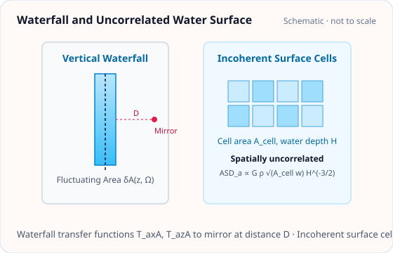

<!-- GENERATED MODEL REFERENCE: regenerate through the catalogue workflow. -->
# Waterfall and spatially uncorrelated water surface

## Model overview

**Level:** — (definition and assignment pending).

**Physical domain:** water  
**Geometry:** `channel`, `waterfall`

Idealized falling stream or incoherent channel cells

**Source-declared observable / representation pairs:**

- a — Spectral density (ASD)

These pairs are a union over the listed calculation paths. They do not imply every API exposes every combination.

[Back to model catalogue](../guide/model-and-method-catalogue.md)

## Geometry and equations



*Vertical waterfall column with fluctuating cross-sectional area and uncorrelated surface cells of area \(A_{\mathrm{cell}}\).*

- `plot_shape` targets static Cuboid, Cylinder, and SphericalShell shapes. No water-specific plotting adapter was identified in this review.

### Equations

**1. Waterfall model** (vertical water stream of velocity \(v\) at horizontal standoff distance \(D > 0\) with periodic area fluctuation \(A(z,t) = A_0 e^{-i \Omega (t - z/v)}\)):

The G-free potential and acceleration transfer functions are:

$$
\begin{aligned}
T_{a_x, A}^{(G\text{-free})} &= -2 \rho_w \frac{|\Omega|}{|v|} K_1\left(\frac{|\Omega| D}{|v|}\right), \\
T_{a_z, A}^{(G\text{-free})} &= 2i \rho_w \frac{\Omega}{v} K_0\left(\frac{|\Omega| D}{|v|}\right)
\end{aligned}
$$

where \(K_0, K_1\) are modified Bessel functions of the second kind.

**2. Spatially uncorrelated water surface model** (narrow channel with uncorrelated surface elevation cells of area \(A_{\mathrm{cell}}\)):

The geometric integral along the channel axis evaluates as:

$$
\int_{-\infty}^\infty \frac{x^2}{(H^2 + x^2)^3} \, dx = \frac{\pi}{8 H^3}.
$$

The resulting one-sided gravitational acceleration amplitude spectral density (ASD) in SI units \(\mathrm{m/(s^2\cdot\sqrt{Hz})}\) is:

$$
\mathrm{ASD}_a(f) = G \rho_w \sqrt{A_{\mathrm{cell}} w} \sqrt{\frac{\pi}{8 H^3}} \, \mathrm{ASD}_\eta(f).
$$

## Parameters and calculation paths

### Parameters and units

#### API parameters

| Function / Path | Parameter | Type / Format | Default | Description |
|---|---|---|---|---|
| `water_waterfall_asd` | `frequency_hz` | float \| array-like | required | Fluctuation frequency in Hz (f > 0) |
| `water_waterfall_asd` | `velocity_mps` | float | required | Waterfall plunge velocity in m/s (v != 0) |
| `water_waterfall_asd` | `distance_m` | float | required | Horizontal distance from stream to detector mirror (D > 0) |
| `water_waterfall_asd` | `area_asd_m2_per_rt_hz` | float \| array-like | required | Stream cross-sectional area ASD in m²/sqrt(Hz) |
| `water_channel_uncorrelated_asd` | `distance_m` | float | required | Perpendicular distance to uncorrelated channel H in meters |
| `water_channel_uncorrelated_asd` | `width_m` | float | required | Channel surface width w in meters |
| `water_channel_uncorrelated_asd` | `correlation_area_m2` | float | required | Incoherent surface patch correlation area \(A_{\mathrm{cell}}\) in m² |
| `water_channel_uncorrelated_asd` | `surface_asd_m_per_rt_hz` | float \| array-like | required | Surface elevation ASD in m/sqrt(Hz) |
| `water_waterfall_asd` | `density_kg_m3` | float | 1000.0 | Fluid mass density in kg/m³ |

#### API return values

| Function / Path | Return type | Representation | Quantity & Unit | Shape / Structure | Description |
|---|---|---|---|---|---|
| `water_waterfall_asd` | ndarray | ASD | a: (m/s²)/√Hz | \((N_{\mathrm{freq}},)\) float64 array | Horizontal gravity acceleration ASD from plunging waterfall jet at distance D |
| `water_channel_uncorrelated_asd` | ndarray | ASD | a: (m/s²)/√Hz | \((N_{\mathrm{freq}},)\) float64 array | Gravity acceleration ASD from spatially incoherent surface displacement fluctuations |

#### Mathematical symbols and notation

| Symbol | Meaning | SI unit | Definition / Relation |
|---|---|---|---|
| \(f\) | Frequency | Hz | Fluctuation frequency (\(f > 0\)) |
| \(v\) | Plunge velocity | m/s | Vertical waterfall flow speed |
| \(D\) | Waterfall distance | m | Horizontal distance from waterfall stream to mirror |
| \(S_A^{1/2}(f)\) | Area fluctuation ASD | m²/√Hz | Stream cross-sectional area amplitude spectral density |
| \(H\) | Channel distance | m | Perpendicular distance to uncorrelated channel |
| \(w\) | Channel width | m | Channel surface width |
| \(A_{\mathrm{cell}}\) | Correlation cell area | m² | Surface incoherence patch area |
| \(S_\eta^{1/2}(f)\) | Elevation ASD | m/√Hz | Uncorrelated surface wave elevation ASD |
| \(\rho_w\) | Water density | kg/m³ | Fluid mass density (default 1000.0 kg/m³) |

#### Usage notes

- Waterfall API evaluates cylindrical cross-sectional area fluctuations; uncorrelated channel API evaluates area-integrated incoherent patches.

### Calculation paths

#### Vertical waterfall with cross-sectional area fluctuations (ASD)

- `gragra.observables.water_waterfall_asd`

**Path-level source-declared output union:** a — Spectral density (ASD)

#### Incoherent surface cells across the channel width

- `gragra.observables.water_channel_uncorrelated_asd`

**Path-level source-declared output union:** a — Spectral density (ASD)

### Calculation example and output

The following Python snippet evaluates this model with representative parameters and prints the resulting physical quantities:

```python
import numpy as np
from gragra.observables import water_waterfall_asd, water_channel_uncorrelated_asd

w_asd = water_waterfall_asd(
    frequency_hz=np.array([1.0, 5.0]), velocity_mps=5.0, distance_m=5.0,
    area_asd_m2_per_rt_hz=np.array([1e-4, 1e-4])
)
u_asd = water_channel_uncorrelated_asd(
    distance_m=2.0, width_m=0.5, correlation_area_m2=0.01,
    surface_asd_m_per_rt_hz=np.array([1e-3, 1e-3])
)
print('waterfall ASD:', w_asd)
print('uncorrelated ASD:', u_asd)
```

Representative output:

```text
waterfall ASD: [1.65562129e-14 4.30963771e-25]
uncorrelated ASD: [1.04562432e-12 1.04562432e-12]
```

## Derivation and sources

### Derivation

water module documents independent Model 1 integral: int x²/(H²+x²)³ dx=pi/(8H³).

### References

Existing public documentation and original formulation context:

- [Water NN](../guide/water-newtonian-noise.md)
- [water API](../api/water.md)

**Bibliographic inventory:** located.

- The formula/source attribution text is repository evidence of attribution, not confirmation that the referenced external source was inspected or that source text proves this implementation.
- No full bibliographic citation/DOI for the Nishizawa 2021 water source was located in the scoped water docs/source search.

## Verification and applicability

### Verification

**Evidence classes are distinct:** source declarations, catalogue output-contract probes, existing test code, documentary validation claims, and saved numerical results.

- Representative catalogue output-contract entries: 0.
- Catalogue probe state: Not assessed (no catalogue output probe registered).
- Registered output-contract probes run during catalogue validation check selected API outputs only; they do not measure scientific accuracy.
- Scientific accuracy tests are not part of documentation generation; no accuracy Level is assigned.

**Existing verification inventory:**

`test_analytic_water.py` contains assertions against closed forms, quadrature, shape/units and SI conversion; these are test code, not newly executed. Example rtol 1e-14 closed form, 1e-9 quadrature, 1e-4 selected product quadrature.

- No committed executed-result artifact located for these assigned models.

### Applicability and limitations

- uncorrelated formula uses narrow-channel approximation and independent cells; source attribution remains unverified.

**Scope note:** Water positive-frequency Bessel domain requires representable 0&lt;q&lt;=700; DC not allowed by ASD; velocity nonzero, distance/width/density positive.

See the public verification and limitations guidance for test-specific conditions and interpretation:

- [Verification matrix](../verification/matrix.md)
- [Verification limitations](../verification/limitations.md)


## Information not yet confirmed

- No specific water-surface or waterfall geometry data, or model-specific geometry renderer for a shared model view, was identified.

*Publication scope: narrative summaries and links, not private derivation records, internal test artifacts or inventory JSON.*
